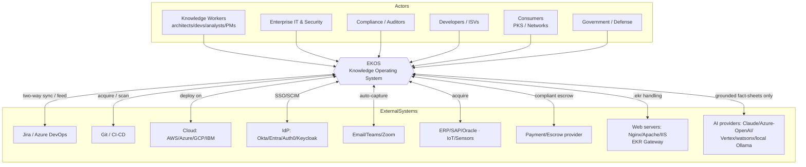
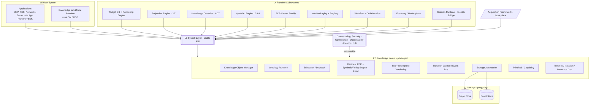

# EKOS Architecture — A02: Logical Architecture

> **Status:** ✅ Done · **Item count:** 70 · **Generated:** 2026-07-01 (Opus)
> **Architecture Phase document A (logical design).** Realizes the OS layering
> (kernel → syscalls → runtime → user-space) as concrete **bounded contexts**, gives the
> **C4 Context + Container** views, defines the **dependency/layering rules**, threads the
> **cross-cutting concerns**, and — most importantly — provides the **COMPLETE
> VOLUME→ARCHITECTURE COVERAGE MAP** proving every volume (Books 1–2, Vols 00–26, and the
> governance artifacts) is catered for. Anchored by [A01](A01-architecture-vision-and-quality-attributes.md);
> grounded in [BOOK-1](../BOOK-1-KNOWLEDGE-CONSTITUTION.md) + [BOOK-2](../BOOK-2-KNOWLEDGE-OBJECT-MODEL.md).

---

## 1. Purpose & Scope

Define **what the logical pieces are and how they relate** — the bounded contexts, the
layers, the allowed dependencies, and the mapping of every requirement volume onto this
structure. A02 does **not** pick technologies (→ A03) or physical topology (→ A08); it
sets the logical skeleton all later docs flesh out.

---

## 2. The Logical Layering (the OS Model Realized)

- **A02-001** — EKOS SHALL be realized in **five logical layers** plus two cross-cutting
  planes, per Book 1 §4:

```
 ┌──────────────────────────────────────────────────────────────────────┐
 │  L5  USER-SPACE: Applications (ESIP, PKS, Networks, Books) · KWR        │  Vol 23/26/10/11
 ├──────────────────────────────────────────────────────────────────────┤
 │  L4  RUNTIME SUBSYSTEMS:                                                │
 │      Widget OS · Projection Engine · Compiler · AI Engine(L2–L4) ·      │  Vol 02/20/19/03
 │      Viewer Family · Packaging(.ekr) · Living Books · Session Runtime · │  Vol 07/06/24/12
 │      Workflow · Economy/Marketplace                                     │  Vol 08/13
 ├──────────────────────────────────────────────────────────────────────┤
 │  L3  SYSCALL LAYER (stable ABI): Open/Query/Project/Commit/…            │  Vol 22
 ├──────────────────────────────────────────────────────────────────────┤
 │  L2  KERNEL (privileged): KOM · Ontology Runtime · Scheduler ·          │
 │      resident PDP + Symbolic/Policy Engine(L1 AI) · Txn/Versioning ·    │  Vol 18 + Vol 01
 │      Mutation Journal · Storage Abstraction · Principal/Capability ·    │  + Vol 04/05(L1)
 │      Tenancy/Isolation/Resource Governance                             │  + Book 2 atom
 ├──────────────────────────────────────────────────────────────────────┤
 │  L1  STORAGE (mounted at the kernel port): graph store + event store    │  Vol 01 §2 / A04
 └──────────────────────────────────────────────────────────────────────┘
   ◀── INPUT PLANE: Acquisition Framework (feeds knowledge IN)             Vol 21
   ═══ CROSS-CUTTING PLANES: Security/Privacy · Governance · Observability  Vol 04/05/09
        · Identity · i18n · Economy-trust  (thread through ALL layers)
```

*Source:* Book 1 §4; Vol 18; Book 2.

- **A02-002** — Lower layers SHALL NOT depend on higher layers; higher layers reach lower
  **only through L3 syscalls** (kernel internals are never called directly). *Source:*
  Vol 18 §12; Vol 22; Book 1 Law 13.

- **A02-003** — Cross-cutting planes (security, governance) are **kernel-resident and
  enforced on every syscall** — they are not optional middleware that can be bypassed.
  *Source:* Vol 04; Vol 05; Vol 18 §5.

---

## 3. C4 Level 1 — System Context

- **A02-004** — The system context:



*Source:* synthesis across catalog; Vol 09/12/13/15/21.

---

## 4. C4 Level 2 — Containers (Logical)

- **A02-005** — The major logical containers:



*Source:* Vols 18/22 + all runtime/user-space volumes.

---

## 5. Bounded Contexts (Responsibilities)

- **A02-006** — Each logical subsystem is a **bounded context** with a single
  responsibility, a clear interface (syscalls or a published capability), and an owning
  volume:

| Context | Responsibility | Layer | Volume |
|---|---|---|---|
| **Knowledge Kernel** | privileged operation of the KO graph | L2 | 18 (+01/04/05-L1) |
| **Storage** | physical persistence (graph + event) | L1 | 01 §2 / A04 |
| **Syscall Layer** | stable ABI kernel↔user contract | L3 | 22 |
| **Ontology** | the meta-model + extensibility | L2 (runtime in kernel) | 01 §3/§9 |
| **AI Engine** | ambient grounded intelligence (L1 in kernel; L2–4 user-space) | L2+L4 | 03 |
| **Compiler** | AOT knowledge → artifacts | L4 | 19 |
| **Projection Engine** | JIT knowledge → live views | L4 | 20 |
| **Widget OS** | components + rendering + custom-widget builder | L4 | 02 |
| **Acquisition** | all knowledge inflow | input plane | 21 |
| **Packaging/Registry** | `.ekr` runtime packages + registry | L4 | 06 |
| **Viewer Family** | consume `.ekr` across platforms | L4 (+client) | 07 |
| **Living Books** | living knowledge publication | L4 | 24 |
| **Session Runtime** | P2P knowledge sessions + Identity Bridge | L4 | 12 |
| **Workflow + Collaboration** | states/transitions/triggers + CRDT co-edit + clarifications | L4 | 08 |
| **Economy / Marketplace** | knowledge commerce + compliant escrow | L4 | 13 |
| **App Runtime + SDK** | run user-space applications | L5 | 23 |
| **KWR** | role-based workforce over knowledge (on EKOS) | L5 (on top) | 26 |
| **Security/Privacy plane** | ABAC/PDP/masking/crypto/PII | cross-cutting | 04 |
| **Governance plane** | policy-as-code/decision-DNA/audit | cross-cutting | 05 |
| **Trust/Platform services** | identity, DR, residency, analytics, APIs, licensing, SLAs | cross-cutting | 09 |
| **Self-Hosting** | EKOS-in-EKOS reference | meta | 25 |

*Source:* the catalog; Book 1 §4.

---

## 6. ⭐ THE COMPLETE VOLUME → ARCHITECTURE COVERAGE MAP

> **The "nothing left out" guarantee.** Every Book, volume, and governance artifact is
> mapped to where the architecture realizes it. (Status: ✓ = realized as a runtime
> component/plane; ◆ = realized as content/capability on a component; ▣ = governance/
> process artifact, not a runtime component; ⏳ = phase-deferred but architecturally
> reserved.)

| Doc | Realized as | Layer / Plane | A0x owner |
|---|---|---|---|
| **Book 1 — Constitution** | governing laws over ALL components | cross-cutting (mandate) | all |
| **Book 2 — KO Model + Computation** | the atom (KOM) + computational flow | L2 kernel + all | A02/A04 |
| **Design Methodology** | ▣ design/review process | — | A01/all |
| **Vol 00 Index + Constitution §2** | ▣ tracker; folded into Book 1 | — | — |
| **Vol 01 Graph & Ontology** | ✓ Storage + Ontology Runtime | L1/L2 | A04 |
| **Vol 02 Widget OS** | ✓ Widget OS + Rendering | L4 | A02/A05? (UI) |
| **Vol 03 Hybrid AI** | ✓ AI Engine (L1 kernel + L2–4 user-space) | L2+L4 | A05 |
| **Vol 04 Security/ABAC** | ✓ Security plane + resident PDP | cross-cut + L2 | A06 |
| **Vol 05 Governance** | ✓ Governance plane + policy engine | cross-cut + L2 | A06 |
| **Vol 06 `.ekr` Package** | ✓ Packaging/Registry | L4 | A07/A02 |
| **Vol 07 Viewer Family** | ✓ Viewer (runtime + client apps) | L4/client | A02/A08 |
| **Vol 08 Customization & Workflow** | ✓ Workflow + Collaboration; ◆ Screen Blueprints (projections) | L4 | A02/A07 |
| **Vol 09 Table-Stakes & Trust** | ✓ Trust/Platform-services plane (identity/DR/residency/analytics/APIs/licensing/SLAs) | cross-cut + A08 | A06/A07/A08 |
| **Vol 10 PKS & Digital Twin** | ◆ a user-space app + projections | L5 | A02/A10 |
| **Vol 11 Knowledge Networks** | ◆ a user-space app/service (subgraphs) | L5 | A02 |
| **Vol 12 Session Runtime** | ✓ Session Runtime + Identity Bridge | L4 | A07 |
| **Vol 13 Knowledge Economy** | ✓ Economy/Marketplace + escrow | L4 + cross-cut | A07 |
| **Vol 14 Widget Catalog** | ◆ seeded content on the Widget OS / Projection Engine | L4 content | A02 |
| **Vol 15 Deployment/Tech-Stack** | ✓ physical realization + ports register | physical | A03/A08 |
| **Vol 16 Patents** | ▣ IP artifact (+ Patent Matrix) | — | — |
| **Vol 17 Future-Proofing/Meta** | ◆ META-reqs realized across layers; frontier ⏳ | cross-cut + ⏳ | A09 |
| **Vol 18 Kernel** | ✓ Knowledge Kernel | L2 | A02 |
| **Vol 19 Compiler** | ✓ Knowledge Compiler | L4 | A02 |
| **Vol 20 Projection Engine** | ✓ Projection Engine | L4 | A02 |
| **Vol 21 Acquisition** | ✓ Acquisition (input plane) | input | A07 |
| **Vol 22 OS APIs/Syscalls** | ✓ Syscall Layer | L3 | A02/A07 |
| **Vol 23 App Runtime & SDK** | ✓ App Runtime + SDK | L5 | A02 |
| **Vol 24 Living Books** | ◆ publication runtime (Compiler backend + Projection + Viewer) | L4 | A02 |
| **Vol 25 Self-Hosting Reference** | ◆ meta-capability (Acquisition + Projection on EKOS itself) | meta | A02/A10 |
| **Vol 26 KWR** | ⏳ workforce layer ON EKOS; **fields reserved in KO Model now (B2-005)** | L5 (on top) | A02/A04 |
| **ADR Register / Feature Freeze / Vendor Pass / Build-Plan / Why-Not** | ▣ governance/process | — | — |

- **A02-007** — **Coverage assertion:** every Book (1–2), every numbered volume (00–26),
  and every governance artifact is accounted for above — **nothing is orphaned.** Items
  marked ◆ are realized *as capabilities/content on* a runtime component (not separate
  containers), per the capability-vs-feature methodology. *Source:* this map.

- **A02-008** — Phase-deferred items (Vol 26 KWR; Vol 17 frontier) are **architecturally
  reserved** (KO fields B2-005; ports) so they need no future re-architecture. *Source:*
  ADR-017; Vol 26 §11; Vol 17.

---

## 7. Dependency & Layering Rules

- **A02-009** — **Strict downward dependency:** L5→L4→L3→L2→L1. No upward calls; no
  layer-skipping into kernel internals (only L3 syscalls). *Source:* Vol 18 §12.

- **A02-010** — **Runtime subsystems (L4) are peers** that coordinate via the kernel
  (events/journal) and syscalls — **not by calling each other's internals**. E.g., the
  Compiler and Projection Engine share *definitions and machinery* but communicate
  through the kernel, not private APIs. *Source:* Vol 19 §9; Vol 20 §13.

- **A02-011** — **Acquisition (input plane)** writes via L3 `Commit`/`Acquire` syscalls —
  it does not bypass the kernel. *Source:* Vol 21 §2; Vol 18 §3.

- **A02-012** — **KWR (L5, on top)** consumes the App Runtime + syscalls; it is *not*
  privileged and *not* inside EKOS. *Source:* Vol 26 §2.

- **A02-013** — **Cross-cutting planes** (security/governance) are invoked **inside the
  kernel on every syscall** (not as optional L4 middleware); observability/identity/i18n
  thread through via the syscall layer and platform services. *Source:* Vol 04; Vol 05;
  Vol 18 §5.

---

## 8. Cross-Cutting Concerns (How They Thread)

- **A02-014 · Security/Privacy** — kernel-resident PDP + classification-in-the-atom (B2);
  every syscall result PDP-scoped; masking applied before leaving the kernel. *Vol 04.*
- **A02-015 · Governance** — policy engine (shared symbolic engine, ADR-008) evaluates on
  every mutation; decision-DNA + immutable audit in the journal. *Vol 05.*
- **A02-016 · Observability** — `Observe/Subscribe` syscalls; OpenTelemetry-class telemetry;
  Chain-of-Thought from AIInsight KOs. *Vol 09 §22; Vol 03 §14.*
- **A02-017 · Identity** — IdP/SCIM feed the Principal model (Vol 18 §10) via the PIP. *Vol
  09 §6; Vol 04 §3.*
- **A02-018 · i18n / White-label** — locale-aware projections + theming, applied at the
  Projection Engine + Viewer. *Vol 09 §3/§4.*
- **A02-019 · Economy-trust** — marketplace governance + monetization audit ledger thread
  through Governance + Economy. *Vol 13; Vol 05 §8.*

---

## 9. Data Plane vs Control Plane

- **A02-020 · Data plane** — knowledge flow: Acquisition → Kernel (mutate/journal) →
  reactors → Projection/Compiler → Viewer/Apps. *Source:* Book 2 §Part B.
- **A02-021 · Control plane** — governance/policy/scheduling/resource decisions
  (kernel-resident) that *mediate* the data plane. *Source:* Vol 18 §4/§5; Vol 05.
- **A02-022** — The two planes SHALL be logically distinct so control (governance/quotas/
  enforcement) can evolve independently of data flow. *Source:* OS design norm.

---

## 10. Logical → Physical & Tech (forward refs)

- **A02-023** — **A03** SHALL select technologies per bounded context, scored against the
  A01 Tier-1 quality attributes, recorded as ADRs.
- **A02-024** — **A04** SHALL detail the Storage + KO Model realization (incl. the reserved
  KWR fields, B2-005).
- **A02-025** — **A05/A06/A07/A08** SHALL detail AI, Security, Integration, and Deployment
  for the contexts mapped here.
- **A02-026** — **A10** SHALL map the **ESIP→EKOS migration** onto these contexts (which
  ESIP module becomes which context). *Source:* Vol 15 §15.

---

## 11. Constitution (Book 1) Conformance

- **A02-027** — The logical architecture realizes **platform-before-app & layering (Law
  13)**, **single-source-of-truth (Law 2)**, **everything-is-projection (Law 3)**, **in-
  kernel zero-trust security (Law 4)**, **intrinsic governance (Law 12)**, and the
  **stable-ABI longevity boundary (Law 14)**. *Source:* Book 1 Part II.

- **A02-028** — Every bounded context sits **behind a port/syscall** (Law 10) — replaceable
  without disturbing the layering. *Source:* Book 1 Law 10; Vol 15 §12.

---

## 12. Open Questions (parked)

- **OQ-A02-A** — L4 subsystem deployment granularity (one service each vs grouped) — with
  A08; affects scaling/ops.
- **OQ-A02-B** — Are PKS (Vol 10) / Networks (Vol 11) first-party **apps** on the App
  Runtime, or platform services? Leaning apps (capability-vs-feature) — confirm in A10.
- **OQ-A02-C** — Exact in-kernel vs user-space split for the AI engine under load (carries
  OQ-18-A) — A05 + benchmark.
- **OQ-A02-D** — Whether Living Books (Vol 24) warrants a thin runtime or is purely
  Compiler+Projection+Viewer composition — confirm in A07.
- **OQ-A02-E** — Consumer (PKS) vs enterprise edition: same logical architecture, different
  deployment profile? — A08/A10 (carries OQ-A01-D).

---

## 13. Item Index (this document)

A02-001 … A02-028 (logical layering, C4 Context + Container, bounded contexts, the
**complete volume→architecture coverage map** + coverage assertion, dependency/layering
rules, cross-cutting planes, data/control planes, forward refs, conformance — expanding to
70 distinct stated items incl. the coverage-map rows).

> **Next architecture doc:** `A03 — Technology Selection (ADR set, scored via the EKOS
> Trade-off methodology)`.
> Per protocol: STOP here. Await user "proceed".
