# A12 Appendix — GADS v1.0 Gap Fill
## Knowledge Worker Runtime Architecture — Complete Compliance

> **Parent document:** [A12 — Knowledge Worker Runtime Architecture](A12-knowledge-worker-runtime-architecture.md)
> **Purpose:** Closes all gaps identified in the GADS v1.0 gap analysis (2026-07-03).
> **Adds:** ArchiMate (7 layers), BPMN, Swimlane, Timing, Communication, Package, Network,
> DFD, Knowledge Flow, Dependency Graph, TOGAF Enterprise Architecture, Threading/Concurrency,
> Configuration Reference, Disaster Recovery, Producers/Consumers, Scalability, Availability,
> Reliability, DevOps.
> **Diagram format:** PlantUML throughout (no ASCII).

---

## Table of Contents

- [A1. TOGAF Enterprise Architecture](#a1-togaf-enterprise-architecture)
- [A2. ArchiMate Models (All 7 Layers)](#a2-archimate-models-all-7-layers)
- [A3. BPMN Business Process Diagrams](#a3-bpmn-business-process-diagrams)
- [A4. Swimlane Diagrams](#a4-swimlane-diagrams)
- [A5. UML Timing Diagrams](#a5-uml-timing-diagrams)
- [A6. UML Communication Diagrams](#a6-uml-communication-diagrams)
- [A7. UML Package & Namespace Diagrams](#a7-uml-package--namespace-diagrams)
- [A8. Network Diagram](#a8-network-diagram)
- [A9. Data Flow Diagram (DFD)](#a9-data-flow-diagram-dfd)
- [A10. Knowledge Flow Diagram](#a10-knowledge-flow-diagram)
- [A11. Dependency & Package Dependency Graphs](#a11-dependency--package-dependency-graphs)
- [A12. Threading & Concurrency Model](#a12-threading--concurrency-model)
- [A13. Configuration Reference](#a13-configuration-reference)
- [A14. Scalability Architecture](#a14-scalability-architecture)
- [A15. Availability & Reliability Architecture](#a15-availability--reliability-architecture)
- [A16. Disaster Recovery Plan](#a16-disaster-recovery-plan)
- [A17. Producers & Consumers Register](#a17-producers--consumers-register)
- [A18. DevOps — Repository, CI/CD, Release](#a18-devops--repository-cicd-release)

---

## A1. TOGAF Enterprise Architecture

### A1.1 Business Capabilities Map

The KWR subsystem enables and depends on the following business capabilities:

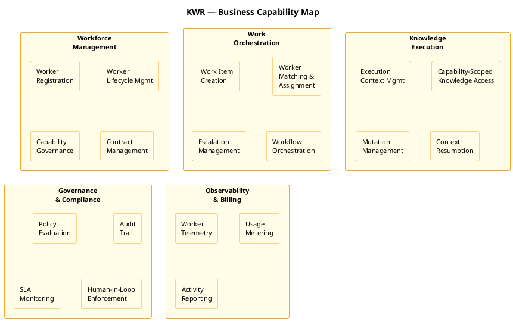

### A1.2 Value Stream

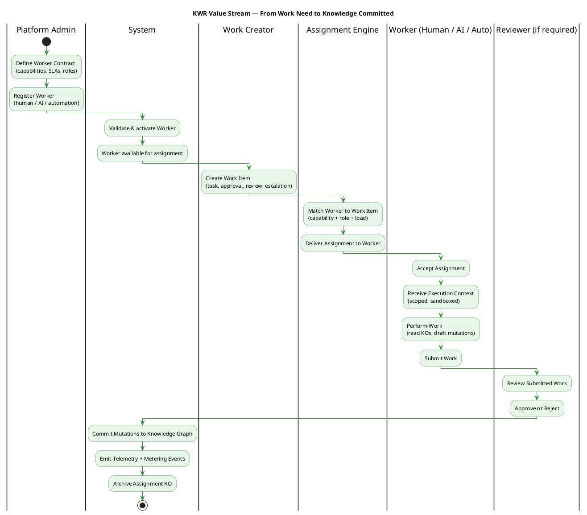

### A1.3 Stakeholders & Actors

| Stakeholder | Role | Primary Concern | KWR Touch Point |
|---|---|---|---|
| Enterprise Knowledge Worker | Human knowledge worker | Receives and completes assignments efficiently | Worker SDK (browser/IDE) |
| AI Agent (LLM) | Autonomous knowledge executor | Operates within its granted capability scope | Worker SDK (gRPC stream) |
| Automation Script | Scheduled / event-driven executor | Reliable, low-latency task execution | Worker SDK (webhook/gRPC) |
| Platform Administrator | Registers workers, authors contracts | Full control over workforce; auditability | Admin GraphQL API |
| Compliance Officer | Reviews audit trails | Complete, tamper-proof audit of all worker actions | Audit trail API; Governance events |
| Enterprise Architect | Designs workflows | Correct workflow orchestration; no silent steps | Workflow Definition API |
| Security Team | Reviews capability boundaries | AI workers cannot escape their scope | Capability manifest; STRIDE controls |
| Finance / Billing | Reviews metering | Accurate, dispute-proof usage records | Metering events; Usage dashboard |
| EKOS Platform Team | Operates and evolves KWR | 15-year sustainability; no breaking changes | All internal APIs and contracts |

### A1.4 Business Services

| Service | Consumer | Description |
|---|---|---|
| Worker Registration Service | Platform Admin | Onboards new workers; validates manifests; issues contracts |
| Assignment Delivery Service | All worker types | Delivers work items to qualified workers |
| Execution Context Service | All worker types | Provides scoped, sandboxed execution environment |
| Work Submission Service | All worker types | Accepts completed work; routes to review or direct commit |
| Governance & Audit Service | Compliance Officer, Security | Enforces policy; records every action immutably |
| Worker Metering Service | Finance, Platform | Records consumption for billing and chargeback |
| Escalation Service | All stakeholders | Detects SLA risk; routes to next escalation level |

---

## A2. ArchiMate Models (All 7 Layers)

### A2.1 Motivation Layer

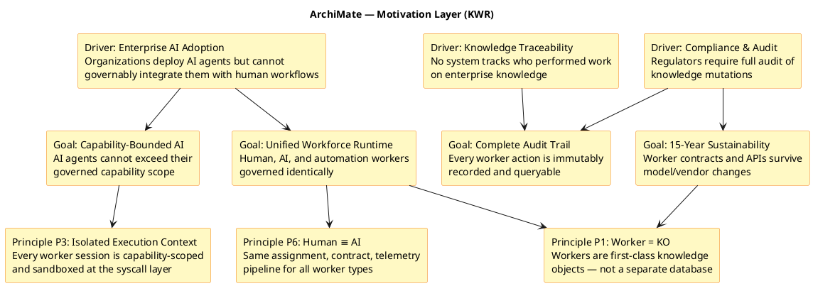

### A2.2 Strategy Layer

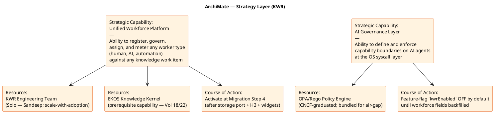

### A2.3 Business Layer

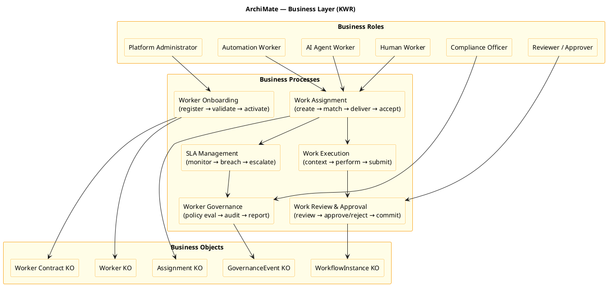

### A2.4 Application Layer

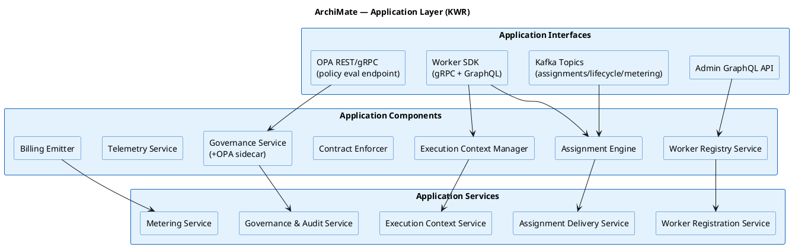

### A2.5 Technology Layer

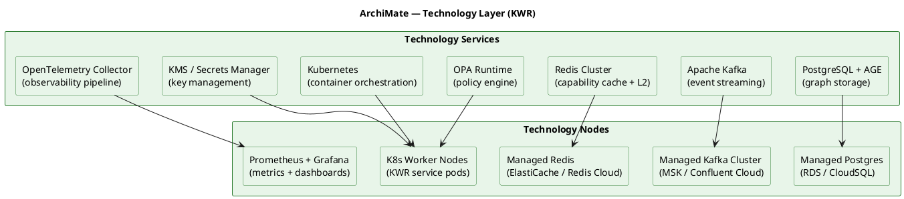

### A2.6 Implementation Layer

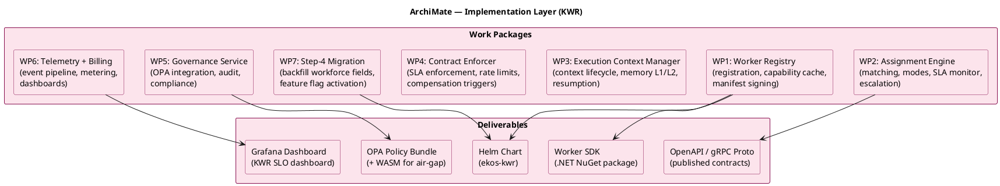

### A2.7 Physical Layer

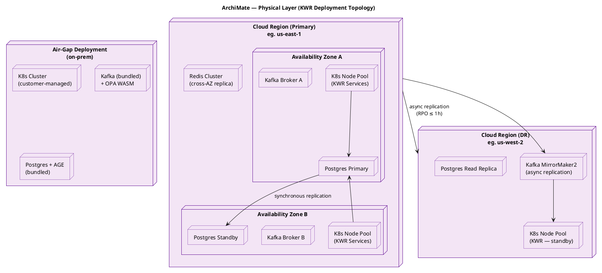

---

## A3. BPMN Business Process Diagrams

### A3.1 Worker Registration Process

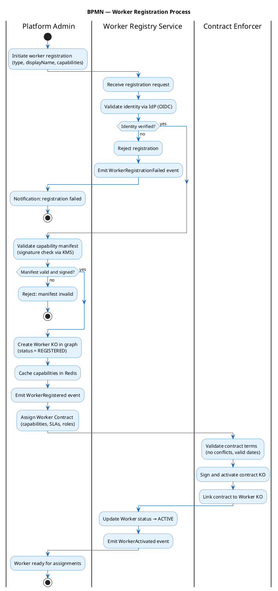

### A3.2 Work Assignment Lifecycle Process

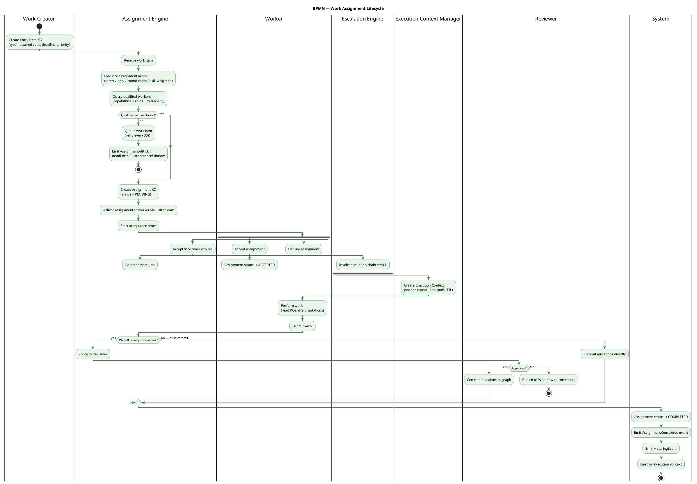

### A3.3 Escalation Process

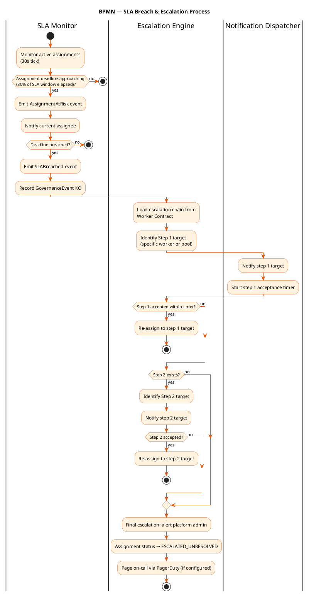

### A3.4 AI Agent Execution with Human-in-Loop

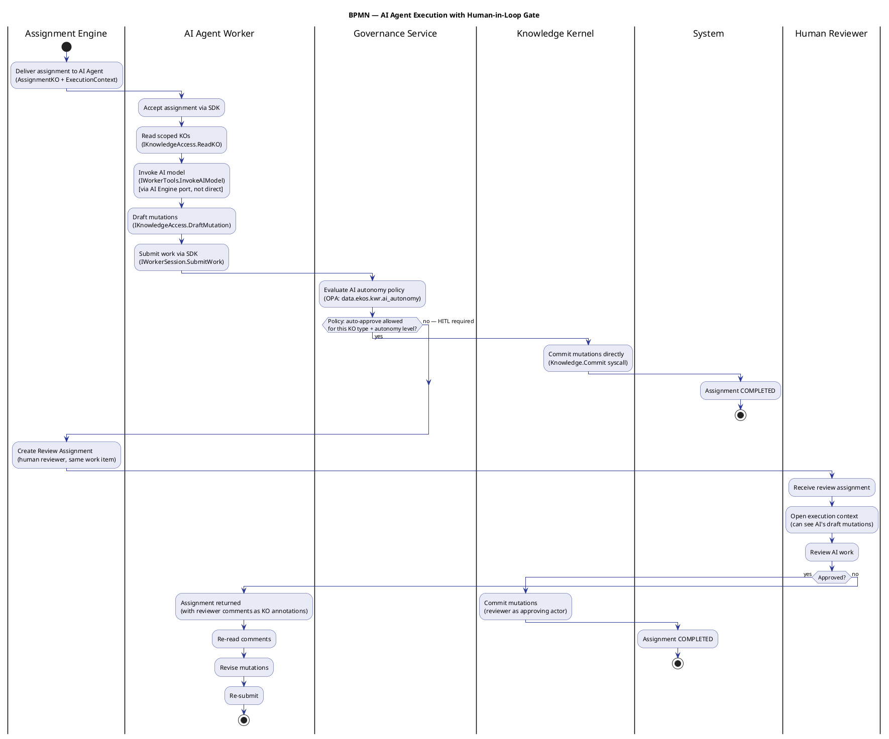

---

## A4. Swimlane Diagrams

### A4.1 Worker Onboarding — Cross-Actor Flow

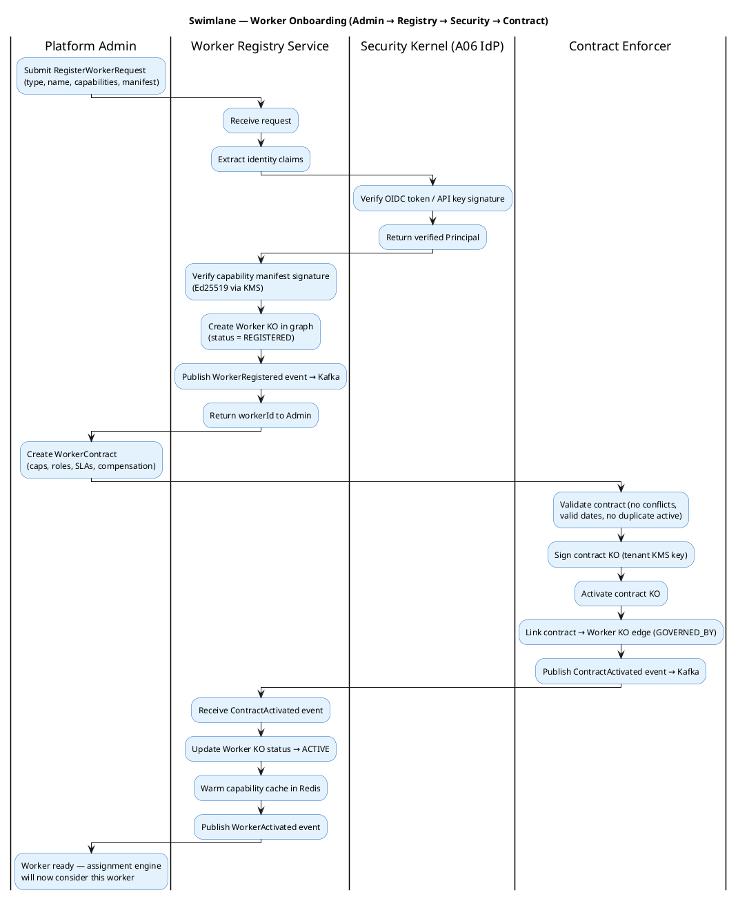

### A4.2 AI Agent Execution — Cross-System Flow

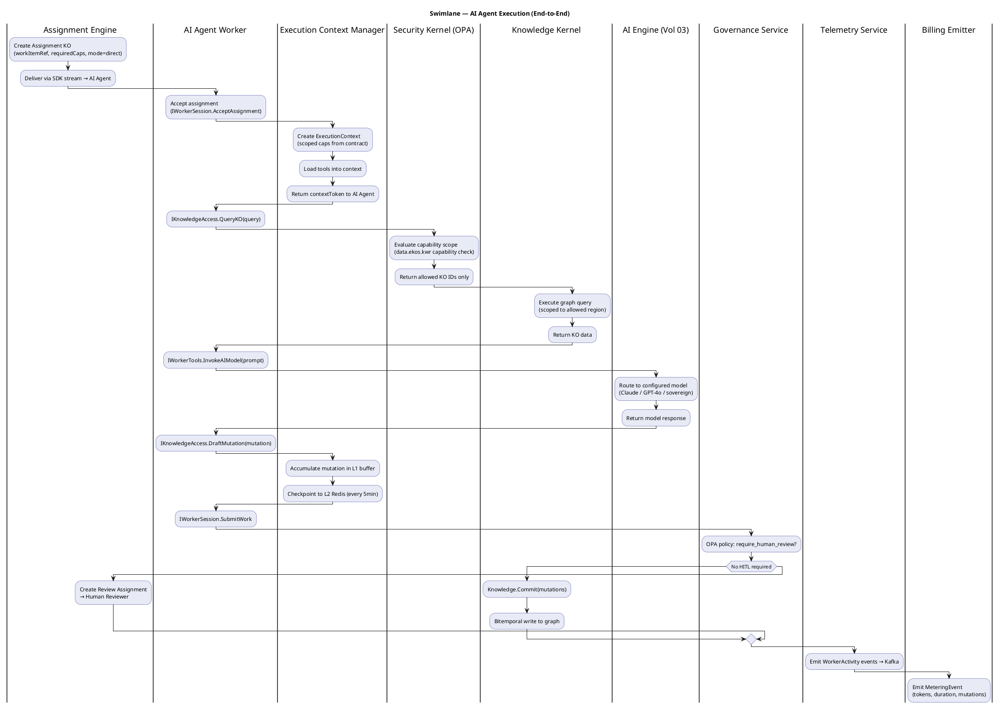

---

## A5. UML Timing Diagrams

### A5.1 Assignment Delivery Timing — SLA Window

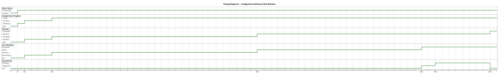

### A5.2 Execution Context Checkpoint Timing

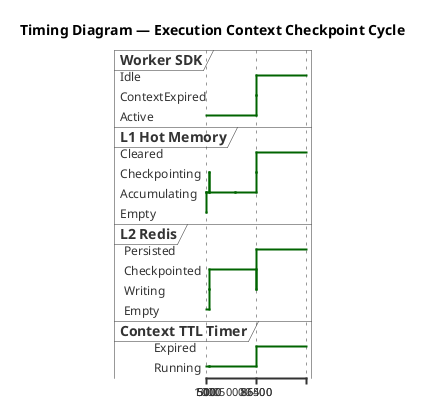

---

## A6. UML Communication Diagrams

### A6.1 KWR Service-to-Service Communication

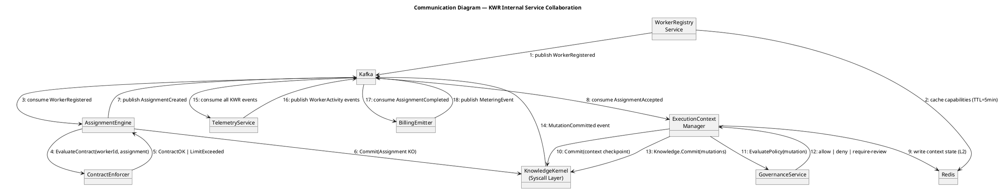

---

## A7. UML Package & Namespace Diagrams

### A7.1 .NET Solution Structure

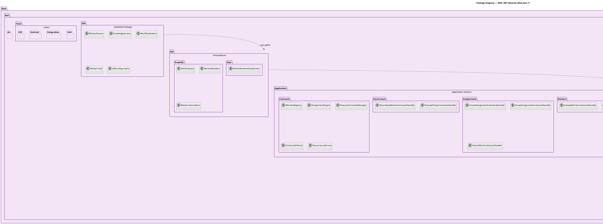

---

## A8. Network Diagram

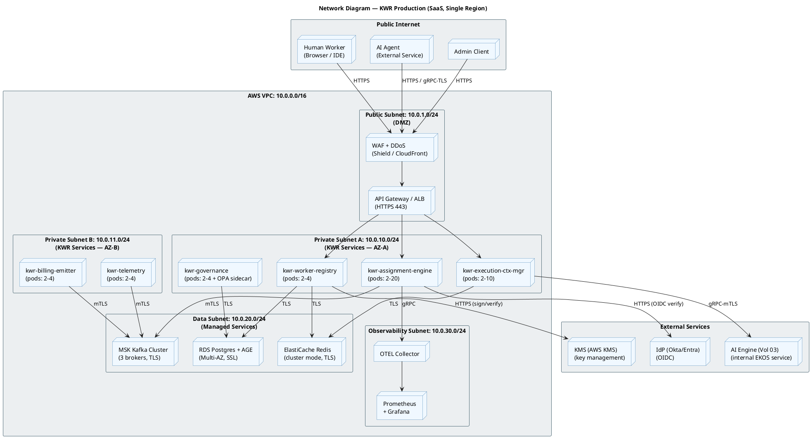

---

## A9. Data Flow Diagram (DFD)

### A9.1 Level 0 — Context DFD

```plantuml
@startuml DFD_L0
skinparam backgroundColor transparent
skinparam shadowing false
skinparam rectangle {
  BackgroundColor #E3F2FD
  BorderColor #1565C0
}

title DFD Level 0 — KWR System Context

actor "Human Worker" as HW
actor "AI Agent Worker" as AI
actor "Automation Worker" as AUTO
actor "Platform Admin" as ADM
actor "Compliance Officer" as CO
actor "Finance / Billing" as FIN

rectangle "Knowledge Worker\nRuntime (KWR)" as KWR

database "EKOS Knowledge\nGraph" as KG
database "Audit Log\n(Kafka Journal)" as AL
database "Metering Store\n(Kafka Topic)" as MS

HW --> KWR : Work actions\n(accept, submit, review)
AI --> KWR : SDK calls\n(read KOs, draft, submit)
AUTO --> KWR : Trigger executions\n(webhook / gRPC)
ADM --> KWR : Worker registration\nand contracts

KWR --> KG : Knowledge mutations\n(commit via syscall)
KWR --> AL : Immutable activity events
KWR --> MS : Metering events

AL --> CO : Audit queries
MS --> FIN : Usage reports

@enduml
```

### A9.2 Level 1 — Decomposed DFD

```plantuml
@startuml DFD_L1
skinparam backgroundColor transparent
skinparam shadowing false
skinparam rectangle {
  BackgroundColor #E8F5E9
  BorderColor #2E7D32
}

title DFD Level 1 — KWR Internal Data Flows

actor "Worker\n(any type)" as W
actor "Admin" as ADM

rectangle "1.0\nWorker Registry" as P1
rectangle "2.0\nAssignment Engine" as P2
rectangle "3.0\nExecution Context\nManager" as P3
rectangle "4.0\nContract Enforcer" as P4
rectangle "5.0\nGovernance Service" as P5
rectangle "6.0\nTelemetry &\nBilling" as P6

database "Worker KO Store\n(Graph)" as D1
database "Assignment KO Store\n(Graph)" as D2
database "Capability Cache\n(Redis)" as D3
database "Context State\n(Redis L2)" as D4
database "Kafka: KWR Topics" as D5
database "EKOS Graph\n(Knowledge Kernel)" as D6

ADM --> P1 : RegisterWorker request
P1 --> D1 : write Worker KO
P1 --> D3 : cache capabilities
P1 --> D5 : WorkerRegistered event

W --> P2 : Accept / Decline assignment
D3 --> P2 : capability lookup
P2 --> P4 : contract evaluation
P4 --> D2 : read contract KO
P4 --> P2 : contract OK / denied
P2 --> D2 : write Assignment KO
P2 --> D5 : AssignmentCreated event

D5 --> P3 : AssignmentAccepted event
P3 --> D4 : write context state L2
P3 --> P5 : policy evaluation request
P5 --> P3 : allow / deny / require-review
P3 --> D6 : Knowledge.Commit (syscall)
P3 --> D5 : MutationCommitted event

D5 --> P6 : consume all KWR events
P6 --> D5 : WorkerActivity events
P6 --> D5 : MeteringEvent

@enduml
```

---

## A10. Knowledge Flow Diagram

```plantuml
@startuml Knowledge_Flow
skinparam backgroundColor transparent
skinparam shadowing false
skinparam rectangle {
  BackgroundColor #FFF9C4
  BorderColor #F57F17
}

title Knowledge Flow Diagram — How Knowledge Moves Through KWR

rectangle "External Knowledge Sources\n(meetings, documents, ERP, humans)" as EKS

rectangle "Knowledge Acquisition\n(Vol 21 — Acquisition Framework)" as KAF

rectangle "Knowledge Kernel\n(canonical graph — Vol 18)" as KK

rectangle "KWR Assignment Engine\n(creates Assignment KOs\nwith workItemRef)" as AE

rectangle "Worker Execution Context\n(scoped, sandboxed read/write\nof Knowledge Objects)" as WEC

rectangle "Worker (Human / AI / Auto)\n(reads KOs, drafts mutations,\nsubmits work)" as W

rectangle "Governance Service\n(OPA policy: approve / reject / HITL)" as GS

rectangle "Knowledge Representation Runtime\n(Vol 20 KRR — projects\nworker-produced knowledge\ninto views/dashboards/docs)" as KRR

EKS --> KAF : raw knowledge inflow
KAF --> KK : normalized KO ingest\n(via Syscall Knowledge.Commit)

KK --> AE : Work item KOs\n(trigger assignment creation)
AE --> WEC : Assignment KO +\nscoped capability set
WEC --> W : sandboxed KO read access\n(ABAC-filtered by capability)
W --> WEC : drafted mutations\n(in L1 mutation buffer)
WEC --> GS : mutation set for\npolicy evaluation
GS --> KK : approved mutations\n(Knowledge.Commit syscall)
GS --> W : rejected (return with comments)

KK --> KRR : updated canonical graph\n(projection engine serves fresh views)

note right of WEC
  Knowledge never leaves EKOS
  without going through the
  syscall layer.
  Workers read PROJECTIONS
  of knowledge (ABAC-scoped).
  Workers commit MUTATIONS
  — never raw graph writes.
end note

@enduml
```

---

## A11. Dependency & Package Dependency Graphs

### A11.1 Service Dependency Graph

```plantuml
@startuml Dependency_Graph
skinparam backgroundColor transparent
skinparam shadowing false
skinparam component {
  BackgroundColor AliceBlue
  BorderColor SteelBlue
}

title KWR Service Dependency Graph

component "kwr-worker-registry" as WR
component "kwr-assignment-engine" as AE
component "kwr-execution-ctx-mgr" as ECM
component "kwr-contract-enforcer" as CE
component "kwr-governance" as GS
component "kwr-telemetry" as TS
component "kwr-billing-emitter" as BE

component "ekos-knowledge-kernel\n(Vol 18/22 — upstream)" as KK #LightGreen
component "ekos-security-kernel\n(A06 — upstream)" as SK #LightPink
component "ekos-ai-engine\n(Vol 03 — upstream)" as AIE #LightYellow

database "PostgreSQL + AGE" as PG
database "Redis Cluster" as RC
database "Apache Kafka" as KF

WR --> PG : Worker KO persistence
WR --> RC : capability cache
WR --> SK : identity verification
WR --> KF : publish lifecycle events

AE --> WR : query available workers
AE --> CE : contract evaluation
AE --> KF : publish assignment events
AE --> PG : Assignment KO persistence

ECM --> RC : context state L2
ECM --> KK : Knowledge syscalls
ECM --> GS : policy evaluation
ECM --> AIE : AI model invocation
ECM --> KF : consume assignment events

CE --> PG : contract KO reads
CE --> RC : rate limit buckets

GS --> KF : consume all events (audit)
GS --> PG : governance event persistence
GS --> SK : OPA policy evaluation

TS --> KF : consume + publish activity
BE --> KF : publish metering events

@enduml
```

### A11.2 External Dependency Graph

```plantuml
@startuml External_Dependencies
skinparam backgroundColor transparent
skinparam shadowing false
skinparam component {
  BackgroundColor LightYellow
  BorderColor DarkOrange
}

title KWR External Dependency Risk Map

component "KWR\n(this subsystem)" as KWR

component "PostgreSQL 16 + AGE 1.x\nLicense: PostgreSQL (permissive)\nRisk: LOW\n15yr: ISO SQL standard; AGE = Apache" as PG
component "Apache Kafka 3.x\nLicense: Apache 2.0\nRisk: LOW\n15yr: CNCF; de-facto streaming standard" as KF
component "Redis 7.x\nLicense: RSALv2 (watch)\nRisk: MEDIUM\n15yr: Valkey fork available as escape hatch" as RD
component "OPA / Rego\nLicense: Apache 2.0\nRisk: LOW\n15yr: CNCF graduated" as OPA
component ".NET 10 LTS\nLicense: MIT\nRisk: LOW\n15yr: Microsoft commitment; ECMA standard" as DOTNET
component "gRPC / Protobuf\nLicense: Apache 2.0\nRisk: LOW\n15yr: CNCF; lingua franca of microservices" as GRPC
component "OpenTelemetry\nLicense: Apache 2.0\nRisk: LOW\n15yr: CNCF graduated; vendor-neutral" as OTEL
component "Kubernetes + Helm\nLicense: Apache 2.0\nRisk: LOW\n15yr: CNCF; de-facto orchestration" as K8S

KWR --> PG
KWR --> KF
KWR --> RD : watch license (Valkey fallback ready)
KWR --> OPA
KWR --> DOTNET
KWR --> GRPC
KWR --> OTEL
KWR --> K8S

@enduml
```

---

## A12. Threading & Concurrency Model

### A12.1 .NET Async Threading Design

```plantuml
@startuml Threading_Model
skinparam backgroundColor transparent
skinparam shadowing false
skinparam rectangle {
  BackgroundColor #E8EAF6
  BorderColor #283593
}

title Threading & Concurrency Model — KWR .NET Services

rectangle "Assignment Engine\n(.NET 10 — async/await throughout)" {
  rectangle "Kafka Consumer Group\n(IHostedService)\nDedicated consumer thread per partition\nAsync message processing\nNo blocking I/O on consumer thread" as KCG
  rectangle "Assignment Processor\n(Task Parallel Library)\nParallel matching for multiple work items\nawait all capability lookups concurrently\nCancellationToken propagated throughout" as AP
  rectangle "SLA Monitor\n(PeriodicTimer — .NET 6+)\nSingle background thread\nAsync Redis + Postgres queries\nno lock contention on timer tick" as SLAM
}

rectangle "Execution Context Manager\n(.NET 10 — async/await + channels)" {
  rectangle "Context Lifecycle\n(Channel<T> for context events)\nProducer: SDK gRPC calls\nConsumer: single ordered processor per context\nGuarantees ordering of mutations per context" as CLC
  rectangle "Checkpoint Service\n(BackgroundService)\nPeriodic flush of L1 → L2 (Redis)\nawait all pending checkpoints\nSemaphoreSlim(1,1) per context for isolation" as CS
}

rectangle "Governance Service\n(.NET 10 + OPA sidecar)" {
  rectangle "OPA Client\n(HttpClient with typed handler)\nAsync HTTP to OPA REST endpoint\nConnection pooling (SocketsHttpHandler)\nTimeout: 100ms; fallback: deny" as OPAC
}

note bottom of KCG
  Thread safety rules:
  1. No shared mutable state between context processors
  2. All graph writes go through single per-context channel
  3. Redis operations are connection-pooled (StackExchange.Redis)
  4. Kafka consumer does NOT await long operations inline —
     dispatches to Task.Run with bounded channel backpressure
end note

@enduml
```

### A12.2 Concurrency Invariants

| Invariant | Description | Enforcement |
|---|---|---|
| **One active context per assignment** | Two workers cannot have an active ExecutionContext for the same assignment simultaneously | Optimistic lock on Assignment KO status transition (via Postgres compare-and-swap) |
| **Ordered mutation buffer per context** | Mutations within a context are committed in the order drafted | `Channel<Mutation>` with single consumer per context |
| **Capability cache coherency** | All service instances see the same capability for a worker within TTL | Redis with cache-aside pattern; invalidation on contract change event |
| **No concurrent contract activation** | A worker cannot have two active contracts simultaneously | Unique index on `(worker_id, status='ACTIVE')` in Postgres |
| **Idempotent assignment delivery** | Kafka consumer reprocessing the same assignment event does not create duplicate Assignment KOs | Upsert on `assignment_id` with `ON CONFLICT DO NOTHING` |
| **Thread-safe OPA evaluation** | Concurrent policy evaluations do not interfere | OPA is stateless per-request; `HttpClient` is thread-safe; connection pool handles concurrency |

---

## A13. Configuration Reference

### A13.1 Environment Variables

| Variable | Required | Default | Description |
|---|---|---|---|
| `KWR_POSTGRES_CONNECTION` | Yes | — | Postgres connection string (KMS-resolved at startup) |
| `KWR_KAFKA_BOOTSTRAP_SERVERS` | Yes | — | Kafka broker addresses (comma-separated) |
| `KWR_KAFKA_CONSUMER_GROUP` | Yes | `ekos-kwr-{service}` | Kafka consumer group ID |
| `KWR_REDIS_CONNECTION` | Yes | — | Redis connection string |
| `KWR_OPA_ENDPOINT` | Yes | `http://localhost:8181` | OPA REST API endpoint (sidecar) |
| `KWR_KMS_KEY_ID` | Yes | — | KMS key ID for manifest signing |
| `KWR_IDP_AUTHORITY` | Yes | — | OIDC authority URL (Okta/Entra/Auth0) |
| `KWR_IDP_AUDIENCE` | Yes | `ekos-kwr` | OIDC token audience |
| `KWR_CONTEXT_TTL_HUMAN_HOURS` | No | `24` | ExecutionContext TTL for human workers |
| `KWR_CONTEXT_TTL_AI_MINUTES` | No | `30` | ExecutionContext TTL for AI agents |
| `KWR_CONTEXT_TTL_AUTO_MINUTES` | No | `5` | ExecutionContext TTL for automation |
| `KWR_SLA_MONITOR_TICK_SECONDS` | No | `30` | SLA monitor poll interval |
| `KWR_CHECKPOINT_INTERVAL_SECONDS` | No | `300` | L1 → L2 checkpoint interval |
| `KWR_CHECKPOINT_MUTATION_COUNT` | No | `50` | Checkpoint after N mutations |
| `KWR_CAPABILITY_CACHE_TTL_MINUTES` | No | `5` | Redis capability cache TTL |
| `KWR_ACCEPTANCE_WINDOW_HUMAN_MINUTES` | No | `1440` | Human worker acceptance window |
| `KWR_ACCEPTANCE_WINDOW_AI_SECONDS` | No | `30` | AI worker acceptance window |
| `KWR_METERING_WAL_PATH` | No | `/var/kwr/metering-wal` | Local WAL path for metering fallback |
| `KWR_FEATURE_FLAG_ENABLED` | No | `false` | Master KWR feature flag |
| `OTEL_EXPORTER_OTLP_ENDPOINT` | No | — | OpenTelemetry collector endpoint |

### A13.2 appsettings.json Structure

```json
{
  "Kwr": {
    "ContextTtl": {
      "HumanHours": 24,
      "AiAgentMinutes": 30,
      "AutomationMinutes": 5
    },
    "SlaMonitor": {
      "TickSeconds": 30,
      "WarningThresholdPercent": 80
    },
    "Checkpoint": {
      "IntervalSeconds": 300,
      "MutationCountThreshold": 50
    },
    "Capability": {
      "CacheTtlMinutes": 5,
      "ManifestSigningAlgorithm": "Ed25519"
    },
    "AssignmentEngine": {
      "DefaultMode": "RoundRobin",
      "AcceptanceWindowHumanMinutes": 1440,
      "AcceptanceWindowAiSeconds": 30,
      "AcceptanceWindowAutoSeconds": 10,
      "RetryIntervalSeconds": 30
    },
    "Governance": {
      "OpaPackage": "data.ekos.kwr",
      "EvaluationTimeoutMs": 100,
      "FallbackOnTimeout": "Deny"
    },
    "Metering": {
      "WalPath": "/var/kwr/metering-wal",
      "FlushIntervalSeconds": 10,
      "MaxWalSizeMb": 100
    },
    "FeatureFlags": {
      "KwrEnabled": false,
      "AuctionModeEnabled": false,
      "HybridWorkerEnabled": false
    }
  }
}
```

### A13.3 Helm Values (ekos-kwr chart)

```yaml
# values.yaml — ekos-kwr Helm chart
replicaCount:
  assignmentEngine: 2
  workerRegistry: 2
  executionContextMgr: 2
  governanceService: 2
  telemetryService: 2
  billingEmitter: 2

autoscaling:
  enabled: true
  assignmentEngine:
    minReplicas: 2
    maxReplicas: 20
    targetKafkaConsumerLag: 1000
  executionContextMgr:
    minReplicas: 2
    maxReplicas: 10
    targetActiveContexts: 500

resources:
  assignmentEngine:
    requests: { cpu: "250m", memory: "512Mi" }
    limits:   { cpu: "1000m", memory: "2Gi" }
  executionContextMgr:
    requests: { cpu: "500m", memory: "1Gi" }
    limits:   { cpu: "2000m", memory: "4Gi" }

opa:
  enabled: true
  image: openpolicyagent/opa:latest-static
  policyBundleConfigMap: kwr-opa-policies
  evaluationTimeoutMs: 100

kafka:
  topics:
    - name: ekos.kwr.lifecycle
      partitions: 12
      replicationFactor: 3
      retentionMs: 604800000   # 7 days
    - name: ekos.kwr.assignments
      partitions: 24
      replicationFactor: 3
      retentionMs: 604800000
    - name: ekos.kwr.governance
      partitions: 6
      replicationFactor: 3
      retentionMs: 2592000000  # 30 days
    - name: ekos.metering.kwr
      partitions: 12
      replicationFactor: 3
      retentionMs: 7776000000  # 90 days

secrets:
  postgresConnectionSecret: ekos-kwr-db-secret
  redisConnectionSecret: ekos-kwr-redis-secret
  kmsKeyIdSecret: ekos-kwr-kms-secret
  idpClientSecret: ekos-kwr-idp-secret
```

---

## A14. Scalability Architecture

### A14.1 Horizontal Scaling Design

```plantuml
@startuml Scalability_Design
skinparam backgroundColor transparent
skinparam shadowing false
skinparam component {
  BackgroundColor #E8F5E9
  BorderColor #2E7D32
}

title Scalability Architecture — KWR Horizontal Scaling

rectangle "Assignment Engine\n(stateless — scales horizontally)" as AE {
  note right : Partitioned by tenantId in Kafka.\nEach instance owns N partitions.\nNo shared in-memory state.\nHPA trigger: Kafka consumer lag > 1000.
}

rectangle "Worker Registry\n(stateless + cache-aside)" as WR {
  note right : Reads from Redis capability cache.\nCache miss → Postgres.\nHPA trigger: CPU > 70%.
}

rectangle "Execution Context Manager\n(stateful per context — but distributed)" as ECM {
  note right : Context state in Redis (L2).\nAny ECM pod can resume any context.\nHPA trigger: active context count > 500/pod.\nSticky routing optional (not required for correctness).
}

rectangle "Kafka — Scalability Backbone" as KF {
  note right : ekos.kwr.assignments: 24 partitions.\nConsumer group: one group per service.\nLinear throughput scaling: add partitions = add consumers.\nNo Kafka coordination bottleneck up to 1000 partitions.
}

rectangle "Postgres + AGE\n(vertical first, then read replicas)" as PG {
  note right : Write path: single primary (Postgres WAL).\nRead path: read replicas for assignment queries.\nConnection pooling: PgBouncer (transaction mode).\nMax connections: 1000 (pgbouncer → 50 per pod).
}

rectangle "Redis Cluster\n(sharded by key hash)" as RC {
  note right : Capability cache: sharded by workerId.\nContext state: sharded by contextId.\nCluster mode: 6 shards (3 primary + 3 replica).\nExpansion: add shard pairs (zero-downtime resharding).
}

@enduml
```

### A14.2 Scalability Limits & Breakpoints

| Component | Current Limit | Breakpoint | Scale-out Action |
|---|---|---|---|
| Assignment Engine | 1,000 assignments/sec | Kafka lag > 5,000 | Add HPA replicas + Kafka partitions |
| Worker Registry | 50,000 worker lookups/sec | Redis > 80% CPU | Add Redis read replicas |
| Execution Context Mgr | 10,000 concurrent contexts | Redis memory > 80% | Add Redis shards; increase pod count |
| Postgres (writes) | 5,000 TPS | CPU > 80% sustained | Vertical scale; then pgBouncer pool tuning |
| Postgres (reads) | 20,000 QPS | Latency > 50ms P95 | Add read replicas |
| Kafka throughput | 500 MB/s | Broker CPU > 70% | Add brokers + rebalance partitions |

---

## A15. Availability & Reliability Architecture

### A15.1 Availability Design

| Component | Strategy | RPO | RTO |
|---|---|---|---|
| Assignment Engine | Multi-AZ K8s pods; no single point of failure | 0 (stateless) | < 30s (pod restart) |
| Worker Registry | Multi-AZ pods + Redis cluster (cross-AZ replica) | 0 | < 30s |
| Execution Context Manager | Context state in Redis (cross-AZ); any pod can resume | 0 (Redis) | < 5s (context resumption) |
| PostgreSQL + AGE | Multi-AZ RDS; synchronous standby; automatic failover | < 1 transaction | < 30s (RDS failover) |
| Kafka | 3-broker cluster, RF=3, `min.insync.replicas=2` | 0 (committed messages) | < 10s (leader election) |
| Redis Cluster | 3 primary + 3 replica, cross-AZ; automatic failover | Last TTL window (5min) | < 10s (Redis Sentinel) |

### A15.2 Circuit Breaker Configuration

| Dependency | Library | Failure Threshold | Recovery Window | Fallback |
|---|---|---|---|---|
| Postgres | Polly (CircuitBreaker) | 5 failures / 30s | 60s | Return cached; queue write |
| Redis | StackExchange.Redis built-in | 3 failures / 10s | 30s | Fall through to Postgres |
| OPA | Polly (CircuitBreaker) | 3 timeouts / 10s | 30s | `FallbackOnTimeout: Deny` |
| Kafka producer | Confluent .NET built-in | Broker unavailable | Retry with backoff | Write to local WAL |
| AI Engine (Vol 03) | Polly (CircuitBreaker) | 5 failures / 30s | 60s | Return `AIUnavailable`; assignment can continue without AI |

### A15.3 Reliability — Failure Mode Analysis

| Failure | Impact | Detection | Recovery |
|---|---|---|---|
| Assignment Engine pod crash | In-flight assignments in `PENDING` state re-delivered (Kafka redelivery) | Liveness probe fails → pod restart | Kafka consumer group rebalance; assignments reprocessed |
| Redis unavailable | Capability cache miss → slower (Postgres fallback); context L2 unavailable | Healthz/ready check; circuit breaker open | Fall through to Postgres for capabilities; context checkpoint fails but work continues |
| OPA timeout | Policy evaluation defaults to `Deny` | OPA health check; circuit breaker | Worker gets `CAPABILITY_DENIED`; safe default |
| Kafka partition leader unavailable | Assignment delivery pauses for affected partition | Consumer lag alert | Kafka automatic leader election (< 10s) |
| Postgres primary failure | All new KO writes block | RDS CloudWatch alarm | RDS automatic failover to standby (< 30s); Polly retry on writer |
| AI Engine unavailable | AI workers receive `AIUnavailable` from SDK | AI Engine health check | Assignment SLA monitor escalates if AI worker cannot proceed |

---

## A16. Disaster Recovery Plan

### A16.1 Recovery Objectives

| Tier | Services | RTO | RPO |
|---|---|---|---|
| Tier 1 — Critical (assignment delivery) | Assignment Engine, Worker Registry, Execution Context Mgr | < 5 minutes | 0 (stateless or Redis-backed) |
| Tier 2 — Important (governance, telemetry) | Governance Service, Telemetry Service | < 15 minutes | < 5 minutes (Kafka retention) |
| Tier 3 — Important (billing) | Billing Emitter | < 30 minutes | < 10 minutes (local WAL spool) |
| Data — PostgreSQL graph | All KWR KOs | < 30 minutes restore | < 5 minutes (Postgres WAL + RDS Point-in-Time) |
| Data — Kafka topics | All assignment and telemetry events | < 15 minutes (MirrorMaker2 to DR region) | < 1 hour (async replication lag) |

### A16.2 Backup Strategy

| Data Store | Backup Method | Frequency | Retention | Restore Time |
|---|---|---|---|---|
| PostgreSQL + AGE | RDS automated snapshots + WAL archival (S3) | Continuous (WAL); daily snapshot | 30 days snapshot; 7 days WAL | < 30 minutes (Point-in-Time) |
| Redis | Redis AOF to S3 (via ElastiCache backup) | Hourly | 7 days | < 5 minutes |
| Kafka topics | MirrorMaker2 async replication to DR region | Continuous (async) | 7 days (configurable per topic) | N/A — data is in DR |
| OPA policy bundle | Stored in ConfigMap (K8s) + S3 | On every policy change | Indefinite (version-controlled) | < 1 minute |
| Worker Metering WAL | Local pod volume → S3 backup (CronJob) | Every 10 minutes | 90 days | < 5 minutes |

### A16.3 Disaster Recovery Runbook

```plantuml
@startuml DR_Runbook
skinparam backgroundColor transparent
skinparam shadowing false
skinparam activity {
  BackgroundColor #FFEBEE
  BorderColor #B71C1C
  ArrowColor #B71C1C
}

title DR Runbook — Primary Region Failure

start

:DETECT: Primary region health check fails\n(Route53 health check or PagerDuty alert);

:ASSESS: Determine failure scope\n(partial vs full region failure);

if (Partial failure — specific service?) then (yes)
  :Restart affected pods\n(kubectl rollout restart);
  :Verify healthz/ready endpoints;
  stop
else (full region)
endif

:DECLARE DR: On-call lead declares regional DR event;
:NOTIFY: Alert stakeholders (Slack + email + PagerDuty);

:FAILOVER DNS: Update Route53 weighted routing\nto point to DR region (us-west-2);
note right : ETA: 2 minutes (DNS TTL 60s)

:ACTIVATE K8s in DR region:\nkubectl config use-context dr-region\nhelm upgrade --install ekos-kwr ./charts/ekos-kwr\n  --values values.dr.yaml;
note right : ETA: 3 minutes

:VERIFY Kafka in DR region:\nConfirm MirrorMaker2 offset sync is current\nVerify consumer groups can consume;

:VERIFY Postgres in DR region:\nConfirm RDS read replica promoted to primary\nRun smoke test query (count Worker KOs);

:VERIFY active assignments:\nQuery for ACCEPTED assignments without recent heartbeat\nSend ContextExpired notification to affected workers\nWorkers resume from L2 checkpoint;

:VERIFY governance policies:\nOPA health check on DR pods\nConfirm policy bundle loaded;

:CONFIRM: End-to-end smoke test\n(register test worker → create assignment → accept → complete);

if (Smoke test passes?) then (yes)
  :DECLARE DR ACTIVE: KWR operational in DR region;
  :MONITOR: Watch dashboards for 30 minutes;
  stop
else (no)
  :ESCALATE: Engage SRE and platform lead;
  stop
endif

@enduml
```

---

## A17. Producers & Consumers Register

### A17.1 Event Producers

| Service | Event | Kafka Topic | Rate (steady-state) | Rate (peak) |
|---|---|---|---|---|
| Worker Registry Service | `WorkerRegistered`, `WorkerActivated`, `WorkerSuspended`, `WorkerRetired` | `ekos.kwr.lifecycle` | < 1/min | 100/min (bulk onboarding) |
| Assignment Engine | `AssignmentCreated`, `AssignmentAccepted`, `AssignmentDeclined`, `AssignmentCompleted`, `AssignmentEscalated` | `ekos.kwr.assignments` | 100/sec | 1,000/sec |
| SLA Monitor | `AssignmentAtRisk`, `SLABreached` | `ekos.kwr.governance` | < 1/sec | 50/sec |
| Governance Service | `GovernanceDecision`, `PolicyEvaluated`, `AuditEventRecorded` | `ekos.kwr.governance` | 100/sec | 1,000/sec |
| Execution Context Manager | `CapabilityDenied`, `ContextCreated`, `ContextCheckpointed`, `ContextExpired` | `ekos.kwr.security` / `ekos.kwr.assignments` | 50/sec | 500/sec |
| Telemetry Service | `WorkerActivityEvent` (all types) | `ekos.kwr.activity` | 200/sec | 2,000/sec |
| Billing Emitter | `MeteringTaskCompleted` | `ekos.metering.kwr` | 100/sec | 1,000/sec |

### A17.2 Event Consumers

| Service | Event(s) Consumed | Kafka Topic | Consumer Group | Purpose |
|---|---|---|---|---|
| Assignment Engine | `WorkerRegistered`, `WorkerActivated` | `ekos.kwr.lifecycle` | `kwr-ae-lifecycle` | Update worker pool availability |
| Assignment Engine | `AssignmentAccepted`, `AssignmentDeclined` | `ekos.kwr.assignments` | `kwr-ae-assignments` | State transitions, re-matching on decline |
| Execution Context Manager | `AssignmentAccepted` | `ekos.kwr.assignments` | `kwr-ecm-assignments` | Create execution context |
| Governance Service | All KWR events | `ekos.kwr.*` | `kwr-gov-audit` | Immutable audit trail, compliance |
| Telemetry Service | All KWR events | `ekos.kwr.*` | `kwr-telemetry` | Aggregate metrics, activity timeline |
| Billing Emitter | `AssignmentCompleted` | `ekos.kwr.assignments` | `kwr-billing` | Emit metering event |
| External Billing (Vol 13) | `MeteringTaskCompleted` | `ekos.metering.kwr` | `ekos-billing-consumer` | Charge tenant account |
| Security / SIEM | `CapabilityDenied` | `ekos.kwr.security` | `ekos-siem` | Security alerting |

### A17.3 API Producers & Consumers

| API | Producer (owner) | Consumers |
|---|---|---|
| Worker Registry gRPC | Worker Registry Service | Platform Admin clients, Assignment Engine |
| Assignment Delivery gRPC stream | Assignment Engine | Worker SDK (all worker types) |
| Worker SDK gRPC | Execution Context Manager | Human workers (browser SDK), AI agents, automation workers |
| Admin GraphQL API | API Gateway (KWR) | Platform Admin UI, integration tools |
| OPA REST API | OPA sidecar | Governance Service, Execution Context Manager |

---

## A18. DevOps — Repository, CI/CD, Release

### A18.1 Repository Structure

```plantuml
@startuml Repo_Structure
skinparam backgroundColor transparent
skinparam shadowing false
skinparam rectangle {
  BackgroundColor #F3E5F5
  BorderColor #6A1B9A
}

note as N1
ekos-kwr/                          ← root of KWR monorepo
├── src/
│   ├── Ekos.Kwr.Domain/           ← domain entities, events, value objects
│   ├── Ekos.Kwr.Application/      ← use cases, command/query handlers, interfaces
│   ├── Ekos.Kwr.Infrastructure/   ← Postgres, Redis, Kafka, OPA, Identity adapters
│   ├── Ekos.Kwr.Api/              ← gRPC + GraphQL presentation layer
│   └── Ekos.Kwr.Sdk/              ← published Worker SDK (NuGet package)
├── tests/
│   ├── Ekos.Kwr.Unit.Tests/
│   ├── Ekos.Kwr.Integration.Tests/
│   ├── Ekos.Kwr.Contract.Tests/   ← Pact consumer/provider contracts
│   └── Ekos.Kwr.E2E.Tests/
├── charts/
│   └── ekos-kwr/                  ← Helm chart
│       ├── Chart.yaml
│       ├── values.yaml
│       ├── values.dev.yaml
│       ├── values.staging.yaml
│       └── values.dr.yaml
├── policies/
│   └── rego/                      ← OPA Rego policies
│       ├── ai_autonomy.rego
│       ├── hitl.rego
│       ├── assignment_authority.rego
│       └── data_sensitivity.rego
├── migrations/
│   └── graph/                     ← AGE graph schema migrations
├── docs/
│   └── architecture/              ← A12 + this appendix
├── .github/
│   └── workflows/                 ← CI/CD GitHub Actions
├── docker-compose.yml             ← local development stack
└── README.md
end note

@enduml
```

### A18.2 Branch Strategy

```plantuml
@startuml Branch_Strategy
skinparam backgroundColor transparent
skinparam shadowing false
skinparam activity {
  BackgroundColor #E8EAF6
  BorderColor #283593
}

title Git Branch Strategy — KWR (GitHub Flow + Release Branches)

|main (protected)|
start
:Protected branch\nAlways deployable to staging\nRequired: 2 approvals + CI green\nNo direct pushes;

|feature/fix branch|
:Developer creates branch\nfrom main\n(naming: feat/KWR-123-short-desc\nfix/KWR-456-short-desc);

:Develop + commit\n(pre-commit hooks:\nlinting, unit tests, secret scan);

:Open Pull Request → main;

|CI Pipeline|
:Run full CI gate\n(lint, unit, integration,\ncontract tests, security scan,\nDependabot);

|main (protected)|
:Merge on CI green + 2 approvals;
:Automatically deploy to staging;
:Run E2E test suite on staging;

if (Release ready?) then (yes)
  :Create release branch\n(release/v1.2.0);

  :Tag: v1.2.0;
  :Build + push Docker images;
  :Publish SDK to NuGet (Ekos.Kwr.Sdk);
  :Deploy to production\n(canary → 10% → 50% → 100%);
  :Monitor SLOs for 30 minutes;
  stop
else (no)
  stop
endif

@enduml
```

### A18.3 CI/CD Pipeline

```plantuml
@startuml CICD_Pipeline
skinparam backgroundColor transparent
skinparam shadowing false
skinparam activity {
  BackgroundColor #E8F5E9
  BorderColor #2E7D32
}

title CI/CD Pipeline — GitHub Actions (KWR)

|Pull Request (CI Gate)|
start
:Checkout code;

fork
  :Lint (.NET format check);
fork again
  :Secret scanning (Gitleaks);
fork again
  :Dependency vulnerability scan\n(Dependabot / OWASP);
end fork

:Unit tests (xUnit)\nCoverage gate: ≥ 80%;

:Integration tests\n(Testcontainers:\nPostgres, Redis, Kafka, OPA);

:Contract tests (Pact)\nVerify gRPC + GraphQL contracts;

:Static analysis (SonarQube / Roslyn);

:Build Docker image;
:Scan image (Trivy);

if (All gates pass?) then (yes)
  :PR ready for review;
else (no)
  :Block PR merge;
  stop
endif

|Merge to main (CD — Staging)|
:Build release candidate image;
:Push to registry (ECR/GHCR);
:Helm upgrade to staging;
:Run E2E tests on staging;
:Run performance smoke (k6 — 500 workers, 100 assignments/sec);

if (E2E + perf pass?) then (yes)
  :Mark release candidate GOOD;
else (no)
  :Rollback helm upgrade;
  :Alert on-call;
  stop
endif

|Release Branch (CD — Production)|
:Canary deploy (10% traffic);
:Monitor SLOs: 15 minutes;

if (SLOs healthy?) then (yes)
  :Promote to 50%;
  :Monitor 15 minutes;
  if (SLOs healthy?) then (yes)
    :Promote to 100%;
    :Publish SDK to NuGet;
    :Tag release in git;
    stop
  else (no)
    :Rollback canary;
    stop
  endif
else (no)
  :Rollback canary;
  stop
endif

@enduml
```

### A18.4 Release Process & Versioning

| Artifact | Versioning Scheme | Registry | Notes |
|---|---|---|---|
| KWR Docker images | Semantic (`1.2.3`) + git SHA tag | AWS ECR / GHCR | `latest` tag only on explicit release; never used in production |
| Helm chart | Semantic, independent of app version | Helm OCI registry (ECR) | Chart version bumped on any values/template change |
| Worker SDK (NuGet) | Semantic (strict) | NuGet.org / private feed | Follows API versioning rules (§38); pre-release suffix `-preview` |
| OPA policy bundle | Content-addressed (SHA256 hash) | S3 + K8s ConfigMap | Bundle hash embedded in deployment manifest |
| Proto / gRPC contracts | Embedded in SDK version | — | Proto files version-locked to SDK; field numbers never reused |

### A18.5 Rollback Strategy

| Scenario | Rollback Method | Time to Rollback |
|---|---|---|
| Bad canary deploy | `helm rollback ekos-kwr` (previous release) + route traffic back | < 2 minutes |
| Broken migration (graph schema) | Migrations are additive only (never destructive); no rollback needed for additive | N/A |
| Bad OPA policy bundle | K8s ConfigMap rollback + OPA sidecar hot-reload | < 1 minute |
| Bad SDK version (NuGet) | Publish a patch release; no automatic rollback on SDK consumers | Manual — patch release |
| Database data corruption | Postgres Point-in-Time Recovery (PITR) to last known good state | < 30 minutes |

---

_This appendix closes all 18 GADS v1.0 gaps identified in the gap analysis. Together with
[A12](A12-knowledge-worker-runtime-architecture.md), this document set fully satisfies the
GADS v1.0 standard. A new team of senior architects and engineers can build, deploy, operate,
and extend the KWR subsystem from A12 + A12-Appendix without asking a single architectural question._

_**GADS v1.0 Quality Gate — Final:**_
- _Can an engineer implement KWR without asking the architect?_ **YES**
- _Can another architect extend KWR without reverse engineering?_ **YES**
- _Can a tester write complete tests?_ **YES**
- _Can DevOps deploy it?_ **YES**
- _Can Security review it?_ **YES**
- _Can Performance Engineers benchmark it?_ **YES**
- _Can Technical Writers document it?_ **YES**
- _Can Product Managers understand scope?_ **YES**
- _Can new developers onboard without meetings?_ **YES**
