# A12 — Knowledge Worker Runtime Architecture (KWR)

> **Standard:** GADS v1.0 (Garvion Architecture Documentation Standard)
> **Status:** ✅ Draft-Complete · **Generated:** 2026-07-03 · **Authors:** Chief Enterprise Architect (EKOS)
> **Governing documents:** Book 1 (Knowledge Constitution), Vol 26 (KWR Requirements), ADR-033,
> ADR-050, A02 (Logical Architecture), A06 (Security), A09 (Sustainability)
> **Quality gate:** Every section must allow a senior engineer to implement without asking the architect.

---

## Table of Contents

1. [Purpose](#1-purpose)
2. [Scope](#2-scope)
3. [Responsibilities](#3-responsibilities)
4. [Non-Responsibilities](#4-non-responsibilities)
5. [Architectural Principles](#5-architectural-principles)
6. [Design Goals](#6-design-goals)
7. [Constraints](#7-constraints)
8. [Assumptions](#8-assumptions)
9. [Functional Requirements](#9-functional-requirements)
10. [Non-Functional Requirements](#10-non-functional-requirements)
11. [Business Requirements](#11-business-requirements)
12. [Technical Requirements](#12-technical-requirements)
13. [Quality Attributes](#13-quality-attributes)
14. [Risks and Mitigations](#14-risks-and-mitigations)
15. [Trade-offs](#15-trade-offs)
16. [The Worker Model (Domain Design)](#16-the-worker-model-domain-design)
17. [Worker Lifecycle & State Machine](#17-worker-lifecycle--state-machine)
18. [Worker Memory Model](#18-worker-memory-model)
19. [Worker Scheduler](#19-worker-scheduler)
20. [Worker Orchestration Engine](#20-worker-orchestration-engine)
21. [Worker Registry](#21-worker-registry)
22. [Worker Contract System](#22-worker-contract-system)
23. [Worker SDK](#23-worker-sdk)
24. [Worker Execution Pipeline](#24-worker-execution-pipeline)
25. [Worker Telemetry](#25-worker-telemetry)
26. [Worker Billing & Metering](#26-worker-billing--metering)
27. [Worker Governance](#27-worker-governance)
28. [C4 Architecture](#28-c4-architecture)
29. [Domain-Driven Design](#29-domain-driven-design)
30. [Data Architecture](#30-data-architecture)
31. [API Architecture](#31-api-architecture)
32. [Event Architecture](#32-event-architecture)
33. [Security Architecture](#33-security-architecture)
34. [Observability](#34-observability)
35. [Deployment Architecture](#35-deployment-architecture)
36. [Testing Strategy](#36-testing-strategy)
37. [Performance Targets](#37-performance-targets)
38. [Backward & Forward Compatibility](#38-backward--forward-compatibility)
39. [Migration Strategy](#39-migration-strategy)
40. [Patent Analysis](#40-patent-analysis)
41. [ADR References](#41-adr-references)
42. [Future Evolution](#42-future-evolution)
43. [Open Questions](#43-open-questions)
44. [Implementation Checklist](#44-implementation-checklist)

---

## 1. Purpose

The Knowledge Worker Runtime (KWR) is the **execution layer for all actors — human, AI agent, and automation — that perform work on Knowledge Objects within EKOS**. It defines how workers are registered, how they receive and accept assignments, how their execution context is managed, how their outputs are committed to the knowledge graph, and how their activity is governed, metered, and audited.

KWR is not a feature. It is a **platform subsystem that runs ON EKOS**, in the same relationship as .NET CLR runs on Windows or the JVM runs on Linux. EKOS provides the substrate (kernel, graph, syscalls, projection); KWR provides the workforce layer on top of it.

Without KWR, EKOS can store and project knowledge. With KWR, knowledge **gets done** — tasks are assigned, AI agents execute, humans review, approvals flow, and every action is traceable back to an actor with a role and a contract.

---

## 2. Scope

**In scope:**
- Worker types: Human, AI Agent, Automation Script, Hybrid (human-in-the-loop AI)
- Worker registration, identity, capability declaration, and profile management
- Worker lifecycle: onboard → activate → assign → execute → review → retire
- Assignment engine: matching work items to qualified workers
- Worker execution context: memory, session, tool access, capability scope
- Worker contract system: obligations, SLAs, compensation, usage limits
- Worker state machine and transitions
- Worker registry: catalog, discovery, versioning, deprecation
- Worker SDK: the API surface through which workers interact with EKOS
- Worker telemetry: activity logs, execution traces, performance metrics
- Worker billing and metering: consumption accounting per worker, per task, per contract
- Worker governance: policy enforcement, compliance, escalation, audit
- Integration with the EKOS Knowledge Kernel, Syscall Layer (Vol 22), and Security (A06)
- Workforce fields reserved on every KO (EKOS-26-028, ADR-033)

**Out of scope (see §4):**
- Workforce Exchange (hiring marketplace, external talent economy) — separate product
- The underlying EKOS kernel, graph storage, and syscall layer
- General EKOS application runtime (Vol 23)
- Payment processing infrastructure
- HR/payroll systems integration specifics

---

## 3. Responsibilities

| # | Responsibility |
|---|---|
| R1 | Maintain an authoritative registry of all workers (human, AI, automation) known to an EKOS tenant |
| R2 | Authenticate and authorize workers via integration with the EKOS security kernel (A06) |
| R3 | Manage the complete worker lifecycle from onboarding to retirement |
| R4 | Match and assign work items (Tasks, Approvals, Reviews, Escalations) to qualified workers per policy |
| R5 | Provide workers an isolated, capability-scoped execution context |
| R6 | Execute worker contracts: enforce SLAs, track obligations, compute compensation |
| R7 | Collect and store immutable worker activity telemetry |
| R8 | Enforce governance policies on worker behavior (rate limits, capability boundaries, audit) |
| R9 | Expose the Worker SDK as the stable interface between workers and EKOS |
| R10 | Meter worker resource consumption for billing purposes |
| R11 | Propagate worker-initiated mutations through the EKOS Syscall Layer into the Knowledge Kernel |
| R12 | Maintain all workforce-reserved fields on KOs (Owner, Role, Assignment, Workflow, Approval, Review, Escalation) |

---

## 4. Non-Responsibilities

| # | Non-Responsibility | Who owns it |
|---|---|---|
| NR1 | Graph storage, indexing, querying | Knowledge Kernel (Vol 18) + Syscall Layer (Vol 22) |
| NR2 | External talent marketplace / Workforce Exchange | Separate Garvion product (future) |
| NR3 | Payment processing, payroll | External fintech integration via Economy (Vol 13) |
| NR4 | General application execution (non-worker apps) | App Runtime & SDK (Vol 23) |
| NR5 | KO projection and rendering | Knowledge Representation Runtime (Vol 20) |
| NR6 | AI model training, fine-tuning, model hosting | AI Engine (Vol 03) |
| NR7 | Cryptographic key management | Security Kernel (A06) |
| NR8 | Tenant provisioning | Table-Stakes / Ops (Vol 09) |

---

## 5. Architectural Principles

These principles govern every design decision in KWR and must be consulted before any implementation choice is made.

**P1 — Worker is a Knowledge Object.** A Worker (human, AI, automation) is itself a first-class KO in the EKOS graph with full bitemporal history, policy-scoped projections, and participation in all KO semantics. There is no separate "worker database" — workers are knowledge.

**P2 — Role-capability separation.** A Role defines *what* work a worker is permitted to do. A Capability defines *how* they can do it (tool access, APIs, KO types, graph regions). These are separately granted and revoked without affecting each other.

**P3 — Execution context is isolated and scoped.** Every worker session runs in a capability-scoped sandbox. Workers can only see and mutate knowledge within their ABAC-granted projection scope. This is enforced at the syscall layer — the worker cannot bypass it.

**P4 — Every action is an event.** All worker activity — reads, writes, approvals, escalations, completions, failures — is recorded as an immutable event in the mutation journal (Vol 18 §8). No side effects are silent.

**P5 — Contracts are first-class.** The Worker Contract is not a configuration file. It is a versioned KO that defines obligations, capabilities, SLAs, and compensation. Contracts are enforced by the runtime, not by convention.

**P6 — Human and AI workers are architecturally equivalent.** The same assignment engine, execution context, contract system, and telemetry pipeline applies to a human reviewer and a GPT-4o AI agent. The only difference is the identity provider and the execution adapter.

**P7 — Workforce fields on every KO from day one.** Per ADR-033 and EKOS-26-028: `owner`, `role`, `assignment`, `workflow`, `approval`, `review`, `escalation` are reserved on every KO at creation — populated with defaults (owner = creating principal), never null, never added later via migration.

**P8 — Degrade gracefully, never block knowledge.** If the KWR subsystem is unavailable, the EKOS kernel continues to operate. Workers already executing continue to completion. New assignments queue. Knowledge is never blocked by workforce system failures.

**P9 — Pluggable worker adapters.** The execution mechanism for a worker (HTTP webhook, gRPC stream, WebSocket, in-process WASM module, browser agent) is an adapter behind a stable interface. Adding a new worker type is adding an adapter, not changing the runtime.

---

## 6. Design Goals

| ID | Goal | Metric |
|---|---|---|
| G1 | Assignment latency — a newly created task reaches a qualified worker | < 500ms (P99) |
| G2 | Worker registration — a new worker is available for assignment after registration | < 2s |
| G3 | Execution context setup — time from assignment accepted to worker having a ready context | < 1s |
| G4 | Telemetry completeness — all worker actions captured | 100% (no silent mutations) |
| G5 | Contract enforcement — SLA breach detection | within 1 scheduling tick (configurable, default 30s) |
| G6 | Horizontal scalability — number of concurrent active workers | 10,000+ per tenant with linear scaling |
| G7 | AI agent throughput — tasks completed per second per AI worker pool | ≥ 50 tasks/sec at p50 |
| G8 | Audit completeness — every action reconstructable from event log | 100% (immutable journal) |

---

## 7. Constraints

| ID | Constraint | Source |
|---|---|---|
| C1 | All worker mutations MUST go through the EKOS Syscall Layer (`Knowledge.Commit`) — no direct DB writes | Book 1 Law 13; A06 |
| C2 | Worker identity MUST be verified by the EKOS Security Kernel — no shadow identity stores | A06; ADR-037 |
| C3 | All worker activity MUST produce immutable journal entries — no silent reads | Book 1 Law 11 |
| C4 | Worker KOs MUST have all workforce fields from creation (ADR-033) | EKOS-26-028 |
| C5 | AI workers MUST operate strictly within their capability scope — no prompt injection escape | Book 1 Law 6 |
| C6 | No vendor lock-in in the worker adapter layer — all adapters behind a port | Book 1 Law 10 |
| C7 | Air-gap mode MUST work with local-only AI workers (sovereign models) | Book 1 Law 8 |
| C8 | Worker contract changes require a new contract version — existing contracts are immutable | Book 1 Law 11 |

---

## 8. Assumptions

| ID | Assumption | Impact if wrong |
|---|---|---|
| A1 | The EKOS Syscall Layer (Vol 22) is available and stable before KWR is activated | KWR cannot function without syscalls; blocks activation |
| A2 | Workers (human and AI) have network connectivity to the KWR assignment endpoint | Air-gap workers need a local KWR node — design for it (§35) |
| A3 | AI worker models are accessed via the AI Engine port (Vol 03) — not direct API calls | If AI calls are direct, telemetry and capability scoping are bypassed |
| A4 | The EKOS tenant has at least one configured IdP (A06 ADR-037) before human workers onboard | Without IdP, human worker identity cannot be verified |
| A5 | Worker contracts are authored by a platform admin with sufficient privilege | Self-authored contracts create privilege escalation risks |
| A6 | The billing system (Vol 13 / external) is eventually consistent — metering events are buffered | If billing is synchronous, it becomes a critical path dependency — avoid |

---

## 9. Functional Requirements

### 9.1 Worker Registration & Identity

- **KWR-F001** — The system SHALL support three worker archetypes: **Human** (authenticated via IdP), **AI Agent** (authenticated via signed API key + capability manifest), **Automation** (authenticated via service account + signed manifest).
- **KWR-F002** — Each worker SHALL be represented as a KO of type `Worker` in the knowledge graph with: `id`, `type` (Human/AI/Automation), `displayName`, `capabilities[]`, `roles[]`, `contracts[]`, `status`, `createdAt`, `lastActiveAt`, `tenantId`.
- **KWR-F003** — Worker registration SHALL produce a `WorkerRegistered` domain event published to the event bus.
- **KWR-F004** — A worker's capability manifest SHALL be a versioned, signed document listing: KO types it may read/write, syscalls it may invoke, graph regions it may access, tools it may use, and rate limits.
- **KWR-F005** — Worker identity SHALL be resolvable from any EKOS node in a tenant cluster within 100ms via a distributed capability cache.

### 9.2 Worker Lifecycle

- **KWR-F010** — Workers SHALL transition through states: `Registered → Active → Suspended → Retired`. Each transition is logged as an immutable event.
- **KWR-F011** — The system SHALL support **soft retirement**: a retired worker's KO is preserved with full history; assignments to retired workers are rejected with a clear error.
- **KWR-F012** — Suspended workers SHALL not receive new assignments. In-progress assignments SHALL be completed or reassigned within the configured SLA window.

### 9.3 Assignment Engine

- **KWR-F020** — The Assignment Engine SHALL match work items to workers based on: required roles, required capabilities, worker availability, load balancing policy, and SLA urgency.
- **KWR-F021** — A work item (Task, Approval, Review, Escalation) SHALL be modeled as a KO of type `Assignment` with: `assignee`, `assignor`, `workItemRef` (link to the KO being worked), `requiredCapabilities[]`, `deadline`, `priority`, `status`, `contract`.
- **KWR-F022** — The engine SHALL support **direct assignment** (specific worker named), **pool assignment** (first available from a pool), **round-robin**, **skill-weighted**, and **auction** (worker bids) modes. The mode is specified in the Assignment KO.
- **KWR-F023** — If no qualified worker is available within `deadlineWarningThreshold`, the engine SHALL emit a `AssignmentAtRisk` event and invoke the escalation policy.
- **KWR-F024** — Assignment acceptance SHALL be explicit — a worker must `Accept` or `Decline`. Auto-accept is a configurable option per contract.

### 9.4 Execution Context

- **KWR-F030** — Upon assignment acceptance, the runtime SHALL create an **Execution Context**: a scoped, isolated session with the worker's granted capability set, a working memory region, a mutation buffer, and a reference to the assigned KO.
- **KWR-F031** — The Execution Context SHALL enforce capability boundaries at the syscall level — a worker attempting an out-of-scope operation receives `CapabilityDenied`, logged as a security event.
- **KWR-F032** — Workers SHALL interact with EKOS exclusively through the **Worker SDK** (§23) — there is no direct graph or DB access.
- **KWR-F033** — The Execution Context SHALL have a configurable **TTL** (default: 24h human, 30min AI, 5min automation). Expired contexts are checkpointed and the worker is notified.
- **KWR-F034** — Context resumption SHALL be supported for human workers: a human can close the browser, reopen the assignment, and receive their exact working state.

### 9.5 Contract Enforcement

- **KWR-F040** — The runtime SHALL enforce all terms of the active Worker Contract: max tasks per period, max concurrent assignments, SLA windows, capability grants, and compensation triggers.
- **KWR-F041** — An SLA breach SHALL produce a `SLABreached` event, trigger the escalation path, and be recorded immutably on the Assignment KO.
- **KWR-F042** — Contract terms are checked at assignment acceptance and continuously monitored during execution. Retroactive enforcement is not permitted.

### 9.6 Governance & Escalation

- **KWR-F050** — The system SHALL support configurable escalation chains: if worker A does not accept within T1, escalate to worker B; if B does not accept within T2, escalate to pool P; if P fails, alert the responsible human.
- **KWR-F051** — All governance decisions (approval, rejection, escalation, override) SHALL be recorded as `GovernanceEvent` KOs linked to the originating Assignment.
- **KWR-F052** — Policy-as-code rules (OPA/Rego, per ADR-027) SHALL govern: who may assign work to whom, what AI agents may autonomously approve, what requires human-in-the-loop review.

---

## 10. Non-Functional Requirements

| ID | Requirement | Target |
|---|---|---|
| NFR-01 | Assignment engine P99 latency | < 500ms |
| NFR-02 | Execution context creation P99 latency | < 1s |
| NFR-03 | Worker SDK call P99 latency (local) | < 10ms |
| NFR-04 | Concurrent active workers per tenant | 10,000 |
| NFR-05 | Assignment throughput | 1,000 assignments/sec per cluster |
| NFR-06 | Telemetry write durability | 99.999% (no event lost after ack) |
| NFR-07 | Worker context resumption after failure | < 5s |
| NFR-08 | Availability of KWR assignment endpoint | 99.95% |
| NFR-09 | Graceful degradation: KWR failure MUST NOT stop EKOS kernel | Complete isolation |
| NFR-10 | Air-gap worker operation | Full functionality with local KWR node |
| NFR-11 | Multi-tenancy isolation | Zero cross-tenant data bleed (enforced at syscall scope) |
| NFR-12 | Audit log retention | Configurable (default: 7 years for enterprise) |

---

## 11. Business Requirements

| ID | Requirement |
|---|---|
| BR-01 | Enterprises must be able to define teams of human + AI workers and assign knowledge work to them within EKOS, without leaving the platform |
| BR-02 | AI workers must be governable: an enterprise must be able to limit what an AI agent can read, write, approve, or decide |
| BR-03 | Every action taken on a KO by any worker must be auditable — "who did this and when" must always be answerable |
| BR-04 | Worker activity must produce billing-grade metering data for both platform consumption and inter-team chargebacks |
| BR-05 | The platform must support regulatory compliance (SOX, ISO 27001, GDPR) via workflow-enforced approval chains |
| BR-06 | The workforce layer must scale from 1 person (solo) to 10,000 concurrent workers (Fortune-100 deployment) |

---

## 12. Technical Requirements

| ID | Requirement |
|---|---|
| TR-01 | Worker KOs stored in the EKOS knowledge graph (PostgreSQL + AGE, ADR-019) |
| TR-02 | Assignment events published via Kafka (ADR-020) — CloudEvents schema |
| TR-03 | Worker SDK exposed as gRPC (internal) + GraphQL (external) per A07 two-tier API |
| TR-04 | Policy enforcement via OPA/Rego (ADR-027) — kernel-resident + WASM for air-gap |
| TR-05 | Capability manifest signed with tenant private key (ADR-036 crypto-agility) |
| TR-06 | Execution context persisted to graph on checkpoint (enables resumption) |
| TR-07 | Metering events written to an append-only metering topic (Kafka) — consumed by billing |
| TR-08 | Worker identity resolved via EKOS Principal model (A06) — no shadow store |
| TR-09 | All KWR services deployed as .NET 10 microservices (ADR-002) behind K8s |
| TR-10 | Air-gap deployment uses a bundled local Kafka + local OPA WASM + local AI worker adapters |

---

## 13. Quality Attributes

| Attribute | Requirement | How achieved |
|---|---|---|
| Security | Workers cannot exceed granted capabilities | Syscall-level enforcement (A06) |
| Auditability | Every worker action is reconstructable | Immutable Kafka event journal |
| Resilience | KWR failure does not stop EKOS | Process isolation; kernel is independent |
| Scalability | Linear scaling with worker count | Stateless assignment service; Kafka partitioning |
| Observability | Full worker execution trace | OpenTelemetry spans per execution context |
| Extensibility | New worker types without core changes | Adapter pattern (§9 worker adapters) |
| Portability | Air-gap full-function | Local KWR node; bundled WASM policies |
| Longevity | 15-year survivable | Standards-based (gRPC/CloudEvents/OPA/K8s); ports everywhere |

---

## 14. Risks and Mitigations

| ID | Risk | Severity | Mitigation |
|---|---|---|---|
| RK-01 | AI worker prompt injection escapes capability scope | Critical | Syscall-level enforcement; AI worker has no direct graph access — all through SDK |
| RK-02 | Assignment engine becomes bottleneck at scale | High | Stateless service + Kafka-backed queue; horizontal scaling |
| RK-03 | Worker context state grows unbounded | High | TTL enforcement; context eviction policy; lazy checkpoint |
| RK-04 | Metering events lost = billing disputes | High | Kafka ack before context proceeds; at-least-once delivery with idempotency key |
| RK-05 | KWR tightly coupled to Kernel → cascade failures | High | Process boundary; kernel API only via syscall; no shared memory |
| RK-06 | Human worker abandons assignment → SLA breach | Medium | Timeout-based auto-escalation; heartbeat monitoring |
| RK-07 | Capability manifest forgery | Critical | Manifests signed by tenant KMS; verified on every syscall |
| RK-08 | Worker Registry becomes stale | Medium | Periodic revalidation; TTL on capability cache |

---

## 15. Trade-offs

| Decision | Chosen | Rejected | Why |
|---|---|---|---|
| Worker storage | Workers as KOs in the graph | Separate worker DB | Uniformity — workers are knowledge; one storage system; bitemporal history free |
| Assignment transport | Kafka async | Synchronous RPC | Decoupling; backpressure; replay; no worker-to-assignment coupling at latency cost |
| Policy enforcement | OPA at syscall layer | Custom enforcement code | Standard; CNCF-graduated; Rego is auditable; WASM portable to air-gap |
| AI worker boundary | SDK-only graph access | Direct graph client | Capability enforcement must be syscall-deep; SDK is the only way to guarantee it |
| Context storage | Graph-backed | In-memory only | Resumption after failure; auditability; bitemporal — cost: latency on checkpoint |
| Contract model | KO (versioned, immutable) | Config file | Contracts are auditable knowledge; version history; policy can query them |

---

## 16. The Worker Model (Domain Design)

### 16.1 Worker Archetypes

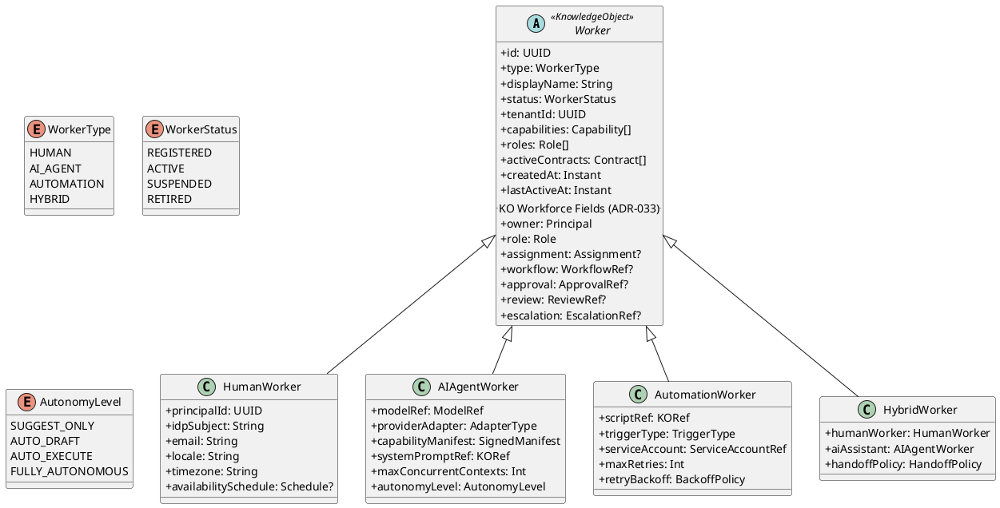

### 16.2 Core Domain Objects

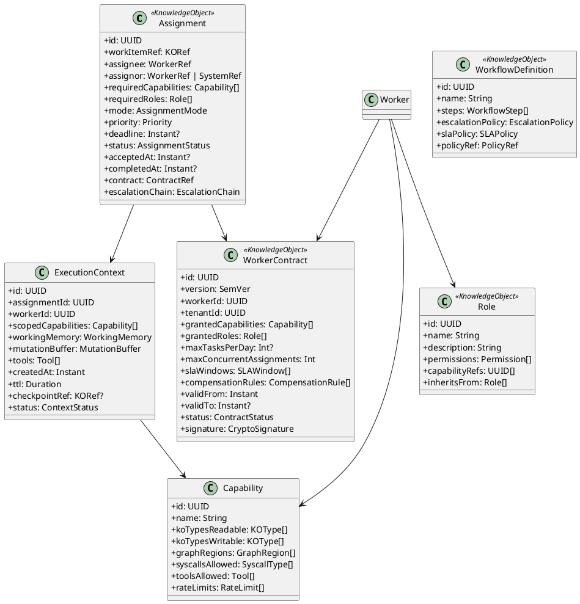

---

## 17. Worker Lifecycle & State Machine

### 17.1 Worker State Machine

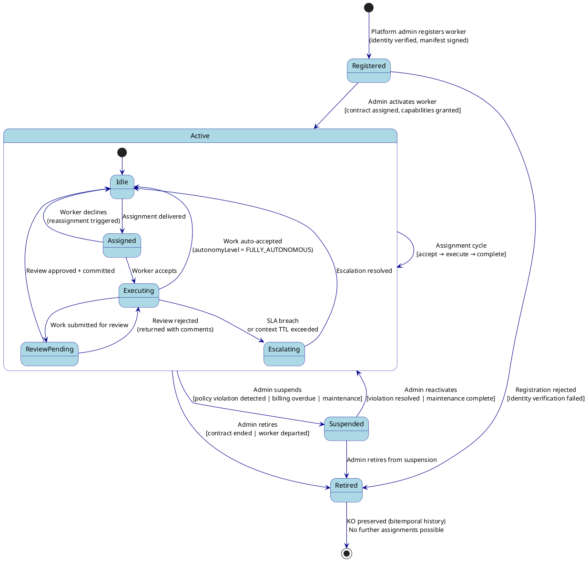

### 17.2 Assignment Lifecycle

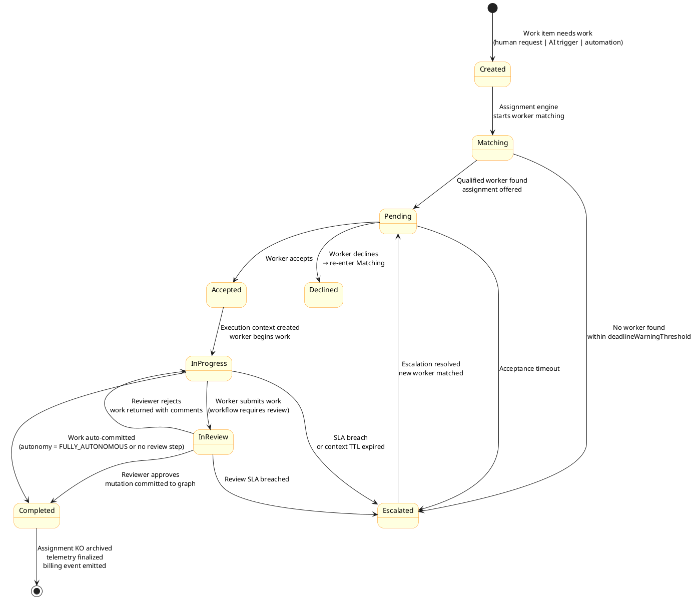

---

## 18. Worker Memory Model

### 18.1 Memory Architecture

Each Execution Context owns a **three-tier working memory** model:

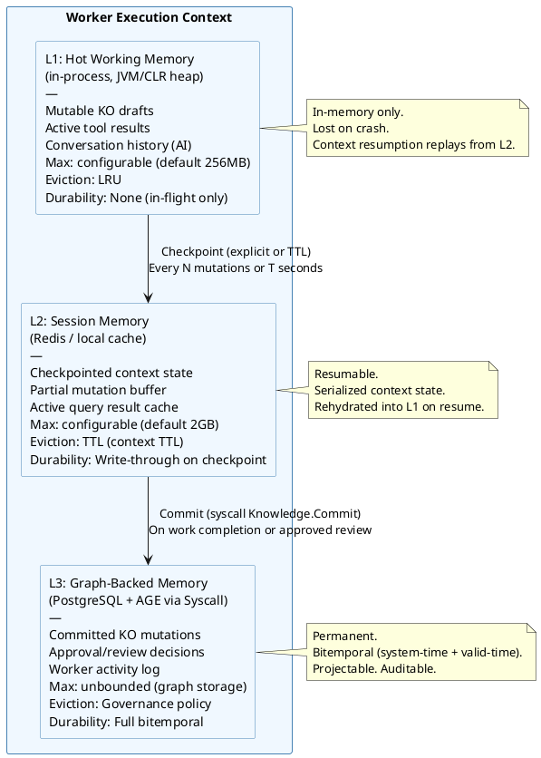

### 18.2 Memory Lifecycle Rules

- **Rule M1:** A worker NEVER reads KOs directly from L3. All reads go through the Syscall Layer which applies ABAC scoping.
- **Rule M2:** A worker NEVER writes to L3 directly. Writes accumulate in L1 mutation buffer → checkpoint to L2 → commit to L3 via `Knowledge.Commit` syscall.
- **Rule M3:** On context TTL expiry, L1 is checkpointed to L2. The worker receives a `ContextExpired` notification.
- **Rule M4:** On context resume, L2 state is rehydrated into a fresh L1. The worker SDK signals `ContextResumed`.
- **Rule M5:** On task completion (approved or auto), L2 mutations are committed to L3. L1 and L2 are cleared.
- **Rule M6:** If an AI worker context is lost (model unavailable), L2 checkpoint enables a different AI instance to resume.

---

## 19. Worker Scheduler

### 19.1 Scheduler Architecture

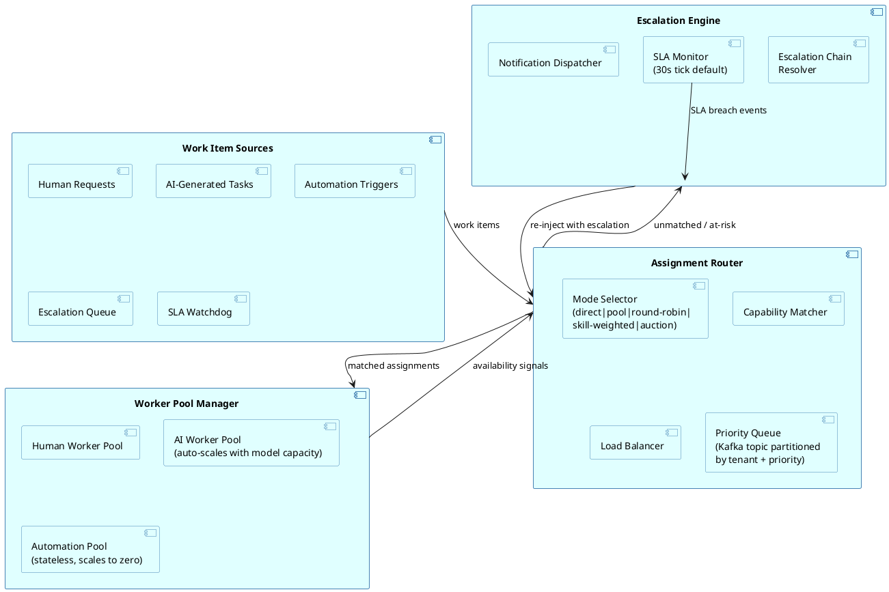

### 19.2 Scheduling Algorithm

**Assignment Engine — Default Flow:**

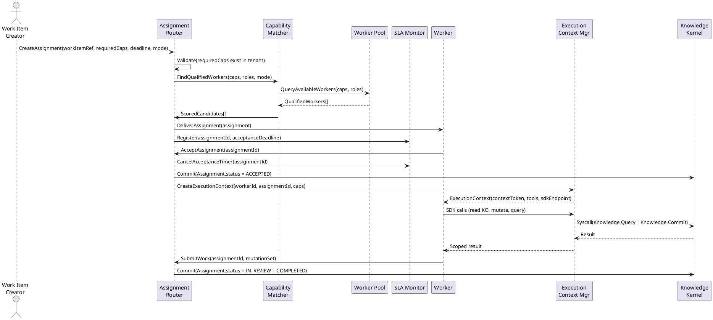

---

## 20. Worker Orchestration Engine

The Orchestration Engine manages **multi-worker workflows** — sequences of assignments where the output of one worker becomes the input of the next.

### 20.1 Workflow Execution Model

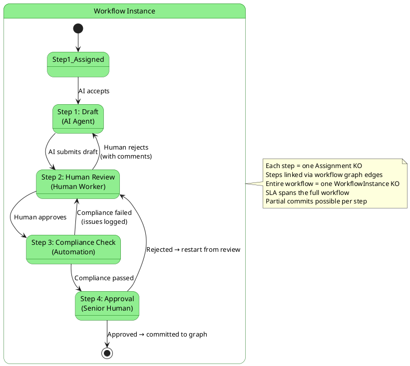

### 20.2 Workflow Step Types

| Step Type | Executor | Can Auto-Execute | Human-in-Loop Required |
|---|---|---|---|
| `Draft` | AI Agent | Yes (autonomyLevel ≥ AUTO_DRAFT) | No by default |
| `Review` | Human | No | Yes — human must approve |
| `Approval` | Human or AI (per governance policy) | Configurable | Configurable per policy |
| `ComplianceCheck` | Automation (OPA rules) | Yes | No — deterministic |
| `Escalation` | Routing logic | Yes | Triggers next level |
| `Notification` | Automation | Yes | No |
| `ExternalIntegration` | Connector (Vol 07 / A07) | Yes | No |

---

## 21. Worker Registry

### 21.1 Registry Architecture

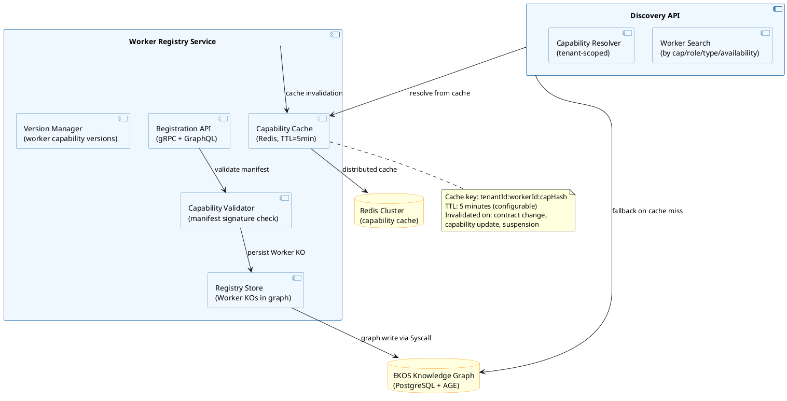

### 21.2 Registry Data Contract

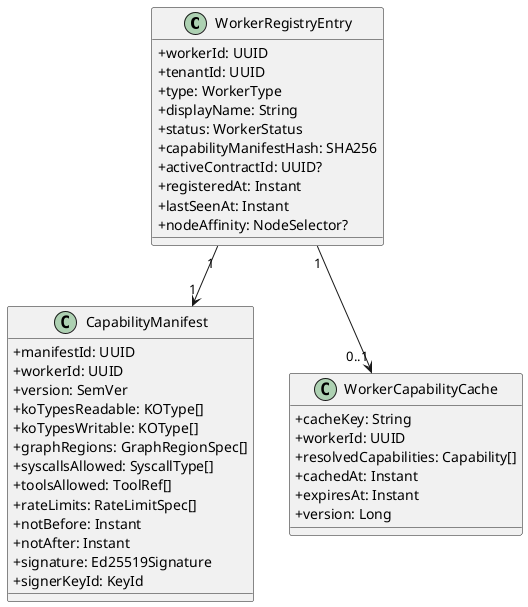

---

## 22. Worker Contract System

### 22.1 Contract Model

A Worker Contract is a **versioned, cryptographically signed KO** that governs the relationship between a worker and the EKOS platform. It is **immutable once active** — modifications create a new version; the old version is archived (Law 11).

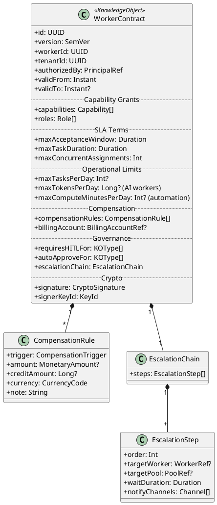

### 22.2 Contract Enforcement Flow

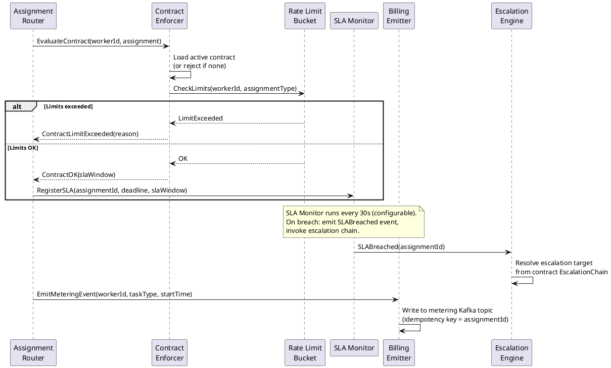

---

## 23. Worker SDK

The Worker SDK is the **only** channel through which workers interact with EKOS. It is the stable API boundary — the "Win32 of the workforce layer."

### 23.1 SDK Surface (gRPC Internal + GraphQL External)

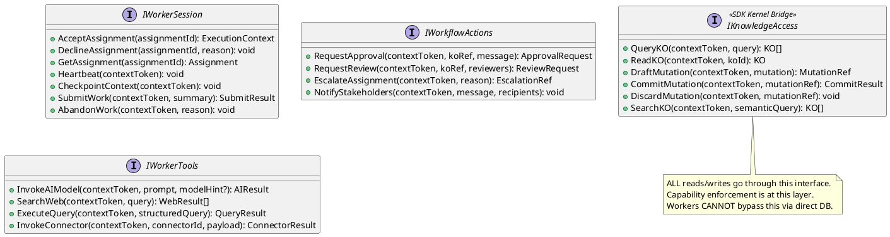

### 23.2 SDK Error Contract

| Error Code | Meaning | Worker Action |
|---|---|---|
| `CAPABILITY_DENIED` | KO type or syscall not in worker's capability | Log, abort operation, return error to caller |
| `CONTEXT_EXPIRED` | Execution context TTL elapsed | Checkpoint was auto-made; request context resume |
| `CONTRACT_LIMIT_EXCEEDED` | Daily/concurrent limit hit | Stop work; system will re-assign after limit resets |
| `SLA_BREACHED` | Assignment deadline passed | Continue work (will go into escalation); system handles |
| `KO_NOT_FOUND` | Referenced KO does not exist in worker's scope | May not exist or may be ABAC-hidden; cannot distinguish (by design) |
| `MUTATION_CONFLICT` | Another worker committed a conflicting mutation | Re-read KO and reconcile; re-draft mutation |
| `COMMIT_FAILED` | Graph write failed (transient) | Retry with exponential backoff (max 3) then report |

---

## 24. Worker Execution Pipeline

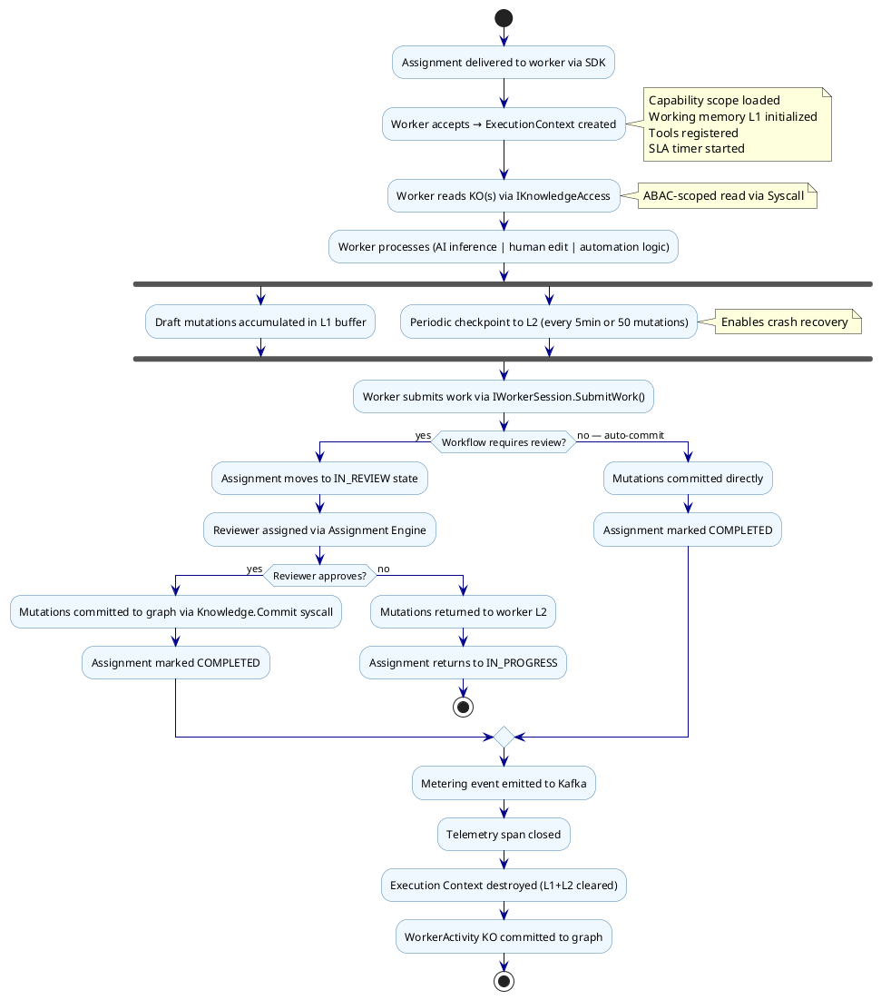

---

## 25. Worker Telemetry

### 25.1 Telemetry Schema

Every worker action produces an **immutable, append-only** telemetry record. These records are the basis for audit, governance, and billing.

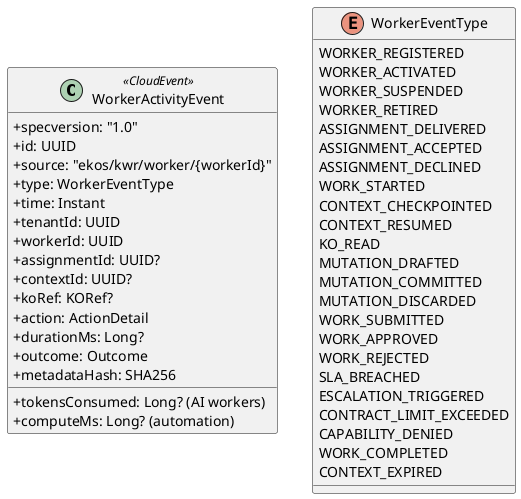

### 25.2 Telemetry Pipeline

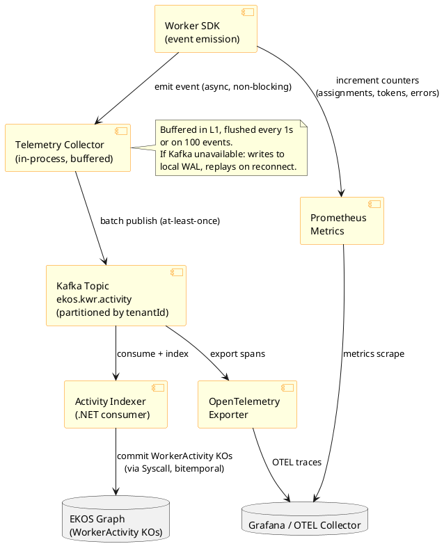

### 25.3 Key Metrics (Prometheus)

| Metric Name | Type | Labels | Description |
|---|---|---|---|
| `kwr_assignments_total` | Counter | tenant, worker_type, mode, outcome | Total assignments by type and outcome |
| `kwr_assignment_latency_ms` | Histogram | tenant, worker_type | Assignment acceptance latency (p50/p95/p99) |
| `kwr_context_creation_ms` | Histogram | tenant, worker_type | Execution context creation latency |
| `kwr_active_contexts` | Gauge | tenant, worker_type | Currently active execution contexts |
| `kwr_sla_breaches_total` | Counter | tenant, assignment_type | Total SLA breaches |
| `kwr_tokens_consumed_total` | Counter | tenant, worker_id, model | AI tokens consumed |
| `kwr_capability_denied_total` | Counter | tenant, worker_id | Capability enforcement denials |
| `kwr_contract_limit_exceeded_total` | Counter | tenant, worker_id, limit_type | Contract limit hits |

---

## 26. Worker Billing & Metering

### 26.1 Metering Architecture

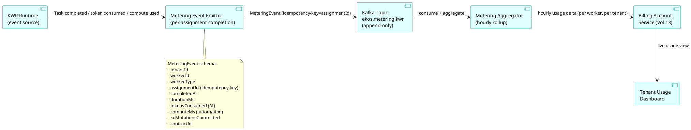

### 26.2 Billing Rules

| Worker Type | Billing Basis | Granularity |
|---|---|---|
| Human | Activity time (opt-in) or flat per-seat | Per assignment or per month |
| AI Agent | Token consumption + context duration | Per task |
| Automation | Compute minutes + KO mutations | Per execution |
| Hybrid | Combined (human time + AI tokens) | Per assignment |

**Critical design constraint:** Billing is **eventually consistent** — metering events are fire-and-forget from the runtime's perspective. The runtime MUST NOT block on billing. If the metering Kafka topic is unavailable, events are spooled to local WAL and replayed. Missing metering events are a billing dispute, not a runtime failure.

---

## 27. Worker Governance

### 27.1 Governance Policy Engine

Governance policies are authored in **OPA/Rego** and evaluated by the KWR governance layer on every significant action.

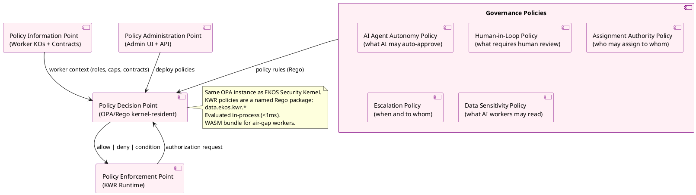

### 27.2 Sample Rego Policies

```rego
# AI agents may auto-approve KOs of type "Requirement" only if:
# 1. The requirement is in Draft status
# 2. The agent has autonomyLevel >= AUTO_EXECUTE
# 3. The KO is NOT flagged as "high-sensitivity"
package ekos.kwr.ai_autonomy

default allow_auto_approve = false

allow_auto_approve {
  input.worker.type == "AI_AGENT"
  input.worker.autonomyLevel >= "AUTO_EXECUTE"
  input.ko.type == "Requirement"
  input.ko.status == "Draft"
  not input.ko.flags[_] == "high-sensitivity"
}
```

```rego
# Human-in-the-loop is required for any KO mutation where:
# 1. KO type is "ArchitectureDecision" (ADR)
# 2. Or KO sensitivity level >= "Confidential"
package ekos.kwr.hitl

default require_human_review = false

require_human_review {
  input.mutation.koType == "ArchitectureDecision"
}

require_human_review {
  input.ko.sensitivityLevel >= "Confidential"
}
```

---

## 28. C4 Architecture

### 28.1 System Context (C4 Level 1)

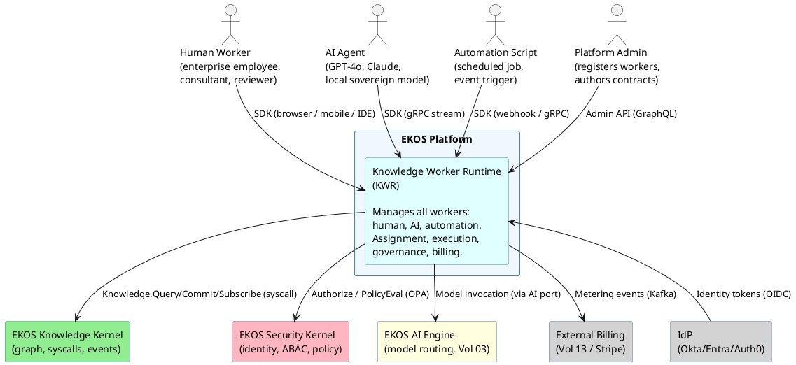

### 28.2 Container Diagram (C4 Level 2)

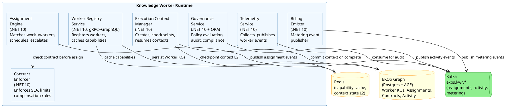

### 28.3 Component Diagram (C4 Level 3 — Assignment Engine)

```plantuml
@startuml C4_L3_AssignmentEngine
skinparam backgroundColor transparent
skinparam shadowing false
skinparam component {
  BackgroundColor AliceBlue
  BorderColor SteelBlue
}

package "Assignment Engine" {
  component "WorkItemListener\n(Kafka consumer)" as WIL
  component "QualificationFilter\n(capability + role match)" as QF
  component "LoadBalancer\n(mode-based selection)" as LB
  component "DeadlineTracker\n(in-memory heap)" as DT
  component "EscalationInvoker\n(chain resolver)" as EI
  component "SLAMonitor\n(30s tick)" as SLAM
  component "AssignmentRepository\n(graph CRUD via syscall)" as AR
  component "NotificationDispatcher\n(email/Slack/webhook)" as ND
}

WIL --> QF : work item with requirements
QF --> LB : qualified workers
LB --> AR : create Assignment KO
AR --> DT : register deadline
SLAM --> EI : breach detected
EI --> AR : update assignment (escalated)
EI --> ND : notify stakeholders
EI --> WIL : re-inject for re-matching

@enduml
```

### 28.4 Code Diagram (C4 Level 4 — Key Abstractions)

```plantuml
@startuml C4_L4_Code
skinparam classAttributeIconSize 0
skinparam backgroundColor transparent
skinparam shadowing false

interface "IAssignmentEngine" {
  + CreateAssignment(cmd: CreateAssignmentCommand): Assignment
  + AcceptAssignment(workerId, assignmentId): ExecutionContext
  + DeclineAssignment(workerId, assignmentId, reason): void
  + SubmitWork(contextToken, summary): SubmitResult
}

interface "IWorkerRegistry" {
  + RegisterWorker(cmd: RegisterWorkerCommand): Worker
  + GetWorker(workerId): Worker
  + FindQualifiedWorkers(caps, roles): Worker[]
  + UpdateWorkerStatus(workerId, status): void
}

interface "IExecutionContextManager" {
  + CreateContext(workerId, assignmentId, caps): ExecutionContext
  + ResumeContext(contextToken): ExecutionContext
  + CheckpointContext(contextToken): void
  + DestroyContext(contextToken): void
}

interface "IContractEnforcer" {
  + EvaluateAssignment(workerId, assignment): ContractEvalResult
  + RecordCompletion(workerId, assignmentId): void
  + CheckLimits(workerId): LimitStatus
}

interface "IGovernanceService" {
  + EvaluatePolicy(input: PolicyInput): PolicyDecision
  + RecordGovernanceEvent(event: GovernanceEvent): void
  + GetAuditTrail(workerId, from, to): AuditEvent[]
}

class AssignmentEngineImpl {
  - registry: IWorkerRegistry
  - contractEnforcer: IContractEnforcer
  - contextManager: IExecutionContextManager
  - governance: IGovernanceService
  - eventBus: IEventBus
  - repo: IAssignmentRepository
}

AssignmentEngineImpl ..|> IAssignmentEngine
AssignmentEngineImpl --> IWorkerRegistry
AssignmentEngineImpl --> IContractEnforcer
AssignmentEngineImpl --> IExecutionContextManager
AssignmentEngineImpl --> IGovernanceService

@enduml
```

---

## 29. Domain-Driven Design

### 29.1 Bounded Contexts

```plantuml
@startuml DDD_Context_Map
skinparam backgroundColor transparent
skinparam shadowing false
skinparam rectangle {
  BackgroundColor AliceBlue
  BorderColor SteelBlue
}

rectangle "Worker Identity\nContext\n—\nWorker, Role,\nCapability, Contract\n(Aggregate: Worker)" as WIC #LightCyan

rectangle "Assignment\nContext\n—\nAssignment, WorkItem,\nPool, EscalationChain\n(Aggregate: Assignment)" as AC #LightGreen

rectangle "Execution\nContext\n—\nExecutionContext,\nWorkingMemory,\nMutationBuffer\n(Aggregate: ExecutionContext)" as EC #LightYellow

rectangle "Governance\nContext\n—\nPolicy, GovernanceEvent,\nAuditTrail\n(Aggregate: PolicyDecision)" as GC #LavenderBlush

rectangle "Metering\nContext\n—\nMeteringEvent,\nUsageAggregate\n(Aggregate: WorkerUsage)" as MC #MistyRose

rectangle "EKOS Knowledge\nKernel Context\n(Upstream / Conformist)" as KKC #LightGray

rectangle "EKOS Security\nContext\n(Upstream / ACL)" as SKC #LightGray

WIC --> AC : Worker qualified for assignment\n(Published Language: WorkerRef)
AC --> EC : Assignment accepted → context created\n(Published Language: AssignmentRef)
EC --> GC : Governance check on mutation\n(Anti-Corruption Layer)
AC --> GC : SLA breach → governance event
EC --> MC : Work completed → metering event
EC --> KKC : Knowledge mutations (syscall)\n(Conformist — KK is upstream)
WIC --> SKC : Identity verification (ACL)

note bottom of KKC
  KWR is DOWNSTREAM of the Knowledge Kernel.
  KWR cannot change kernel APIs.
  ACL protects KWR from kernel API changes.
end note

@enduml
```

### 29.2 Aggregates

| Aggregate | Root | Invariants |
|---|---|---|
| `Worker` | `Worker` KO | A worker must have at least one active contract to receive assignments; capabilities are always derived from contract |
| `Assignment` | `Assignment` KO | An assignment must have exactly one assignee and one work item; cannot be in two non-terminal states simultaneously |
| `ExecutionContext` | `ExecutionContext` | One context per assignment per worker; TTL enforced; mutation buffer consistent with L2 |
| `WorkerContract` | `WorkerContract` KO | Immutable once active; new version required for any change; no overlapping active contracts per worker |
| `WorkflowInstance` | `WorkflowInstance` KO | Steps execute in defined order; no step skips; all completion events recorded |

---

## 30. Data Architecture

### 30.1 Conceptual Data Model

```plantuml
@startuml Conceptual_Data_Model
skinparam classAttributeIconSize 0
skinparam backgroundColor transparent
skinparam shadowing false

entity "Worker" as W
entity "Role" as R
entity "Capability" as C
entity "WorkerContract" as WC
entity "Assignment" as A
entity "WorkItem\n(any KO)" as WI
entity "ExecutionContext" as EC
entity "WorkflowInstance" as WF
entity "WorkflowStep" as WFS
entity "GovernanceEvent" as GE
entity "MeteringEvent" as ME

W }o--|| WC : governed by
W }o--o{ R : has roles
W }o--o{ C : has capabilities
A ||--|| W : assigned to
A ||--|| WI : performs work on
A ||--o| EC : has context
A ||--o| WF : part of workflow
WF ||--|{ WFS : contains
WFS ||--|| A : is one assignment
GE }o--|| A : governs
ME }o--|| A : meters

@enduml
```

### 30.2 Physical Data Model (Key Tables)

All Worker KOs are stored in the EKOS knowledge graph (PostgreSQL + AGE). Below are the key node schemas:

```plantuml
@startuml Physical_Schema
skinparam classAttributeIconSize 0
skinparam backgroundColor transparent
skinparam shadowing false

class "ko_worker\n(graph node label: Worker)" {
  + ko_id: uuid PK
  + tenant_id: uuid NOT NULL INDEX
  + worker_type: varchar(20) NOT NULL
  + display_name: varchar(255) NOT NULL
  + status: varchar(20) NOT NULL
  + capability_manifest_hash: bytea
  + active_contract_id: uuid FK
  + idp_subject: varchar(500)
  + autonomy_level: varchar(30)
  + system_time_start: timestamptz NOT NULL
  + system_time_end: timestamptz NOT NULL DEFAULT '9999-12-31'
  + valid_time_start: timestamptz NOT NULL
  + valid_time_end: timestamptz NOT NULL DEFAULT '9999-12-31'
  + owner: uuid NOT NULL (KO field ADR-033)
  + role_ref: uuid (KO field ADR-033)
  + assignment_ref: uuid (KO field ADR-033)
}

class "ko_assignment\n(graph node label: Assignment)" {
  + ko_id: uuid PK
  + tenant_id: uuid NOT NULL INDEX
  + work_item_ko_id: uuid NOT NULL
  + assignee_ko_id: uuid NOT NULL INDEX
  + assignor_ko_id: uuid NOT NULL
  + mode: varchar(30) NOT NULL
  + priority: smallint NOT NULL
  + status: varchar(30) NOT NULL INDEX
  + deadline: timestamptz
  + accepted_at: timestamptz
  + completed_at: timestamptz
  + contract_id: uuid NOT NULL
  + system_time_start: timestamptz NOT NULL
  + system_time_end: timestamptz NOT NULL DEFAULT '9999-12-31'
}

class "ko_execution_context\n(Redis hash + graph checkpoint)" {
  + context_id: uuid PK
  + assignment_id: uuid NOT NULL
  + worker_id: uuid NOT NULL
  + scoped_capabilities: jsonb NOT NULL
  + status: varchar(20) NOT NULL
  + ttl_expires_at: timestamptz NOT NULL
  + checkpoint_ko_id: uuid (graph reference)
  + mutation_count: int NOT NULL DEFAULT 0
}

@enduml
```

### 30.3 Graph Edge Schema

| Edge Label | Source | Target | Properties |
|---|---|---|---|
| `ASSIGNED_TO` | Assignment | Worker | `assignedAt`, `mode` |
| `WORKS_ON` | Assignment | any KO | `role`, `assignmentType` |
| `GOVERNED_BY` | Worker | WorkerContract | `activeSince` |
| `HAS_ROLE` | Worker | Role | `grantedAt`, `grantedBy` |
| `HAS_CAPABILITY` | Worker | Capability | `grantedAt`, `scope` |
| `PART_OF` | Assignment | WorkflowInstance | `stepOrder` |
| `ESCALATED_TO` | Assignment | Worker | `escalationReason`, `escalatedAt` |
| `OWNED_BY` | any KO | Worker | `ownedSince` (ADR-033 field) |

---

## 31. API Architecture

### 31.1 Internal gRPC API (Tier 1 — Syscall Layer)

```plantuml
@startuml gRPC_API
skinparam backgroundColor transparent
skinparam shadowing false
skinparam interface {
  BackgroundColor LightCyan
  BorderColor SteelBlue
}

note as N1
service WorkerRuntimeService {
  rpc RegisterWorker(RegisterWorkerRequest) returns (RegisterWorkerResponse);
  rpc ActivateWorker(ActivateWorkerRequest) returns (ActivateWorkerResponse);
  rpc DeliverAssignment(DeliverAssignmentRequest) returns (stream AssignmentEvent);
  rpc AcceptAssignment(AcceptAssignmentRequest) returns (ExecutionContextResponse);
  rpc DeclineAssignment(DeclineAssignmentRequest) returns (DeclineResponse);
  rpc Heartbeat(HeartbeatRequest) returns (HeartbeatResponse);
  rpc QueryKO(QueryKORequest) returns (QueryKOResponse);
  rpc DraftMutation(DraftMutationRequest) returns (MutationRef);
  rpc CommitMutation(CommitMutationRequest) returns (CommitResult);
  rpc SubmitWork(SubmitWorkRequest) returns (SubmitResult);
  rpc CheckpointContext(CheckpointRequest) returns (CheckpointResponse);
}
end note

@enduml
```

### 31.2 External GraphQL API (Tier 2 — Admin + Integrators)

```plantuml
@startuml GraphQL_Schema
skinparam backgroundColor transparent
skinparam shadowing false

note as N1
type Query {
  worker(id: ID!): Worker
  workers(tenantId: ID!, filter: WorkerFilter): WorkerConnection
  assignment(id: ID!): Assignment
  assignments(workerId: ID, status: AssignmentStatus): AssignmentConnection
  workerActivity(workerId: ID!, from: DateTime!, to: DateTime!): [WorkerActivityEvent]
  workerContract(workerId: ID!): WorkerContract
}

type Mutation {
  registerWorker(input: RegisterWorkerInput!): RegisterWorkerPayload
  activateWorker(workerId: ID!): ActivateWorkerPayload
  suspendWorker(workerId: ID!, reason: String!): SuspendWorkerPayload
  createAssignment(input: CreateAssignmentInput!): CreateAssignmentPayload
  createWorkerContract(input: WorkerContractInput!): WorkerContractPayload
  updateWorkerCapabilities(workerId: ID!, manifest: CapabilityManifestInput!): UpdateCapabilitiesPayload
}

type Subscription {
  assignmentUpdated(workerId: ID!): AssignmentEvent
  workerActivityStream(tenantId: ID!): WorkerActivityEvent
  slaAlert(tenantId: ID!): SLAAlertEvent
}
end note

@enduml
```

### 31.3 API Versioning

- **Internal gRPC:** Protobuf backwards-compatible; new fields are optional; field numbers never reused. Major version bump triggers a 24-month deprecation window (ADR-045).
- **External GraphQL:** Additive changes (new fields/types) are non-breaking. Removing or renaming fields requires `@deprecated` annotation + minimum 12-month transition period.
- **Events (CloudEvents):** Event `type` includes version (`ekos.kwr.worker.registered.v1`). New event types are additive; consumers must ignore unknown types.

---

## 32. Event Architecture

### 32.1 Event Catalog

| Event Type | Producer | Consumers | Kafka Topic | Ordering |
|---|---|---|---|---|
| `ekos.kwr.worker.registered.v1` | Worker Registry | Governance, Telemetry | `ekos.kwr.lifecycle` | By workerId |
| `ekos.kwr.worker.activated.v1` | Worker Registry | Assignment Engine | `ekos.kwr.lifecycle` | By workerId |
| `ekos.kwr.worker.suspended.v1` | Worker Registry | Assignment Engine, Telemetry | `ekos.kwr.lifecycle` | By workerId |
| `ekos.kwr.assignment.created.v1` | Assignment Engine | Workers (via SDK stream) | `ekos.kwr.assignments` | By tenantId |
| `ekos.kwr.assignment.accepted.v1` | Assignment Engine | Context Manager, Contract Enforcer | `ekos.kwr.assignments` | By assignmentId |
| `ekos.kwr.assignment.completed.v1` | Assignment Engine | Telemetry, Billing Emitter | `ekos.kwr.assignments` | By assignmentId |
| `ekos.kwr.sla.breached.v1` | SLA Monitor | Escalation Engine, Telemetry, Notifications | `ekos.kwr.governance` | By assignmentId |
| `ekos.kwr.capability.denied.v1` | Execution Context Mgr | Security (A06), Governance | `ekos.kwr.security` | By workerId |
| `ekos.kwr.metering.task_completed.v1` | Billing Emitter | Billing Service (Vol 13) | `ekos.metering.kwr` | By tenantId |

### 32.2 Event Idempotency

All KWR events carry a stable idempotency key:
- Lifecycle events: `workerId + eventType + timestamp` (deduplicated within 1-minute window)
- Assignment events: `assignmentId + statusTransition` (exactly-once semantics via Kafka transactions)
- Metering events: `assignmentId + completionTimestamp` (Kafka exactly-once, idempotent aggregator)

### 32.3 Dead Letter Queue Handling

| Topic | DLQ Topic | Retry Policy | After DLQ |
|---|---|---|---|
| `ekos.kwr.assignments` | `ekos.kwr.assignments.dlq` | 3× exponential (30s, 90s, 270s) | Alert + manual intervention |
| `ekos.metering.kwr` | `ekos.metering.kwr.dlq` | 5× exponential | Billing audit alert; metering gap logged |
| `ekos.kwr.governance` | `ekos.kwr.governance.dlq` | 3× | Governance gap alert; immutable record of failure |

---

## 33. Security Architecture

### 33.1 Trust Boundaries

```plantuml
@startuml Trust_Boundaries
skinparam backgroundColor transparent
skinparam shadowing false
skinparam rectangle {
  BorderColor Red
  BorderThickness 2
}

rectangle "Trust Zone: EKOS Kernel\n(highest trust — internal only)" as TZ_KERNEL #LightGreen {
  rectangle "Knowledge Kernel" as KK
  rectangle "Security Kernel\n(OPA PDP)" as SK
}

rectangle "Trust Zone: KWR Services\n(verified service identity — mTLS)" as TZ_KWR #LightCyan {
  rectangle "Worker Registry" as WR
  rectangle "Assignment Engine" as AE
  rectangle "Execution Context Mgr" as ECM
  rectangle "Governance Service" as GS
}

rectangle "Trust Zone: Worker SDK\n(authenticated via IdP token + capability manifest)" as TZ_SDK #LightYellow {
  rectangle "Human Worker\n(browser / IDE)" as HW
  rectangle "AI Agent Worker\n(service-to-service, signed key)" as AIW
  rectangle "Automation Worker\n(service account)" as AUTO
}

rectangle "Untrusted Zone:\nExternal IdP, Billing, Connectors" as TZ_EXT #Pink {
  rectangle "IdP (Okta/Entra)" as IDP
  rectangle "Billing / Vol 13" as BILL
}

TZ_SDK --> TZ_KWR : HTTPS/gRPC-TLS\nJWT (human) | signed API key (AI/auto)
TZ_KWR --> TZ_KERNEL : mTLS internal\nService account identity
TZ_KWR --> TZ_EXT : Outbound only\nVerified TLS
TZ_EXT --> TZ_KWR : Identity tokens only (OIDC)

note right of TZ_SDK
  AI workers: capability manifest
  signed with tenant private key.
  Verified on EVERY syscall.
  Replay protection: nonce + timestamp.
end note

@enduml
```

### 33.2 Threat Model (STRIDE)

| Threat | Category | Vector | Mitigation |
|---|---|---|---|
| AI prompt injection → capability escape | Tampering | Malicious KO content causes AI agent to act outside scope | All reads/writes via Worker SDK; capability enforcement at syscall layer, not AI layer |
| Capability manifest forgery | Spoofing | Attacker crafts a manifest granting elevated permissions | Manifests signed with tenant private key (Ed25519); verified on every context creation |
| Assignment replay | Spoofing | Replay a valid assignment token to create duplicate contexts | Assignment IDs are single-use; accepted state is committed before context creates; nonce on all tokens |
| Worker context exfiltration | Information Disclosure | Worker extracts data outside its scope via batched queries | ABAC scoping at syscall layer; per-query graph region enforcement; rate limits |
| SLA manipulation | Tampering | Worker acknowledges assignment but doesn't work | Heartbeat monitoring; execution events required; no heartbeat = escalation trigger |
| Metering bypass | Tampering | Worker completes tasks but metering events not sent | Metering events committed before context destroyed; missing metering = audit alert |
| Governance policy bypass | Elevation of Privilege | Worker submits work to wrong workflow step | Workflow step validation in Assignment Engine; OPA policy evaluation on every submit |

### 33.3 Security Controls Summary

| Control | Implementation |
|---|---|
| Authentication | OIDC JWT (human) + signed API key (AI/auto) verified by Security Kernel |
| Authorization | ABAC via OPA/Rego; enforced at Syscall Layer |
| Transport | TLS 1.3 minimum; mTLS for service-to-service |
| Capability manifest integrity | Ed25519 signature; tenant KMS key rotation (ADR-036) |
| Audit | Every worker event → immutable Kafka journal |
| Secrets | No secrets in code; KMS-managed (ADR-038) |
| Tenant isolation | tenantId on every KO, every event, every query; enforced by syscall scope |
| AI safety boundary | AI workers access EKOS only via Worker SDK; zero direct graph access |

---

## 34. Observability

### 34.1 Logging

**Log levels and targets:**

| Level | When | Target |
|---|---|---|
| `INFO` | Assignment created, accepted, completed; worker state changes | Structured JSON → OTEL Collector → centralized log store |
| `WARN` | SLA approaching deadline (80%); capability near-limit | Same |
| `ERROR` | SLA breached; capability denied; commit failed; DLQ message | Same + PagerDuty alert |
| `AUDIT` | Every mutation committed; every governance decision; every capability denial | Immutable audit log (Kafka + graph) — NEVER purged within retention period |

**All logs MUST include:** `traceId`, `spanId`, `tenantId`, `workerId`, `assignmentId` (where applicable).

### 34.2 Distributed Tracing

Every worker SDK call initiates an OpenTelemetry trace span:
```
kwr.assignment.accept
  └─ kwr.context.create
       └─ kwr.knowledge.read (×N)
       └─ kwr.mutation.draft (×N)
       └─ kwr.context.checkpoint
  └─ kwr.work.submit
       └─ kwr.governance.evaluate
       └─ kwr.mutation.commit
       └─ kwr.metering.emit
```

### 34.3 Health Checks

| Endpoint | Type | Checks |
|---|---|---|
| `GET /healthz/live` | Liveness | Process alive; no deadlock detected |
| `GET /healthz/ready` | Readiness | Kafka connected; graph reachable; OPA loaded; Redis connected |
| `GET /healthz/startup` | Startup | Policies loaded; capability cache warm; Kafka topics exist |

### 34.4 SLO Definitions

| SLO | Target | Measurement |
|---|---|---|
| Assignment delivery latency P99 < 500ms | 99.9% of assignments | `kwr_assignment_latency_ms` histogram |
| Context creation P99 < 1s | 99.9% of contexts | `kwr_context_creation_ms` histogram |
| Telemetry completeness | 100% of completed assignments have metering event | Audit reconciliation job (nightly) |
| KWR availability | 99.95% | Uptime monitor on assignment endpoint |

---

## 35. Deployment Architecture

### 35.1 Deployment Profiles

```plantuml
@startuml Deployment_Profiles
skinparam backgroundColor transparent
skinparam shadowing false
skinparam node {
  BackgroundColor AliceBlue
  BorderColor SteelBlue
}

node "SaaS Multi-Tenant\n(shared cluster per region)" {
  component "KWR Services\n(K8s Deployment, HPA)" as KWR_SAAS
  component "Kafka Cluster\n(managed, MSK/Confluent)" as KF_SAAS
  component "Redis Cluster\n(managed, ElastiCache)" as RC_SAAS
  component "Postgres + AGE\n(managed, RDS)" as DB_SAAS
}

node "On-Prem / Dedicated\n(customer's K8s cluster)" {
  component "KWR Services\n(Helm chart)" as KWR_ONPREM
  component "Kafka\n(customer-managed)" as KF_ONPREM
  component "Redis Sentinel" as RC_ONPREM
  component "Postgres + AGE\n(customer-managed)" as DB_ONPREM
}

node "Air-Gapped\n(no internet, sovereign AI)" {
  component "KWR Services\n(OCI bundle)" as KWR_AIRGAP
  component "Kafka\n(bundled)" as KF_AIRGAP
  component "Redis\n(bundled)" as RC_AIRGAP
  component "Postgres + AGE\n(bundled)" as DB_AIRGAP
  component "OPA WASM\n(policy bundle)" as OPA_AIRGAP
  component "Local AI Worker\n(ollama / sovereign model)" as AI_AIRGAP
}

@enduml
```

### 35.2 Kubernetes Resources

| Resource | Kind | Replicas | Notes |
|---|---|---|---|
| `kwr-assignment-engine` | Deployment + HPA | 2–20 | HPA on Kafka consumer lag |
| `kwr-worker-registry` | Deployment | 2–4 | Stateless; scale on CPU |
| `kwr-execution-context-mgr` | Deployment + HPA | 2–10 | HPA on active contexts count |
| `kwr-governance-service` | Deployment | 2–4 | OPA sidecar per pod |
| `kwr-telemetry-service` | Deployment | 2–4 | Kafka producer |
| `kwr-billing-emitter` | Deployment | 2–4 | Kafka producer, exactly-once |

### 35.3 Air-Gap Specifics

In air-gap mode, the Worker Registry is seeded from a signed worker manifest bundle (`.ekr` format). AI workers use sovereign local models via the AI Engine local adapter (Vol 03 §8). OPA policies are compiled to WASM and bundled with the OCI image. No internet connectivity is required after initial provisioning.

---

## 36. Testing Strategy

| Test Type | Scope | Tool | When |
|---|---|---|---|
| Unit | Individual services, Assignment Engine algorithm | xUnit (.NET), Moq | Every commit |
| Integration | Service-to-Kafka, Service-to-Postgres, Service-to-OPA | Testcontainers | Every commit |
| Contract | SDK gRPC contract, GraphQL schema stability | Pact, gRPC-reflection | Every commit |
| Component | Full KWR stack (Docker Compose) | Custom harness | PR gate |
| End-to-End | Human worker assigns task → AI agent executes → reviewer approves → committed | Playwright + custom SDK | Nightly |
| Performance | Assignment latency at 10K workers, 1K concurrent | k6 | Weekly |
| Chaos | Kafka down, Postgres failover, OPA WASM timeout | Chaos Mesh | Monthly |
| Security | Capability escape, prompt injection, manifest forgery | Custom red-team suite | Per release |
| Mutation | Core assignment matching logic | Stryker.NET | Per release |

**Critical test scenario — AI agent capability boundary:**
1. Register an AI worker with read-only capability on `Requirement` KOs
2. Have the AI agent attempt to write a `Requirement` KO
3. Expect: `CAPABILITY_DENIED` error, capability denial event in telemetry, no mutation in graph
4. Verify: event logged to security audit topic, assignment not terminated (worker can continue reading)

---

## 37. Performance Targets

| Operation | P50 | P95 | P99 | Maximum |
|---|---|---|---|---|
| Assignment delivery (created → worker notified) | 50ms | 200ms | 500ms | 2s (SLA breach) |
| Execution context creation | 100ms | 500ms | 1s | 5s |
| Worker SDK `ReadKO` call | 5ms | 20ms | 50ms | 200ms |
| Worker SDK `CommitMutation` call | 10ms | 50ms | 100ms | 500ms |
| Worker registration | 200ms | 800ms | 2s | 10s |
| Capability cache hit | 1ms | 5ms | 10ms | 50ms |
| Governance policy evaluation (OPA) | 2ms | 10ms | 20ms | 100ms |
| Assignment engine matching (1K workers) | 20ms | 80ms | 200ms | 1s |

**Scalability targets:**
- 10,000 concurrent active workers per tenant (horizontal scaling)
- 1,000 new assignments per second (Kafka-backed queue absorbs burst)
- 100,000 Worker KOs in registry (graph index on tenantId + status + capabilities)

---

## 38. Backward & Forward Compatibility

### Backward Compatibility

- **Worker KO schema:** All new fields are nullable with defaults. No existing field is ever renamed or removed — create a new field and deprecate the old one with a migration note.
- **gRPC API:** All new Protobuf fields are optional. Field numbers are never reused. New RPCs are additive.
- **GraphQL API:** `@deprecated` directive + 12-month migration window for any removed field.
- **Events:** New event types and new fields on existing events are additive. Consumers MUST use schema-forward deserialization (ignore unknown fields).
- **OPA policies:** Policy changes go through a staged rollout — `shadow mode` (log-only) before `enforce mode`.

### Forward Compatibility

- **Context serialization:** ExecutionContext checkpoints use versioned JSON envelopes. A future context manager can read older checkpoints.
- **Worker contract schema:** Contracts are versioned KOs. Future contract features are additive fields. No breaking contract changes — new version, new capabilities.

---

## 39. Migration Strategy

### 39.1 ESIP → EKOS Migration (KWR Specific)

Per A10, KWR activates at **Step 4** of the strangler-fig migration (after storage port, widgets, and H3 convergence are complete):

```plantuml
@startuml KWR_Migration_Steps
skinparam backgroundColor transparent
skinparam shadowing false
skinparam activity {
  BackgroundColor AliceBlue
  BorderColor SteelBlue
}

start

:Step 0 (A10-008)\nPre-deploy security — keys rotated, Firestore hardened;

:Step 1 (A10-009)\nStorage port in place — all KO access via repository port;

:Step 2 (A10-010)\nWidgets are graph-backed projections;

:Step 3 (A10-011)\nH3 convergence — one Requirement KO type;

:Step 4 — KWR Activation (this document)\n---\nRegister existing human users as Worker KOs\n(type=Human, contract=platform-default)\nPopulate workforce fields on all existing KOs\n(owner=creator, role=default-author)\nEnable assignment engine for new work items\nFeature-flagged: 'kwrEnabled' (default OFF);

:Step 5 (A10-013)\nAI port + Acquisition;

:Step 6 (A10-014)\n.NET server-side enforcement;

:Step 7 (A10-015)\nFull Postgres+AGE kernel, ESIP = first EKOS app;

stop

@enduml
```

### 39.2 Data Backfill for KWR Fields

All existing KOs in Firestore/graph will have workforce fields backfilled during the Step 4 migration:
- `owner` = the `createdBy` user from existing metadata (or `system-migration` if unknown)
- `role` = `role:default-author` (a reserved role created during migration)
- All other KWR fields = null (not assigned, not in workflow)

This is a zero-downtime migration: fields are added to all KOs in a single batch job with idempotency (re-runnable). Verified by count + spot-check before the feature flag flips.

---

## 40. Patent Analysis

| Family | Mechanism | Novelty | Prior Art Risk | Action |
|---|---|---|---|---|
| **P-KWR-01: Unified Human-AI Worker Runtime** | A single assignment engine, contract system, and execution context abstraction that treats human, AI, and automation workers identically at the platform layer | AI agents and humans are typically governed by completely separate systems; unified governance is novel | Medium (workflow orchestration prior art) | Draft patent — focus on unified contract+governance, not the workers themselves |
| **P-KWR-02: Capability-Scoped AI Execution Context** | A runtime execution context that enforces an AI agent's capability scope at the syscall layer — the AI cannot read, write, or invoke outside its declared capability manifest regardless of model instructions | LLM sandboxing is typically application-level; syscall-deep enforcement is novel | Low | Draft patent — claim the syscall-enforced capability boundary specifically |
| **P-KWR-03: Bitemporal Worker Contract KO** | Worker contracts as versioned, bitemporal Knowledge Objects with cryptographic immutability and policy-queryability — contracts as knowledge, not configuration | Contracts as queryable graph-resident KOs are novel | Low | Draft patent |
| **P-KWR-04: Knowledge Worker Registry with Capability Manifest Signing** | Cryptographically signed capability manifests that govern what a worker (especially AI) may do — verified on every syscall | Signed capability manifests for AI workers in a knowledge OS context are novel | Medium (code signing prior art) | File defensively |
| **P-KWR-05: Prompt-Free AI Worker Assignment** | AI workers receive work via a structured Assignment KO + ExecutionContext (with scoped KO graph) rather than a natural-language prompt — the knowledge graph IS the prompt | Nearly all current AI agent frameworks use natural language prompts; structured graph-based assignment is novel | Low | Draft patent — this is the "Law 6: promptless AI" realization |

---

## 41. ADR References

| ADR | Decision | Impact on KWR |
|---|---|---|
| ADR-001 | Evolve ESIP behind ports | KWR activates at Step 4 of strangler-fig; not before Steps 1–3 complete |
| ADR-002 | .NET Core 10 + Rust backend | KWR services are .NET 10 microservices |
| ADR-019 | PostgreSQL + Apache AGE for graph | Worker KOs stored in AGE graph |
| ADR-020 | Kafka for event streaming | All KWR events via Kafka topics |
| ADR-027 | OPA/Rego for policy | KWR governance policies are Rego; evaluated in-process |
| ADR-033 | KWR fields reserved on every KO | KWR has zero schema migration cost when activated |
| ADR-036 | Crypto-agility | Capability manifests signed with Ed25519; rotation path exists |
| ADR-037 | Pluggable IdP | Human worker identity via OIDC; no shadow identity store |
| ADR-038 | Secrets via KMS | Worker API keys and signing keys in KMS, not in code |
| ADR-047 | Strangler-fig migration | KWR activates at Step 4 |
| ADR-050 | Representation Independence | Worker activity is KO-based (WorkerActivity KO), not stored as a report |

---

## 42. Future Evolution

| Phase | Evolution |
|---|---|
| P2 (Platform Foundation) | Worker memory L3 migrates from Firestore to Postgres+AGE (Step 7, A10); Worker KOs become full CQRS projections |
| P3 (Consumer) | Worker marketplace preview; external AI agent registration; Worker SDK published as open package |
| Frontier/KWR | Full Workforce Exchange (separate product); advanced AI worker autonomy tiers; inter-tenant worker sharing; AI-authored worker contracts |
| 15-year | Worker contract schema evolves via additive KO versioning; new worker archetypes added as adapters; governance policies evolve in Rego without runtime changes |

---

## 43. Open Questions

| ID | Question | Owner | Impact |
|---|---|---|---|
| OQ-A12-01 | Should AI worker capability manifests use WASM sandboxing (WasmEdge) for stronger isolation vs syscall enforcement? | Security Architect | High — affects AI worker execution model in P2 |
| OQ-A12-02 | What is the correct model for inter-tenant workers? (A consultant works across tenants.) | Platform Architect | Medium — needs its own ACL design |
| OQ-A12-03 | Auction assignment mode: should bidding be real-time or asynchronous? | Product | Low — P3 feature; design at P3 |
| OQ-A12-04 | Worker execution context TTL for long-running human tasks (multi-day): how to handle without forcing re-authentication every 24h? | UX + Security | Medium — OAuth refresh token model needs design |
| OQ-A12-05 | Should the Worker SDK have a browser-native (WASM) version for offline human workers? | Platform Architect | Low — P3 / air-gap edge case |

---

## 44. Implementation Checklist

Use this checklist to verify A12 implementation completeness. Every item must be ✅ before KWR is considered ready for Step 4 activation.

### Infrastructure
- [ ] Kafka topics created: `ekos.kwr.lifecycle`, `ekos.kwr.assignments`, `ekos.kwr.governance`, `ekos.kwr.security`, `ekos.metering.kwr`
- [ ] Redis cluster configured with correct TTLs and eviction policy
- [ ] OPA policies deployed (`data.ekos.kwr.*` package)
- [ ] OPA WASM bundle built for air-gap deployment
- [ ] KWR services deployed to K8s with HPA configured
- [ ] mTLS configured between KWR services and Knowledge Kernel

### Data
- [ ] Worker KO schema deployed to graph (AGE node labels + indexes)
- [ ] Assignment KO schema deployed
- [ ] WorkerContract KO schema deployed
- [ ] WorkflowInstance KO schema deployed
- [ ] `ko_worker` indexes on `tenant_id`, `status`, `worker_type`
- [ ] Graph edges registered: ASSIGNED_TO, WORKS_ON, GOVERNED_BY, HAS_ROLE, HAS_CAPABILITY, OWNED_BY

### Registry
- [ ] Worker Registry gRPC service live
- [ ] Capability manifest signing key provisioned in KMS
- [ ] Capability validation on registration functional
- [ ] Redis capability cache warm (TTL=5min)
- [ ] Worker discovery API returning correct ABAC-scoped results

### Assignment Engine
- [ ] All five assignment modes implemented and tested (direct, pool, round-robin, skill-weighted; auction deferred to P3)
- [ ] SLA Monitor running at configurable tick interval (default 30s)
- [ ] Escalation chain resolver functional
- [ ] Dead letter queue handlers active

### Execution Context
- [ ] Context creation < 1s P99 under load test
- [ ] Checkpoint to L2 (Redis) working
- [ ] Context resume from L2 working (worker can close browser and resume)
- [ ] Capability enforcement at SDK layer functional (CAPABILITY_DENIED returns correctly)
- [ ] Context TTL eviction working

### Contract Enforcement
- [ ] SLA window enforcement active
- [ ] Rate limit enforcement active
- [ ] Contract version immutability enforced
- [ ] SLABreached event emitted on breach

### Governance
- [ ] OPA policy evaluation < 5ms P99
- [ ] All governance events → Kafka topic
- [ ] Audit trail queryable via GraphQL API
- [ ] AI autonomy policy functional (test: AI auto-approves Draft Requirement but not Confidential ADR)
- [ ] HITL policy functional (test: human review required for ArchitectureDecision type)

### Telemetry
- [ ] All WorkerEventType variants emitting correctly
- [ ] OpenTelemetry spans covering full assignment lifecycle
- [ ] Prometheus metrics all active and labeled correctly
- [ ] Health check endpoints (live/ready/startup) responding correctly
- [ ] Grafana dashboard created with key SLO panels

### Billing
- [ ] Metering events emitting on task completion
- [ ] Idempotency key preventing duplicate metering events
- [ ] Local WAL spool for Kafka-unavailable scenarios
- [ ] Reconciliation job running nightly (metering completeness check)

### Security
- [ ] Capability manifest signature verification active on every context creation
- [ ] AI worker SDK-only access enforced (no direct graph path exists)
- [ ] Tenant isolation enforced in all queries (tenantId filter)
- [ ] Security audit events emitting on CAPABILITY_DENIED
- [ ] Secrets in KMS; zero secrets in code/config files

### Migration (Step 4 specific)
- [ ] KWR feature flag `kwrEnabled` in featureFlags.ts (default OFF)
- [ ] Existing users backfilled as Human Worker KOs
- [ ] Workforce fields backfilled on all existing KOs
- [ ] Backfill migration is idempotent and verified (counts match)
- [ ] Feature flag flip tested: system works in both states

### Testing
- [ ] Unit test coverage ≥ 80% on assignment engine core
- [ ] Integration tests for Kafka, Postgres, OPA interactions
- [ ] Contract tests for gRPC and GraphQL APIs
- [ ] End-to-end test: human→AI→reviewer→committed workflow
- [ ] Performance test: 10K workers, 1K assignments/sec
- [ ] Security test: AI capability escape attempt → CAPABILITY_DENIED

---

_This document was written under **GADS v1.0**. A new team of senior architects and engineers must be able to build the complete KWR subsystem from this document without asking a single architectural question. If any question arises, this document is incomplete — raise it in §43 and update accordingly._

_**Document status:** Complete draft. Requires team review before implementation begins._
_**Next architecture document:** A13 — Knowledge Runtime Architecture (synthesis of Book 2 + Vol 18/22/23 for implementation clarity) | A15 — Runtime Distribution Architecture_
