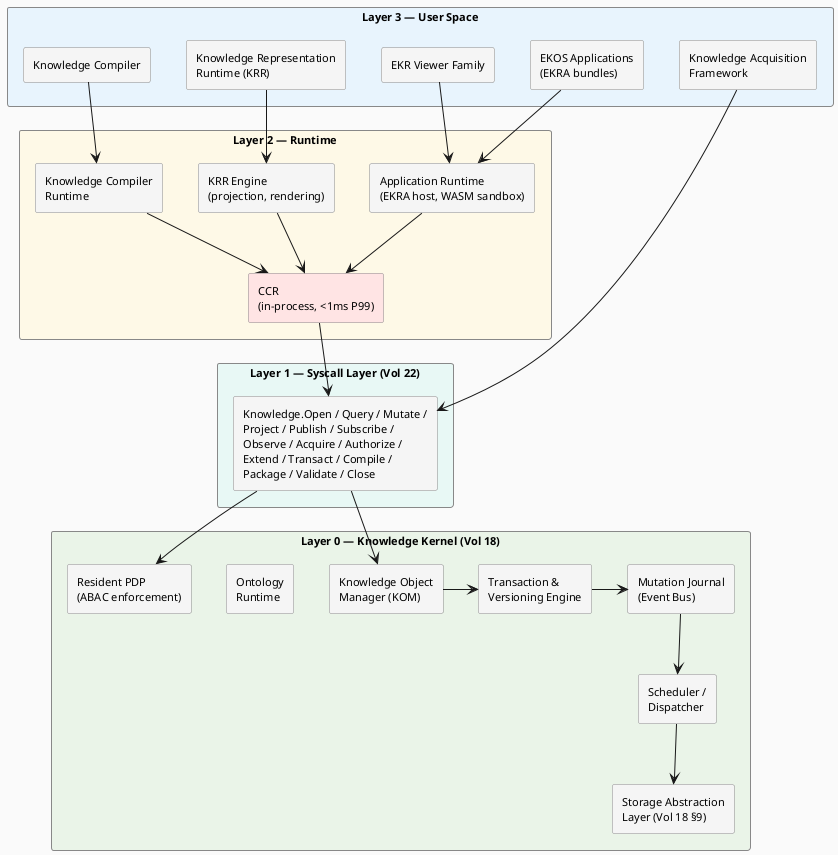
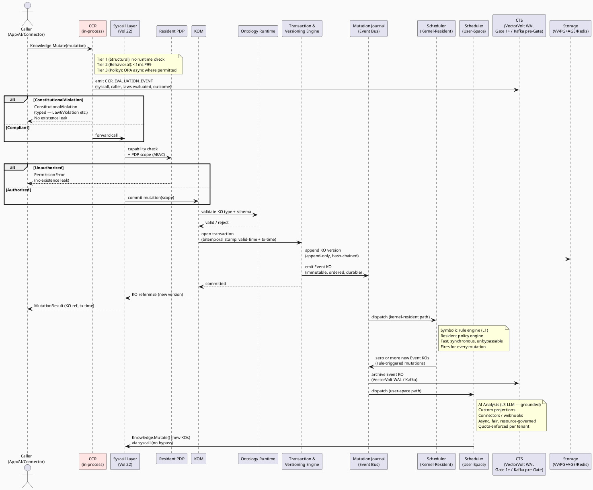
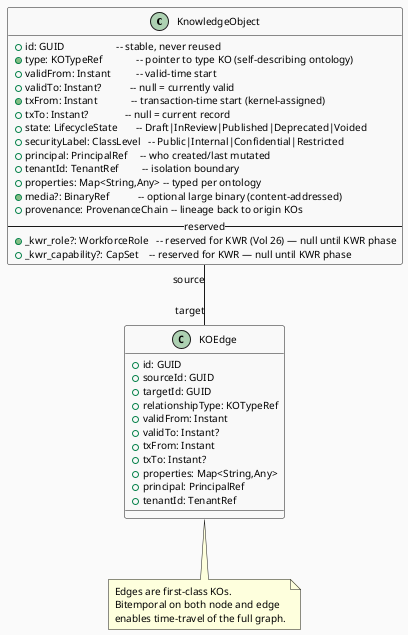
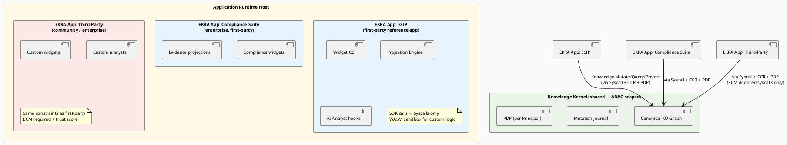
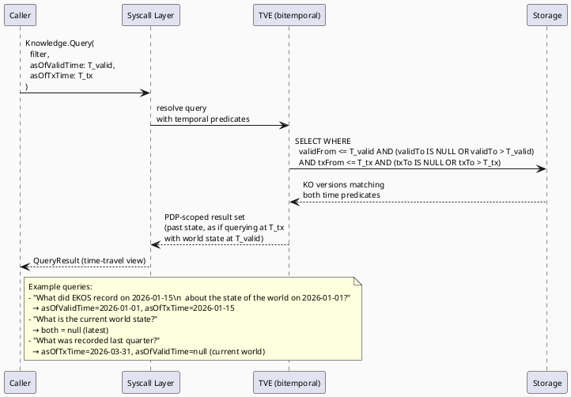
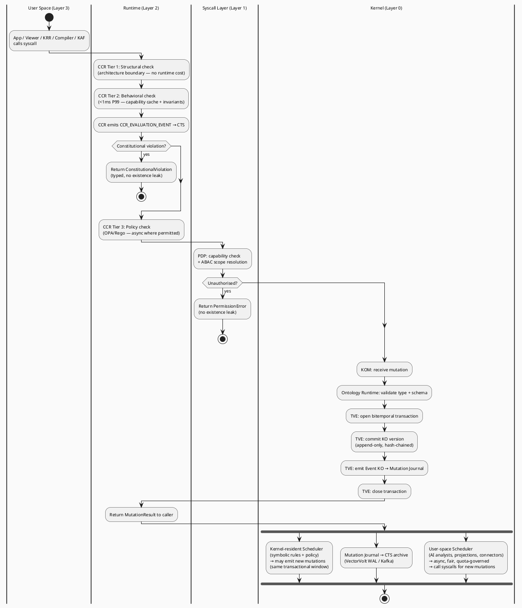

# EKOS Architecture — A13: Knowledge Runtime Architecture

> **⚠️ ESCS ADDENDUM (2026-08-01):** The ESCS formalization (see
> [ESCS-SUPPLEMENT.md §10](../ESCS-SUPPLEMENT.md)) changes the runtime's role beyond
> executing mutations on a graph:
> - **ESCS-043 (SDLC change):** A13 must now account for the Application Manifest →
>   Knowledge Package compilation path. The Projection Runtime is not just a rendering
>   layer — it is the **application execution environment** that replaces the traditional
>   "install a binary" model. The sequence: Manifest authored → Compiled (E11) → Published
>   to Registry (E17) → User subscribes in EKR → Projection Runtime renders app on demand.
> - **ESCS-044 (developer = manifest author):** The App SDK (E12) should surface manifest
>   authoring as the primary developer workflow — not writing code against syscalls.
> - **ESCS-045 (EKR = common runtime environment):** A13's runtime architecture is the
>   implementation of ESCS-045. Document this section as the "EKR runtime contract" that
>   every Knowledge Package and Living Application executes within.
> - **ESCS-046 (one manifest → all surfaces):** The Projection Runtime's multi-surface
>   dispatch is the architectural expression of this requirement. A13 §4 (Projection
>   dispatch) should be updated to reflect this when E11 begins.

> **Status:** ✅ Done · **Generated:** 2026-07-03
> Synthesises [Book 2](../BOOK-2-KNOWLEDGE-OBJECT-COMPUTATIONAL-MODEL.md) (computational
> model), [Vol 18](../18-knowledge-kernel.md) (Knowledge Kernel), [Vol 22](../22-knowledge-os-apis-syscall-layer.md)
> (Syscall Layer + CCR amendment ADR-051), and [Vol 23](../23-ekos-application-runtime-sdk.md)
> (App Runtime & SDK) into the definitive execution-model architecture. This is the document
> that answers: *"What actually happens when a Knowledge Object is mutated, and how does
> execution flow through the system?"* Required reading before implementing any EKOS layer.
> Anchored by [A02](A02-logical-architecture.md) (layer boundaries), [A06](A06-security-identity-trust-architecture.md)
> (CCR/PDP/ABAC), [ADR-051](../ADR-REGISTER.md) (CCR gate), [ADR-053](../ADR-REGISTER.md)
> (VectorVolt as storage engine), [VECTORVOLT-EKOS-INTEGRATION-PLAN.md](VECTORVOLT-EKOS-INTEGRATION-PLAN.md).

---

## 1. Purpose & Scope

Specify the **EKOS computation model** — the precise sequence of events from the moment
a caller invokes a syscall to the moment side-effects are fully dispatched and the system
reaches a consistent state. This covers:
- The four-layer runtime stack (Kernel / Syscall / Runtime / User-Space)
- The Mutation → Event → Dispatch → Projection lifecycle
- CCR enforcement in the execution path
- Scheduler two-tier dispatch (kernel-resident vs user-space)
- Application isolation and ABI stability contract
- VectorVolt's role in the runtime (per VECTORVOLT-EKOS-INTEGRATION-PLAN.md gates)

**Not in scope:** widget rendering internals (Vol 20/KRR), knowledge acquisition connectors
(Vol 21), `.ekr` packaging (Vol 06), Knowledge Economy transactions (Vol 13). Those
subsystems are clients of the runtime defined here.

---

## 2. The Four-Layer Runtime Stack



- **A13-001** — Layer 0 (Kernel) is privileged. No code outside the kernel has direct
  access to KOs, the Mutation Journal, or the Storage Abstraction Layer. The kernel boundary
  is physical: kernel code runs with direct storage access; all other code calls through
  the syscall surface only (EKOS-18-041/042).
- **A13-002** — Layer 1 (Syscall Layer) is the **only** crossing point. Every user-space
  subsystem — KRR, Compiler, Acquisition Framework, Apps, Viewers — reaches the kernel
  exclusively through named syscalls. No internal shortcut or "trusted" internal path exists
  (EKOS-22-001/002/003).
- **A13-003** — Layer 2 (Runtime) hosts the CCR (Constitutional Compliance Runtime) and
  the Application Runtime. CCR executes **in-process** inside each Layer 2 service, before
  every syscall body executes. It is not a separate service — there is no network hop
  (ADR-051; EKOS-22-040/041).
- **A13-004** — Layer 3 (User Space) has no special trust. An EKOS first-party app, a
  third-party extension, and an AI analyst all execute in Layer 3 under identical
  constraints: capability-checked, PDP-scoped, resource-governed (EKOS-23-015/016).

---

## 3. The Computation Model (B2-023)

Three operations compose all EKOS computation:

| Operation | What it does | Where it runs | Deterministic? |
|---|---|---|---|
| **Mutation** | Commits a state change to one or more KOs | Kernel (TVE) | Yes |
| **Dispatch** | Reacts to a mutation event — fires rules, AI, projections | Kernel (fast path) + User-space (async) | Yes (symbolic/policy) / Bounded (LLM) |
| **Projection** | Reads KO state and renders a view | User-space (JIT) | Yes (given same KO state + scope) |

All three operations produce KOs. A mutation produces a new KO version. A dispatch produces
Event KOs and may produce new KOs (AIInsight, GovernancePolicy, etc.). A projection produces
a Projection KO (cached, replayable). Computation is self-describing (B2-039).

---

## 4. Full Execution Sequence: Mutation Lifecycle



### Mutation (Atomic Unit of Change)

- **A13-005** — Every mutation is **atomic**: it either commits fully or not at all. There
  is no partial mutation visible to any reader (B2-025; EKOS-18-008).
- **A13-006** — Every mutation carries a **bitemporal stamp**: valid-time (when the fact
  is true in the world) and transaction-time (when EKOS recorded it). Both are immutable
  once committed. Transaction-time is set by the kernel using the system clock (PTP IEEE
  1588 at VectorVolt Gate 2+; system clock pre-Gate 2).
- **A13-007** — Every mutation is **attributed**: the Principal (human user, AI analyst,
  connector, application) that caused the mutation is recorded and non-repudiable.
  There are no anonymous mutations (B2-026; EKOS-18-008).
- **A13-008** — Mutations are **append-only** at the storage layer. No existing KO version
  is overwritten. Soft-delete transitions state; hard-delete does not exist (Book 1 Law 11;
  EKOS-18-022/023/024).

### CCR Gate (Constitutional Compliance Runtime)

- **A13-009** — The CCR executes **before** the syscall body, **in-process** in Layer 2.
  Three enforcement tiers run in order (ADR-051; EKOS-22-040 through 044):
  - **Tier 1 Structural** — architecture port boundary (no runtime check; enforced by
    design — e.g., a Viewer pod cannot make a Kernel-internal call because it has no
    kernel binary).
  - **Tier 2 Behavioral** — CCR runtime check per syscall, target < 1ms P99. Checks: Law
    4 (provenance), Law 6 (ABAC), Law 11 (non-destructive), Law 16 (representation
    independence). Implemented as pre-compiled in-memory capability cache lookup +
    behavioral invariant assertion.
  - **Tier 3 Policy** — OPA/Rego evaluation (Laws 5/7/8/9/10/12/14/15). Runs
    asynchronously where the law permits async; synchronously where it does not. Policy
    bundle refreshed from OPA bundle service on a schedule (not per-call).
- **A13-010** — A `ConstitutionalViolation` (typed: `Law6Violation`, `Law11Violation`,
  `PolicyViolation`, etc.) halts the syscall and is returned to the caller. The violation
  does **not** reveal whether a non-visible KO exists (no existence leak — Vol 04 §7).
- **A13-011** — CCR emits a `CCR_EVALUATION_EVENT` to the Constitutional Telemetry Stream
  for every syscall, whether compliant or not. The CTS is immutable, caller-agnostic,
  and deployment-agnostic (SaaS/air-gap/edge all emit the same event schema — EKOS-22-046).
  At Gate 1+, CTS writes go to VectorVolt WAL. Pre-Gate 1, CTS writes go to Kafka directly.

### Scheduler: Two-Tier Dispatch

- **A13-012** — The Scheduler has two tiers that are architecturally distinct (EKOS-18-009
  through 013):

  | Tier | Location | Trigger | Latency | Bypass? |
  |---|---|---|---|---|
  | **Kernel-resident (L1)** | Inside kernel | Every mutation | Synchronous, same transaction window | Never bypassable |
  | **User-space (L2/L3)** | Outside kernel, via syscall | Async dispatch from Mutation Journal | Eventually consistent | Quota-governed, cancellable |

- **A13-013** — Kernel-resident dispatch fires the symbolic rule engine and resident policy
  engine. These run in the same transactional context as the mutation — their outputs are
  committed atomically with the triggering mutation. If a rule produces a new mutation, that
  mutation also passes through the full CCR + PDP + TVE cycle.
- **A13-014** — User-space dispatch is **fair and resource-governed**: each tenant's reactors
  run under kernel-enforced quotas (EKOS-18-037/038). A runaway AI analyst cannot starve
  another tenant's projections. Fairness is enforced at the Mutation Journal subscription
  level — each reactor type has a guaranteed share.
- **A13-015** — User-space reactors **cannot bypass the syscall layer**. An AI analyst that
  wants to mutate a KO must call `Knowledge.Mutate()` via the syscall surface. There is no
  internal path that skips CCR or PDP. This applies equally to first-party EKOS analysts
  and third-party custom analysts (EKOS-23-015/016).

### Projection (JIT Read)

- **A13-016** — A Projection is **JIT (just-in-time)** and **deterministic**: given the
  same KO state and the same PDP scope, the same projection always produces the same output
  (B2-032). Projections are therefore **cacheable** — the cache key is
  `(KO-refs + versions, PDP-scope-hash, projection-definition-hash)`.
- **A13-017** — Projections are **PDP-scoped**: the Projection Engine only sees KOs the
  calling Principal is authorised to read. Projection code cannot access KOs outside the
  caller's scope by any means (EKOS-18-014/015/016).
- **A13-018** — Projections are themselves **KOs**: a rendered widget projection is stored
  as a Projection KO with provenance (which KOs fed it, which Principal requested it, at
  what transaction-time). This enables audit, replay, and time-travel of rendered views
  (B2-039).
- **A13-019** — At VectorVolt Gate 3 (VV Phase 5), the `MaterializedViewEngine` provides
  **pre-computed projections** for widget aggregates: counters, sums, group-bys are updated
  atomically as each mutation commits, eliminating scan-time aggregation for common widget
  patterns. This is the high-performance complement to JIT projection — not a replacement.

---

## 5. Knowledge Object Anatomy (B2 Summary)

Every KO — node or edge — carries an identical set of mandatory fields:



- **A13-020** — Every KO is **stamped**: it always carries identity, type, bitemporal
  timestamps, security label, principal, and provenance. There are no unstamped KOs
  (B2-001 through B2-005).
- **A13-021** — The ontology is **self-describing**: KO types are themselves KOs. Type
  hierarchy is stored in the graph. Runtime type extension (new KO type added) does not
  require a schema migration — the Ontology Runtime validates mutations against the live
  type graph (EKOS-18-018 through 021).
- **A13-022** — Reserved `_kwr_*` fields ensure that when KWR (Knowledge Workforce
  Runtime, Vol 26) is built, no KO schema migration is required across existing KOs. The
  fields are present but null until KWR activates (B2-005).

---

## 6. Syscall Layer: The Stable ABI

```plantuml
@startuml
skinparam backgroundColor #FAFAFA
skinparam defaultFontSize 10

package "Syscall Catalogue (Vol 22)" {
  [Knowledge.Open()] as Open
  [Knowledge.Close()] as Close
  [Knowledge.Query(filter, scope)] as Query
  [Knowledge.Mutate(mutation)] as Mutate
  [Knowledge.Project(koId, target)] as Project
  [Knowledge.Validate(ko)] as Validate
  [Knowledge.Compile(workspaceId)] as Compile
  [Knowledge.Package(manifest)] as Package
  [Knowledge.Publish(koId)] as Publish
  [Knowledge.Subscribe(filter, handler)] as Subscribe
  [Knowledge.Observe(metric, scope)] as Observe
  [Knowledge.Acquire(source, mapping)] as Acquire
  [Knowledge.Authorize(principal, op, koId)] as Authorize
  [Knowledge.Extend(typeDefinition)] as Extend
  [Knowledge.Transact(ops[])] as Transact
}

note bottom
  Every call: CCR gate (in-process) → PDP scope →
  Kernel execution → CTS event.
  ABI versioned; additive changes backward-compatible;
  breaking changes follow deprecation policy (OQ-22-B).
  Transport: in-process (Layer 2 services) / gRPC (remote) / IPC (sidecar).
end note
@enduml
```

- **A13-023** — The syscall ABI is **stable across kernel versions** (EKOS-22-018 through
  021). Apps compiled against ABI version N continue operating as the kernel evolves.
  ABI version is negotiated at `Knowledge.Open()` handshake.
- **A13-024** — **Additive changes** (new optional parameters, new syscalls, new error
  codes) are backward-compatible and do not require a version bump. **Breaking changes**
  (parameter removal, semantic change, syscall removal) follow the deprecation policy
  (OQ-22-B: deprecation window length TBD — candidate: 2 major kernel versions).
- **A13-025** — Transport is **pluggable**: in-process (zero-copy for Layer 2 services on
  the same node), gRPC (remote calls across nodes), IPC/Unix socket (sidecar pattern).
  The caller's code is identical regardless of transport; the transport is resolved at
  `Knowledge.Open()` based on deployment topology (EKOS-22-033/034/035).
- **A13-026** — `Knowledge.Transact(ops[])` bundles multiple mutations into a single
  atomic transaction. All ops commit or all roll back. PDP scope applies to the full
  transaction — if any single op in the bundle is unauthorised, the entire transaction
  is rejected (no partial commits).

---

## 7. Application Runtime & Isolation Model



- **A13-027** — Each EKRA application runs in its **own WASM sandbox** (custom logic) or
  managed runtime context (declarative widgets/projections). The sandbox confines: memory
  access, syscall surface (ECM-declared only), CPU quota (kernel-governed), network access
  (none — all external I/O via Acquire syscall) (EKOS-23-015/016/017/018).
- **A13-028** — Multiple applications share the **same canonical KO graph** but each sees
  only the PDP-scoped subset authorised for the calling Principal. Application A cannot
  read KOs that Application B has written if the Principal does not have access — even on
  the same EKOS instance (EKOS-23-028).
- **A13-029** — The **EKRA manifest** declares: required EKOS/ABI version, capabilities
  required, syscalls used, widgets/projections/analysts included, ontology extensions,
  Ed25519 signature. The Application Runtime verifies the manifest before execution. A
  third-party app that invokes a syscall not declared in its ECM gets a `Law13Violation`
  from CCR before the syscall body executes (EKOS-22-053; EKOS-23-007/008/009).
- **A13-030** — Apps survive kernel upgrades because the syscall ABI is stable (A13-023).
  The EKRA manifest declares ABI compatibility (`minAbiVersion`, `maxAbiVersion`). The
  Application Runtime refuses to start an app that declares incompatible ABI bounds and
  emits a diagnostic to the tenant admin (EKOS-23-033/034).

---

## 8. VectorVolt's Role in the Runtime (Gate Map)

| Runtime Path | Pre-Gate 1 | Gate 1 (VV Ph 1+2+3) | Gate 3 (VV Ph 5) | Gate 6 (VV Graph) |
|---|---|---|---|---|
| **CTS writes** | Kafka (direct) | **VectorVolt WAL** (immutable, hash-chained) | VectorVolt WAL (same) | VectorVolt WAL (same) |
| **Metering events** | Kafka batch | **VectorVolt GroupCommitBatcher** | VV GCB (same) | VV GCB (same) |
| **Graph sync** | PostgreSQL+AGE direct write | **ProjectionDispatcher → PostgreSQL+AGE** | PD → PG+AGE (same) | VV graph (replaces AGE) |
| **CCR capability cache** | Redis lookup (~1ms) | Redis (same) | **VectorVolt DocumentStore** (~10ns) | VV DS (same) |
| **KO scan (ABAC-filtered)** | PostgreSQL+AGE | PostgreSQL+AGE | **VectorVolt VectorScanner** (AVX2) | VV VS (same) |
| **Widget aggregates** | ClickHouse | ClickHouse | **VectorVolt MaterializedViewEngine** | VV MVE (same) |
| **Graph traversal** | PostgreSQL+AGE | PostgreSQL+AGE | PostgreSQL+AGE | **VectorVolt Graph Extension** |
| **Relational projections** | PostgreSQL | PostgreSQL | PostgreSQL | PostgreSQL (permanent) |

- **A13-031** — Every gate transition is a **Helm values change only** — no application
  code changes, no data migration, no downtime (ADR-053 invariant; ADR-052 provider
  interface guarantee).
- **A13-032** — The CCR capability cache (Tier 2 Behavioral check) is the most
  latency-sensitive VectorVolt integration point. At Gate 3, capability lookups drop from
  ~1ms (Redis RTT) to ~10ns (VectorVolt DocumentStore in-process). This is the mechanism
  by which CCR achieves <1ms P99 at high throughput without sacrificing constitutional
  enforcement (EKOS-22-041).

---

## 9. Determinism & Non-Determinism Boundaries

A critical design constraint: the EKOS runtime must produce **reproducible audit trails**
and **crash-recoverable state** from the Mutation Journal alone.

- **A13-033** — **Deterministic layers** (B2-036/037): symbolic rule engine, graph
  algorithms, projections, Knowledge Compiler output, ontology validation — these always
  produce the same output given the same inputs. They are reproducible from WAL replay.
- **A13-034** — **Non-determinism is confined to the LLM layer** (L3 AI analysts). LLM
  calls are bounded by: (a) fact-sheet inputs (structured, deterministic — the LLM never
  sees raw KOs); (b) output stored as `AIInsight` KOs (the insight, once produced and
  committed, is deterministic — it's a KO with a tx-time stamp); (c) re-runs produce new
  AIInsight KOs, not overwrites of old ones (Law 11). The LLM's non-determinism is thus
  isolated to the production of new KOs, not to mutation of existing ones.
- **A13-035** — **Crash recovery** is via **Mutation Journal replay** (EKOS-18-026 through
  029). The Journal is the single source of truth. On restart, the kernel replays the
  Journal from the last snapshot + tail to rebuild in-memory state. All VectorVolt read
  stores (DocumentStore, ColumnarStore, MaterializedViewEngine) are projections of the
  Journal — they rebuild from ProjectionDispatcher replay after a crash (A17 DR
  architecture).

---

## 10. Execution Model: Time-Travel Reads

Bitemporal storage enables two distinct time-travel query modes:



- **A13-036** — Time-travel is a **first-class syscall capability**, not a reporting add-on.
  `Knowledge.Query()` accepts optional `asOfValidTime` and `asOfTxTime` parameters. Omitting
  both returns the current state (B2; EKOS-18-022 through 024).
- **A13-037** — **Bitemporal edges** (KOEdge carries both time axes — A13 §5) enable
  time-travel of the **full graph**, not just individual nodes. A traversal query with a
  temporal predicate returns the relationship graph as it existed at that point in time.
- **A13-038** — Time-travel reads are **PDP-scoped**: the caller only sees KOs they were
  authorised to see at the query time (present authorisation), not what they could have
  seen in the past. A user who has since lost access cannot use time-travel to retrieve
  previously accessible KOs (EKOS-18-014/015/016).

---

## 11. Observability Hooks in the Execution Path

- **A13-039** — `Knowledge.Observe(metric, scope)` exposes **kernel-internal metrics** to
  user-space via a PDP-scoped subscription. Observable metrics include: mutation throughput,
  dispatch queue depth per reactor type, projection cache hit rate, CCR P99 latency, CTS
  event emission rate, per-tenant quota utilisation (EKOS-22-036/037).
- **A13-040** — `Knowledge.Subscribe(filter, handler)` delivers a **stream of Event KOs**
  matching the filter to the caller's handler. Subscription is PDP-scoped — the caller only
  receives events for KOs they can read. This powers: live widget updates, reactive
  projection pipelines, Knowledge Acquisition Framework connectors, Knowledge Session sync.
- **A13-041** — All syscall calls emit **OpenTelemetry spans** (EKOS-22-037). The span
  includes: syscall name, correlation ID, caller Principal, tenant, PDP scope hash, CCR
  tier outcomes, storage latency. This feeds standard observability dashboards (Prometheus +
  Grafana / Datadog) independently of the CTS (which is constitutional evidence, not ops
  telemetry).

---

## 12. Execution Model Summary (Single Reference Diagram)



---

## 13. Open Questions

- **OQ-A13-A** — Kernel-resident vs user-space reactor boundary under load: if a symbolic
  rule engine fires frequently, does it belong in kernel-resident (always) or should
  high-frequency rules migrate to user-space with near-synchronous dispatch? (OQ-18-A)
- **OQ-A13-B** — In-kernel transaction model for distributed polyglot store: when VectorVolt
  (Gate 1+) and PostgreSQL+AGE both receive writes from ProjectionDispatcher, is the
  cross-store consistency model eventual or 2PC? (OQ-18-B — leaning eventual + idempotent
  replay)
- **OQ-A13-C** — Concrete IDL and binding-generation toolchain for the syscall ABI
  (Protobuf confirmed per A03-ADR-031; binding generation toolchain for .NET/Rust/TS/Python
  not yet specified — OQ-22-A)
- **OQ-A13-D** — ABI deprecation window length: how many major kernel versions must a
  breaking change be deprecated before removal? (OQ-22-B — candidate: 2 major versions)
- **OQ-A13-E** — WASM sandbox for custom app logic: `.NET NativeAOT-LLVM → Wasm` maturity
  for production use (OQ-23-A; tracked as VectorVolt Phase 8.4 research module)
- **OQ-A13-F** — LLM non-determinism containment: if the same AIInsight KO is requested
  twice, does EKOS return the cached KO (deterministic) or invoke the LLM again (fresh
  insight)? Proposed: cache by `(fact-sheet-hash, model-version, prompt-template-version)`.

---

## 14. Item Index

A13-001 … A13-041: four-layer stack (001–004), computation model (005–019), KO anatomy
(020–022), syscall ABI (023–026), application isolation (027–030), VectorVolt gate map
(031–032), determinism boundaries (033–035), time-travel (036–038), observability (039–041).
6 open questions filed.

> **Next architecture doc:** `A15 — Runtime Distribution Architecture`
> (edge/offline/multi-kernel — ChatGPT GAP-3).
> Per protocol: STOP here. Await user "proceed".
