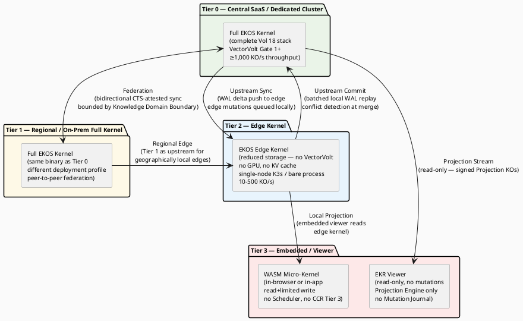
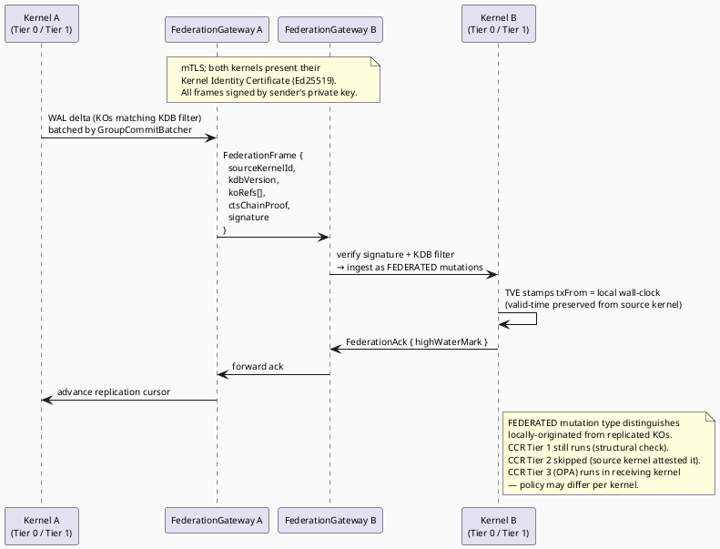
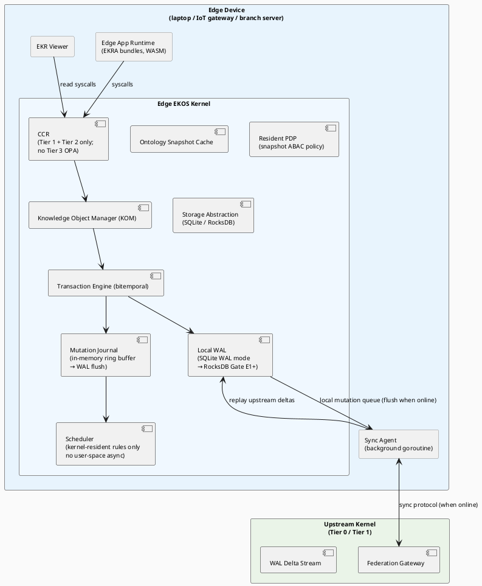
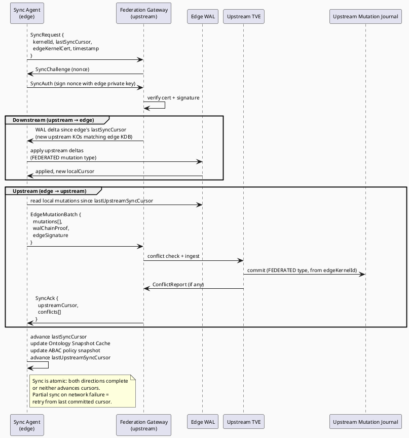
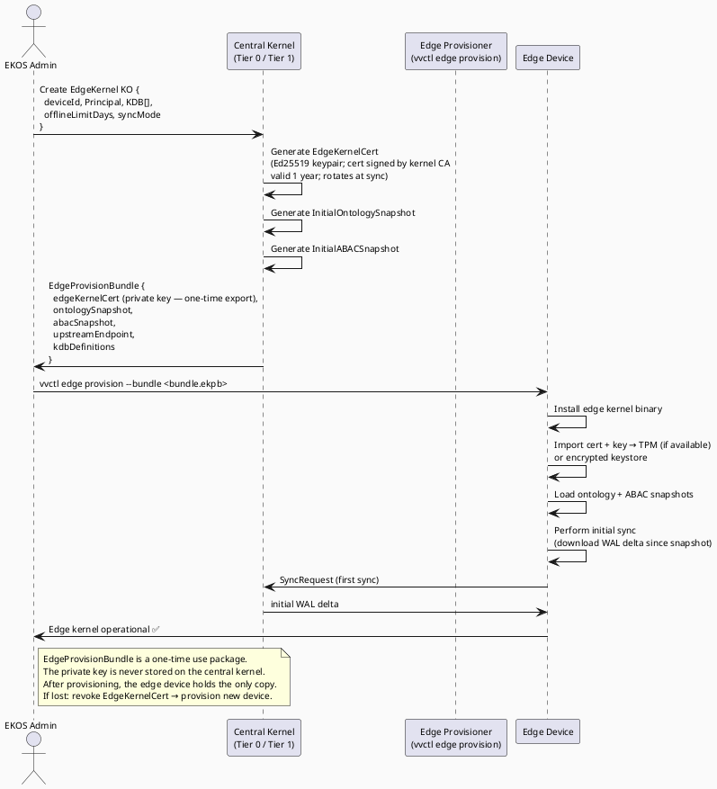

# EKOS Architecture — A15: Runtime Distribution Architecture

> **Status:** ✅ Done · **Generated:** 2026-07-03
> Addresses ChatGPT GAP-3: *"How does EKOS run at the edge, offline, or across multiple
> kernels?"* This document specifies the **distributed runtime model**: topology patterns
> for multi-kernel federation, edge kernel deployments (field workers, branch offices,
> air-gap sites), offline-first operation with deterministic sync, and conflict resolution.
> Anchored by [A02](A02-logical-architecture.md) (layer boundaries), [A04](A04-data-storage-ontology-architecture.md)
> (bitemporal/polyglot storage), [A08](A08-deployment-infrastructure-architecture.md)
> (K8s/multi-cloud), [A13](A13-knowledge-runtime-architecture.md) (runtime execution model),
> [A18](A18-on-premises-deployment-architecture.md) (on-prem), [ADR-052](../ADR-REGISTER.md)
> (storage provider abstraction), [ADR-053](../ADR-REGISTER.md) (VectorVolt integration),
> [VECTORVOLT-EKOS-INTEGRATION-PLAN.md](VECTORVOLT-EKOS-INTEGRATION-PLAN.md).

---

## 1. Purpose & Scope

A13 defined what happens inside a single EKOS kernel. A15 defines how **multiple EKOS
runtimes interact** when:

1. **Multi-kernel federation** — Two or more full EKOS kernels that share a knowledge
   domain boundary (e.g., regional instances, org-unit sub-kernels, partner kernels).
2. **Edge kernel** — A lightweight EKOS runtime running on constrained hardware: field
   worker laptops, IoT gateways, branch-office servers, mobile devices.
3. **Offline-first operation** — An edge kernel that operates entirely disconnected for
   extended periods and syncs deterministically when connectivity resumes.
4. **Embedded kernel** — EKOS runtime embedded inside another application or device
   (read-only projection client, `.ekr`-compatible Viewer, WASM micro-kernel).

Decisions here are constrained by EKOS's core invariants:
- Law 11 (non-destructive): every mutation is append-only, even across kernels.
- CTS integrity: the Constitutional Telemetry Stream must remain hash-chain-continuous
  within each kernel; cross-kernel events require explicit attestation.
- Bitemporal correctness: valid-time and transaction-time semantics hold regardless of
  where a KO was created.
- ABAC everywhere: a KO replicated to an edge kernel is still subject to PDP enforcement;
  replication is not a privilege escalation path.

---

## 2. Distributed Runtime Taxonomy

| Tier | Runs | Storage | Throughput | Offline? | Mutation authority |
|---|---|---|---|---|---|
| **0 Central** | Full K8s cluster | VectorVolt Gate 1+ · PG+AGE · Kafka | ≥1,000 KO/s | N/A | Full authority |
| **1 Regional** | Full K8s / on-prem | Same as Tier 0 | ≥1,000 KO/s | Graceful degradation | Full authority in its Domain Boundary |
| **2 Edge** | K3s / bare process | SQLite (offline WAL) + RocksDB | 10–500 KO/s | **Yes — primary design goal** | Local mutations, pending upstream merge |
| **3 Embedded** | In-browser WASM / mobile | In-memory + IndexedDB | Read-only | Offline read only | None (projection only) |

- **A15-001** — All four tiers run the **same EKOS ABI** (A13-023). An EKRA app compiled
  against ABI v2 runs on a Tier 0 SaaS cluster and on a Tier 2 edge kernel without
  recompilation. The application code does not know which tier it is on.
- **A15-002** — Tiers 0 and 1 are peers; neither is subordinate. Federation is
  **opt-in and bounded** by explicit Knowledge Domain Boundary declarations — a Tier 0
  Central kernel does not automatically have authority over a Tier 1 Regional kernel.
- **A15-003** — Tiers 2 and 3 are **always downstream** of a Tier 0 or Tier 1 upstream.
  They cannot federate with each other directly (two field laptops do not sync peer-to-peer
  — they sync through their shared upstream).

---

## 3. Multi-Kernel Federation (Tier 0 ↔ Tier 1)

### 3.1 Knowledge Domain Boundary

- **A15-004** — A **Knowledge Domain Boundary (KDB)** is the unit of federation. It is a
  named, versioned, cryptographically signed declaration that specifies: which KO types
  flow across which kernel pair; which direction (uni- or bidirectional); which Principal
  identities are trusted across kernels; and the conflict resolution policy for KOs that
  both kernels may mutate.
- **A15-005** — KDB declarations are themselves KOs, stored in both kernels, signed by
  the Principals of both kernels. Modifying a KDB requires a quorum-signed mutation in
  both kernels and is recorded in both CTS streams.
- **A15-006** — KOs that do not match any KDB declaration are **never replicated**. By
  default, no KO crosses a kernel boundary.

### 3.2 Federation Sync Protocol

- **A15-007** — The federation transport is **WAL-delta streaming** (not full-state sync).
  The FederationGateway tracks a `highWaterMark` cursor per peer kernel. Only mutations
  after the cursor are sent.
- **A15-008** — Each `FederationFrame` includes a **CTS chain proof**: the sending kernel
  provides the hash-chain segment covering the included KOs. The receiving kernel verifies
  the chain before ingesting. A broken chain is a hard stop (same rule as A17 DR runbook).
- **A15-009** — Replicated KOs get a **FEDERATED mutation type** tag. This means:
  - CCR Tier 1 (Structural) still fires — architecture boundary checks are non-negotiable.
  - CCR Tier 2 (Behavioral) is **skipped** — the source kernel already ran it and the
    CTS proof attests this. Skipping avoids double-latency.
  - CCR Tier 3 (OPA) **fires in the receiving kernel** — policy may differ between kernels
    (a Tier 1 on-prem kernel with stricter retention policy may reject KOs that the SaaS
    kernel accepted).
- **A15-010** — The `txFrom` timestamp on the replicated KO is set by the **receiving
  kernel's clock** (the moment it committed locally). The `validFrom`/`validTo` from the
  source kernel are preserved intact. This preserves bitemporal correctness: the valid-time
  reflects reality; the transaction-time reflects when *this* kernel knew about it.

### 3.3 Conflict Resolution (Federated)

Conflicts arise when both Kernel A and Kernel B mutate the same KO (identified by
stable `id` GUID) independently before federation sync catches up.

- **A15-011** — EKOS uses **valid-time-wins** as the default conflict policy: the mutation
  with the later `validFrom` is applied last and becomes the "current" version. Both
  versions are preserved (Law 11). The superseded version's `txTo` is closed at the
  moment of merge.
- **A15-012** — The KDB declaration may specify an alternative conflict policy per KO
  type. Available policies:
  | Policy | Semantics | Use when |
  |---|---|---|
  | `valid-time-wins` | Later `validFrom` survives | Facts with clear temporal ordering |
  | `source-kernel-wins` | Designated "authority kernel" always wins | Master-replica pattern |
  | `merge-properties` | Per-property merge (last-write-wins per field) | Form-like KOs with independent fields |
  | `manual-escalation` | Conflict KO created, workflow triggered | High-stakes KOs (legal, governance) |
- **A15-013** — When `manual-escalation` fires, a **ConflictKO** is created in both
  kernels: it references both conflicting versions, links to the KDB, and is assigned to
  a designated Resolution Principal. The ConflictKO blocks further replication of the
  affected KO until resolved. This is recorded in CTS as a constitutional event.

---

## 4. Edge Kernel (Tier 2)

### 4.1 Edge Kernel Architecture

- **A15-014** — The Edge Kernel is the **same binary** as the full kernel, compiled with
  feature flags disabling: VectorVolt kernel-bypass networking (DPDK), GPU node pool,
  ClickHouse connector, Kafka producer. What remains is a full-fidelity constitutional
  kernel with SQLite as the WAL store.
- **A15-015** — The edge Scheduler runs **kernel-resident dispatch only** (symbolic rules
  + policy engine). User-space async reactors (AI analysts, projections) are not scheduled
  locally — they execute when the device syncs with the upstream kernel and upstream
  dispatches them. This keeps the edge kernel deterministic and fast.
- **A15-016** — CCR on the edge runs **Tier 1 + Tier 2 only**. Tier 3 OPA is not
  available on edge (OPA bundle is too large for constrained devices; policy bundle would
  be stale during extended offline periods). The CCR pre-compilation model means Tier 2
  enforcement adds <1ms P99 even on ARM hardware (Raspberry Pi 4, Apple M-series).
- **A15-017** — The **Ontology Snapshot Cache** is a versioned snapshot of the type graph
  downloaded from the upstream kernel at last sync. The edge kernel validates mutations
  against this snapshot. If an app on the edge tries to create a KO with an unknown type,
  the mutation is rejected with `OntologyVersionMismatch` — the user is prompted to sync
  before retrying.
- **A15-018** — **ABAC policy snapshot**: the edge PDP uses the ABAC policy snapshot
  downloaded at last sync. Policy changes made in the upstream kernel do not apply to
  edge mutations until the next sync. This is a deliberate trade-off: consistency is
  preferred to availability for privilege elevation, but privilege reduction may be delayed
  by at most one sync cycle. The sync agent priority-downloads policy changes first.

### 4.2 Local WAL — the Offline Source of Truth

- **A15-019** — The **local WAL** is the edge kernel's source of truth, just as VectorVolt
  WAL is the central kernel's source of truth. It is SQLite in WAL mode at Edge Gate 0;
  RocksDB at Edge Gate 1 (for higher throughput edge servers). The local WAL is:
  - Append-only (Law 11).
  - Hash-chained (same algorithm as VectorVolt WAL — SHA3-256).
  - Encrypted at rest (AES-256-GCM; key from local Vault agent or TPM-bound key).
- **A15-020** — On restart after a crash, the edge kernel **replays the local WAL** from
  the last checkpoint, rebuilding in-memory state. This is identical to the central kernel's
  recovery model (A13-035). No upstream connection is needed for crash recovery.
- **A15-021** — The local WAL retains a configurable **maximum duration** of mutations
  before requiring a sync (default: 7 days for Pro/Team, 30 days for Enterprise, unlimited
  for on-prem air-gap). If the retention limit is reached without sync, the edge kernel
  enters `SYNC_REQUIRED` mode: read-only until it successfully flushes to upstream.

### 4.3 Sync Protocol (Edge → Upstream)

- **A15-022** — Sync is **bidirectional and atomic per session**: downstream (upstream →
  edge) and upstream (edge → upstream) complete together, or neither cursor advances.
  Partial sync leaves the edge in the same state as before sync started — safe to retry.
- **A15-023** — The sync session is **mutually authenticated**: the edge kernel presents
  its Kernel Identity Certificate (Ed25519, issued by the upstream CA at provisioning time)
  and signs the nonce. The upstream verifies the certificate chain back to its own CA.
  An edge device that has been revoked cannot sync.
- **A15-024** — Conflict resolution during upstream ingest follows the KDB policy (A15-011
  through A15-013). The SyncAck includes a `ConflictReport` with any conflicts that
  required `manual-escalation`. The edge Sync Agent surfaces these to the user immediately
  after sync completes.
- **A15-025** — Sync frequency is configurable per deployment:
  | Mode | Default interval | Trigger |
  |---|---|---|
  | Always-online edge | Continuous (streaming) | WAL write → immediate upstream push |
  | Occasionally-connected | Every 15 minutes when online | Timer + network-available event |
  | Scheduled sync | User-defined (daily, hourly) | Cron |
  | Manual sync | Never automatic | User action / `vvctl edge sync` |

---

## 5. Offline-First Operation

- **A15-026** — An edge kernel is **fully functional with zero upstream connectivity**.
  A field worker can: create KOs, query existing KOs, run projections against the local
  snapshot, execute EKRA apps (WASM sandbox, local only), and generate CTS events (all
  CTS events are locally WAL-persisted and flushed to upstream at next sync).
- **A15-027** — Operations that **require connectivity** are explicitly surfaced to the
  user (not silently degraded):
  | Operation | Offline behaviour |
  |---|---|
  | `Knowledge.Mutate()` | Succeeds locally; pending upstream commit. KO is tagged `PENDING_UPSTREAM`. |
  | `Knowledge.Query()` | Succeeds against local snapshot. Data freshness = last sync time (shown in UI). |
  | `Knowledge.Project()` | Succeeds against local snapshot (JIT, PDP-scoped). |
  | `Knowledge.Acquire()` (external connector) | Fails with `AcquireOfflineError`. Queued if connector supports local queue. |
  | AI Analyst dispatch | Queued locally; dispatched by upstream Scheduler at next sync. |
  | `Knowledge.Publish()` | Queued; published upstream at next sync. |
  | CCR Tier 3 (OPA) | Not enforced. Queued CCR events audited by upstream at sync. |
- **A15-028** — KOs tagged `PENDING_UPSTREAM` are visible locally with a visual indicator
  (the EKR Viewer and KRR show an "offline" badge). They are not visible to other users or
  kernels until upstream sync commits them. The app (EKRA) may also query for pending
  mutations using the reserved KO metadata field `_sync.pendingUpstream: boolean`.
- **A15-029** — If sync reveals that a `PENDING_UPSTREAM` KO was rejected by the upstream
  (conflict escalated, OPA Tier 3 policy violation, type unknown), the edge kernel creates
  a **RejectionKO** referencing the original mutation, with the rejection reason. The
  original `PENDING_UPSTREAM` KO is not deleted — it remains in local WAL (Law 11), but
  its state transitions to `REJECTED_BY_UPSTREAM`. The user is notified.
- **A15-030** — The **offline duration limit** (A15-021) enforces constitutional continuity:
  an edge kernel that stays disconnected indefinitely is a constitutional compliance risk
  (Tier 3 policy may have changed, ABAC policy may have changed, the edge may be running
  revoked-user sessions). The SYNC_REQUIRED mode protects against this.

---

## 6. Embedded Kernel / WASM Micro-Kernel (Tier 3)

- **A15-031** — The **WASM Micro-Kernel** is a projection-and-limited-write runtime
  compiled to WebAssembly, deployable in:
  - Browser (runs on the user's machine, reads from a Tier 0/1/2 kernel via WebSocket).
  - Mobile (React Native / Swift / Kotlin — same WASM runtime, different host).
  - Electron/Tauri desktop shell.
- **A15-032** — The WASM Micro-Kernel has **no Mutation Journal and no Scheduler**. It
  can: call `Knowledge.Query()`, `Knowledge.Project()`, `Knowledge.Subscribe()` (streaming
  updates), and `Knowledge.Mutate()` (forwarded immediately to upstream kernel — no local
  buffering). If the upstream is unreachable, `Knowledge.Mutate()` returns
  `UpstreamUnavailableError` — there is no local persistence fallback.
- **A15-033** — **EKR Viewer** is a subset of the WASM Micro-Kernel: read-only projection
  client. No mutations, no subscriptions, no Scheduler. Bundle target: ≤1MB (CI gate from
  A20). The Viewer family includes: `.ekr` file renderer (offline — renders a signed
  projection snapshot), browser Viewer (online, real-time), PDF export.
- **A15-034** — The **`.ekr` offline Viewer** renders a signed Projection KO bundle
  (exported from any Tier 0/1/2 kernel). The bundle is: self-contained (includes all KOs
  the projection references), signed by the exporting kernel (Ed25519), and has an
  `expiresAt` timestamp after which the Viewer shows a warning (not a hard block — the
  content is still readable, but the user is informed it may be stale).

---

## 7. VectorVolt in Distributed Scenarios

| Tier | VectorVolt role |
|---|---|
| **Tier 0 Central** | Full integration per VECTORVOLT-INT gates (Gate 1–6). WAL is VectorVolt WAL. CTS writes to VV WAL. CCR cache in VV DocumentStore (Gate 3). KO scans via VectorScanner (Gate 3). Graph traversal via VV Graph Extension (Gate 6). |
| **Tier 1 Regional** | Same as Tier 0. Runs its own VectorVolt cluster. WAL sync between Tier 0 and Tier 1 goes through FederationGateway, not VV replication protocol — VV WALs are per-kernel-local. |
| **Tier 2 Edge** | **No VectorVolt**. Storage is SQLite WAL (Edge Gate 0) → RocksDB (Edge Gate 1). VectorVolt's kernel-bypass (DPDK/RDMA) is unavailable on constrained hardware. At Edge Gate 1, RocksDB provides sorted-key scans that approximate VectorScanner behaviour for small datasets (≤10M KOs). |
| **Tier 3 Embedded** | No VectorVolt. In-memory only. IndexedDB (browser) for persistence. |

- **A15-035** — The FederationGateway is the point at which VectorVolt WAL segments from
  Tier 0 become federated mutation streams for Tier 1/2. The Gateway reads VectorVolt WAL
  via the `IColumnarStoreProvider` interface (ADR-052), extracts KO mutations matching KDB
  filters, and wraps them in `FederationFrame` payloads. This means federation does not
  require VectorVolt on the receiving end.
- **A15-036** — When a Tier 2 Edge Kernel syncs to Tier 0, the upstream kernel's
  `ProjectionDispatcher` replays the edge mutations through the full VectorVolt write path
  — they get indexed in VectorScanner, materialised in the MVE, and archived in the CTS
  WAL. From the upstream kernel's perspective, edge mutations are indistinguishable from
  local mutations (except for the `FEDERATED` tag and `sourceKernelId`).

---

## 8. Constitutional Continuity Across Kernels

- **A15-037** — Each kernel has its **own CTS hash chain**. Chain continuity is a per-kernel
  invariant — a chain gap in Kernel A is not visible in Kernel B's chain. Cross-kernel
  constitutional continuity is provided by **FederationFrame CTS proofs** (A15-008): when
  Kernel A sends mutations to Kernel B, it includes the hash-chain segment covering those
  mutations, so Kernel B can verify they were constitutionally compliant in Kernel A.
- **A15-038** — For **audit and compliance purposes** (SOC2, GDPR, ISO27001), a federated
  deployment's compliance posture is the intersection of all participating kernels' postures.
  An Enterprise customer whose Tier 1 kernel lacks HIPAA configuration is non-compliant
  even if their Tier 0 kernel is HIPAA-configured. The Customer Onboarding flow (A21)
  enforces compliance profile consistency across all kernels before activating federation.
- **A15-039** — Edge kernel CTS events are **locally WAL-persisted** (A15-026). At sync,
  the edge CTS archive is forwarded to the upstream kernel's CTS ingestion endpoint. The
  upstream stores the edge CTS events in a **labelled sub-stream** (`kernelId=<edgeId>`)
  in the same VectorVolt WAL segment, maintaining separation while making them queryable
  from the central compliance dashboard.
- **A15-040** — The **CTS audit trail for offline mutations** includes: the edge kernel's
  local timestamps (which may differ from upstream clock if the device clock drifted), the
  edge's last-known-good NTP sync time, and the `txFrom` stamp applied by the upstream at
  commit time. Auditors can distinguish "when the user made the change on the device" from
  "when EKOS committed it to the canonical record".

---

## 9. Provisioning an Edge Kernel

- **A15-041** — Provisioning produces an **EdgeProvisionBundle** (`.ekpb` file, encrypted
  with the admin's public key). The edge kernel private key is generated once and never
  stored on the upstream kernel. If the device is lost, the EdgeKernelCert is revoked and
  a new device is provisioned — no KOs on the upstream kernel are compromised.
- **A15-042** — The edge kernel binary is distributed as a **signed OCI image** (same
  cosign signing as on-prem — A18) or as a **platform-native package** (`.deb`, `.rpm`,
  `.msi`, `.dmg`, Homebrew formula). The signing key is the EKOS release key (not the
  kernel's identity key — those are distinct).
- **A15-043** — `vvctl edge provision` is the CLI entrypoint for edge kernel lifecycle:
  | Command | Action |
  |---|---|
  | `vvctl edge provision --bundle <file>` | First-time provisioning from bundle |
  | `vvctl edge sync` | Manual sync trigger |
  | `vvctl edge status` | Show sync state, cursor, pending mutations, offline duration |
  | `vvctl edge revoke` | Revoke this device's cert from the upstream |
  | `vvctl edge export-viewer <projection>` | Export a signed `.ekr` viewer bundle |

---

## 10. Scaling Dimensions for Distributed Runtime

| Dimension | Tier 0 Central | Tier 1 Regional | Tier 2 Edge | Tier 3 Embedded |
|---|---|---|---|---|
| **KO volume** | Billions | Hundreds of millions | Millions | Thousands (snapshot) |
| **Concurrent writers** | Thousands | Hundreds | 1–10 | Read-only |
| **Offline tolerance** | N/A | Minutes (K8s eviction) | Days–weeks | Read-only offline |
| **Hardware floor** | 11-node cluster (A18) | 3-node cluster | Single ARM device | Browser tab |
| **WAL store** | VectorVolt (Gate 1+) | VectorVolt (Gate 1+) | SQLite → RocksDB | None |
| **AI dispatch** | Full (GPU pool) | Full or sovereign model | Queued → upstream | None |
| **CTS** | Full chain | Full chain | Per-kernel chain, synced | Forwarded to edge/upstream |

---

## 11. Edge Gate Model (Separate from VECTORVOLT-INT Gates)

The VECTORVOLT-EKOS-INTEGRATION-PLAN.md defines Gates 1–6 for the central kernel. Edge
kernels follow a parallel **Edge Gate** model:

| Edge Gate | Prerequisite | Capability unlocked |
|---|---|---|
| **E0** (Base) | Edge kernel binary shipped | SQLite WAL; CCR Tier 1+2; offline-first; manual sync |
| **E1** | RocksDB adapter (IColumnarStoreProvider) | Higher throughput edge (10M+ KOs); RocksDB WAL |
| **E2** | Streaming sync (continuous mode) | Always-online edge with sub-second mutation latency to upstream |
| **E3** | Edge Mesh (P2P between nearby Edge kernels via upstream-brokered relay) | Temporary local collaboration (e.g. field team on the same LAN) |

- **A15-044** — Edge Gate E0 ships simultaneously with VectorVolt Gate 1 (mandatory
  pre-EKOS Phase 1). Edge kernels are required for the field-worker use case that appears
  in the EKOS product requirements (Vol 08/09). Gate E0 = SQLite WAL + sync protocol +
  `vvctl edge provision`.
- **A15-045** — Edge Gate E3 (P2P edge mesh) is explicitly **deferred to post-EKOS Phase 3**.
  P2P without a central trust anchor risks constitutional continuity breaks (two edge
  kernels with diverged ABAC policy snapshots merging without an upstream to arbitrate).

---

## 12. Open Questions

- **OQ-A15-A** — Edge kernel binary size target: the full EKOS kernel binary (no GPU, no
  VectorVolt, no Kafka) is estimated at ~80MB. Is this acceptable for field deployment over
  cellular links, or must the binary be further stripped (remove Tier 3 OPA stub, remove
  unused syscalls)? Candidate target: ≤50MB compressed.
- **OQ-A15-B** — TPM binding for the edge Kernel Identity Certificate: required for
  regulated industries (gov/defense) but adds hardware dependency. Proposal: TPM is
  strongly recommended but falls back to encrypted keystore (with admin acknowledgement of
  lower assurance). Flag in EdgeKernelCert metadata.
- **OQ-A15-C** — Conflict policy for multi-master federation (two Tier 1 kernels both
  authorised to mutate the same KO type): `valid-time-wins` is correct for most cases but
  may be wrong for counter-type KOs (quantity, balance). Needs a `merge-function` hook in
  the KDB declaration for numeric accumulators.
- **OQ-A15-D** — WASM Micro-Kernel write support: `Knowledge.Mutate()` forwarded to
  upstream in real time (A15-032). What is the UX for slow upstream connections from mobile?
  Is optimistic local display acceptable (show the KO immediately, with `PENDING_UPSTREAM`
  badge, then confirm)? Likely yes — but optimistic UI is a spec decision, not a storage
  decision.
- **OQ-A15-E** — CTS audit gap during extended offline: if an edge kernel is offline for 30
  days, the central compliance dashboard shows a 30-day gap in the edge's CTS stream. Is
  this a compliance violation for SOC2/HIPAA customers, or is the gap acceptable given the
  edge CTS events are captured locally and flushed at sync? Needs legal/compliance review.

---

## 13. Item Index

A15-001 … A15-045: tier taxonomy (001–003), multi-kernel federation (004–013), edge kernel
architecture (014–025), offline-first operation (026–030), embedded/WASM (031–034),
VectorVolt in distributed scenarios (035–036), constitutional continuity (037–040),
provisioning (041–043), scaling dimensions (044, table), edge gate model (044–045).
5 open questions filed.

> **Next architecture doc:** Pending items assessment — A14 coverage confirmed by Book 2.
> After this: ESIP Security widget + SAFe Step 7 metrics, then **VectorVolt Phase 1 (Rust)**.
> Per protocol: STOP here. Await user "proceed" or task change.
