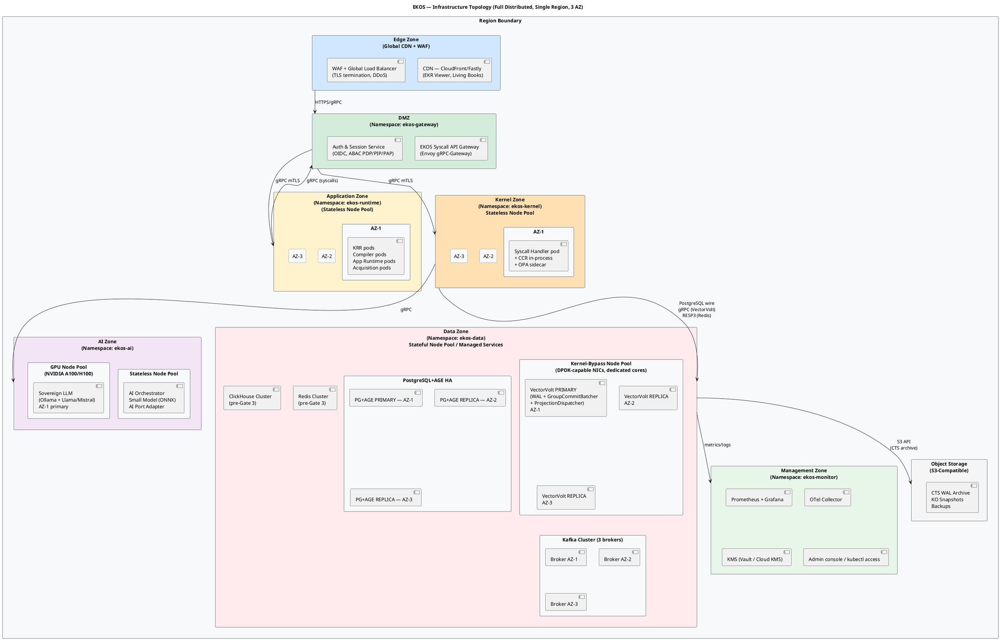
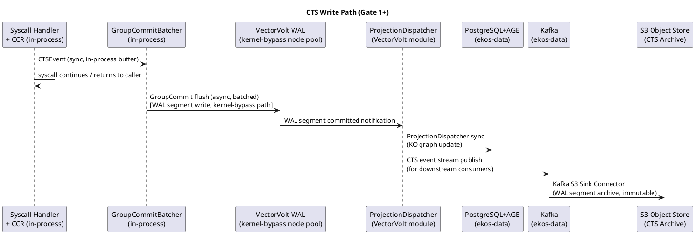

# A16 — Full Distributed Deployment Architecture

> **Status:** ✅ Done · **Generated:** 2026-07-03

---

## 1. Purpose & Scope

A16-001 This document specifies the **concrete component placement, network topology, Kubernetes configuration, and data-flow wiring** for the EKOS full distributed deployment profile.

A16-002 **What this document is NOT:** it does not re-state deployment principles, tenancy models, or IaC toolchain choices — those are fully covered in **A08 (Deployment & Infrastructure Architecture)** and its referenced ADRs (ADR-041, ADR-042, ADR-052). Treat A08 as the authoritative principle layer; A16 is its realization.

A16-003 **Scope:** multi-region active-active, 3-AZ distribution, full Kubernetes topology, all storage providers at each VectorVolt gate, and the in-process CCR architecture. Applies to the SaaS and dedicated deployment profiles from A08; on-prem and air-gap profiles follow the same topology with locality constraints noted per component.

---

## 2. C4 Context Diagram

```plantuml
@startuml A16-C4-Context
!include https://raw.githubusercontent.com/plantuml-stdlib/C4-PlantUML/master/C4_Context.puml

title EKOS — C4 Context Diagram

Person(kw, "Knowledge Worker", "Authors Knowledge Objects,\nruns EKOS apps, consumes Living Books")
Person(dev, "Developer / App Author", "Builds EKOS apps,\nregisters KO types, calls Knowledge.* APIs")
Person(admin, "Platform Admin", "Manages tenants, policies,\ninfrastructure, observability")

System(ekos, "EKOS", "Enterprise Knowledge Operating System\n— Knowledge graph, ambient AI,\nsyscall API, app runtime, compliance")

System_Ext(idp, "External Identity Provider", "OIDC/SAML — Okta, Entra ID,\nor on-prem LDAP bridge")
System_Ext(llm_api, "External LLM APIs", "OpenAI, Anthropic, Bedrock —\nreached via AI Port adapter")
System_Ext(erp, "ERP / Source Systems", "SAP, Salesforce, ServiceNow,\nIoT endpoints — ingest sources")
System_Ext(cdn_ext, "CDN", "CloudFront / Fastly —\nEKR Viewer delivery, Living Books")
System_Ext(obj_store, "S3-Compatible Object Store", "AWS S3 / MinIO (air-gap) —\nCTS archive, snapshots, backups")
System_Ext(sovereign_gpu, "Sovereign GPU Cluster", "On-prem or cloud GPU nodes —\nOllama + Llama/Mistral class models")

Rel(kw, ekos, "Uses", "HTTPS / EKR Viewer / gRPC")
Rel(dev, ekos, "Builds on", "Knowledge.* syscall API / CLI")
Rel(admin, ekos, "Operates", "Admin console / kubectl / IaC")

Rel(ekos, idp, "Delegates authn", "OIDC / SAML 2.0")
Rel(ekos, llm_api, "Calls LLMs", "HTTPS / AI Port adapter")
Rel(ekos, erp, "Ingests from", "REST / JDBC / MQTT")
Rel(ekos, cdn_ext, "Publishes to", "HTTPS push / S3 origin")
Rel(ekos, obj_store, "Archives CTS / snapshots", "S3 API")
Rel(ekos, sovereign_gpu, "Runs sovereign models", "Ollama API / CUDA")

@enduml
```

---

## 3. C4 Container Diagram

```plantuml
@startuml A16-C4-Container
!include https://raw.githubusercontent.com/plantuml-stdlib/C4-PlantUML/master/C4_Container.puml

title EKOS — C4 Container Diagram (Full Distributed)

Person(kw, "Knowledge Worker")
Person(dev, "Developer")
System_Ext(idp, "External IdP")
System_Ext(obj_store, "S3 Object Store")
System_Ext(cdn_ext, "CDN")
System_Ext(llm_api, "External LLM APIs")

System_Boundary(ekos, "EKOS Platform") {

  ' Edge / DMZ
  Container(waf_lb, "WAF + Load Balancer", "NGINX / AWS ALB", "TLS termination, WAF rules, rate limiting")
  Container(api_gw, "EKOS Syscall API Gateway", "Envoy / gRPC-Gateway", "Unified gRPC+REST entry point for all Knowledge.* syscalls; mTLS to backend")
  Container(auth_svc, "Auth & Session", "Go service", "OIDC token exchange, ABAC PDP/PIP/PAP, session tokens")

  ' Application Zone
  Container(krr, "KRR — Knowledge Representation Runtime", "Go pods (stateless)", "Widget rendering, EKR format serialization, Living Book publication")
  Container(compiler, "Knowledge Compiler", "Go pods (stateless)", "KO type compilation, schema validation, .ekr bundle generation")
  Container(acq, "Knowledge Acquisition Framework", "Go pods (stateless, per-connector)", "Ingest connectors: Web, IoT, ERP, Voice")
  Container(app_rt, "EKOS App Runtime", "Go/WASM pods", "Hosts EKOS apps (including ESIP app); executes Knowledge.* syscalls")

  ' AI Zone
  Container(ai_sym, "AI Layer — Symbolic", "Rules engine / OWL reasoner", "Tier 1: deterministic reasoning over KO graph")
  Container(ai_small, "AI Layer — Small Model", "ONNX Runtime pod", "Tier 2: local small models for classification/NER")
  Container(ai_orch, "AI Layer — Orchestrator", "Go service", "Tier routing, prompt assembly, context injection")
  Container(ai_llm, "AI Layer — LLM Adapter", "Go adapter", "Sovereign model (Ollama) or external LLM API; behind AI Port")

  ' Kernel Zone
  Container(syscall, "Syscall Handler Pods", "Go pods", "Implements Knowledge.* API; CCR compiled IN-PROCESS; OPA sidecar")
  Container(opa, "OPA Sidecar", "OPA binary", "Tier 3 policy enforcement; runs as sidecar in syscall handler pod")

  ' Data Zone
  Container(vv, "VectorVolt", "Rust — kernel-bypass node pool", "WAL, GroupCommitBatcher, ProjectionDispatcher, DocumentStore (Gate 3+), VectorScanner (Gate 3+)")
  Container(pg_age, "PostgreSQL + AGE", "PostgreSQL 16 + Apache AGE extension", "Graph store (primary + replica per AZ); default IGraphStoreProvider + IRelationalStoreProvider")
  Container(kafka, "Kafka", "Apache Kafka 3.x (3+ brokers)", "Event backbone; CTS stream; fallback CTS write path pre-Gate 1")
  Container(redis, "Redis", "Redis 7 Cluster", "IDocumentStoreProvider pre-Gate 3; session cache; CCR capability cache pre-Gate 3")
  Container(clickhouse, "ClickHouse", "ClickHouse 24.x cluster", "IColumnarStoreProvider pre-Gate 3; analytics, metering")
  Container(kms, "KMS", "HashiCorp Vault / Cloud KMS / air-gap HSM", "Key management; pluggable per deployment profile (ADR-052)")

  ' Monitoring / Management
  Container(otel, "OpenTelemetry Collector", "OTel Collector", "Collects traces, metrics, logs from all pods")
  Container(prom, "Prometheus + Grafana", "Prometheus + Grafana OSS", "Metrics store; dashboards; alerting")
}

' External relationships
Rel(kw, waf_lb, "HTTPS / WSS")
Rel(dev, api_gw, "gRPC / REST", "mTLS")
Rel(waf_lb, api_gw, "HTTP/2")
Rel(api_gw, auth_svc, "Token validation", "gRPC")
Rel(api_gw, syscall, "Routes Knowledge.* calls", "gRPC mTLS")

Rel(syscall, vv, "CTS WAL writes, KO reads", "In-process / gRPC")
Rel(syscall, pg_age, "Graph queries (until Gate 6)", "PostgreSQL wire protocol")
Rel(syscall, kafka, "Event publish / CTS fallback (pre-Gate 1)", "Kafka protocol")
Rel(syscall, redis, "Capability cache (pre-Gate 3)", "RESP3")

Rel(vv, pg_age, "ProjectionDispatcher sync", "PostgreSQL wire protocol")
Rel(vv, kafka, "CTS stream events", "Kafka protocol")
Rel(kafka, obj_store, "CTS WAL segment archive", "S3 API")

Rel(krr, syscall, "Fetch KOs for rendering", "gRPC")
Rel(krr, cdn_ext, "Push published Living Books", "HTTPS")
Rel(compiler, syscall, "Register compiled KO types", "gRPC")
Rel(acq, kafka, "Publish ingest events", "Kafka protocol")
Rel(app_rt, api_gw, "Knowledge.* syscalls", "gRPC")

Rel(syscall, ai_orch, "AI inference requests", "gRPC")
Rel(ai_orch, ai_sym, "Symbolic tier")
Rel(ai_orch, ai_small, "Small model tier")
Rel(ai_orch, ai_llm, "LLM tier")
Rel(ai_llm, llm_api, "External LLM calls", "HTTPS")

Rel(auth_svc, idp, "OIDC / SAML", "HTTPS")
Rel(syscall, kms, "Key operations", "Vault API / Cloud KMS API")

Rel(otel, prom, "Metrics export")
Rel(syscall, otel, "Traces + metrics")
Rel(vv, otel, "WAL metrics")
Rel(krr, otel, "Render metrics")

@enduml
```

---

## 4. Infrastructure Topology Diagram



---

## 5. Component Inventory

| # | Component | Technology | Namespace / Node Pool | Replicas (min / prod) | Persistent Storage | Notes |
|---|-----------|------------|----------------------|----------------------|-------------------|-------|
| A16-CI-01 | EKOS Syscall API Gateway | Envoy + gRPC-Gateway | `ekos-gateway` / stateless | 2 / 6 | None | mTLS to all backends; health-checks per AZ |
| A16-CI-02 | Auth & Session Service | Go | `ekos-gateway` / stateless | 2 / 4 | None (Redis-backed session store) | ABAC PDP/PIP/PAP; delegates authn to IdP |
| A16-CI-03 | Syscall Handler Pods | Go | `ekos-kernel` / stateless | 3 / 9 (1 per AZ min) | None | CCR compiled in-process; OPA sidecar per pod |
| A16-CI-04 | OPA Sidecar | OPA 0.6x | `ekos-kernel` (sidecar) | 1:1 with syscall pods | None | Loads policy bundles from KMS/object store |
| A16-CI-05 | KRR | Go | `ekos-runtime` / stateless | 3 / 12 | None | Horizontal scale; widget rendering + Living Book pub |
| A16-CI-06 | Knowledge Compiler | Go | `ekos-runtime` / stateless | 2 / 6 | None | Stateless; input KO type source, output .ekr bundle |
| A16-CI-07 | Knowledge Acquisition Framework | Go (per-connector pods) | `ekos-runtime` / stateless | 1 per connector type / 3 | None | Web, IoT, ERP, Voice connector pods |
| A16-CI-08 | EKOS App Runtime | Go/WASM | `ekos-runtime` / stateless | 3 / 12 | None | Hosts EKOS apps including ESIP; isolation per tenant |
| A16-CI-09 | AI Orchestrator | Go | `ekos-ai` / stateless | 2 / 4 | None | Tier routing; prompt assembly; context injection |
| A16-CI-10 | AI Small Model | ONNX Runtime | `ekos-ai` / stateless | 2 / 4 | Model volume (read-only) | Classification, NER; CPU-only nodes |
| A16-CI-11 | AI Symbolic Layer | Rules engine / OWL | `ekos-ai` / stateless | 2 / 4 | None | Deterministic; no model weights |
| A16-CI-12 | AI LLM Adapter (sovereign) | Ollama + Llama/Mistral | `ekos-ai` / GPU node pool | 1 / 2 (AZ-1 primary) | Model PVC (GPU node) | Falls back to external LLM API adapter if GPU unavailable |
| A16-CI-13 | AI LLM Adapter (external) | Go adapter | `ekos-ai` / stateless | 2 / 4 | None | Calls OpenAI/Anthropic/Bedrock via AI Port |
| A16-CI-14 | VectorVolt | Rust | `ekos-data` / kernel-bypass node pool | 1P+2R / 1P+2R per region | NVMe PVC (local) | DPDK-capable NIC required; dedicated cores via CPU pinning |
| A16-CI-15 | PostgreSQL + AGE | PostgreSQL 16 + AGE | `ekos-data` / stateful | 1P+2R / 1P+2R | PVC 500GB+ / managed disk | IGraphStoreProvider + IRelationalStoreProvider (ADR-052) |
| A16-CI-16 | Kafka | Apache Kafka 3.x | `ekos-data` / stateful | 3 brokers / 3+ brokers | PVC 200GB per broker | CTS stream; 3 AZ distribution; RF=3 |
| A16-CI-17 | Redis | Redis 7 Cluster | `ekos-data` / stateful | 3 / 6 | PVC 50GB | IDocumentStoreProvider pre-Gate 3; CCR capability cache |
| A16-CI-18 | ClickHouse | ClickHouse 24.x | `ekos-data` / stateful | 3 / 6 | PVC 1TB+ | IColumnarStoreProvider pre-Gate 3; metering, analytics |
| A16-CI-19 | KMS | HashiCorp Vault / Cloud KMS | `ekos-monitor` / stateful | 3 / 5 (HA Raft) | PVC 10GB (Vault) | Pluggable per profile; air-gap uses HSM |
| A16-CI-20 | Prometheus | Prometheus OSS | `ekos-monitor` / stateful | 2 / 2 | PVC 200GB | Long-term via Thanos/Cortex optional |
| A16-CI-21 | Grafana | Grafana OSS | `ekos-monitor` / stateless | 2 / 2 | None | Dashboards in ConfigMap / Git |
| A16-CI-22 | OTel Collector | OpenTelemetry Collector | `ekos-monitor` / DaemonSet | 1 per node | None | Collects from all pods via sidecar injection |
| A16-CI-23 | CDN | CloudFront / Fastly / MinIO (air-gap) | External / Edge Zone | N/A | N/A | EKR Viewer, Living Books; S3 origin |

---

## 6. VectorVolt Placement & Integration

A16-VV-001 **Node pool:** VectorVolt runs exclusively on the **kernel-bypass node pool** (`nodePool: vectorvolt`). Nodes require DPDK-capable NICs (e.g., Intel X710, Mellanox ConnectX-5), dedicated physical cores (CPU pinning via `cpuset` cgroups), and NVMe local storage. Kubernetes `taint: vectorvolt=true:NoSchedule` prevents other workloads from landing on these nodes.

A16-VV-002 **Topology:** 1 primary + 2 replicas distributed across AZ-1 (primary), AZ-2, AZ-3. Primary handles all WAL writes. Replicas serve read fabric. Failover via leader election (Raft or external sentinel — TBD, see OQ-A16-A).

A16-VV-003 **Gate 1 (VV Phase 1+2+3) — CTS WAL write path:** Syscall handler pods call VectorVolt WAL via local gRPC (within the data zone). `GroupCommitBatcher` coalesces CTS events for metering efficiency. `ProjectionDispatcher` syncs committed WAL segments to PostgreSQL+AGE for graph queries. Until Gate 1 is declared, CTS writes fall back to Kafka directly (see §8).

A16-VV-004 **Gate 3 (VV Phase 5) — Document & Columnar stores:** `VectorVoltDocumentProvider` replaces Redis as `IDocumentStoreProvider` for the CCR capability cache and KO document store. `VectorScanner` (AVX2) handles KO scan queries previously routed to ClickHouse. `MaterializedViewEngine` feeds KRR widget dashboards. Redis and ClickHouse remain available as warm standby until Gate 3 is validated.

A16-VV-005 **Gate 4 (VV Phase 6) — Multi-tenant sharding:** `TenantManager`, `ConsistentHashRouter`, and `VersionstampGenerator` activate for cross-shard bitemporal ordering. Required before the dedicated-per-tenant topology (A08) can use VectorVolt as the shard coordinator.

A16-VV-006 **CCR read path (Gate 3+):** CCR capability cache reads bypass Redis and hit VectorVolt `DocumentStore` directly via the in-process VectorVolt client embedded in syscall handler pods. No network hop; P99 target <200µs for cache reads.

A16-VV-007 **Storage provider references:** IGraphStoreProvider = `PostgreSQLAGEProvider` until Gate 6. IDocumentStoreProvider = `RedisProvider` pre-Gate 3 → `VectorVoltDocumentProvider` at Gate 3. IColumnarStoreProvider = `ClickHouseProvider` pre-Gate 3 → `VectorVoltColumnarProvider` at Gate 3. See ADR-052 and §9 (Helm values) for provider selector configuration.

---

## 7. CCR In-Process Architecture

A16-CCR-001 **CCR is not a microservice.** The Constitutional Compliance Runtime is compiled as a Go package (`ekos-ccr`) and linked directly into every **syscall handler pod** binary. There is no CCR deployment, no CCR service, no CCR namespace.

A16-CCR-002 **Invocation:** Every `Knowledge.*` syscall handler calls `ccr.Check(ctx, syscallDescriptor)` before executing the syscall body and `ccr.Audit(ctx, result)` after. Both calls are synchronous and in-process.

A16-CCR-003 **Latency guarantee:** Because CCR executes in the same process and goroutine as the syscall handler, there is zero network round-trip. P99 CCR overhead target is **<1ms**, achieved by:
  - Hot-path policy evaluation using pre-compiled Rego (OPA Wasm) loaded at pod startup.
  - Capability cache: Redis (pre-Gate 3) or VectorVolt DocumentStore (Gate 3+) queried once per session and cached in-process for the session lifetime.
  - Policy bundle refresh is asynchronous (background goroutine); hot-path reads the in-memory compiled bundle.

A16-CCR-004 **OPA for Tier 3:** The OPA sidecar (A16-CI-04) handles complex Tier 3 attribute-based policy that CCR delegates via a local Unix socket call (not a network call). OPA sidecar is on the same pod; latency budget is <2ms.

A16-CCR-005 **CTS emit:** CCR emits a `CTSEvent` to the CTS pipeline (§8) synchronously before returning from `ccr.Check()`; the event is buffered in-process by the `GroupCommitBatcher` and flushed asynchronously to VectorVolt WAL.

A16-CCR-006 **Failure mode:** If CCR fails to evaluate (internal error), the syscall is **denied** (fail-closed). If the CTS emit fails, the syscall is denied; events must never be lost (constitutional guarantee).

---

## 8. CTS Pipeline Architecture

A16-CTS-001 **CTS (Constitutional Telemetry Stream)** is an immutable, append-only audit log of every Knowledge.* syscall outcome, including CCR decision, actor, KO reference, and timestamp.

A16-CTS-002 **Write path (Gate 1+):**



A16-CTS-003 **Write path (pre-Gate 1 fallback):** `GroupCommitBatcher` publishes directly to Kafka (bypassing VectorVolt WAL). Kafka S3 Sink archives to object store. No ProjectionDispatcher sync in fallback path; PostgreSQL+AGE updated via separate Kafka consumer.

A16-CTS-004 **Immutability guarantee:** WAL segments in VectorVolt are append-only (no in-place update API exposed). S3-archived segments use Object Lock (WORM). Kafka topic is configured with `retention.ms=-1` (infinite) and `cleanup.policy=delete` disabled.

A16-CTS-005 **CTS consumers:** Downstream consumers (metering, compliance reporting, Knowledge Economy billing) subscribe to the Kafka CTS topic. They do not read VectorVolt WAL directly.

A16-CTS-006 **CTS segment naming:** `cts/{tenant-id}/{year}/{month}/{day}/{segment-id}.wal` in S3.

---

## 9. Storage Provider Configuration (Helm Values Reference)

A16-HELM-001 The storage provider selection is controlled by the `storageProviders` block in the EKOS Helm chart `values.yaml`. Set once per deployment; changing providers requires a rolling restart and data migration plan.

```yaml
# values.yaml — Storage Provider Configuration (A16-HELM-001)
# Reference: ADR-052, VectorVolt Integration Plan gates

storageProviders:
  graph:
    # IGraphStoreProvider — default until Gate 6
    provider: postgresql-age          # options: postgresql-age | vectorvolt-graph (Gate 6+)
    postgresqlAge:
      host: "pg-primary.ekos-data.svc.cluster.local"
      port: 5432
      database: "ekos_graph"
      readReplicaHosts:
        - "pg-replica-az2.ekos-data.svc.cluster.local"
        - "pg-replica-az3.ekos-data.svc.cluster.local"

  relational:
    # IRelationalStoreProvider
    provider: postgresql              # options: postgresql (only supported provider)
    postgresql:
      host: "pg-primary.ekos-data.svc.cluster.local"
      port: 5432
      database: "ekos_relational"

  document:
    # IDocumentStoreProvider — Redis pre-Gate 3, VectorVolt at Gate 3+
    provider: redis                   # options: redis | vectorvolt-document (Gate 3+)
    redis:
      clusterMode: true
      nodes:
        - "redis-0.ekos-data.svc.cluster.local:6379"
        - "redis-1.ekos-data.svc.cluster.local:6379"
        - "redis-2.ekos-data.svc.cluster.local:6379"
    vectorvoltDocument:               # activated at Gate 3
      endpoint: "vectorvolt-primary.ekos-data.svc.cluster.local:7171"
      tls: true

  columnar:
    # IColumnarStoreProvider — ClickHouse pre-Gate 3, VectorVolt at Gate 3+
    provider: clickhouse              # options: clickhouse | vectorvolt-columnar (Gate 3+)
    clickhouse:
      host: "clickhouse.ekos-data.svc.cluster.local"
      port: 9000
      database: "ekos_columnar"
    vectorvoltColumnar:               # activated at Gate 3
      endpoint: "vectorvolt-primary.ekos-data.svc.cluster.local:7172"
      tls: true

vectorvolt:
  enabled: true
  primary:
    host: "vectorvolt-primary.ekos-data.svc.cluster.local"
    port: 7170                        # WAL / GroupCommitBatcher port
    grpcPort: 7171                    # DocumentStore gRPC port
    columnarPort: 7172                # VectorScanner / columnar port
  replicas:
    - host: "vectorvolt-replica-az2.ekos-data.svc.cluster.local"
      port: 7170
    - host: "vectorvolt-replica-az3.ekos-data.svc.cluster.local"
      port: 7170
  wal:
    groupCommitBatchSizeMax: 1000
    groupCommitFlushIntervalMs: 5
    segmentSizeMB: 64
    ctsArchiveBucket: "s3://ekos-cts-archive"

kafka:
  brokers:
    - "kafka-0.ekos-data.svc.cluster.local:9092"
    - "kafka-1.ekos-data.svc.cluster.local:9092"
    - "kafka-2.ekos-data.svc.cluster.local:9092"
  ctsTopicName: "ekos.cts.events"
  ctsTopicReplicationFactor: 3
  ctsTopicRetentionMs: -1            # infinite retention
  s3SinkEnabled: true
  s3SinkBucket: "s3://ekos-cts-archive"
```

---

## 10. Network Security Zones

| Zone | Ingress From | Egress To | Protocols / Ports | Notes |
|------|-------------|-----------|-------------------|-------|
| **Edge Zone** | Internet (any) | DMZ | HTTPS 443, WSS 443 | TLS termination at WAF/LB; no plaintext |
| **DMZ** (`ekos-gateway`) | Edge Zone | Kernel Zone, App Zone, Auth IdP | gRPC 50051 (mTLS), HTTPS 443 (IdP) | Auth service calls external IdP; all backend calls mTLS |
| **Application Zone** (`ekos-runtime`) | DMZ | Kernel Zone (via API Gateway), AI Zone | gRPC 50051 (mTLS) | No direct data zone access; all KO access via syscall API |
| **AI Zone** (`ekos-ai`) | Kernel Zone | External LLM APIs (HTTPS 443), GPU node pool (internal) | gRPC 50051, HTTPS 443 | Sovereign LLM on GPU pool; external calls via AI Port adapter |
| **Kernel Zone** (`ekos-kernel`) | DMZ | Data Zone, AI Zone, Management Zone (metrics) | gRPC 50051 (mTLS), PG wire 5432, VV 7170-7172, Redis 6379, Kafka 9092, OTel 4317 | CCR+OPA in-process; OPA sidecar via Unix socket (no port) |
| **Data Zone** (`ekos-data`) | Kernel Zone, Management Zone | Object Storage (S3 443), Management Zone (metrics) | PG 5432, VV 7170-7172, Kafka 9092, Redis 6379, CH 9000 | No ingress from App Zone or Edge; no egress to internet |
| **Management Zone** (`ekos-monitor`) | Admin VPN / bastion only | Data Zone (scrape), App Zone (scrape), Kernel Zone (scrape) | Prometheus scrape 9090, Grafana 3000, OTel 4317, Vault 8200 | Admin access requires VPN + MFA |
| **Object Storage** | Data Zone, Management Zone | None (S3 endpoint) | HTTPS 443 (S3 API) | VPC endpoint (no internet routing for S3 traffic) |

---

## 11. Multi-AZ Distribution

A16-AZ-001 All three availability zones (AZ-1, AZ-2, AZ-3) are used for every stateless workload. Kubernetes `topologySpreadConstraints` enforces `maxSkew: 1` across AZs for all stateless deployments.

| Component | AZ Distribution | Active Mode | Notes |
|-----------|----------------|-------------|-------|
| Syscall Handler Pods | AZ-1, AZ-2, AZ-3 | Active-active (all serve traffic) | Session affinity optional |
| KRR | AZ-1, AZ-2, AZ-3 | Active-active | HPA scales per-AZ |
| Knowledge Compiler | AZ-1, AZ-2, AZ-3 | Active-active | Stateless; any pod handles any job |
| EKOS App Runtime | AZ-1, AZ-2, AZ-3 | Active-active | Tenant sessions routed by API Gateway |
| AI Orchestrator | AZ-1, AZ-2, AZ-3 | Active-active | Stateless request routing |
| Sovereign LLM (GPU) | AZ-1 primary (GPU pool) | Single-active (GPU node affinity) | Fallback to external LLM adapter if GPU node unavailable |
| VectorVolt | AZ-1 (primary), AZ-2 (replica), AZ-3 (replica) | Single-active write / active-active read | All WAL writes to AZ-1 primary; read fabric serves all AZs |
| PostgreSQL + AGE | AZ-1 (primary), AZ-2 (replica), AZ-3 (replica) | Single-active write / active-active read | Patroni or managed HA (RDS Multi-AZ) |
| Kafka | AZ-1, AZ-2, AZ-3 (one broker each) | Active-active (RF=3) | Partition leaders distributed across AZs |
| Redis Cluster | AZ-1, AZ-2, AZ-3 (2 nodes each) | Active-active (cluster mode) | 6 nodes total (3 primary + 3 replica) |
| ClickHouse | AZ-1, AZ-2, AZ-3 | Active-active (sharded) | ReplicatedMergeTree RF=2 |
| KMS (Vault) | AZ-1, AZ-2, AZ-3 | Active-active (Raft) | 3-node Raft cluster; quorum requires 2/3 |
| Prometheus | AZ-1, AZ-2 (redundant pair) | Active-active (duplicate scrape) | Thanos dedup for long-term store |

---

## 12. Scaling Dimensions

| # | Component | Scaling Axis | Trigger | Max |
|---|-----------|-------------|---------|-----|
| A16-SC-01 | Syscall Handler Pods | Horizontal (pod count) | CPU >70% or queue depth >500 | 50 pods per region |
| A16-SC-02 | KRR | Horizontal (pod count) | CPU >60% or render latency P95 >200ms | 40 pods per region |
| A16-SC-03 | Knowledge Compiler | Horizontal (pod count) | Queue depth >100 pending compile jobs | 20 pods per region |
| A16-SC-04 | EKOS App Runtime | Horizontal (pod count) | Active session count >1000 per pod | 60 pods per region |
| A16-SC-05 | AI Orchestrator | Horizontal (pod count) | AI request queue depth >200 | 20 pods per region |
| A16-SC-06 | AI Small Model | Horizontal (pod count) | Inference latency P95 >100ms | 10 pods per region |
| A16-SC-07 | Knowledge Acquisition | Horizontal (pods per connector type) | Ingest lag >30s per connector | 5 pods per connector type |
| A16-SC-08 | VectorVolt Read Fabric | Vertical (replica nodes) + Horizontal (read replicas) | Read IOPS >80% of NVMe capacity | 5 replicas per region |
| A16-SC-09 | VectorVolt WAL Primary | Vertical (node size) only | WAL write throughput >80% of NIC bandwidth | 1 primary per region (scale vertically) |
| A16-SC-10 | Kafka | Horizontal (broker count) | Consumer lag >10k msgs or disk >70% | 9 brokers per region |
| A16-SC-11 | PostgreSQL+AGE | Read replicas horizontal; primary vertical | Read query P95 >50ms or CPU >80% | 5 replicas per region |
| A16-SC-12 | Redis | Horizontal (shard count) | Memory >70% or op latency P95 >5ms | 12 nodes per region |
| A16-SC-13 | ClickHouse | Horizontal (shard count) | Query P95 >500ms or disk >70% | 9 nodes per region |

---

## 13. GPU / AI Node Pool

A16-GPU-001 **Node pool name:** `vectorvolt-gpu` (or cloud-provider equivalent: `eksNodeGroup: ekos-gpu`, `azureNodePool: ekosgpu`). Nodes require NVIDIA A100 (preferred) or H100 GPU; minimum 80GB VRAM for Llama-3 70B class models.

A16-GPU-002 **Node taint and affinity:**
```yaml
# Node taint (applied to GPU nodes)
taints:
  - key: "nvidia.com/gpu"
    value: "true"
    effect: "NoSchedule"

# Pod affinity for sovereign LLM (values.yaml)
ai:
  sovereignLlm:
    nodeSelector:
      nodePool: "ekos-gpu"
    tolerations:
      - key: "nvidia.com/gpu"
        operator: "Exists"
        effect: "NoSchedule"
    resources:
      limits:
        nvidia.com/gpu: 1
```

A16-GPU-003 **Sovereign model deployment:** Ollama server runs as a `StatefulSet` (1 replica, AZ-1 affinity). Model weights stored on a `PersistentVolume` (local NVMe or ReadWriteOnce cloud disk). Model: Llama-3-70B-Instruct or Mistral-Large (configurable at deploy time via `ai.sovereignLlm.model` Helm value).

A16-GPU-004 **Fallback behavior:** If GPU node is unavailable (node failure, maintenance) or sovereign model health check fails, the AI Orchestrator automatically routes requests to the **external LLM adapter** (A16-CI-13). The adapter calls the configured external provider (OpenAI/Anthropic/Bedrock) via the AI Port (HTTPS, behind egress proxy). Fallback is transparent to callers.

A16-GPU-005 **GPU node count:** Minimum 1 for dev/staging; 2 (AZ-1 + AZ-2) for production to allow sovereign LLM failover without cold-start. GPU nodes are expensive; auto-scaling is node-pool-level (not pod-level) — use cluster autoscaler with scale-down disabled during business hours.

A16-GPU-006 **NVIDIA device plugin:** Deploy `nvidia-device-plugin` DaemonSet in `kube-system` namespace. Required for `nvidia.com/gpu` resource limits to function.

---

## 14. Kubernetes Resource Manifest Reference

### 14.1 Namespace Layout

```yaml
# A16-K8S-001 — Namespace definitions
apiVersion: v1
kind: Namespace
metadata:
  name: ekos-gateway
  labels: { ekos.io/zone: dmz }
---
apiVersion: v1
kind: Namespace
metadata:
  name: ekos-kernel
  labels: { ekos.io/zone: kernel }
---
apiVersion: v1
kind: Namespace
metadata:
  name: ekos-runtime
  labels: { ekos.io/zone: application }
---
apiVersion: v1
kind: Namespace
metadata:
  name: ekos-ai
  labels: { ekos.io/zone: ai }
---
apiVersion: v1
kind: Namespace
metadata:
  name: ekos-data
  labels: { ekos.io/zone: data }
---
apiVersion: v1
kind: Namespace
metadata:
  name: ekos-monitor
  labels: { ekos.io/zone: management }
```

### 14.2 Node Pool Labels & Taints Reference

```yaml
# A16-K8S-002 — Node pool labels (applied at node group / MachinePool level)
# Stateless node pool
nodeLabels:
  nodePool: ekos-stateless
  ekos.io/zone: application

# Stateful node pool
nodeLabels:
  nodePool: ekos-stateful
  ekos.io/zone: data

# Kernel-bypass node pool (VectorVolt)
nodeLabels:
  nodePool: ekos-vectorvolt
  ekos.io/zone: data
  ekos.io/dpdk: "true"
nodeTaints:
  - key: vectorvolt
    value: "true"
    effect: NoSchedule

# GPU node pool
nodeLabels:
  nodePool: ekos-gpu
  ekos.io/zone: ai
nodeTaints:
  - key: nvidia.com/gpu
    value: "true"
    effect: NoSchedule
```

### 14.3 Key Resource Quotas

```yaml
# A16-K8S-003 — Resource quotas (production baseline)
apiVersion: v1
kind: ResourceQuota
metadata:
  name: ekos-kernel-quota
  namespace: ekos-kernel
spec:
  hard:
    requests.cpu: "40"
    requests.memory: "80Gi"
    limits.cpu: "80"
    limits.memory: "160Gi"
    pods: "60"
---
apiVersion: v1
kind: ResourceQuota
metadata:
  name: ekos-runtime-quota
  namespace: ekos-runtime
spec:
  hard:
    requests.cpu: "80"
    requests.memory: "160Gi"
    limits.cpu: "160"
    limits.memory: "320Gi"
    pods: "150"
---
apiVersion: v1
kind: ResourceQuota
metadata:
  name: ekos-data-quota
  namespace: ekos-data
spec:
  hard:
    requests.cpu: "60"
    requests.memory: "240Gi"
    limits.cpu: "120"
    limits.memory: "480Gi"
    pods: "40"
    requests.storage: "10Ti"
```

### 14.4 VectorVolt StatefulSet Affinity (Reference Snippet)

```yaml
# A16-K8S-004 — VectorVolt StatefulSet (abbreviated)
apiVersion: apps/v1
kind: StatefulSet
metadata:
  name: vectorvolt
  namespace: ekos-data
spec:
  replicas: 3                          # 1 primary + 2 replicas; role elected at runtime
  selector:
    matchLabels: { app: vectorvolt }
  template:
    spec:
      nodeSelector:
        nodePool: ekos-vectorvolt
      tolerations:
        - key: vectorvolt
          operator: Exists
          effect: NoSchedule
      topologySpreadConstraints:
        - maxSkew: 1
          topologyKey: topology.kubernetes.io/zone
          whenUnsatisfiable: DoNotSchedule
          labelSelector:
            matchLabels: { app: vectorvolt }
      containers:
        - name: vectorvolt
          image: vectorvolt/vectorvolt:latest
          resources:
            requests:
              cpu: "8"
              memory: "32Gi"
            limits:
              cpu: "16"
              memory: "64Gi"
          volumeMounts:
            - name: wal-data
              mountPath: /data/wal
  volumeClaimTemplates:
    - metadata:
        name: wal-data
      spec:
        accessModes: [ "ReadWriteOnce" ]
        storageClassName: local-nvme    # node-local NVMe; no network storage for WAL
        resources:
          requests:
            storage: 500Gi
```

---

## 15. Open Questions

| ID | Question | Owner | Target |
|----|----------|-------|--------|
| OQ-A16-A | VectorVolt leader election mechanism: embed Raft (preferred for air-gap) or use external etcd sentinel? Impacts Gate 4 cross-shard ordering design. | VectorVolt arch | Gate 1 milestone |
| OQ-A16-B | GPU node failover: should sovereign LLM use a hot-standby pod in AZ-2 (doubles GPU cost) or accept cold-start (~60s Ollama model load) on failover? Needs SLA input from product. | Platform + Product | Before prod launch |
| OQ-A16-C | CTS Kafka topic partitioning strategy: partition by `tenant-id` (ensures per-tenant ordering, risks hot partitions) or by `ko-id` hash (even distribution, loses tenant ordering)? | Data arch | Gate 1 milestone |
| OQ-A16-D | ClickHouse vs VectorVolt columnar at Gate 3: what is the benchmarked crossover point (query size / scan volume) that justifies migration? Gate 3 declaration requires this benchmark. | VectorVolt team | Gate 3 planning |
| OQ-A16-E | Air-gap deployment CDN substitute: EKR Viewer requires a CDN for global delivery. In air-gap, this is MinIO + nginx. Confirm MinIO S3-compatible static hosting is sufficient for EKR Viewer SPA delivery. | Platform | Air-gap profile design |
| OQ-A16-F | OPA policy bundle distribution: push from KMS/object store vs pull by OPA sidecar on fixed interval? Pull interval affects policy propagation latency; push requires OPA bundle server component. | Security arch | Before Gate 1 |
| OQ-A16-G | Multi-region write path: A08 specifies active-active multi-region (ADR-042). VectorVolt WAL is single-active-write per region. Conflict resolution for cross-region KO writes must be specified in a follow-on document (A17 candidate). | Distributed systems arch | Pre-GA |
