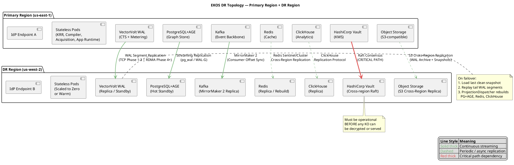
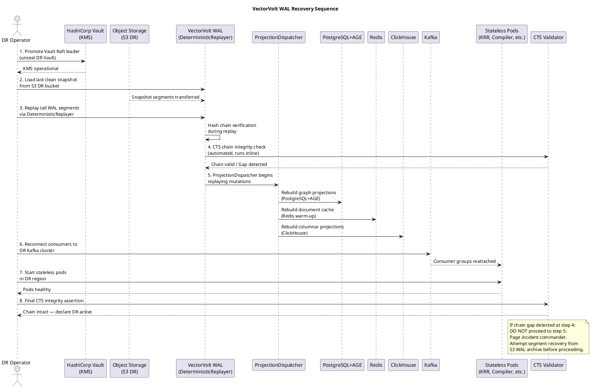
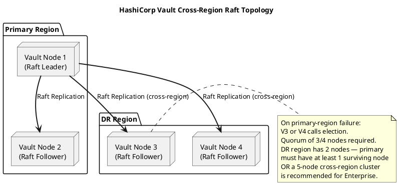

# A17 — Disaster Recovery Deployment Architecture

> **Status:** ✅ Done · **Generated:** 2026-07-03

---

## Table of Contents

1. [Purpose & Scope](#1-purpose--scope)
2. [DR Principles](#2-dr-principles)
3. [RPO/RTO Targets by Tier](#3-rpорто-targets-by-tier)
4. [DR Topology Diagram](#4-dr-topology-diagram)
5. [Replication Architecture per Component](#5-replication-architecture-per-component)
6. [VectorVolt WAL as the Recovery Spine](#6-vectorvolt-wal-as-the-recovery-spine)
7. [KMS DR — Critical Path](#7-kms-dr--critical-path)
8. [Failover Runbook](#8-failover-runbook)
9. [Failback Procedure](#9-failback-procedure)
10. [CTS Integrity Validation](#10-cts-integrity-validation)
11. [Backup Architecture](#11-backup-architecture)
12. [Game-Day Testing Protocol](#12-game-day-testing-protocol)
13. [DR Dashboard](#13-dr-dashboard)
14. [Open Questions](#14-open-questions)

---

## 1. Purpose & Scope

**A17-001 — Purpose.** This document specifies the concrete disaster recovery (DR) architecture for EKOS: the actual replication topology, per-tier RPO/RTO commitments, component-by-component recovery strategies, failover runbooks, and CTS integrity validation procedures. It is the operational complement to the SLA framework and backup self-service surface described in A08-020, A08-021, and A08-022.

**A17-002 — What this document does NOT duplicate.** The following are defined in A08 and referenced here:

| A08 Section | Topic |
|-------------|-------|
| A08-020 | Self-service backup/restore UI; immutable backups in customer-owned storage (S3 / Azure Blob / on-prem); DR dashboard surface |
| A08-021 | Bitemporal history and mutation journal enabling point-in-time reconstruction |
| A08-022 | DR/RPO/RTO targets as per-tier SLAs; game-day testing mandate |

**A17-003 — Scope boundary.** This document covers all EKOS-managed infrastructure: VectorVolt WAL, PostgreSQL+AGE, Kafka, Redis, ClickHouse, KMS (Vault), object storage, and stateless compute pods. External Identity Providers (IdPs) are outside EKOS DR scope; EKOS must support multiple IdP endpoints to tolerate IdP-region failures. Customer-managed KMS (dedicated/on-prem deployments) is the customer's operational responsibility.

**A17-004 — Phases.** DR capabilities evolve with the EKOS phase roadmap. Phase designations follow the VectorVolt Gate model:

- Phase 1–3: TCP-based WAL replication, Pilot Light and Warm Standby tiers
- Phase 4 Gate 2: RDMA WAL replication available for Enterprise/Dedicated
- Phase 5+: Active-Active with VectorVolt `VersionstampGenerator` for cross-region bitemporal ordering

---

## 2. DR Principles

**A17-P1 — Bitemporal storage is itself a DR mechanism.** EKOS Law 11 (non-destructive) combined with bitemporal transaction-time storage means every past state is mathematically recoverable from the VectorVolt WAL. There is no concept of "overwritten data" — only new assertions. Point-in-time recovery is not a special-case operation; it is a first-class query over the WAL + ProjectionDispatcher.

**A17-P2 — The VectorVolt WAL is the single source of truth.** All other stores — PostgreSQL+AGE graph projections, Redis document cache, ClickHouse columnar analytics — are derived projections of the WAL. On failover, these stores are rebuilt by replaying the WAL through the ProjectionDispatcher. No secondary store requires independent backup for correctness; object-stored WAL archive segments are the canonical backup artifact.

**A17-P3 — KMS comes first.** HashiCorp Vault with cross-region Raft replication is the first service that must reach operational readiness in the DR region. Every Knowledge Object (KO) at rest is encrypted; no KO can be read, projected, or served until KMS is unsealed and responding. KMS promotion gates all subsequent failover steps.

**A17-P4 — CTS hash chain integrity is a constitutional invariant.** The Cryptographic Trust Spine (CTS) WAL is hash-chained and append-only. Any gap in the chain — detected after failover — constitutes a constitutional violation under Law 11. Automated chain validation runs before DR is declared active, and the system will not promote to live traffic with an unresolved chain break.

**A17-P5 — Recovery tier determines replication posture.** EKOS does not apply a single DR strategy to all tenants. Infrastructure cost and SLA commitments are matched: Free (Pilot Light), Pro (Warm Standby), Enterprise (Active-Passive), Dedicated (Active-Active if contractually required). Tenants are isolated across tiers; a Free-tier outage does not affect Enterprise failover paths.

**A17-P6 — Stateless compute is free.** KRR, Compiler, Acquisition, and App Runtime pods carry no DR state. OPA policies live in Git (IaC). On DR activation, these spin up in the DR region from the same OCI images used in primary. No replication infrastructure is required for stateless components.

---

## 3. RPO/RTO Targets by Tier

| Tier | DR Model | RPO | RTO | Notes |
|------|----------|-----|-----|-------|
| **Free** | Pilot Light | 24 hours | 24 hours | Best-effort; restore from daily backup snapshots; minimal DR infrastructure pre-provisioned |
| **Pro** | Warm Standby | 1 hour | 4 hours | DR region runs at reduced capacity; promote on failover; streaming replication with 1h sync interval |
| **Enterprise** | Active-Passive | 1 minute | 1 hour | DR region fully provisioned, no live traffic; continuous streaming replication; automated failover trigger |
| **Dedicated / On-Prem** | Active-Active (if contractually required) or Active-Passive | Customer-defined (≥ Enterprise minimums) | Customer-defined (≥ Enterprise minimums) | Bitemporal ordering via VectorVolt `VersionstampGenerator`; Phase 4 Gate 2 RDMA path available |

**A17-005 — RPO definition.** RPO = maximum data age at the moment of DR declaration. For VectorVolt WAL, RPO is bounded by the GroupCommit batch window (target < 10 ms for Enterprise) plus the cross-region replication lag. For PostgreSQL+AGE, RPO is bounded by streaming replication lag (target < 1 s for Enterprise).

**A17-006 — RTO definition.** RTO = elapsed time from DR declaration to the system accepting production traffic in the DR region with validated CTS integrity. It includes: KMS promotion, Postgres replica promotion, Kafka consumer reconnect, VectorVolt WAL replay, and CTS chain validation.

---

## 4. DR Topology Diagram



**Tier-specific DR region provisioning:**

| Component | Free (Pilot Light) | Pro (Warm Standby) | Enterprise (Active-Passive) | Dedicated (Active-Active) |
|-----------|-------------------|-------------------|---------------------------|-----------------------|
| VectorVolt WAL | Snapshot only | Replica, scaled-down | Full replica, standby | Full replica, active |
| PostgreSQL+AGE | Backup restore | Hot standby | Hot standby, auto-promote | Both regions active |
| Kafka | Not replicated | MirrorMaker 2 | MirrorMaker 2, consumer sync | Full cross-region |
| Redis | Not pre-provisioned | Replica | Replica | Both regions active |
| ClickHouse | Not pre-provisioned | Replica | Replica | Both regions active |
| Vault/KMS | Backup | Raft follower | Raft follower | Raft cluster |
| Stateless Pods | Not pre-provisioned | Scaled to zero | Warm (1 replica) | Full capacity |

---

## 5. Replication Architecture per Component

| Component | Replication Method | RPO (Enterprise) | Recovery Method | RTO Contribution | Notes |
|-----------|--------------------|-----------------|-----------------|-----------------|-------|
| **VectorVolt WAL** | TCP WAL segment stream (Phase 1–3); RDMA (Phase 4 Gate 2) | < 10 ms (GroupCommit window + replication lag) | Load last clean snapshot → replay tail WAL segments via `DeterministicReplayer` | 5–15 min (snapshot load + replay) | Primary recovery spine; all other stores rebuild from here |
| **PostgreSQL+AGE** | PostgreSQL streaming replication (`pg_wal`); WAL archiving via WAL-G or pgBackRest to DR S3 | < 1 s streaming lag | Promote standby replica; point-in-time recovery via pg_wal if replica is behind | 1–5 min (promote) + replay time | Also reconstructable via ProjectionDispatcher WAL replay — secondary path |
| **Kafka** | MirrorMaker 2 cross-region topic replication; consumer group offset sync | < replication lag (typically seconds) | Consumer pods reconnect to DR Kafka cluster on failover | < 2 min (consumer reconnect) | CTS Kafka topics are downstream of VectorVolt WAL — WAL is authoritative if Kafka topics are stale |
| **Redis** | Redis Sentinel or Redis Cluster cross-region replication | Minutes (async) | Promote DR replica; rebuild from VectorVolt DocumentStore if stale | 5–20 min (promote + warm-up) | Cache is always rebuilable from WAL projection; stale Redis is non-critical for correctness |
| **ClickHouse** | ClickHouse native replication protocol | Minutes (async) | Promote DR replica; rebuild from VectorVolt ColumnarStore at Phase 5+ | 10–30 min (promote or rebuild) | Analytics projections are re-projectable from WAL at Gate 3; stale analytics do not block CTS |
| **HashiCorp Vault (KMS)** | Raft consensus cross-region | Near-zero (Raft quorum) | Raft leader election in DR region; unseal via auto-unseal or operator | 2–5 min (Raft election + unseal) | **CRITICAL PATH** — must complete before any other recovery step |
| **Object Storage (S3)** | S3 cross-region replication (CRR); enabled on all EKOS buckets | < 15 min (S3 CRR typical) | DR region reads from DR bucket; WAL archive segments available | Negligible (already replicated) | Stores: WAL archive, KO binary store, snapshots, immutable backups |
| **KRR / Compiler / Acquisition / App Runtime Pods** | None (stateless) | N/A | Deploy from OCI image registry in DR region | 2–5 min (pod spin-up) | OCI images must be available in DR region registry (mirrored) |
| **OPA Policies** | Git (IaC) | N/A | Pull from Git on pod startup | Included in pod spin-up | No replication infrastructure required |
| **External IdP** | Customer's responsibility | N/A | Configure DR IdP endpoint in EKOS tenant config | N/A | EKOS maintains multiple IdP endpoint config per tenant |

---

## 6. VectorVolt WAL as the Recovery Spine

**A17-010 — The WAL is the source of truth.** The VectorVolt Write-Ahead Log (WAL) is append-only and hash-chained. Every mutation to every EKOS Knowledge Object — including CTS events, metering records, and graph mutations — is recorded in the WAL before any projection store is updated. This means the WAL, combined with the last clean snapshot, contains a complete and verifiable record of all EKOS state.

**A17-011 — Projection stores are disposable.** PostgreSQL+AGE, Redis, and ClickHouse are materialized views of the WAL. They can be fully reconstructed by replaying the WAL through the `ProjectionDispatcher`. In a DR scenario, if streaming replication of a projection store has fallen behind, the correct recovery path is WAL replay — not attempting to reconcile a stale projection.

**A17-012 — Recovery sequence.** The correct component startup order during WAL-based recovery is:



**A17-013 — DeterministicReplayer guarantees.** The `DeterministicReplayer` applies WAL segments in strictly monotonic versionstamp order. It is the same code path used in normal operation — DR replay is not a special-case code path. This eliminates a class of DR bugs where recovery logic diverges from production logic.

**A17-014 — Segment availability window.** WAL archive segments are stored in object storage with cross-region replication enabled. The retention window is:

| Tier | WAL Archive Retention |
|------|-----------------------|
| Free | 7 days |
| Pro | 30 days |
| Enterprise | 90 days |
| Dedicated | Per SLA (minimum 90 days) |

Point-in-time recovery is possible to any transaction-time within the retention window, subject to snapshot availability.

---

## 7. KMS DR — Critical Path

**A17-020 — Why KMS is the first dependency.** Every Knowledge Object stored by EKOS is encrypted at rest using a tenant-specific key managed by HashiCorp Vault. The ProjectionDispatcher, DeterministicReplayer, and all serving pods require KMS access to decrypt KO binary data before they can operate. If Vault is not unsealed and responding in the DR region, the DR system cannot serve any request, regardless of how quickly other components are ready.

**A17-021 — Vault cross-region Raft topology.** Vault operates as a Raft cluster spanning both primary and DR regions. In normal operation, the primary region hosts the Raft leader. The DR region maintains Raft followers that remain synchronized.



**A17-022 — Unseal procedure in DR.** EKOS uses Vault's auto-unseal feature backed by a cloud KMS (AWS KMS, Azure Key Vault, or GCP Cloud KMS) configured in the DR region. This eliminates operator key-sharding delays during failover. Steps:

1. Raft election completes — DR Vault nodes elect a new leader (automated, ~30 s).
2. Auto-unseal authenticates to the cloud KMS in the DR region.
3. Vault API becomes available in the DR region.
4. EKOS services authenticate to DR Vault using AppRole or Kubernetes auth.

**A17-023 — Customer KMS (Dedicated/on-prem).** When tenants supply their own KMS (dedicated deployment), EKOS does not manage that KMS's DR. The tenant must ensure their KMS is available in the DR region before initiating EKOS failover. EKOS failover will stall at step 7 (KMS health check) until the customer KMS is reachable.

**A17-024 — KMS DR test requirement.** Per the game-day protocol (Section 12), KMS failover must be tested independently — not only as part of a full DR drill. A Vault leader-kill test must be performed at minimum quarterly.

---

## 8. Failover Runbook

> **For on-call engineers.** This runbook assumes DR has been declared by the incident commander. Prerequisites: access to DR region cloud console, Vault admin credentials, EKOS operator CLI.

**A17-030 — Failover decision criteria.** DR is declared when the primary region is confirmed unavailable and one or more of the following is true:

- Primary VectorVolt WAL is not accepting writes for > 30 s (Enterprise), > 5 min (Pro), > 1 h (Free)
- Primary Vault is unreachable for > 60 s
- Automated health monitor has fired `ekos.dr.primary_unavailable` alert

```plantuml
@startuml A17-Failover-Runbook
title EKOS Failover Runbook — Activity Diagram

start

:Incident Commander declares DR;
:Page DR on-call engineer;

:Step 1 — Detect & Verify\nConfirm primary region unavailability\n(3 independent health checks must fail);

if (Primary region truly unavailable?) then (YES)
  :Step 2 — Freeze DR write traffic\n(ensure no split-brain writes during transition);
else (NO — false alarm)
  :Cancel DR, page incident commander;
  stop
endif

:Step 3 — Promote KMS (Vault)\nVerify Raft leader elected in DR region\nVerify auto-unseal completed\nVerify Vault API responds: vault status;

if (Vault operational?) then (YES)
else (NO)
  :Manual unseal: vault operator unseal\nPage Vault admin;
  :Wait for Vault operational;
endif

:Step 4 — Promote PostgreSQL+AGE Replica\npg_ctl promote -D /var/lib/postgresql/data\nVerify replica accepts writes\nUpdate DNS / connection string;

:Step 5 — Verify WAL Segment Availability\nCheck S3 DR bucket for latest WAL archive segment\nekos-ops wal-status --region dr;

:Step 6 — Start VectorVolt WAL in DR\nekos-ops wal-start --region dr --mode recovery\nDeterministicReplayer loads last clean snapshot\nReplays tail WAL segments from S3;

:Step 6a — CTS Chain Validation (automated)\nekos-ops cts-validate --region dr;

if (CTS chain intact?) then (YES)
else (NO — chain gap detected)
  :DO NOT proceed\nAttempt WAL segment recovery from S3 archive\nekos-ops wal-recover-segment --gap <start> <end>;
  if (Segment recovered?) then (YES)
    :Re-run CTS validation;
  else (NO)
    :Page incident commander\nConstitutional violation — escalate;
    stop
  endif
endif

:Step 7 — ProjectionDispatcher Rebuild\nWait for PD to rebuild PostgreSQL+AGE projections\nWait for PD to warm Redis cache\nWait for PD to populate ClickHouse;

:Step 8 — Reconnect Kafka Consumers\nekos-ops kafka-failover --region dr\nConsumer pods reconnect to DR Kafka cluster\nVerify consumer group lag is < threshold;

:Step 9 — Start Stateless Pods\nDeploy KRR, Compiler, Acquisition, App Runtime\nfrom OCI image registry in DR region\nVerify pod health: kubectl get pods -n ekos;

:Step 10 — Redirect Traffic\nUpdate load balancer / DNS to DR region endpoints\nValidate TLS certificates in DR region\nEnable DR IdP endpoint in tenant config;

:Step 11 — Validate CTS Integrity (final)\nekos-ops cts-validate --region dr --full\nVerify CTS stream is accepting new events\nVerify metering records are flowing;

:Step 12 — Declare DR Active\nPost to incident channel: "EKOS DR ACTIVE — <timestamp>"\nNotify affected tenants per communication plan\nOpen DR dashboard: ekos-ops dr-dashboard;

stop

@enduml
```



**A17-031 — CLI reference.** All EKOS DR operations are available via the `ekos-ops` operator CLI:

| Command | Purpose |
|---------|---------|
| `ekos-ops wal-status --region dr` | Show WAL replication lag, last synced segment |
| `ekos-ops wal-start --region dr --mode recovery` | Start VectorVolt WAL in DR recovery mode |
| `ekos-ops cts-validate --region dr` | Validate CTS hash chain in DR WAL |
| `ekos-ops kafka-failover --region dr` | Reconnect Kafka consumers to DR cluster |
| `ekos-ops dr-dashboard` | Open DR operator dashboard |
| `ekos-ops dr-test --dry-run` | Simulate failover without traffic redirect |

---

## 9. Failback Procedure

**A17-040 — Failback principles.** Failback returns production traffic to the primary region after it has recovered. Failback is never automatic — it requires explicit operator decision and zero-data-loss validation.

**A17-041 — Failback sequence.**

1. **Verify primary region health.** Confirm all primary-region infrastructure is operational. Run `ekos-ops primary-health-check` to validate VectorVolt WAL, Vault, PostgreSQL, Kafka, Redis, ClickHouse, and stateless pod availability.

2. **Catch up primary WAL.** While DR is active, the primary region WAL is behind. Reconnect primary WAL replica to the DR WAL (which is now the leader): `ekos-ops wal-sync --source dr --target primary`. Wait for primary to reach WAL parity. Monitor with `ekos-ops wal-status --region primary`.

3. **Catch up projection stores.** Once WAL parity is reached, start ProjectionDispatcher in primary region against the current WAL. Allow projection stores to rebuild. This may take minutes to hours depending on the volume of DR-period mutations.

4. **Zero-data-loss validation.** Run `ekos-ops cts-validate --region primary --compare-region dr`. The CTS hash chain must be identical in both regions at the point of parity. Any divergence must be investigated before proceeding.

5. **Dual-region validation window.** Run both primary and DR regions in parallel for a minimum of 15 minutes (Enterprise) to validate parity. Do not redirect traffic yet.

6. **Traffic redirect.** Update load balancer / DNS to primary region endpoints. Drain DR region connections gracefully (connection draining: 60 s).

7. **Declare primary active.** Post to incident channel: `"EKOS PRIMARY RESTORED — <timestamp>"`. Resume normal monitoring.

8. **DR region cleanup.** Scale down DR region stateless pods to Warm Standby or Pilot Light posture (per tier). Do not decommission DR replication infrastructure.

**A17-042 — Failback timing.** Failback should not be rushed. If the primary-region outage lasted hours, the ProjectionDispatcher rebuild may require equivalent time. Accept that DR may serve production traffic for the duration of rebuild.

---

## 10. CTS Integrity Validation

**A17-050 — Why CTS validation is mandatory.** The Cryptographic Trust Spine (CTS) WAL is hash-chained: each segment commits the hash of the prior segment's tail. A gap in the chain means either data was lost or segments were received out of order. Under EKOS Law 11 (non-destructive), this is a constitutional violation. The system must not serve production traffic from a DR region with an unvalidated or broken CTS chain.

**A17-051 — Validation algorithm.**

```
FOR EACH segment S in WAL archive (ascending versionstamp order):
  ASSERT hash(S.content) == S.header.self_hash
  ASSERT S.header.prev_hash == hash(S_prev.content)
  IF assertion fails:
    REPORT gap at segment S
    HALT — do not proceed to traffic redirect
```

**A17-052 — Automated validator.** `ekos-ops cts-validate` runs this algorithm inline during the WAL recovery step. It is also scheduled to run continuously in background once DR is active, alerting on any new chain anomaly (which would indicate a replication integrity issue during DR operation).

**A17-053 — Gap recovery procedure.** If a chain gap is detected:

1. Identify the missing segment ID from the gap report.
2. Attempt to retrieve the missing segment from the S3 WAL archive in the DR region: `ekos-ops wal-recover-segment --segment-id <id>`.
3. If the segment exists in S3 but was not replicated to the DR WAL: inject it and re-run validation.
4. If the segment does not exist in S3: the segment was lost before replication. This is a data loss event. Escalate to incident commander. Determine the furthest consistent point-in-time (last valid chain segment) and assess whether to recover to that point or extend RTO until the primary region recovers.

**A17-054 — CTS integrity SLA.** A chain gap > 0 segments is a Severity 1 incident regardless of tier.

---

## 11. Backup Architecture

**A17-060 — Backup catalog.** The following artifacts are backed up, independent of streaming replication:

| Artifact | Storage | Encryption | Retention (Enterprise) | Test Restore Frequency |
|----------|---------|------------|----------------------|----------------------|
| VectorVolt WAL archive segments | S3 cross-region replicated | AES-256, tenant key via Vault | 90 days | Monthly |
| VectorVolt clean snapshots | S3 cross-region replicated | AES-256, tenant key via Vault | 90 days (daily snapshots) | Monthly |
| PostgreSQL base backup | S3 via WAL-G / pgBackRest | AES-256 | 30 days | Monthly |
| PostgreSQL WAL archive (pg_wal) | S3 | AES-256 | 14 days | Monthly |
| Vault Raft snapshot | S3 | Vault-managed | 30 days (hourly snapshots) | Quarterly |
| ClickHouse table backup | S3 | AES-256 | 30 days | Quarterly |
| OPA policy set | Git (version-controlled) | Git commit signing | Indefinite (Git history) | On deploy |
| Tenant configuration | Git (IaC) | Git commit signing | Indefinite (Git history) | On deploy |

**A17-061 — Backup immutability.** All S3 backup buckets have Object Lock (WORM) enabled with a minimum retention period matching the tier SLA. Backups cannot be deleted or overwritten within the retention window — this is enforced at the storage level, not application level. This satisfies A08-020's immutable backup requirement.

**A17-062 — Backup encryption.** All backup artifacts are encrypted using tenant-specific keys managed by Vault. The Vault Raft snapshot itself is encrypted by the DR-region cloud KMS auto-unseal key. This means KMS must be available to restore any backup — which is correct, as KMS is the first dependency in the recovery chain.

**A17-063 — Backup integrity verification.** Each backup artifact includes a SHA-256 checksum stored in a separate manifest file. `ekos-ops backup-verify --artifact <id>` recomputes the checksum and validates it against the manifest. This is run automatically after every backup write and before every restore.

---

## 12. Game-Day Testing Protocol

**A17-070 — Mandatory testing.** Per A08-022, DR targets are tested via game-days. Game-days are not optional — they are required for SLA validity.

**A17-071 — Schedule.**

| Test | Frequency | Scope | Success Criteria |
|------|-----------|-------|-----------------|
| Vault leader kill | Quarterly | KMS failover only | Raft election completes in < 60 s; auto-unseal succeeds; KMS API responds in < 5 min |
| Full DR failover drill | Quarterly | All components | Measured RTO within tier SLA; CTS chain valid; no data loss |
| Kafka consumer reconnect | Monthly | Kafka failover only | Consumer reconnects to DR cluster in < 2 min; lag recovers to zero |
| WAL replay validation | Monthly | VectorVolt WAL | DeterministicReplayer replays 24h of WAL to clean state; CTS chain valid |
| Backup restore | Monthly | Random artifact selection | Restore completes; checksum valid; data matches source |
| Failback drill | Semi-annual | Full failback sequence | Primary restored; zero-data-loss validated; DR posture re-established |
| Active-Active conflict resolution (Dedicated) | Annual | Bitemporal ordering under concurrent writes | VersionstampGenerator assigns globally monotonic stamps; no ordering violation |

**A17-072 — Game-day procedure.**

1. Announce in `#ekos-platform` channel: `"GAME DAY STARTING — <date> <time> — <test type>"`.
2. Confirm test environment or production isolation. Full failover drills use isolated staging that mirrors production topology.
3. Execute runbook from Section 8 against the staging environment.
4. Record actual RTO and RPO measured during the drill.
5. Compare against SLA targets. Document any delta.
6. File a post-game-day report within 24 hours to the `ekos-dr-reports` Confluence space.
7. If measured RTO > SLA target: open a P1 engineering ticket; no new game-days until remediated.

**A17-073 — Game-day participants.** Minimum required: 1 DR on-call engineer, 1 incident commander, 1 SRE observer. KMS admin on standby for Vault tests.

---

## 13. DR Dashboard

**A17-080 — Purpose.** The DR dashboard provides operators with real-time visibility into DR readiness posture. It is accessible at `ekos-ops dr-dashboard` and as a web UI in the EKOS operator console.

**A17-081 — Dashboard panels.**

| Panel | Metric | Alert Threshold |
|-------|--------|-----------------|
| WAL Replication Lag | Seconds since last DR WAL segment received | > 30 s (Enterprise), > 5 min (Pro) |
| PostgreSQL Replication Lag | Seconds behind primary | > 5 s (Enterprise), > 60 s (Pro) |
| Kafka Consumer Lag (DR) | Messages behind primary topic | > 10,000 messages |
| Vault Raft Status | Leader region, follower health | Any follower disconnected > 60 s |
| S3 Replication Lag | Age of oldest unreplicated object | > 15 min |
| Last Validated Backup | Timestamp of last successfully verified backup | > 24 h (any tier) |
| CTS Chain Integrity | Last hash chain validation result, gap count | Any gap > 0 |
| Estimated RPO Posture | Max of all component lags, converted to estimated RPO | > 80% of tier RPO |
| DR Region Pod Readiness | Count of pods running in DR region vs. expected | Any pod in CrashLoopBackOff |
| Last Game-Day Result | Date, test type, measured RTO, pass/fail | Overdue (> quarter since last full drill) |

**A17-082 — Alert routing.** All DR dashboard alerts route to the `ekos-dr-oncall` PagerDuty escalation policy. CTS chain gap alerts are Severity 1 and page the incident commander directly.

---

## 14. Open Questions

**OQ-A17-A — Active-Active conflict resolution at Gate 4.** The `VersionstampGenerator` provides globally monotonic versionstamps for Active-Active deployments. The exact protocol for cross-region versionstamp coordination needs formal specification before Phase 4 Gate 2. Open question: does the VersionstampGenerator use a distributed clock (HLC / TrueTime-equivalent) or a primary-region oracle with DR-region shadow? Either choice has RTO implications.

**OQ-A17-B — 5-node Vault Raft for Enterprise quorum.** The current topology (Section 7) places 2 Vault nodes in the DR region. With 4 total nodes, DR-region quorum requires at least 1 surviving primary-region node, which may not be available during a full primary-region failure. Recommendation: move to a 5-node cluster (3 primary, 2 DR) or a 6-node cluster (3 primary, 3 DR) for Enterprise. Decision pending infrastructure cost approval.

**OQ-A17-C — ProjectionDispatcher rebuild time under large WAL.** For a tenant with 5+ years of WAL history, a full rebuild from WAL replay may exceed the Enterprise RTO of 1 hour. Mitigation: more frequent clean snapshots (every 1 h instead of daily). Formal rebuild time estimates need benchmarking against target WAL volumes.

**OQ-A17-D — Customer-managed KMS SLA alignment.** For Dedicated/on-prem tenants supplying their own KMS, EKOS cannot guarantee RTO if the customer KMS is slow to come online. The SLA contract language needs a carve-out: EKOS RTO clock starts only after customer KMS is confirmed operational. Legal review required.

**OQ-A17-E — Kafka topic retention during primary outage.** If the primary Kafka cluster goes down and MirrorMaker 2 cannot replicate for an extended period, DR Kafka topics will serve stale data. Since CTS Kafka is downstream of VectorVolt WAL, correctness is maintained, but analytics consumers may see stale event streams during the outage window. The acceptable staleness period and consumer communication plan need definition.

**OQ-A17-F — ClickHouse re-projection timeline.** At Phase 5, ClickHouse columnar projections are re-projectable from the VectorVolt ColumnarStore. The re-projection time for large columnar datasets needs formal benchmarking. If re-projection exceeds RTO, a pre-warmed ClickHouse replica in the DR region is required — which has ongoing cost implications for Pro and Enterprise tiers.

---

*Document A17 — authored 2026-07-03. Cross-references: A08-020, A08-021, A08-022. Governed by EKOS Constitution Law 11 (non-destructive). Next review: 2026-10-03 or after any DR event or game-day result that reveals a gap.*
