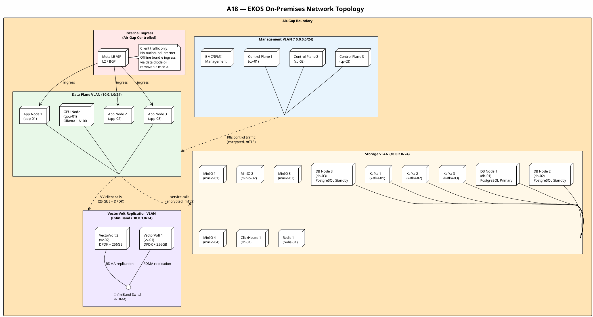
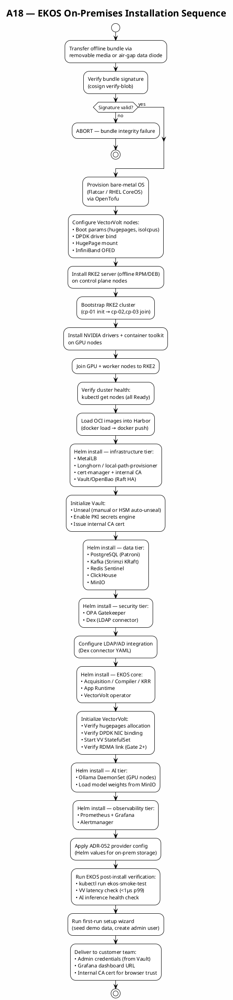

# A18 — On-Premises Deployment Architecture

> **Status:** ✅ Done · **Generated:** 2026-07-03

---

## 1. Purpose & Scope

This document specifies the concrete on-premises deployment architecture for EKOS. Where A08 establishes platform-agnostic deployment principles (air-gap first-class per A08-003; offline Helm/OpenTofu bundles per A08-033; signed offline update bundles per A08-034), A18 translates those principles into actionable hardware specifications, software stack configuration, network topology, Kubernetes cluster design, and an installation sequence that an enterprise IT team can execute without calling EKOS support.

**Target deployment scenarios:**

| Scenario | Driver |
|---|---|
| Government / defense | Air-gapped networks, FIPS 140-2 compliance, HSM key storage, no internet path |
| Regulated enterprise (finance, healthcare, energy) | Data residency obligations, internal audit requirements, preference for self-hosted infrastructure |
| Large enterprise (cost-optimized) | Existing data-center investments; OpEx ceiling on cloud spend |
| Data-sovereignty jurisdictions | Legal or contractual prohibition on data crossing national borders |

**Scope boundaries:**
- This document covers bare-metal and private hypervisor (VMware vSphere, Microsoft Hyper-V) deployments.
- Cloud-provider managed Kubernetes (EKS, AKS, GKE) is out of scope; see A07.
- EKOS SaaS is out of scope; see A06.
- VectorVolt Gate sequencing constraints are inherited from VECTORVOLT-EKOS-INTEGRATION-PLAN.md; A18 documents the bare-metal node configuration only.

---

## 2. On-Premises Principles

**A18-001 — Air-Gap by Default.** Every software artifact (OCI images, Helm charts, OpenTofu modules, sovereign AI model weights) is packaged into a signed offline bundle before delivery. No runtime component contacts an external registry, CDN, or vendor API. Internet access during or after installation is never required.

**A18-002 — Sovereign AI Only.** AI inference runs exclusively on customer-owned GPU hardware via self-hosted Ollama. No request, prompt, or response leaves the deployment boundary. External AI provider credentials are never provisioned.

**A18-003 — Internal PKI, No External CA.** All TLS certificates are issued by cert-manager running against an internal Root CA whose private key never leaves the cluster. External certificate authorities (Let's Encrypt, DigiCert, etc.) are not used.

**A18-004 — Zero External Dependencies at Runtime.** The running EKOS cluster has no required outbound network connections. License validation phone-home is opt-in and can be permanently disabled for air-gapped installs. CTS data never leaves the deployment boundary.

**A18-005 — Hardware-Managed Durability for Performance-Critical Components.** VectorVolt and Kafka manage their own data durability on local NVMe. They do not depend on distributed storage (Longhorn, Ceph) for their primary data paths. Distributed storage (MinIO, Longhorn) is used only for object storage, snapshots, and application-tier persistent volumes.

**A18-006 — FIPS 140-2 Compliance Option.** All cryptographic operations can be run through FIPS 140-2 validated modules (OpenSSL FIPS provider, BoringCrypto) by setting `ekos.fips: true` in the Helm values file. RKE2 ships with a FIPS-validated mode built-in. This option is required for U.S. government deployments.

**A18-007 — Customer Identity Provider.** EKOS integrates with the customer's existing LDAP or Active Directory. External OAuth providers (Google, GitHub, Okta SaaS) are not required. SAML 2.0 integration is supported where the IdP is on-premises.

**A18-008 — CIS Kubernetes Benchmark Compliance.** RKE2 is pre-hardened to CIS Kubernetes Benchmark Level 2. Additional pod security policies (SELinux/AppArmor profiles) are applied at install time. Deviation from the CIS baseline requires explicit operator override.

**A18-009 — Immutable Infrastructure.** Node OS images are immutable (Flatcar Container Linux or RHEL CoreOS). Configuration drift is prevented by re-provisioning nodes rather than patching them in place. OpenTofu manages all infrastructure state.

**A18-010 — Quarterly Signed Update Bundles.** Upgrades are delivered as signed offline delta bundles containing only changed layers. Emergency security patches are delivered out-of-band as minimal bundles signed with the EKOS emergency signing key.

---

## 3. Hardware Reference Architecture

### 3.1 Node Specifications

| Node Type | Min Count | CPU | RAM | Primary Storage | Network | Notes |
|---|---|---|---|---|---|---|
| **Control Plane** | 3 | 8 cores (x86-64) | 32 GB | 500 GB NVMe (OS + etcd) | 10 GbE | RKE2 control plane + etcd; odd count required for quorum |
| **VectorVolt** | 2 | 32+ cores (x86-64, NUMA-aware) | 256 GB | 2 TB NVMe (WAL + data) + 500 GB NVMe (OS) | Intel X710 10/25 GbE (DPDK) + InfiniBand (RDMA replication) | Dedicated; no workload co-location; huge pages at boot |
| **GPU / Sovereign AI** | 1 | 32 cores | 128 GB | 4 TB NVMe (model weights) | 25 GbE | NVIDIA A100 80GB or H100 80GB (production); RTX 4090 24GB (budget/dev — 7B–13B models only) |
| **Database** | 3 | 16 cores | 128 GB | 2 TB NVMe RAID (data) + 500 GB NVMe (WAL, dedicated) | 10 GbE | PostgreSQL 16 + AGE; Patroni HA; WAL on isolated NVMe device |
| **Kafka** | 3 | 16 cores | 64 GB | 4 TB NVMe (log segments) | 10 GbE | KRaft mode; no ZooKeeper; log segments on local NVMe |
| **Application** | 3 | 16 cores | 64 GB | 500 GB NVMe (OS) | 10 GbE | KRR, Compiler, Acquisition, App Runtime — stateless; scale horizontally |
| **MinIO** | 4 | 8 cores | 32 GB | 8 TB HDD or NVMe per node (erasure-coded) | 10 GbE | S3-compatible object storage; CTS archive, snapshots, backups |
| **ClickHouse** | 3 | 16 cores | 64 GB | 2 TB NVMe | 10 GbE | Until VectorVolt Gate 3; ClickHouse Keeper for HA |
| **Redis** | 3 | 8 cores | 32 GB | 500 GB NVMe | 10 GbE | Redis 7 Sentinel cluster |

### 3.2 Minimum Bill of Materials (Production HA)

| Category | Quantity | Purpose |
|---|---|---|
| Control plane nodes | 3 | Kubernetes HA control plane |
| VectorVolt nodes | 2 | Sub-microsecond OLTP engine |
| GPU nodes | 1 | Sovereign AI (expandable) |
| Database nodes | 3 | PostgreSQL + AGE Patroni cluster |
| Kafka nodes | 3 | Event streaming |
| Application nodes | 3 | Stateless EKOS services |
| MinIO nodes | 4 | Object storage |
| ClickHouse nodes | 3 | Columnar analytics (pre-Gate 3) |
| Redis nodes | 3 | Session / cache tier |
| **Total minimum nodes** | **25** | |
| Network switches | 2 | 10/25 GbE ToR (bonded uplinks), management switch |
| InfiniBand switch | 1 | RDMA replication between VV nodes |
| Management server | 1 | BMC / IPMI / iDRAC out-of-band management |

> **Sizing note:** For small deployments (≤50 users), database, Redis, and ClickHouse nodes may be co-located on the application nodes with resource quotas. See Section 15 (Sizing Guide) for full small/medium/large profiles.

---

## 4. Network Topology Diagram



---

## 5. Software Stack

| Component | Software | Version | Deployment Model | HA Mode |
|---|---|---|---|---|
| Kubernetes distribution | RKE2 (Rancher Government) | 1.30.x (FIPS build) | systemd on bare metal | 3-node control plane + etcd quorum |
| Container runtime | containerd | 1.7.x | bundled with RKE2 | N/A |
| CNI | Canal (Calico + Flannel) | bundled with RKE2 | DaemonSet | N/A |
| Load balancer | MetalLB | 0.14.x | Helm chart | L2 or BGP mode |
| Persistent volumes (app tier) | Longhorn | 1.6.x | Helm chart | Replicated volumes |
| Persistent volumes (VV / Kafka) | local-path-provisioner | 0.0.28 | Helm chart | Self-managed durability |
| OCI registry | Harbor | 2.10.x | Helm chart | Active-passive |
| Graph + relational DB | PostgreSQL 16 + Apache AGE | 16.3 / 1.5.0 | Patroni on bare metal | Patroni HA (3-node) |
| Streaming | Apache Kafka | 3.7.x | Helm (Strimzi operator) | KRaft, 3 brokers |
| Cache / session | Redis | 7.2.x | Helm | Redis Sentinel (3-node) |
| Columnar analytics | ClickHouse | 24.3 LTS | Helm | ClickHouse Keeper (3-node) |
| Object storage | MinIO | RELEASE.2024-x | Helm | Erasure-coded (4+ nodes) |
| Secret / KMS | HashiCorp Vault (BSL) or OpenBao (Apache 2.0) | Vault 1.17 / OpenBao 2.0 | Helm | Vault Raft integrated storage |
| PKI / TLS | cert-manager | 1.15.x | Helm | Leader-elected |
| Internal CA | cert-manager ClusterIssuer | N/A | CRD config | Backed by Vault PKI secrets engine |
| Policy engine | Open Policy Agent (OPA) | 0.66.x | Helm (Gatekeeper) | Replicated |
| Monitoring | Prometheus | 2.52.x | kube-prometheus-stack Helm | HA pair |
| Dashboards | Grafana | 11.x | kube-prometheus-stack Helm | Replicated |
| Sovereign AI inference | Ollama | 0.3.x | DaemonSet on GPU nodes | Single-node (add GPU nodes for HA) |
| Identity integration | Dex (LDAP/SAML connector) | 2.39.x | Helm | Replicated |
| VectorVolt engine | VectorVolt (Rust) | per integration plan | StatefulSet on bare metal | 2-node RDMA replication |

---

## 6. Kubernetes Cluster Architecture

### 6.1 RKE2 Setup

**A18-011** — RKE2 is the mandatory Kubernetes distribution for government and regulated deployments. It ships FIPS 140-2 validated, has CIS Kubernetes Benchmark Level 2 hardening built-in, and carries a U.S. DoD STIG. Vanilla kubeadm is acceptable for commercial deployments that do not require FIPS or STIG compliance.

**A18-012** — Do not use k3s. k3s omits features required at EKOS production scale (no multi-node etcd, limited audit logging, no FIPS build).

**Bootstrap sequence:**

```bash
# On each control plane node — install RKE2 server
curl -sfL https://get.rke2.io | INSTALL_RKE2_TYPE="server" sh -
# (In air-gap: install from offline RPM/DEB package in the bundle)

# /etc/rancher/rke2/config.yaml on cp-01 (bootstrap node):
cluster-init: true
tls-san:
  - 10.0.0.10   # VIP managed by keepalived or MetalLB
  - ekos-api.internal
cni: canal
kube-apiserver-arg:
  - "audit-log-path=/var/log/kubernetes/audit.log"
  - "audit-log-maxage=30"
  - "audit-log-maxbackup=10"
  - "audit-log-maxsize=100"
  - "encryption-provider-config=/etc/kubernetes/encryption.yaml"
etcd-arg:
  - "quota-backend-bytes=8589934592"   # 8 GB etcd quota

# cp-02, cp-03: join using token from cp-01
server: https://10.0.0.10:9345
token: <rke2-join-token>
```

### 6.2 Node Pools and Labels

```bash
# Label VectorVolt nodes — no other workloads scheduled here
kubectl label node vv-01 vv-02 ekos.io/node-role=vectorvolt
kubectl taint node vv-01 vv-02 ekos.io/node-role=vectorvolt:NoSchedule

# Label GPU nodes
kubectl label node gpu-01 ekos.io/node-role=gpu nvidia.com/gpu=present
kubectl taint node gpu-01 ekos.io/gpu=true:NoSchedule

# Label database nodes
kubectl label node db-01 db-02 db-03 ekos.io/node-role=database

# Label Kafka nodes
kubectl label node kafka-01 kafka-02 kafka-03 ekos.io/node-role=kafka

# Application nodes — no taint, default scheduling
kubectl label node app-01 app-02 app-03 ekos.io/node-role=application
```

### 6.3 Namespace Layout

| Namespace | Contents |
|---|---|
| `ekos-system` | EKOS control-plane services (Acquisition, Compiler, KRR, App Runtime) |
| `ekos-vectorvolt` | VectorVolt operator and StatefulSet |
| `ekos-data` | PostgreSQL (Patroni), Redis, ClickHouse |
| `ekos-kafka` | Kafka (Strimzi operator) |
| `ekos-storage` | MinIO |
| `ekos-ai` | Ollama, model-serving sidecar |
| `ekos-infra` | cert-manager, MetalLB, Longhorn, Harbor |
| `ekos-security` | Vault/OpenBao, OPA Gatekeeper |
| `ekos-observability` | Prometheus, Grafana, Alertmanager |
| `ekos-identity` | Dex, LDAP connector |

### 6.4 Storage Classes

| Storage Class | Provisioner | Used By | Durability Guarantee |
|---|---|---|---|
| `ekos-local-nvme` | local-path-provisioner | VectorVolt WAL, Kafka log segments | Application-managed (VV WAL, Kafka replication) |
| `ekos-longhorn-rwo` | Longhorn | PostgreSQL, Redis, ClickHouse | 3-way replica |
| `ekos-longhorn-rwx` | Longhorn | Shared config, cert stores | 3-way replica |
| `ekos-minio` | MinIO CSI | Object blobs, CTS archive | Erasure-coded (4+4 or 6+2) |

### 6.5 MetalLB Configuration

```yaml
# L2 mode — no BGP router required
apiVersion: metallb.io/v1beta1
kind: IPAddressPool
metadata:
  name: ekos-pool
  namespace: ekos-infra
spec:
  addresses:
    - 10.0.1.100-10.0.1.120   # Reserved for EKOS LoadBalancer services
---
apiVersion: metallb.io/v1beta1
kind: L2Advertisement
metadata:
  name: ekos-l2
  namespace: ekos-infra
spec:
  ipAddressPools:
    - ekos-pool
```

---

## 7. VectorVolt Bare-Metal Configuration

### 7.1 Hardware Requirements

**A18-013** — VectorVolt nodes must have DPDK-compatible NICs. Validated cards: Intel X710 (10/25 GbE), Intel E810 (100 GbE), Mellanox ConnectX-5 or ConnectX-6 (25/100 GbE). Broadcom NICs are not supported for kernel bypass.

**A18-014** — VectorVolt WAL must reside on a dedicated NVMe device isolated from the OS partition. Sharing a device with the OS or other workloads invalidates latency guarantees.

**A18-015** — NUMA topology must be respected. Assign isolated CPU cores and memory channels that are local to the NUMA node where the DPDK NIC is attached. Verify with `numactl --hardware`.

### 7.2 Linux Boot Parameters

Add the following to `/etc/default/grub` on each VectorVolt node, then run `update-grub` (Debian/Ubuntu) or `grub2-mkconfig` (RHEL):

```
GRUB_CMDLINE_LINUX="default_hugepagesz=2M hugepages=1024 hugepagesz=1G hugepages=4 isolcpus=4-31 nohz_full=4-31 rcu_nocbs=4-31 intel_idle.max_cstate=0 processor.max_cstate=0 mce=off iommu=pt intel_iommu=on"
```

Parameter explanation:

| Parameter | Value | Purpose |
|---|---|---|
| `default_hugepagesz` | `2M` | Default huge page size |
| `hugepages` | `1024` | Reserve 2 GB in 2M pages |
| `hugepagesz` | `1G` | Also configure 1G pages |
| `hugepages` (1G) | `4` | Reserve 4 GB in 1G pages (for VV DPDK memory pools) |
| `isolcpus` | `4-31` | Remove cores 4–31 from kernel scheduler |
| `nohz_full` | `4-31` | Disable scheduler ticks on isolated cores |
| `rcu_nocbs` | `4-31` | Offload RCU callbacks from isolated cores |
| `intel_idle.max_cstate` | `0` | Disable C-states — prevent latency spikes from core sleep |
| `iommu=pt` | — | IOMMU passthrough — required for DPDK |
| `intel_iommu=on` | — | Enable VT-d IOMMU for DMA remapping |

> **Validation:** After reboot, verify with `cat /proc/cmdline` and `grep HugePages /proc/meminfo`. Expected: `HugePages_Total: 1024` (2M) and `HugePages_Total: 4` (1G).

### 7.3 DPDK Driver Binding

```bash
# Install DPDK userspace tools (from offline bundle)
apt-get install -y dpdk dpdk-dev  # or equivalent RPM

# Identify NIC PCI address (e.g., Intel X710)
dpdk-devbind.py --status | grep -i "X710\|E810\|ConnectX"

# Bind the data-plane NIC to vfio-pci (kernel bypass driver)
modprobe vfio-pci
dpdk-devbind.py --bind=vfio-pci 0000:03:00.0   # replace with actual PCI address

# Persist across reboots (add to /etc/rc.local or systemd unit)
echo "vfio-pci" >> /etc/modules-load.d/dpdk.conf
```

### 7.4 HugePage Mount

```bash
# Mount hugetlbfs for DPDK memory pools
mkdir -p /dev/hugepages
mount -t hugetlbfs nodev /dev/hugepages
echo "nodev /dev/hugepages hugetlbfs defaults 0 0" >> /etc/fstab

# For 1G pages
mkdir -p /dev/hugepages1G
mount -t hugetlbfs -o pagesize=1G nodev /dev/hugepages1G
```

### 7.5 VectorVolt StatefulSet Configuration

```yaml
# Excerpt from VectorVolt Helm values (on-prem profile)
vectorvolt:
  nodeSelector:
    ekos.io/node-role: vectorvolt
  tolerations:
    - key: ekos.io/node-role
      value: vectorvolt
      effect: NoSchedule
  resources:
    requests:
      cpu: "28"           # leaves 4 cores for OS on a 32-core node
      memory: "240Gi"
      hugepages-2Mi: "2Gi"
      hugepages-1Gi: "4Gi"
    limits:
      cpu: "28"
      memory: "240Gi"
      hugepages-2Mi: "2Gi"
      hugepages-1Gi: "4Gi"
  securityContext:
    capabilities:
      add: ["IPC_LOCK", "NET_ADMIN", "SYS_RAWIO"]
  volumeMounts:
    - name: hugepages-2mi
      mountPath: /dev/hugepages
    - name: hugepages-1gi
      mountPath: /dev/hugepages1G
    - name: vv-wal
      mountPath: /var/vv/wal
  volumes:
    - name: hugepages-2mi
      emptyDir:
        medium: HugePages-2Mi
    - name: hugepages-1gi
      emptyDir:
        medium: HugePages-1Gi
    - name: vv-wal
      hostPath:
        path: /dev/nvme1n1    # dedicated WAL NVMe device
        type: BlockDevice
```

### 7.6 InfiniBand RDMA Replication (Gate 2)

**A18-016** — InfiniBand is required for VectorVolt RDMA replication (Gate 2+). Minimum: HDR100 (100 Gb/s). Mellanox ConnectX-5 or ConnectX-6 with OFED drivers.

```bash
# Install OFED from offline bundle on VectorVolt nodes
tar -xzf MLNX_OFED_LINUX-23.10-x86_64.tgz
./mlnxofedinstall --add-kernel-support --without-fw-update

# Verify IB link state
ibstat | grep -A3 "State:"
# Expected: State: Active, Physical state: LinkUp, Rate: 100

# Configure IPoIB for Kubernetes pod network
ip link set ib0 up
ip addr add 10.0.3.1/24 dev ib0   # VV node 1 replication IP
# (10.0.3.2 on VV node 2)
```

---

## 8. Sovereign AI Deployment

### 8.1 GPU Node Setup

**A18-017** — GPU nodes run Ollama as a Kubernetes DaemonSet (one replica per GPU node). The NVIDIA device plugin allocates GPU resources to pods.

```bash
# Install NVIDIA drivers from offline bundle (air-gap safe)
# Recommended: NVIDIA Data Center Driver 535.x (production)
bash NVIDIA-Linux-x86_64-535.161.08.run --no-opengl-files --silent

# Install container toolkit (offline)
apt-get install -y nvidia-container-toolkit

# Configure containerd to use nvidia runtime
nvidia-ctk runtime configure --runtime=containerd
systemctl restart containerd
```

### 8.2 Model Selection

| Model | Parameters | VRAM Required | Recommended Hardware | Use Case |
|---|---|---|---|---|
| Llama 3.1 70B (Q4_K_M) | 70B | ~42 GB | A100 80GB / H100 80GB | Production — full capability |
| Mistral Large 2 (Q4_K_M) | 123B | ~75 GB | H100 80GB | Production — superior reasoning |
| Qwen2.5 72B (Q4_K_M) | 72B | ~45 GB | A100 80GB | Production — multilingual |
| Llama 3.1 8B (Q8_0) | 8B | ~10 GB | RTX 4090 24GB | Budget — limited reasoning |
| Phi-3.5 Mini (Q8_0) | 3.8B | ~4 GB | Any GPU | Edge / resource-constrained |

> **Default recommendation:** Llama 3.1 70B (Q4_K_M) on A100 80GB. Load at install time from the offline bundle (model weights are included in the air-gap tarball).

### 8.3 Ollama Helm Values

```yaml
ollama:
  nodeSelector:
    ekos.io/node-role: gpu
  tolerations:
    - key: ekos.io/gpu
      value: "true"
      effect: NoSchedule
  resources:
    limits:
      nvidia.com/gpu: "1"
  models:
    - llama3.1:70b-instruct-q4_K_M    # pulled from Harbor (offline bundle)
    - mistral-large:2407-q4_K_M        # optional second model
  persistence:
    storageClass: ekos-local-nvme
    size: 500Gi     # model weights on local NVMe
  env:
    OLLAMA_HOST: "0.0.0.0"
    OLLAMA_NUM_PARALLEL: "4"
    OLLAMA_MAX_LOADED_MODELS: "1"
```

### 8.4 EKOS AI Adapter Configuration

```yaml
ekos:
  ai:
    provider: ollama
    endpoint: "http://ollama.ekos-ai.svc.cluster.local:11434"
    model: "llama3.1:70b-instruct-q4_K_M"
    timeout: 120s
    externalProvider: none   # explicitly disabled
```

---

## 9. Air-Gap Bundle Specification

### 9.1 Bundle Contents

```
ekos-bundle-v2.0.0-2026Q3.tar.gz
├── manifest.json              # signed SHA256 manifest of all contents
├── manifest.json.sig          # cosign signature (EKOS root signing key)
├── images/
│   ├── ekos-core.tar          # all EKOS component OCI images
│   ├── infrastructure.tar     # RKE2, Harbor, cert-manager, MetalLB, Longhorn
│   ├── data.tar               # PostgreSQL, Redis, Kafka, ClickHouse, MinIO
│   ├── security.tar           # Vault/OpenBao, OPA Gatekeeper
│   └── observability.tar      # Prometheus, Grafana, Alertmanager
├── models/
│   └── llama3.1-70b-q4_K_M.gguf   # sovereign AI model weights
├── charts/
│   └── ekos-stack-2.0.0.tgz   # Helm umbrella chart
├── terraform/
│   └── ekos-onprem-2.0.0/     # OpenTofu modules for K8s infrastructure
├── rke2/
│   └── rke2-v1.30.x-amd64.tar.gz  # RKE2 offline installer
└── signing-keys/
    └── ekos-cosign.pub         # EKOS public key for signature verification
```

### 9.2 Bundle Signing

All bundles are signed with cosign using the EKOS root signing key (offline, HSM-protected). Customers receive the `ekos-cosign.pub` public key at contract signing via secure out-of-band channel.

```bash
# Verify bundle integrity before loading (customer runs this)
cosign verify-blob \
  --key ekos-cosign.pub \
  --signature manifest.json.sig \
  manifest.json

# Verify individual image digests match manifest
sha256sum -c manifest.json   # fails if any file is tampered
```

### 9.3 Harbor Image Load

```bash
# Load all OCI images into Harbor on-prem registry
for tarball in images/*.tar; do
  docker load -i "$tarball"
done

# Tag and push to Harbor
for image in $(docker images --format "{{.Repository}}:{{.Tag}}" | grep ekos); do
  docker tag "$image" harbor.ekos.internal/ekos/"${image##*/}"
  docker push harbor.ekos.internal/ekos/"${image##*/}"
done

# Load Ollama model into MinIO (Ollama will pull from MinIO on first start)
mc alias set minio http://minio.ekos-storage.svc.cluster.local:9000 admin <password>
mc cp models/llama3.1-70b-q4_K_M.gguf minio/ekos-models/
```

### 9.4 Delta Update Bundle Format

Quarterly updates ship as delta bundles:

```
ekos-delta-v2.0.0-to-v2.1.0-2026Q4.tar.gz
├── manifest-delta.json        # only changed images listed; signed
├── manifest-delta.json.sig
├── images/
│   └── changed-images.tar     # only layers that changed (OCI layer delta)
├── charts/
│   └── ekos-stack-2.1.0.tgz
└── CHANGELOG.md               # human-readable change log
```

Delta bundles reference unchanged layers by digest — Harbor deduplicates on push. Typical delta size: 200–800 MB vs. 15–20 GB for a full bundle.

---

## 10. Installation Sequence



---

## 11. Identity Integration

### 11.1 LDAP / Active Directory

**A18-018** — EKOS uses Dex as an OIDC broker. Dex connects to the customer's LDAP or Active Directory and exposes a standard OIDC endpoint consumed by all EKOS services. No EKOS component connects directly to LDAP.

```yaml
# Dex config — LDAP connector example (Active Directory)
connectors:
  - type: ldap
    id: ad
    name: "Corporate Active Directory"
    config:
      host: "ldap.corp.example.com:636"
      insecureSkipVerify: false
      rootCAData: "<base64-encoded-internal-CA-cert>"
      bindDN: "cn=ekos-svc,ou=service-accounts,dc=corp,dc=example,dc=com"
      bindPW: "$LDAP_BIND_PASSWORD"   # sourced from Vault secret
      usernamePrompt: "Corporate Username"
      userSearch:
        baseDN: "ou=users,dc=corp,dc=example,dc=com"
        filter: "(objectClass=person)"
        username: sAMAccountName
        idAttr: DN
        emailAttr: mail
        nameAttr: displayName
      groupSearch:
        baseDN: "ou=groups,dc=corp,dc=example,dc=com"
        filter: "(objectClass=group)"
        userMatchers:
          - userAttr: DN
            groupAttr: member
        nameAttr: cn
```

### 11.2 SAML 2.0 (On-Premises IdP)

For customers with ADFS or Shibboleth, Dex also supports SAML 2.0:

```yaml
connectors:
  - type: saml
    id: adfs
    name: "ADFS"
    config:
      ssoURL: "https://adfs.corp.example.com/adfs/ls/"
      caData: "<base64-encoded-ADFS-signing-cert>"
      redirectURI: "https://ekos.corp.example.com/dex/callback"
      entityIssuer: "https://ekos.corp.example.com/dex"
      usernameAttr: "http://schemas.xmlsoap.org/ws/2005/05/identity/claims/upn"
      emailAttr: "http://schemas.xmlsoap.org/ws/2005/05/identity/claims/emailaddress"
      groupsAttr: "http://schemas.microsoft.com/ws/2008/06/identity/claims/groups"
```

### 11.3 Internal PKI (cert-manager)

**A18-019** — The internal CA root key is generated inside Vault's PKI secrets engine at install time and never exported. cert-manager issues all cluster TLS certificates against this CA via the Vault issuer.

```yaml
# cert-manager ClusterIssuer — Vault PKI
apiVersion: cert-manager.io/v1
kind: ClusterIssuer
metadata:
  name: ekos-internal-ca
spec:
  vault:
    server: https://vault.ekos-security.svc.cluster.local:8200
    path: pki/sign/ekos-cluster
    caBundle: <base64-internal-CA-cert>
    auth:
      kubernetes:
        mountPath: /v1/auth/kubernetes
        role: cert-manager
```

All Ingress resources and inter-service mTLS certificates are issued by this ClusterIssuer. Certificate rotation is automatic (cert-manager renews at 2/3 of validity period).

---

## 12. Security Configuration

### 12.1 FIPS 140-2 Mode

**A18-020** — Enable FIPS mode by setting `ekos.fips: true` in the Helm values file. This activates:
- RKE2 FIPS mode (uses FIPS-validated Go crypto; see RKE2 FIPS documentation)
- OpenSSL FIPS provider for all Rust/C components
- BoringCrypto for Go components
- Kernel FIPS mode (`fips=1` in boot parameters — add to `GRUB_CMDLINE_LINUX`)

```bash
# Verify FIPS mode is active on nodes
cat /proc/sys/crypto/fips_enabled   # expected: 1
```

### 12.2 HSM Integration

**A18-021** — For highest-classification government deployments, HashiCorp Vault (or OpenBao) can be configured with HSM auto-unseal:

```hcl
# vault.hcl — HSM auto-unseal (PKCS#11)
seal "pkcs11" {
  lib            = "/usr/lib/x86_64-linux-gnu/pkcs11/opensc-pkcs11.so"
  slot           = "0"
  pin            = "env:VAULT_HSM_PIN"
  key_label      = "ekos-vault-unseal"
  hmac_key_label = "ekos-vault-hmac"
}
```

Supported HSM models: Thales Luna Network HSM, nCipher nShield, Entrust nShield.

### 12.3 SELinux / AppArmor

**A18-022** — All EKOS pods ship with pre-built SELinux policy modules (RHEL/Fedora) or AppArmor profiles (Debian/Ubuntu). Applied via OPA Gatekeeper policy:

```yaml
apiVersion: constraints.gatekeeper.sh/v1beta1
kind: K8sPSPAllowedProfiles
metadata:
  name: ekos-require-security-profiles
spec:
  match:
    namespaces: ["ekos-system", "ekos-data", "ekos-kafka", "ekos-ai"]
  parameters:
    allowedProfiles:
      - "runtime/default"
      - "localhost/ekos-vectorvolt"   # custom profile for VV
      - "localhost/ekos-ollama"       # custom profile for Ollama
```

### 12.4 Network Segmentation Policy

**A18-023** — Kubernetes NetworkPolicy objects enforce VLAN-level segmentation within the cluster:

```yaml
# Only ekos-system namespace can initiate calls to ekos-data
apiVersion: networking.k8s.io/v1
kind: NetworkPolicy
metadata:
  name: data-tier-ingress
  namespace: ekos-data
spec:
  podSelector: {}
  ingress:
    - from:
        - namespaceSelector:
            matchLabels:
              kubernetes.io/metadata.name: ekos-system
        - namespaceSelector:
            matchLabels:
              kubernetes.io/metadata.name: ekos-vectorvolt
  policyTypes:
    - Ingress
```

### 12.5 No Telemetry

**A18-024** — All EKOS components ship with telemetry disabled by default. The Helm values `ekos.telemetry.enabled: false` is the default. For air-gapped installs, egress NetworkPolicy blocks all outbound traffic to non-cluster destinations:

```yaml
# Default-deny all egress from ekos namespaces except to cluster-internal
apiVersion: networking.k8s.io/v1
kind: NetworkPolicy
metadata:
  name: default-deny-external-egress
  namespace: ekos-system
spec:
  podSelector: {}
  policyTypes:
    - Egress
  egress:
    - to:
        - namespaceSelector: {}   # allow intra-cluster only
    - ports:
        - protocol: UDP
          port: 53                # DNS
```

---

## 13. ADR-052 Provider Configuration

```yaml
# ekos-values-onprem.yaml — Helm values for on-premises deployment
ekos:
  deploymentMode: onprem
  fips: false              # set true for government deployments
  telemetry:
    enabled: false
    phoneHome: false       # disable license phone-home for air-gap

  storage:
    graph: postgresql-age
    relational: postgresql
    document: redis
    columnar: clickhouse   # replaced by VectorVolt at Gate 3

  postgresql:
    endpoints:
      - "db-01.ekos-data.svc.cluster.local:5432"
      - "db-02.ekos-data.svc.cluster.local:5432"
      - "db-03.ekos-data.svc.cluster.local:5432"
    ha: patroni

  redis:
    mode: sentinel
    sentinels:
      - "redis-01.ekos-data.svc.cluster.local:26379"
      - "redis-02.ekos-data.svc.cluster.local:26379"
      - "redis-03.ekos-data.svc.cluster.local:26379"
    masterName: ekos-master

  kafka:
    brokers:
      - "kafka-01.ekos-kafka.svc.cluster.local:9092"
      - "kafka-02.ekos-kafka.svc.cluster.local:9092"
      - "kafka-03.ekos-kafka.svc.cluster.local:9092"
    mode: kraft

  vectorvolt:
    enabled: true           # Gate 1+ — dedicated bare metal nodes
    nodes:
      - "vv-01.ekos-vectorvolt.svc.cluster.local:6543"
      - "vv-02.ekos-vectorvolt.svc.cluster.local:6543"
    hugepages: 1g
    dpdk: true
    rdma: infiniband        # Gate 2+; set "none" for Gate 1

  ai:
    provider: ollama
    endpoint: "http://ollama.ekos-ai.svc.cluster.local:11434"
    model: "llama3.1:70b-instruct-q4_K_M"
    externalProvider: none

  registry:
    server: "harbor.ekos-infra.svc.cluster.local"
    prefix: "ekos"

  vault:
    address: "https://vault.ekos-security.svc.cluster.local:8200"
    authMethod: kubernetes
    fipsMode: false         # set true to require FIPS-validated seal
```

---

## 14. Monitoring & Observability

### 14.1 Self-Hosted Stack

**A18-025** — All metrics, logs, and traces remain on-premises. No data is sent to Datadog, New Relic, or any external observability platform.

| Component | Purpose | Retention |
|---|---|---|
| Prometheus | Metrics scraping and storage | 90 days (configurable) |
| Grafana | Dashboards and alerting | N/A |
| Alertmanager | Alert routing to on-prem PagerDuty or email | N/A |
| Loki (optional) | Log aggregation | 30 days |
| Tempo (optional) | Distributed tracing | 14 days |

### 14.2 Key Dashboards (Pre-Built)

Pre-built Grafana dashboards are included in the bundle:

- **EKOS Overview** — service health, API latency, active users
- **VectorVolt Latency** — p50/p99/p999 read and write latency; DPDK ring utilization; huge page consumption
- **VectorVolt RDMA** — InfiniBand throughput, packet loss, link state (Gate 2+)
- **Kafka Throughput** — consumer lag, partition leadership, log segment size
- **PostgreSQL HA** — Patroni leader/replica status, WAL lag, connection pool saturation
- **Sovereign AI** — Ollama inference latency, GPU utilization, VRAM usage, queue depth
- **Kubernetes Cluster** — node CPU/memory, pod restart rates, PVC utilization

### 14.3 VectorVolt Custom Metrics

VectorVolt exposes Prometheus metrics on `:9090/metrics` on each node:

```
vv_read_latency_ns{quantile="0.99"}   # target: <1000 (sub-microsecond)
vv_write_latency_ns{quantile="0.99"}
vv_dpdk_rx_packets_total
vv_dpdk_tx_packets_total
vv_hugepage_used_bytes
vv_wal_fsync_latency_ns{quantile="0.99"}
vv_rdma_bytes_sent_total
vv_rdma_bytes_recv_total
```

### 14.4 CTS Audit Log

**A18-026** — All EKOS actions are written to the Change Tracking System (CTS). CTS data is stored on-premises in MinIO (compressed Parquet, partitioned by day). CTS data never leaves the deployment boundary. CTS archive retention is configured per customer policy (default: 7 years).

---

## 15. Sizing Guide

### 15.1 Small (≤50 concurrent users)

| Node Type | Count | CPU | RAM | Storage | Notes |
|---|---|---|---|---|---|
| Control plane | 3 | 8 cores | 32 GB | 500 GB NVMe | Standard |
| VectorVolt | 2 | 16 cores | 128 GB | 1 TB NVMe | Reduced; hugepages=512 (1G: 2) |
| GPU / AI | 1 | 16 cores | 64 GB | 2 TB NVMe | RTX 4090 acceptable; 13B model |
| Combined data/app | 3 | 16 cores | 64 GB | 2 TB NVMe | DB + Kafka + Redis + App co-located |
| MinIO | 2 | 8 cores | 16 GB | 4 TB HDD | Reduced erasure (2+2) |
| **Total** | **11** | | | | Minimum viable HA cluster |

### 15.2 Medium (51–500 concurrent users)

| Node Type | Count | CPU | RAM | Storage | Notes |
|---|---|---|---|---|---|
| Control plane | 3 | 8 cores | 32 GB | 500 GB NVMe | Standard |
| VectorVolt | 2 | 32 cores | 256 GB | 2 TB NVMe | Full spec |
| GPU / AI | 1 | 32 cores | 128 GB | 4 TB NVMe | A100 80GB; 70B model |
| Database | 3 | 16 cores | 128 GB | 2 TB NVMe | Dedicated Patroni cluster |
| Kafka | 3 | 16 cores | 64 GB | 4 TB NVMe | Dedicated KRaft |
| Application | 3 | 16 cores | 64 GB | 500 GB NVMe | Stateless EKOS services |
| MinIO | 4 | 8 cores | 32 GB | 8 TB NVMe | Standard erasure (4+4) |
| Redis | 3 | 8 cores | 32 GB | 500 GB NVMe | Standard Sentinel |
| ClickHouse | 3 | 16 cores | 64 GB | 2 TB NVMe | Until Gate 3 |
| **Total** | **25** | | | | Reference architecture |

### 15.3 Large (501–5000 concurrent users)

| Node Type | Count | CPU | RAM | Storage | Notes |
|---|---|---|---|---|---|
| Control plane | 3 | 16 cores | 64 GB | 1 TB NVMe | Upgraded control plane |
| VectorVolt | 4 | 64 cores | 512 GB | 4 TB NVMe (×2) | 4-node ring; dual InfiniBand |
| GPU / AI | 3 | 32 cores | 256 GB | 8 TB NVMe | H100 80GB per node; model sharding |
| Database | 5 | 32 cores | 256 GB | 4 TB NVMe | 1 primary + 2 sync standbys + 2 async read replicas |
| Kafka | 5 | 16 cores | 128 GB | 8 TB NVMe | 5-broker KRaft; replication factor 3 |
| Application | 6 | 16 cores | 64 GB | 500 GB NVMe | Horizontally scaled |
| MinIO | 8 | 16 cores | 64 GB | 16 TB NVMe | High-throughput erasure (6+2) |
| Redis | 6 | 16 cores | 64 GB | 1 TB NVMe | Redis Cluster mode (6-node) |
| ClickHouse | 5 | 32 cores | 128 GB | 4 TB NVMe | Sharded cluster; until Gate 3 |
| **Total** | **45** | | | | Enterprise scale |

---

## 16. Open Questions

**OQ-A18-A — VMware NSX-T vs. Calico for Network Policy at Scale.**
At large (5000-user) deployments on VMware vSphere, should EKOS recommend VMware NSX-T DFW for network segmentation in place of Calico NetworkPolicy? NSX-T has better integration with vSphere but adds vendor lock-in. Decision needed before A18 is finalized for VMware-specific deployment guide.

**OQ-A18-B — OpenBao Maturity for Production HSM Workloads.**
OpenBao (Apache 2.0 fork of Vault) is the preferred choice for fully open-source deployments, but its HSM seal support (PKCS#11 auto-unseal) needs validation against production HSM hardware. If OpenBao PKCS#11 seal is not production-ready by EKOS GA, the recommendation falls back to HashiCorp Vault BSL. Needs validation testing.

**OQ-A18-C — Hyper-V SR-IOV for VectorVolt DPDK.**
VectorVolt requires DPDK kernel bypass which typically requires bare-metal or PCIe passthrough. On Hyper-V, SR-IOV with a supported NIC (Mellanox ConnectX-5 with Hyper-V SR-IOV driver) may be sufficient. Performance validation on Hyper-V with SR-IOV needed before claiming Hyper-V support for VectorVolt nodes. Currently only bare-metal is guaranteed.

**OQ-A18-D — Patroni vs. CloudNativePG for PostgreSQL HA.**
The current design uses Patroni (direct systemd on bare metal, outside Kubernetes). CloudNativePG runs PostgreSQL inside Kubernetes as a proper operator. For on-prem deployments where simplicity matters, CloudNativePG may be preferable. Trade-off: CloudNativePG is simpler to operate but Patroni has more deployment flexibility. Decision affects Section 6.4 storage class design.

**OQ-A18-E — Longhorn vs. Rook/Ceph for Application-Tier Persistent Volumes.**
Longhorn is simpler to operate and is the current recommendation. Rook/Ceph offers more features (block, file, object in one system) and may reduce the MinIO dependency at small deployment sizes. However, Rook/Ceph operational complexity is significantly higher. Decision matters for small-deployment node count (Section 15.1).

**OQ-A18-F — Offline Model Weight Delta Format.**
The current bundle spec includes full model weights (~40 GB for 70B Q4). When GGUF quantization or fine-tuning updates are released, what is the delta format for model weights? GGUF does not natively support delta distribution. Options: full re-ship (simple, large), VCDIFF binary delta (complex tooling), or versioned model shards. Decision needed before first production update bundle is generated.

---

*Document owner: EKOS Architecture Working Group · Next review: 2026-Q4 · Supersedes: none (new document) · Cross-references: A08 (Deployment & Infrastructure), A12 (Knowledge Worker Runtime), ADR-052 (Storage Provider Selection), VECTORVOLT-EKOS-INTEGRATION-PLAN.md*
