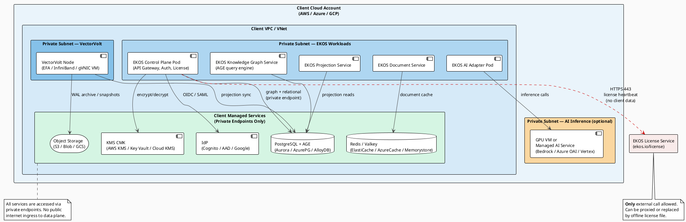
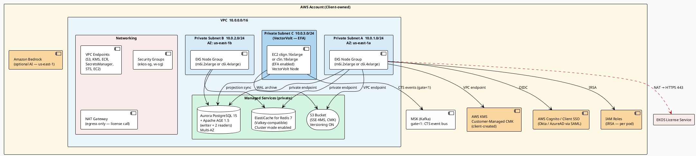
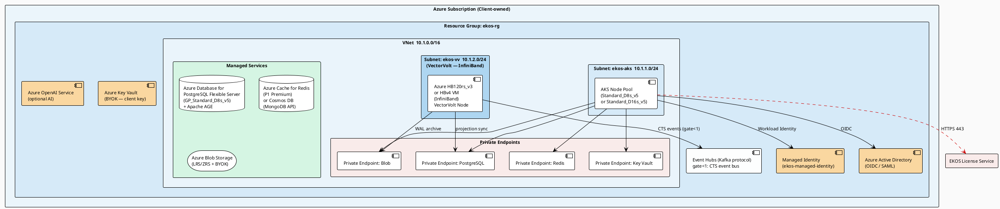
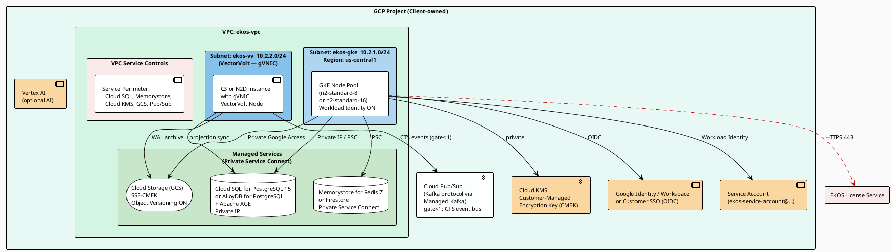

# EKOS Architecture — A19: Client-Cloud Deployment Architecture (BYOC)

> **Status:** ✅ Done · **Generated:** 2026-07-03
> **Architecture Phase document A (deployment).** Implements the "client-cloud" (BYOC)
> deployment scenario introduced in [A08](A08-deployment-infrastructure-architecture.md)
> §4 (ADR-041 dedicated single-tenant profile) and §12 (ADR-052 storage provider
> selection). EKOS is deployed via Helm into the **client's own Kubernetes cluster** using
> the client's managed cloud services. All client data remains in the client's cloud
> account. Covers three cloud variants: **AWS**, **Azure**, and **GCP**.

---

## 1. Purpose & Scope

### 1.1 The Problem This Document Solves

Enterprises that want EKOS's capabilities but already operate cloud infrastructure — and
will not allow a third-party vendor to manage, touch, or see their data — need a deployment
model where:

1. EKOS software runs as Helm workloads **inside the client's Kubernetes cluster**.
2. EKOS **data** is stored exclusively in the client's managed cloud services (Aurora, Azure
   PostgreSQL, Cloud SQL, ElastiCache, etc.).
3. The client's IAM, KMS, networking rules, and data-residency policies govern everything.
4. The EKOS vendor provides only the **Helm chart** and **license validation endpoint** —
   not a managed control plane, not data access, not infrastructure.

This model is sometimes called **Bring Your Own Cloud (BYOC)**. A19 is the concrete
implementation specification.

### 1.2 Relationship to A08

| A08 Item | A19 Position |
|---|---|
| A08-001 — Cloud-neutral | A19 implements the promise: three concrete cloud variants |
| A08-002 — OpenTofu + Helm | A19 provides the per-cloud OpenTofu module structure and Helm values |
| A08-009 / ADR-041 — Dedicated single-tenant profile | A19 **is** that profile when the tenant is the client |
| A08-012 — Dedicated-per-tenant topology (separate VPC + customer KMS) | A19 concretizes this for AWS/Azure/GCP |

A19 does **not** re-specify multi-tenancy, SaaS, or air-gap profiles — those remain in A08.

### 1.3 Scope Boundaries

**In scope:**
- Three cloud variants: AWS, Azure, GCP
- Storage provider selection per cloud (ADR-052)
- VectorVolt cloud VM and kernel-bypass networking configuration
- IAM authentication patterns (no static credentials)
- Network topology (private endpoints, no public data plane)
- AI adapter wiring (Bedrock / Azure OpenAI / Vertex AI)
- License and telemetry — the only permitted external call
- Reference cost estimates per workload tier
- Helm install and OpenTofu bootstrap steps

**Out of scope:**
- On-premises / bare-metal deployment → A08
- Air-gapped deployment → A08 §4
- EKOS-operated SaaS → A08
- Multi-region active-active topology details → A08 §8–§9

---

## 2. BYOC Principles

- **A19-001 · No EKOS data egress** — Client data (graph nodes/edges, documents,
  projections, WAL, snapshots) is stored only in the client's cloud account. EKOS
  operators cannot access it. No EKOS-operated pipeline touches the data plane.
  *Enforcement: no outbound data-plane routes from client VPC to EKOS infrastructure.*

- **A19-002 · Client-controlled encryption** — EKOS uses the client's KMS CMK
  (AWS KMS CMK / Azure Key Vault key / Cloud KMS CMEK) for all encryption at rest.
  EKOS holds no key material. The client can revoke access to the CMK to immediately
  disable EKOS's ability to decrypt stored data.

- **A19-003 · Client IAM — no static credentials** — EKOS pods authenticate to
  cloud services using the cloud's native workload identity mechanism:
  AWS IRSA (IAM Roles for Service Accounts), Azure Workload Identity / Managed Identity,
  GCP Workload Identity Federation. No long-lived API keys or service account JSON files
  are stored in Kubernetes secrets.

- **A19-004 · Bring your own managed services (ADR-052)** — If the client already
  operates a PostgreSQL cluster, an Elasticsearch/OpenSearch deployment, or a Redis
  cluster that meets EKOS's requirements, EKOS can plug into those existing services.
  EKOS provides IStorageProvider adapters (see §7) that accept connection strings the
  client supplies at Helm install time. The client is not required to provision
  EKOS-dedicated instances.

- **A19-005 · License telemetry is the only external call** — The single network egress
  from the client's environment to EKOS infrastructure is the license validation heartbeat
  (HTTPS/443, JSON payload: license key + instance ID + feature flags; **no client data**).
  This call can be proxied through the client's existing HTTP proxy or replaced entirely
  by an offline license file in air-adjacent environments (see §12).

- **A19-006 · Cost transparency** — All infrastructure costs appear on the **client's**
  cloud bill. EKOS provides reference cost estimates per workload tier (see §13) and
  publishes no hidden billback. The client sees exactly what EKOS resources cost.

- **A19-007 · Client controls data residency** — Kubernetes namespace, managed service
  region, and backup configuration are chosen by the client. EKOS does not prescribe a
  region. The client's data sovereignty policies are inherited automatically.

- **A19-008 · Upgrade path is client-controlled** — Helm chart upgrades are pulled by the
  client on their schedule. EKOS publishes Helm chart versions; the client decides when to
  upgrade. No auto-update agent runs in the client's cluster.

---

## 3. Architecture Overview

### 3.1 Conceptual Diagram



### 3.2 Data Flow Summary

| Flow | Path | Notes |
|---|---|---|
| Client application → EKOS API | HTTPS / gRPC through client's load balancer | Client controls TLS termination |
| EKOS pod → PostgreSQL+AGE | Private endpoint / private link | Encrypted in transit (TLS); at rest via CMK |
| EKOS pod → Redis | Private endpoint | TLS; AUTH token stored in client's secret manager |
| VectorVolt → Object storage | VPC endpoint / Private Google Access | WAL archive and snapshots; SSE-KMS with CMK |
| EKOS pod → KMS | Private endpoint | Key usage logged to client's CloudTrail/Monitor Logs/Cloud Audit |
| EKOS pod → IdP | OIDC well-known endpoint (HTTPS) | Client controls the IdP |
| EKOS → License service | HTTPS 443 outbound | Only external call; JSON with license key + instance ID |

---

## 4. AWS Deployment Architecture

### 4.1 Infrastructure Diagram



### 4.2 AWS Service Selection

| Layer | Service | SKU / Configuration |
|---|---|---|
| Kubernetes | Amazon EKS | 1.30+; managed node groups; IRSA enabled |
| Graph + Relational | Aurora PostgreSQL 15 | `db.r7g.2xlarge` writer + 2 readers; Multi-AZ; AGE extension installed via RDS custom parameter group |
| Document / Cache | ElastiCache for Redis 7 (Valkey-compatible) | `cache.r7g.xlarge`; cluster mode enabled; TLS; AUTH token |
| Columnar | Amazon Redshift Serverless (default) or ClickHouse on EC2 `c6i.4xlarge` (client preference) — or VectorVolt columnar at Gate 3 | Redshift namespace in same VPC; private endpoint |
| Object storage | Amazon S3 | SSE-KMS with CMK; Versioning ON; Object Lock for WAL integrity |
| KMS | AWS KMS Customer-Managed CMK | Client creates CMK; grants EKOS IAM role `kms:Decrypt`, `kms:GenerateDataKey` |
| IdP | Amazon Cognito User Pool **or** existing Okta / Azure AD via SAML/OIDC federation | EKOS OIDC discovery URL configured in Helm values |
| AI inference | Amazon Bedrock (Titan / Claude Haiku via EKOS adapter) — optional | Private endpoint via VPC PrivateLink; model access enabled by client |
| Event bus (Gate <1) | Amazon MSK (Managed Streaming for Kafka) | `kafka.t3.small` (dev) / `kafka.m5.xlarge` (prod); private subnets |
| VectorVolt networking | EC2 with EFA | `c6gn.16xlarge` (Arm/Graviton3) or `c5n.18xlarge` (x86); EFA enabled; placement group (cluster) |
| IaC | OpenTofu AWS provider `~> 5.x` | Modules: `terraform-aws-modules/eks`, `terraform-aws-modules/rds-aurora`, custom EKOS module |

### 4.3 VectorVolt — AWS Configuration

- **Instance type (recommended):** `c6gn.16xlarge` — 64 vCPUs, 128 GB RAM, 200 Gbps EFA network, NVMe instance storage (1.9 TB × 2).
- **Alternative:** `c5n.18xlarge` — 72 vCPUs, 192 GB RAM, 100 Gbps EFA, no NVMe (EBS gp3 for WAL).
- **EFA requirement:** Instance must be in a placement group with strategy `cluster` to achieve low-latency EFA communication.
- **INetworkTransport:** `EfaTransport` — configured in `vectorvolt.toml` (see §8).
- **WAL storage:** NVMe instance store (`/dev/nvme1n1`) mounted as XFS with `noatime`; WAL archive synced to S3.
- **HugePages:** `c6gn` and `c5n` support **2MB pages only** on AWS (1GB pages are not available on cloud VMs); configure `vm.nr_hugepages` accordingly (see §8.3).

### 4.4 IAM Architecture — AWS (IRSA)

```
Client creates IAM Role: ekos-pod-role
  Trust policy: allows eks.amazonaws.com OIDC provider for namespace ekos, SA ekos-service-account
  Permissions:
    - rds-db:connect  (Aurora IAM auth)
    - s3:GetObject, s3:PutObject, s3:DeleteObject  (on ekos S3 bucket)
    - kms:Decrypt, kms:GenerateDataKey  (on CMK ARN)
    - secretsmanager:GetSecretValue  (Redis AUTH token secret)
    - bedrock:InvokeModel  (if Bedrock AI enabled)
    - msk:Connect, kafka-cluster:*  (if MSK enabled, Gate <1)
```

Helm values reference the IAM role ARN; EKOS pods annotate their service account with
`eks.amazonaws.com/role-arn`. The AWS EKS Pod Identity Webhook injects the IRSA token.
No AWS credentials are stored as Kubernetes secrets.

---

## 5. Azure Deployment Architecture

### 5.1 Infrastructure Diagram



### 5.2 Azure Service Selection

| Layer | Service | SKU / Configuration |
|---|---|---|
| Kubernetes | Azure Kubernetes Service (AKS) | 1.30+; Workload Identity enabled; OIDC issuer enabled |
| Graph + Relational | Azure Database for PostgreSQL Flexible Server | `GP_Standard_D8s_v5`; HA (zone-redundant); AGE extension installed via `LOAD 'age'`; BYOK enabled |
| Graph (alternative) | Azure Cosmos DB for PostgreSQL (Citus) | If client already uses Cosmos DB; AGE compatibility limited — use only if client explicitly prefers Citus |
| Document / Cache | Azure Cache for Redis (Premium P1, 6 GB) | TLS; Microsoft Entra auth (no AUTH string); private endpoint |
| Document (alternative) | Azure Cosmos DB (MongoDB API) | If client already uses Cosmos DB; EKOS IDocumentProvider = MongoDbProvider |
| Columnar | Azure Synapse Analytics (serverless SQL pool) **or** ClickHouse on AKS | Synapse uses private link; client preference |
| Object storage | Azure Blob Storage | ZRS (zone-redundant) or LRS; BYOK (Key Vault CMK); immutability policy for WAL |
| KMS | Azure Key Vault (Premium SKU) | BYOK; soft-delete + purge protection ON; private endpoint |
| IdP | Azure Active Directory (OIDC) | Most enterprise clients already have AAD; EKOS OIDC discovery from `login.microsoftonline.com/{tenantId}/v2.0` |
| AI inference | Azure OpenAI Service (GPT-4o / embedding models) — optional | Private endpoint; deployed in client's subscription; EKOS AI adapter = AzureOpenAIAdapter |
| Event bus (Gate <1) | Azure Event Hubs (Standard / Premium) with Kafka protocol surface | `eh.namespace` in same VNet; private endpoint |
| VectorVolt networking | Azure HB-series VMs with InfiniBand | `Standard_HB120rs_v3` (120 vCPUs, 448 GB RAM, 200 Gbps InfiniBand); or `Standard_HBv4` (176 vCPUs) |
| IaC | OpenTofu AzureRM provider `~> 3.x` | Modules: `Azure/aks`, `Azure/postgresql-flexible-server`, custom EKOS module |

### 5.3 VectorVolt — Azure Configuration

- **Instance type (recommended):** `Standard_HB120rs_v3` — 120 vCPUs, 448 GB RAM, 200 Gbps InfiniBand EDR, 480 GB NVMe local SSD.
- **InfiniBand:** Requires RDMA-capable VM family; HB/HBv2/HBv3/HBv4 series; must deploy in proximity placement group.
- **INetworkTransport:** `InfiniBandTransport` — configured in `vectorvolt.toml` (see §8).
- **WAL storage:** Local NVMe (`/dev/nvme0n1`) as XFS; WAL archive to Blob Storage.
- **HugePages:** HB-series VMs support **2MB pages** (1GB pages not available); configure `vm.nr_hugepages = 16384` for 32 GB of hugepage pool (tune per workload).

### 5.4 IAM Architecture — Azure (Workload Identity)

```
Client creates:
  Azure Managed Identity: ekos-managed-identity (User-assigned)
  Federated credential: links to AKS OIDC issuer, namespace=ekos, SA=ekos-service-account

Role assignments on Managed Identity:
  - Key Vault Crypto User  (Key Vault CMK)
  - Storage Blob Data Contributor  (Blob Storage container)
  - Azure Cache for Redis Contributor  (or Entra auth role)
  - Cognitive Services OpenAI User  (if Azure OpenAI enabled)
  - Event Hubs Data Sender/Receiver  (if Event Hubs enabled, Gate <1)
  - PostgreSQL Flexible Server — Microsoft Entra admin role (for AAD auth)
```

Helm values reference the Managed Identity client ID. AKS Workload Identity webhook
injects the federated token. No client secrets or certificates are stored in K8s secrets.

---

## 6. GCP Deployment Architecture

### 6.1 Infrastructure Diagram



### 6.2 GCP Service Selection

| Layer | Service | SKU / Configuration |
|---|---|---|
| Kubernetes | Google Kubernetes Engine (GKE) | 1.30+; Standard mode; Workload Identity enabled; Private cluster (no public endpoint) |
| Graph + Relational | Cloud SQL for PostgreSQL 15 (Private IP) | `db-perf-optimized-N-8` or higher; HA (regional); AGE extension installed; CMEK |
| Graph (alternative) | AlloyDB for PostgreSQL | Higher performance for graph-heavy workloads; AGE compatible; Cluster + Read pool; CMEK |
| Document / Cache | Memorystore for Redis 7 | `STANDARD_HA` tier; `M2` capacity tier (12 GB); Private Service Connect; CMEK |
| Document (alternative) | Firestore (Native mode) | If client already uses Firestore; EKOS IDocumentProvider = FirestoreProvider |
| Columnar | BigQuery (via ClickHouse-BigQuery connector) **or** ClickHouse on GKE | BigQuery dataset in same project; VPC Service Controls perimeter |
| Object storage | Cloud Storage (GCS) | Standard class; CMEK; Object Versioning ON; Retention policy for WAL |
| KMS | Cloud KMS (Customer-Managed Encryption Key — CMEK) | HSM-backed key ring; client creates and manages; EKOS service account granted `cloudkms.cryptoKeyEncrypterDecrypter` |
| IdP | Google Identity / Google Workspace **or** customer SSO via OIDC | EKOS OIDC discovery from Google's OIDC endpoint or customer IdP |
| AI inference | Vertex AI (Gemini / embedding models) — optional | Private Service Connect to Vertex AI; EKOS AI adapter = VertexAIAdapter |
| Event bus (Gate <1) | Cloud Managed Kafka (Pub/Sub Kafka surface) **or** Pub/Sub with Kafka protocol adapter | Private endpoint; same project |
| VectorVolt networking | C3 or N2D instances with gVNIC | `c3-highcpu-176` (176 vCPUs, 352 GB RAM, gVNIC 200 Gbps) or `n2d-highcpu-224`; local SSD for WAL |
| IaC | OpenTofu Google provider `~> 5.x` | Modules: `terraform-google-modules/kubernetes-engine`, `terraform-google-modules/sql-db`, custom EKOS module |

### 6.3 VectorVolt — GCP Configuration

- **Instance type (recommended):** `c3-highcpu-176` — 176 vCPUs, 352 GB RAM, gVNIC (200 Gbps), 6 × 375 GB NVMe local SSD.
- **Alternative:** `n2d-highcpu-224` — AMD EPYC; 224 vCPUs; gVNIC; suitable if client already standardizes on N2D.
- **gVNIC:** Enabled via instance template `--network-interface=nic-type=GVNIC`; required for 100+ Gbps throughput.
- **INetworkTransport:** `gVNICTransport` — configured in `vectorvolt.toml` (see §8).
- **WAL storage:** Local SSD (`/dev/nvme0n1` through `/dev/nvme0n5`; software RAID-0 for throughput); archive to GCS.
- **HugePages:** GCP cloud VMs support **2MB pages only** (1GB pages not exposed); configure `vm.nr_hugepages` based on RAM. For `c3-highcpu-176` with 352 GB: `vm.nr_hugepages = 131072` (256 GB hugepage pool).

### 6.4 IAM Architecture — GCP (Workload Identity Federation)

```
Client creates:
  GCP Service Account: ekos-service-account@{project}.iam.gserviceaccount.com
  Workload Identity binding:
    serviceAccount:{project}.svc.id.goog[ekos/ekos-service-account]
    → impersonates ekos-service-account

IAM roles granted to ekos-service-account:
  - roles/cloudsql.client               (Cloud SQL IAM auth)
  - roles/storage.objectAdmin           (GCS bucket — EKOS objects only, IAM Condition)
  - roles/cloudkms.cryptoKeyEncrypterDecrypter  (CMEK key)
  - roles/redis.editor                  (Memorystore)
  - roles/aiplatform.user               (Vertex AI, if enabled)
  - roles/pubsub.editor                 (Managed Kafka / Pub/Sub, Gate <1)
```

GKE Workload Identity injects a GCP service account token into the pod. No GCP service
account keys (JSON files) are created or stored.

---

## 7. Storage Provider Configuration (ADR-052)

### 7.1 Provider Selection Table

| Storage Interface | AWS Provider | Azure Provider | GCP Provider |
|---|---|---|---|
| `IGraphStore` | `AgePostgresGraphStore` (Aurora PG + AGE) | `AgePostgresGraphStore` (Azure PG Flex + AGE) | `AgePostgresGraphStore` (Cloud SQL PG + AGE) |
| `IRelationalStore` | `PostgresRelationalStore` (same Aurora instance) | `PostgresRelationalStore` (same Azure PG Flex) | `PostgresRelationalStore` (same Cloud SQL / AlloyDB) |
| `IDocumentStore` | `RedisDocumentStore` (ElastiCache Redis) | `RedisDocumentStore` (Azure Cache for Redis) | `RedisDocumentStore` (Memorystore Redis) |
| `IColumnarStore` | `RedshiftColumnarStore` **or** `ClickHouseColumnarStore` | `SynapseColumnarStore` **or** `ClickHouseColumnarStore` | `BigQueryColumnarStore` **or** `ClickHouseColumnarStore` |
| `IObjectStore` | `S3ObjectStore` | `AzureBlobObjectStore` | `GcsObjectStore` |
| `IKmsProvider` | `AwsKmsProvider` | `AzureKeyVaultKmsProvider` | `GcpCloudKmsProvider` |
| `IEventBus` (Gate <1) | `KafkaEventBus` → MSK | `KafkaEventBus` → Event Hubs (Kafka surface) | `KafkaEventBus` → Managed Kafka |
| `IAIAdapter` (optional) | `BedrockAIAdapter` | `AzureOpenAIAdapter` | `VertexAIAdapter` |

### 7.2 Helm values.yaml — AWS Variant

```yaml
# ekos/values-aws.yaml
global:
  cloud: aws
  region: us-east-1

storageProviders:
  graph:
    provider: age-postgres
    connectionSecretRef: ekos-aurora-conn-secret   # k8s secret with DSN
    pgExtension: age
  relational:
    provider: postgres
    connectionSecretRef: ekos-aurora-conn-secret   # same Aurora instance, different DB
  document:
    provider: redis
    connectionSecretRef: ekos-redis-conn-secret
    tlsEnabled: true
  columnar:
    provider: redshift                              # or: clickhouse
    connectionSecretRef: ekos-redshift-conn-secret
  objectStore:
    provider: s3
    bucket: ekos-data-${accountId}
    region: us-east-1
    kmsKeyArn: "arn:aws:kms:us-east-1:${accountId}:key/${cmkKeyId}"
  kms:
    provider: aws-kms
    keyArn: "arn:aws:kms:us-east-1:${accountId}:key/${cmkKeyId}"

eventBus:
  provider: kafka
  bootstrapServers: "b-1.ekos-msk.abc123.kafka.us-east-1.amazonaws.com:9096"
  tlsEnabled: true
  saslMechanism: AWS_MSK_IAM

aiAdapter:
  enabled: true
  provider: bedrock
  region: us-east-1
  modelId: "anthropic.claude-haiku-4-5"
  sovereignFallback: false

vectorvolt:
  enabled: true
  transport: efa
  instanceType: c6gn.16xlarge
  hugepagesSizeKB: 2048
  walDevice: /dev/nvme1n1
  archiveBucket: s3://ekos-wal-${accountId}

iam:
  aws:
    roleArn: "arn:aws:iam::${accountId}:role/ekos-pod-role"

license:
  endpoint: "https://license.ekos.io/v1/validate"
  proxy: ""                    # optional: "http://client-proxy:3128"
  offlineLicenseFile: ""       # optional: "/etc/ekos/license.jwt"
```

### 7.3 Helm values.yaml — Azure Variant

```yaml
# ekos/values-azure.yaml
global:
  cloud: azure
  region: eastus

storageProviders:
  graph:
    provider: age-postgres
    connectionSecretRef: ekos-pg-conn-secret
    pgExtension: age
  relational:
    provider: postgres
    connectionSecretRef: ekos-pg-conn-secret
  document:
    provider: redis
    connectionSecretRef: ekos-redis-conn-secret
    tlsEnabled: true
    authMethod: entra                # Azure Managed Identity auth (no AUTH string)
  columnar:
    provider: synapse               # or: clickhouse
    connectionSecretRef: ekos-synapse-conn-secret
  objectStore:
    provider: azure-blob
    accountName: "ekosdata${uniqueId}"
    containerName: ekos-objects
    keyVaultKeyUri: "https://ekos-kv.vault.azure.net/keys/ekos-cmk"
  kms:
    provider: azure-key-vault
    vaultUri: "https://ekos-kv.vault.azure.net"
    keyName: ekos-cmk

eventBus:
  provider: kafka
  bootstrapServers: "ekos-eh.servicebus.windows.net:9093"
  tlsEnabled: true
  saslMechanism: OAUTHBEARER
  saslOAuthClientId: "${managedIdentityClientId}"

aiAdapter:
  enabled: true
  provider: azure-openai
  endpoint: "https://ekos-aoai.openai.azure.com"
  deploymentName: "gpt-4o-mini"
  sovereignFallback: false

vectorvolt:
  enabled: true
  transport: infiniband
  instanceType: Standard_HB120rs_v3
  hugepagesSizeKB: 2048
  hugepagesCount: 16384
  walDevice: /dev/nvme0n1
  archiveContainer: "https://ekoswal${uniqueId}.blob.core.windows.net/wal"

iam:
  azure:
    managedIdentityClientId: "${managedIdentityClientId}"

license:
  endpoint: "https://license.ekos.io/v1/validate"
  proxy: ""
  offlineLicenseFile: ""
```

### 7.4 Helm values.yaml — GCP Variant

```yaml
# ekos/values-gcp.yaml
global:
  cloud: gcp
  region: us-central1
  projectId: "${gcpProjectId}"

storageProviders:
  graph:
    provider: age-postgres
    connectionSecretRef: ekos-cloudsql-conn-secret
    cloudSqlInstanceConnection: "${projectId}:us-central1:ekos-pg"
    pgExtension: age
  relational:
    provider: postgres
    connectionSecretRef: ekos-cloudsql-conn-secret
  document:
    provider: redis
    connectionSecretRef: ekos-memorystore-conn-secret
    tlsEnabled: true
  columnar:
    provider: bigquery               # or: clickhouse
    projectId: "${gcpProjectId}"
    dataset: ekos_columnar
  objectStore:
    provider: gcs
    bucket: "ekos-data-${gcpProjectId}"
    cmekKeyName: "projects/${gcpProjectId}/locations/us-central1/keyRings/ekos-kr/cryptoKeys/ekos-cmek"
  kms:
    provider: gcp-cloud-kms
    keyName: "projects/${gcpProjectId}/locations/us-central1/keyRings/ekos-kr/cryptoKeys/ekos-cmek"

eventBus:
  provider: kafka
  bootstrapServers: "kafka.${gcpProjectId}.kafka.googleapis.com:9093"
  tlsEnabled: true
  saslMechanism: OAUTHBEARER

aiAdapter:
  enabled: true
  provider: vertex-ai
  projectId: "${gcpProjectId}"
  location: us-central1
  modelId: "gemini-2.0-flash"
  sovereignFallback: false

vectorvolt:
  enabled: true
  transport: gvnic
  instanceType: c3-highcpu-176
  hugepagesSizeKB: 2048
  hugepagesCount: 131072
  walDevices:
    - /dev/nvme0n1
    - /dev/nvme0n2
    - /dev/nvme0n3
    - /dev/nvme0n4
    - /dev/nvme0n5
  walRaidMode: raid0
  archiveBucket: "gs://ekos-wal-${gcpProjectId}"

iam:
  gcp:
    serviceAccountEmail: "ekos-service-account@${gcpProjectId}.iam.gserviceaccount.com"
    workloadIdentityPool: "${gcpProjectId}.svc.id.goog"

license:
  endpoint: "https://license.ekos.io/v1/validate"
  proxy: ""
  offlineLicenseFile: ""
```

---

## 8. VectorVolt Cloud Configuration

### 8.1 Instance Recommendation Summary

| Cloud | Recommended Instance | vCPUs | RAM | Network | NVMe Local SSD | Network Transport |
|---|---|---|---|---|---|---|
| AWS | `c6gn.16xlarge` | 64 | 128 GB | 200 Gbps EFA | 1.9 TB × 2 | `EfaTransport` |
| AWS (alt) | `c5n.18xlarge` | 72 | 192 GB | 100 Gbps EFA | None (EBS gp3) | `EfaTransport` |
| Azure | `Standard_HB120rs_v3` | 120 | 448 GB | 200 Gbps InfiniBand | 480 GB NVMe | `InfiniBandTransport` |
| Azure (alt) | `Standard_HBv4` | 176 | 768 GB | 400 Gbps InfiniBand | 960 GB NVMe | `InfiniBandTransport` |
| GCP | `c3-highcpu-176` | 176 | 352 GB | 200 Gbps gVNIC | 6 × 375 GB NVMe | `gVNICTransport` |
| GCP (alt) | `n2d-highcpu-224` | 224 | 896 GB | 100 Gbps gVNIC | Up to 3 TB NVMe | `gVNICTransport` |

### 8.2 vectorvolt.toml — Network Transport Configuration

```toml
# /etc/vectorvolt/vectorvolt.toml

[network]
# Select transport based on cloud:
#   aws:   efa
#   azure: infiniband
#   gcp:   gvnic
transport = "efa"          # or "infiniband" or "gvnic"

[network.efa]
device = "efa0"            # EFA device name (aws)
port   = 1
gid_index = 3

[network.infiniband]
device = "mlx5_0"          # InfiniBand HCA device (azure HB-series)
port   = 1
gid_index = 0

[network.gvnic]
device = "eth0"            # gVNIC presents as standard NIC; uses kernel TCP/UDP
# gVNIC achieves kernel-bypass via GCP's Andromeda network fabric
# rather than user-space DPDK (which requires bare metal)
offload_tx = true
offload_rx = true
gso_enabled = true

[storage]
wal_path = "/mnt/wal"
wal_archive = "s3://ekos-wal-${accountId}"   # or azure-blob:// or gs://
snapshot_interval_secs = 300

[memory]
# HugePages — cloud VMs support 2MB pages only (not 1GB)
hugepage_size_kb = 2048
# Set vm.nr_hugepages in node startup script before VectorVolt starts
# AWS c6gn.16xlarge (128 GB RAM): allocate 32 GB → nr_hugepages = 16384
# Azure HB120rs_v3 (448 GB RAM): allocate 64 GB → nr_hugepages = 32768
# GCP c3-highcpu-176 (352 GB RAM): allocate 256 GB → nr_hugepages = 131072
hugepages_count = 16384    # tune per instance type
```

### 8.3 HugePages Setup — Cloud VM Node Startup Script

```bash
#!/bin/bash
# Run as root during VM startup (UserData / cloud-init / startup script)
# IMPORTANT: 1GB hugepages are NOT available on AWS/Azure/GCP cloud VMs.
# Only 2MB pages are supported. Adjust hugepages_count per instance RAM.

HUGEPAGES_COUNT=16384   # 16384 × 2MB = 32 GB (AWS c6gn.16xlarge example)

echo "vm.nr_hugepages=${HUGEPAGES_COUNT}" >> /etc/sysctl.conf
sysctl -p

# Verify
grep HugePages_Total /proc/meminfo
# Mount hugetlbfs
mkdir -p /mnt/hugepages
mount -t hugetlbfs none /mnt/hugepages

# NVMe WAL setup (skip if using EBS)
mkfs.xfs -f /dev/nvme1n1
mkdir -p /mnt/wal
mount -o noatime,nodiratime /dev/nvme1n1 /mnt/wal
echo "/dev/nvme1n1 /mnt/wal xfs noatime,nodiratime 0 0" >> /etc/fstab
```

### 8.4 Gate Progression for VectorVolt in Client-Cloud

| Gate | State | VectorVolt Role | CTS Bus |
|---|---|---|---|
| Before Gate 1 | VectorVolt not yet deployed | EKOS runs without VectorVolt; all writes go to PostgreSQL directly | Kafka (MSK / Event Hubs / Managed Kafka) |
| Gate 1 | VectorVolt on dedicated cloud VM | WAL on NVMe instance storage; ProjectionDispatcher syncs to client's managed PostgreSQL | Kafka retained as fallback |
| Gate 2 | Kernel bypass enabled | EFA/InfiniBand/gVNIC transport active; sub-microsecond intra-cluster messaging | VectorVolt CTS bus |
| Gate 3 | VectorVolt replaces columnar store | VectorVolt handles columnar analytics; Redshift/Synapse/BigQuery optional | VectorVolt CTS bus |

---

## 9. IAM Architecture

### 9.1 Principle: Zero Static Credentials

EKOS pods authenticate to all cloud services using cloud-native workload identity tokens
that are **rotated automatically** and **never written to disk** by EKOS. No long-lived
credentials of any form appear in Kubernetes Secrets, ConfigMaps, environment variables,
or container images.

### 9.2 Credential Flow — AWS (IRSA)

```
1. Client creates IAM Role ekos-pod-role with trust policy for EKS OIDC provider
2. Client annotates K8s ServiceAccount: eks.amazonaws.com/role-arn = arn:aws:iam::...
3. EKS Pod Identity Webhook injects projected service account token into pod
4. AWS SDK in EKOS pod exchanges token for temporary STS credentials (15-min TTL)
5. EKOS uses temporary credentials to call Aurora (IAM auth), S3, KMS, Bedrock
6. No AWS credentials stored in K8s; no IAM access keys created
```

### 9.3 Credential Flow — Azure (Workload Identity)

```
1. Client creates User-assigned Managed Identity ekos-managed-identity
2. Client creates federated credential: AKS OIDC issuer → namespace=ekos, SA=ekos-service-account
3. AKS Workload Identity webhook injects federated token into pod via projected volume
4. EKOS Azure SDK exchanges token for AAD access token using client ID from env var
5. Access token used for PostgreSQL (AAD auth), Blob Storage, Key Vault, Azure OpenAI
6. No client secrets or certificates stored anywhere
```

### 9.4 Credential Flow — GCP (Workload Identity Federation)

```
1. Client creates GCP Service Account ekos-service-account@project.iam.gserviceaccount.com
2. Client creates IAM binding: Workload Identity pool → impersonate ekos-service-account
3. GKE injects service account token via projected volume (Workload Identity webhook)
4. GCP client libraries exchange Kubernetes token for GCP access token automatically
5. Access token used for Cloud SQL (IAM auth), GCS, Cloud KMS, Vertex AI
6. No service account JSON keys created or stored
```

---

## 10. Network Architecture

### 10.1 Principle: No Public Internet for Data Plane

All data-plane traffic between EKOS pods and managed services travels through **private
endpoints** (AWS VPC Endpoints / Azure Private Endpoints / GCP Private Service Connect).
The managed services have **no public IP addresses** and are inaccessible from the internet.

### 10.2 Allowed Egress

| Destination | Protocol | Purpose | Can be restricted? |
|---|---|---|---|
| `license.ekos.io` | HTTPS/443 | License heartbeat | Yes — via HTTP proxy or offline license |
| Client's IdP OIDC endpoint | HTTPS/443 | Token validation | No — but client controls the IdP |
| AI managed service (Bedrock/Azure OAI/Vertex) | HTTPS/443 | AI inference | Yes — disable AI adapter; or use sovereign model on-VPC |
| Helm chart registry (OCI) | HTTPS/443 | Chart pull on upgrade | Yes — mirror to client's private registry (ECR/ACR/Artifact Registry) |
| Container image registry | HTTPS/443 | Image pull on upgrade | Yes — mirror to client's private registry |

All other egress is **blocked by default** (security group / NSG / VPC firewall deny-all-egress + allow-list rules).

### 10.3 Security Group / NSG Rules (AWS example)

```
# ekos-sg (applied to EKS pods via security group for pods)
Inbound:
  TCP 443  from client-app-sg     # EKOS API
  TCP 8080 from client-app-sg     # EKOS gRPC (if separate)
Outbound:
  TCP 5432 to aurora-sg           # PostgreSQL
  TCP 6379 to redis-sg            # Redis
  TCP 9096 to msk-sg              # Kafka/MSK (Gate <1)
  TCP 443  to 0.0.0.0/0 via NAT  # License, IdP, Bedrock (allow-listed by FQDN in NAT/SG)

# vv-sg (applied to VectorVolt EC2 instances)
Inbound:
  TCP 7000-7100 from ekos-sg      # VectorVolt internal protocol
Outbound:
  TCP 5432 to aurora-sg           # projection sync
  TCP 443  to s3-endpoint-sg      # WAL archive via VPC endpoint
  TCP 9096 to msk-sg              # CTS events (Gate <1)
```

### 10.4 VPC Peering / Transit Gateway

If the client deploys EKOS in a dedicated VPC (EKOS-VPC) and their application in a separate
VPC (App-VPC), a **VPC peering** or **Transit Gateway** attachment connects the two VPCs.
EKOS data-plane traffic never leaves the client's AWS account in this configuration.

### 10.5 GCP VPC Service Controls

GCP clients should wrap EKOS managed services (Cloud SQL, Memorystore, GCS, Cloud KMS)
in a **VPC Service Controls perimeter** to prevent data exfiltration even if a pod is
compromised. EKOS Workload Identity service account is added to the perimeter's
access policy.

---

## 11. AI Adapter Configuration

### 11.1 Overview

EKOS uses a port-based AI adapter (`IAIAdapter`) that abstracts the underlying AI service.
The adapter is configured per cloud variant in Helm values. All AI calls from EKOS pods
to the AI service travel via private endpoints — no public internet unless the AI service
does not support private endpoints (in which case traffic is allow-listed at the NAT/firewall).

### 11.2 Bedrock (AWS)

```yaml
aiAdapter:
  provider: bedrock
  region: us-east-1
  modelId: "anthropic.claude-haiku-4-5"
  # Private endpoint: VPC PrivateLink for Bedrock (requires Bedrock PrivateLink endpoint in VPC)
  # If PrivateLink not available, traffic exits via NAT (allow-listed FQDN: bedrock-runtime.us-east-1.amazonaws.com)
  privateEndpointEnabled: true
```

IAM: EKOS IAM role requires `bedrock:InvokeModel` on the specific model ARN.

### 11.3 Azure OpenAI (Azure)

```yaml
aiAdapter:
  provider: azure-openai
  endpoint: "https://ekos-aoai.openai.azure.com"
  deploymentName: "gpt-4o-mini"
  apiVersion: "2024-10-01-preview"
  # Private endpoint: Azure OpenAI supports Azure Private Link
  privateEndpointEnabled: true
```

IAM: Managed Identity requires `Cognitive Services OpenAI User` role on the Azure OpenAI resource.

### 11.4 Vertex AI (GCP)

```yaml
aiAdapter:
  provider: vertex-ai
  projectId: "${gcpProjectId}"
  location: us-central1
  modelId: "gemini-2.0-flash"
  # Private Service Connect for Vertex AI (supported in GA)
  privateEndpointEnabled: true
```

IAM: Service Account requires `roles/aiplatform.user`.

### 11.5 Sovereign Model Fallback

For clients who cannot use any managed AI service (strict data sovereignty requirements),
EKOS supports a **sovereign model** running on a GPU VM in the client's VPC:

| Cloud | GPU VM | Model |
|---|---|---|
| AWS | `p3.8xlarge` (V100) or `g5.12xlarge` (A10G) | Ollama + Llama 3.1 8B (EKOS-validated) |
| Azure | `Standard_NC24ads_A100_v4` | Ollama + Llama 3.1 8B or Phi-3 medium |
| GCP | `a2-highgpu-1g` (A100) | Ollama + Llama 3.1 8B |

```yaml
aiAdapter:
  provider: ollama
  endpoint: "http://ekos-ollama.ekos.svc.cluster.local:11434"
  modelId: "llama3.1:8b"
  sovereignFallback: true
```

---

## 12. License & Telemetry

### 12.1 What the License Call Contains

```json
{
  "licenseKey": "EKOS-XXXXXXXX-XXXX-XXXX-XXXX-XXXXXXXXXXXX",
  "instanceId": "sha256:abcdef...",
  "version": "1.4.2",
  "featureFlags": ["graph", "ai-adapter", "vectorvolt-gate1"],
  "timestamp": "2026-07-03T12:00:00Z"
}
```

The payload contains **no client data, no user data, no knowledge graph content, no document
content, and no query results**. The EKOS license service cannot distinguish client data
from the license call.

### 12.2 License Call Frequency

- Heartbeat: every 24 hours (jittered ±2 hours to avoid thundering herd)
- On startup: immediate validation
- Grace period: 72 hours if license service is unreachable

### 12.3 Proxying the License Call

Clients who require all outbound traffic to pass through an inspecting proxy:

```yaml
license:
  endpoint: "https://license.ekos.io/v1/validate"
  proxy: "http://corp-proxy.internal:3128"
  proxySkipTLSVerify: false
  proxyCASecretRef: ekos-proxy-ca-secret   # k8s secret with proxy CA cert
```

### 12.4 Offline License (Air-Adjacent Environments)

For environments with no internet egress at all (financial sector, government-adjacent):

```yaml
license:
  offlineLicenseFile: "/etc/ekos/license.jwt"
  endpoint: ""    # disabled
```

The offline license is a signed JWT issued by EKOS for a specific instance ID and valid
for a client-agreed period (typically 90 days). The client renews by contacting EKOS
support, receiving a new JWT, and updating the Kubernetes secret that mounts the file.

---

## 13. Cost Reference

The following estimates cover the **managed cloud service costs** for running EKOS in
the client's account. Costs are approximate (USD/month) based on 2026-Q2 public list
pricing and do not include compute for the EKOS application pods (typically 4–8 vCPUs
total across pods for small workloads).

### 13.1 Workload Tiers

| Tier | Knowledge Graph Nodes | Active Users | Monthly Events |
|---|---|---|---|
| Small | < 500K | < 50 | < 10M |
| Medium | 500K – 5M | 50 – 500 | 10M – 500M |
| Large | 5M – 50M | 500 – 5,000 | 500M – 10B |

### 13.2 AWS Cost Estimates (USD/month)

| Service | Small | Medium | Large |
|---|---|---|---|
| EKS (cluster + 3 nodes m6i.xlarge) | $360 | $720 | $2,880 |
| Aurora PostgreSQL (db.r7g.xlarge × 1 writer + 1 reader) | $420 | $840 | $3,360 |
| ElastiCache Redis (cache.r7g.large) | $150 | $300 | $1,200 |
| S3 (500 GB / 5 TB / 50 TB) | $12 | $115 | $1,150 |
| MSK Kafka (t3.small / m5.large / m5.2xlarge) | $60 | $480 | $1,920 |
| Redshift Serverless (per RPU-hour) | $50 | $500 | $5,000 |
| VectorVolt EC2 c6gn.16xlarge (Gate 1+) | $0 (pre-Gate 1) | $2,800 | $2,800 |
| NAT Gateway + data transfer | $50 | $200 | $500 |
| **Total (excl. GPU AI)** | **~$1,100** | **~$5,200** | **~$18,800** |

*Bedrock pricing is per-token; estimate $100–$2,000/month depending on AI usage.*

### 13.3 Azure Cost Estimates (USD/month)

| Service | Small | Medium | Large |
|---|---|---|---|
| AKS (3 nodes Standard_D4s_v5) | $400 | $800 | $3,200 |
| Azure PostgreSQL Flex (GP_Standard_D4s_v5) | $380 | $760 | $3,040 |
| Azure Cache for Redis (P1 Premium) | $220 | $440 | $1,760 |
| Azure Blob Storage (LRS) | $10 | $100 | $1,000 |
| Event Hubs Standard (10 TU / 40 TU / 200 TU) | $110 | $440 | $2,200 |
| Azure Synapse Serverless SQL | $50 | $500 | $5,000 |
| VectorVolt HB120rs_v3 (Gate 1+) | $0 (pre-Gate 1) | $3,200 | $3,200 |
| **Total (excl. GPU AI)** | **~$1,200** | **~$6,200** | **~$19,400** |

*Azure OpenAI pricing is per-token; estimate $100–$2,000/month.*

### 13.4 GCP Cost Estimates (USD/month)

| Service | Small | Medium | Large |
|---|---|---|---|
| GKE (3 nodes n2-standard-4) | $290 | $580 | $2,320 |
| Cloud SQL PostgreSQL (db-perf-optimized-N-4) | $340 | $680 | $2,720 |
| Memorystore Redis M2 (12 GB) | $300 | $600 | $2,400 |
| Cloud Storage (Standard) | $10 | $100 | $1,000 |
| Managed Kafka (small / medium / large) | $100 | $800 | $3,200 |
| BigQuery Serverless (per TB scanned) | $50 | $500 | $5,000 |
| VectorVolt c3-highcpu-176 (Gate 1+) | $0 (pre-Gate 1) | $4,200 | $4,200 |
| **Total (excl. GPU AI)** | **~$1,100** | **~$7,500** | **~$20,800** |

*Vertex AI pricing is per-token/per-character; estimate $100–$2,000/month.*

**Dominant cost drivers:** Aurora/PostgreSQL (relational+graph) and VectorVolt VM instances
dominate at Medium/Large tiers. Columnar (Redshift/Synapse/BigQuery) cost depends heavily
on query volume.

---

## 14. Deployment Steps

### 14.1 Prerequisites Checklist (All Clouds)

- [ ] Kubernetes cluster provisioned (EKS / AKS / GKE) with OIDC issuer enabled
- [ ] Managed PostgreSQL instance running with Apache AGE extension installed
- [ ] Redis / Valkey cache instance provisioned with TLS and IAM/Entra/service account auth
- [ ] Object storage bucket created with CMK encryption enabled
- [ ] KMS CMK created (AWS KMS / Azure Key Vault / Cloud KMS); EKOS service account granted key usage
- [ ] Workload identity configured: IRSA (AWS) / Managed Identity + federated credential (Azure) / Workload Identity binding (GCP)
- [ ] EKOS pod IAM role / managed identity / service account granted minimum required permissions (see §9)
- [ ] VectorVolt VM provisioned with EFA/InfiniBand/gVNIC enabled (Gate 1+)
- [ ] HugePages configured on VectorVolt VM startup script
- [ ] Security groups / NSG / firewall rules applied (egress: only license endpoint + allow-listed services)
- [ ] Helm 3.14+ installed in CI/CD pipeline
- [ ] OpenTofu 1.7+ installed for IaC provisioning
- [ ] EKOS Helm chart registry access: `helm registry login registry.ekos.io --username ... --password ...`

### 14.2 OpenTofu Bootstrap

```bash
# Clone EKOS OpenTofu modules
git clone https://github.com/ekos-io/terraform-modules.git ekos-tf
cd ekos-tf/aws   # or azure / gcp

# Initialize
tofu init

# Create a tfvars file with client-specific values
cat > ekos.tfvars << 'EOF'
vpc_id             = "vpc-XXXXXXXX"
private_subnet_ids = ["subnet-AAA", "subnet-BBB"]
eks_cluster_name   = "ekos-prod"
cmk_key_arn        = "arn:aws:kms:us-east-1:123456789012:key/XXXX"
aurora_db_name     = "ekos"
# ... (full variable reference in modules/aws/variables.tf)
EOF

# Plan and apply
tofu plan -var-file=ekos.tfvars
tofu apply -var-file=ekos.tfvars
```

### 14.3 Helm Install

```bash
# Add EKOS Helm repository
helm repo add ekos https://charts.ekos.io
helm repo update

# Install EKOS into the client's cluster
helm upgrade --install ekos ekos/ekos \
  --namespace ekos \
  --create-namespace \
  --version 1.4.2 \
  --values values-aws.yaml \            # or values-azure.yaml / values-gcp.yaml
  --set global.licenseKey="${EKOS_LICENSE_KEY}" \
  --wait \
  --timeout 10m

# Verify installation
kubectl -n ekos get pods
kubectl -n ekos logs deployment/ekos-control-plane | grep "license validated"
```

### 14.4 Post-Install Validation

```bash
# Check all pods running
kubectl -n ekos get pods --field-selector=status.phase!=Running

# Validate storage provider connectivity
kubectl -n ekos exec deployment/ekos-control-plane -- ekos-cli health storage

# Validate license
kubectl -n ekos exec deployment/ekos-control-plane -- ekos-cli license status

# Run EKOS smoke test (creates a test knowledge graph node and reads it back)
kubectl -n ekos exec deployment/ekos-control-plane -- ekos-cli smoke-test --cleanup

# Check VectorVolt connectivity (Gate 1+)
kubectl -n ekos exec deployment/ekos-control-plane -- ekos-cli vectorvolt status
```

---

## 15. Open Questions

- **OQ-A19-A — AGE extension support on managed PG services:** Apache AGE requires
  installing the extension (`CREATE EXTENSION age`) which needs superuser or at minimum
  `rds_superuser` (AWS). On Azure PostgreSQL Flex and Cloud SQL, extension allow-lists
  differ per version. Need to verify AGE 1.5 is on each cloud's approved extension list
  before GA. *Owner: EKOS Data Layer team. Target: A19 v1.1.*

- **OQ-A19-B — EFA availability in all AWS regions:** EFA-capable instance types
  (`c6gn`, `c5n`) are available in major regions but not all. Client-cloud deployments in
  regions without EFA (e.g., some GovCloud regions) may require fallback to TCP transport
  for VectorVolt until EFA is available. *Owner: EKOS Infrastructure team.*

- **OQ-A19-C — Azure InfiniBand placement group constraint:** HB-series VMs with
  InfiniBand must be in the same proximity placement group, which limits cluster size to
  the placement group maximum (typically 150 VMs). For large VectorVolt clusters this may
  require multiple placement groups with HPC network fabric. *Owner: EKOS VectorVolt team.*

- **OQ-A19-D — Bring-your-own PostgreSQL version compatibility:** ADR-052 allows clients
  to plug in an existing PostgreSQL cluster. Minimum required version for AGE is PostgreSQL
  13+; minimum for EKOS's relational schema is PostgreSQL 14+. Clients on PG 12 or earlier
  need a migration path. *Owner: EKOS Data Layer team.*

- **OQ-A19-E — Offline license renewal UX:** The 90-day offline license renewal requires
  client contact with EKOS support. This is a friction point for air-adjacent clients.
  Evaluate whether a self-service offline license portal (client authenticates with their
  EKOS account, downloads new JWT) can reduce support burden. *Owner: EKOS Licensing team.*

- **OQ-A19-F — Cosmos DB for PostgreSQL (Citus) + AGE compatibility:** The Azure variant
  notes Cosmos DB for PostgreSQL as an alternative. AGE's compatibility with Citus
  distributed tables needs verification — AGE typically requires single-node PostgreSQL
  for full graph traversal. If incompatible, the Citus alternative is limited to relational
  store only (IRelationalStore), not IGraphStore. *Owner: EKOS Data Layer team.*

- **OQ-A19-G — GCP AlloyDB + AGE extension:** AlloyDB is PostgreSQL-compatible but has
  a curated extension list. AGE availability on AlloyDB needs confirmation from GCP.
  Fallback is Cloud SQL Standard (which has a broader extension allow-list). *Owner:
  EKOS Infrastructure team.*

---

*End of A19 — Client-Cloud Deployment Architecture*
