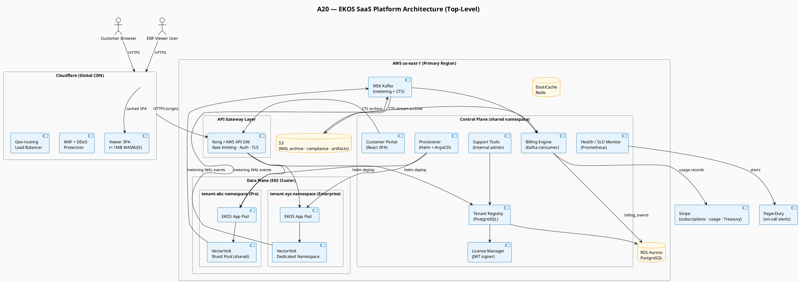
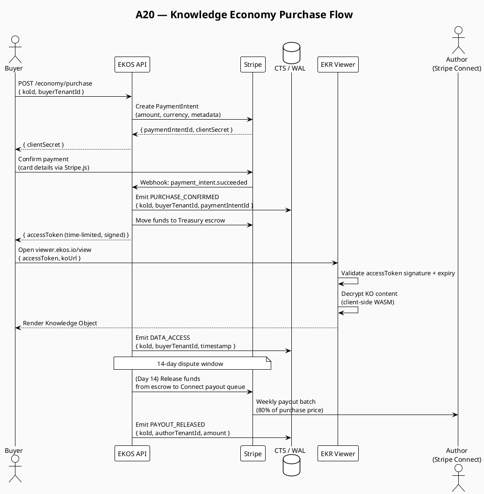

> **Status:** ✅ Done · **Generated:** 2026-07-03

# A20 — EKOS SaaS Platform Architecture

---

## 1. Purpose & Scope

**A20-001** This document architectures EKOS as a fully managed, multi-tenant SaaS business operated by Sandeep Bassi / VectorVolt. Customers visit `ekos.io`, sign up, choose a tier, pay via Stripe, and receive a fully operational EKOS environment — no infrastructure to deploy, no Kubernetes to manage, no VectorVolt nodes to configure. The platform handles all operational concerns transparently.

**A20-002** The scope of this document spans six interconnected platform concerns:

1. **Control Plane** — tenant management, billing, provisioning, license management, customer portal, support tools, and SLO monitoring.
2. **Data Plane** — per-tenant isolated EKOS environments running on shared or dedicated Kubernetes clusters, with VectorVolt providing the storage and compute substrate.
3. **Global CDN** — Cloudflare-backed delivery of the EKR Viewer SPA and public artifact metadata; E2E encryption ensures CDN never sees plaintext KO content.
4. **Knowledge Economy Infrastructure** — Stripe Treasury escrow, author payouts, revenue share, and dispute resolution for the marketplace.
5. **Usage Metering** — VectorVolt WAL-sourced metering events flowing through Kafka to the Billing Engine and Stripe usage-based billing.
6. **Compliance Evidence** — CTS (Constitutional Transparency Stream) events as the immutable audit trail backing SOC2 Type I/II and GDPR obligations.

**A20-003** This document explicitly does not duplicate the following architecture decisions already settled upstream:

- **ADR-041** (A08-009): shared-cluster multi-tenant isolation model — referenced, not re-litigated here.
- **ADR-042** (A08-014): active-active multi-region topology — referenced, not re-specified here.
- **A08-039**: SOC2/ISO27001 control alignment and CTS event taxonomy — referenced and extended via Section 10's compliance table.

**A20-004** The SaaS platform is intentionally phased (Section 14) to reflect the solo-builder reality of the VectorVolt team. Every architectural decision must be achievable by one engineer using managed AWS services as heavily as possible in early phases. Complexity is introduced only when economics justify it (Section 15).

**A20-005** The operational model is: VectorVolt team owns and operates all infrastructure. Customers get an API endpoint, a Customer Portal, and an EKR Viewer URL. There is no customer-managed infrastructure in Free/Pro/Team tiers. Enterprise and Dedicated tiers introduce optional customer-managed KMS keys and, for Dedicated, optional private VPC peering.

---

## 2. SaaS Tier Definitions

**A20-006** EKOS is offered in six tiers, ranging from a free read-only viewer to a fully isolated dedicated cluster. Tier selection determines isolation model, VectorVolt resource allocation, SLA, AI feature access, and KO (Knowledge Object) limits.

**A20-007** Tier definitions:

| Tier | Price | Isolation Model | VectorVolt | SLA | AI Features | Limits |
|---|---|---|---|---|---|---|
| **Viewer** | Free | CDN-served SPA; no EKOS account | None | No SLA | None | Public `.ekr` files only |
| **Free** | $0/user | Shared cluster; namespace-per-tenant; low isolation | Shared shard pool, low quota | Best-effort | Basic AI (10 calls/day) | 1 user, 1 project, 10 KOs |
| **Pro** | $49/user/month | Shared cluster; namespace-per-tenant; stronger isolation | Shared shard pool, standard quota | 99.9% | Full AI (1,000 calls/month included) | 5 projects, 10,000 KOs |
| **Team** | $79/user/month | Shared cluster; namespace-per-tenant; strongest shared isolation | Shared shard pool, elevated quota | 99.9% | Full AI + Knowledge Sessions (10 hrs/month included) | Unlimited projects, 100,000 KOs |
| **Enterprise** | $299/user/month or custom | Shared cluster; dedicated namespace + node pool; dedicated RDS | Dedicated namespace in shared pool, strict quotas | 99.95% | Full AI + Sessions (priority) + custom models | Unlimited KOs; custom user cap |
| **Dedicated** | Custom pricing | Fully isolated cluster + VPC; separate AWS account option | Dedicated VectorVolt node pool; shard-per-tenant | 99.99% | Full AI + dedicated inference endpoint | Unlimited; all limits configurable |

**A20-008** The **Viewer** tier requires no account creation. A user visits `viewer.ekos.io/{ekrUrl}` and the Cloudflare-served SPA fetches and decrypts the `.ekr` file client-side. No data touches EKOS servers. No billing relationship exists. The Viewer is a pure CDN-served static asset.

**A20-009** The **Free** tier is the freemium acquisition channel. It is deliberately constrained to create upgrade pressure at 10 KOs and 1 project. Free tier data resides in `us-east-1` by default; EU users are shown a GDPR notice and region selection at signup (see OQ-A20-C).

**A20-010** The **Pro** tier is the primary revenue unit. At $49/user/month it targets individual architects and small teams. The 10,000 KO limit is generous enough to avoid friction but metered usage charges apply above included AI calls and storage.

**A20-011** The **Team** tier adds real-time collaborative Knowledge Sessions (CRDT-backed, Yjs, Vol 08), unlimited projects, and a higher AI call budget. It targets architecture teams of 5–20 users. The $79/user price point creates meaningful per-seat revenue at team scale.

**A20-012** The **Enterprise** tier adds SAML/SSO, dedicated node pools (physical isolation of compute), dedicated RDS instance, tenant-specific KMS key, audit log exports, and a dedicated support contact. Custom pricing applies for large user counts. The **Dedicated** tier adds full cluster isolation and is targeted at regulated industries (financial services, healthcare) where co-tenancy is contractually prohibited.

---

## 3. Platform Architecture Diagram

**A20-013** The following diagram shows the top-level platform topology, including the boundary between the globally distributed control plane, the data plane, and external services.



**A20-014** The diagram shows the logical separation between: (a) the globally distributed CDN/WAF layer handled by Cloudflare, (b) the control plane components that manage tenants and billing in a dedicated namespace, (c) the data plane EKS cluster where per-tenant EKOS environments run in isolated namespaces, and (d) managed AWS services (RDS, ElastiCache, MSK) shared by the control plane and data plane.

**A20-015** All customer traffic enters through Cloudflare. There is no direct ingress to AWS resources. Cloudflare handles TLS termination, DDoS mitigation, WAF rule evaluation, and geo-based routing before handing off to the AWS API Gateway layer. The API Gateway layer handles authentication, rate limiting, and tenant routing before forwarding to the appropriate control-plane or data-plane component.

---

## 4. Control Plane Architecture

**A20-016** The control plane is a collection of services running in a dedicated Kubernetes namespace (`ekos-control-plane`) on the shared EKS cluster. In Phase 1, all control-plane services co-exist on the same cluster as the data plane. In Phase 3, the control plane migrates to a dedicated management cluster for blast-radius isolation.

### Tenant Registry

**A20-017** The Tenant Registry is the authoritative source of truth for all tenant metadata. It is backed by a dedicated PostgreSQL schema in RDS Aurora.

Schema (simplified):

```sql
CREATE TABLE tenants (
  tenant_id       UUID PRIMARY KEY DEFAULT gen_random_uuid(),
  name            TEXT NOT NULL,
  slug            TEXT UNIQUE NOT NULL,           -- used as K8s namespace suffix
  tier            TEXT NOT NULL,                  -- 'free'|'pro'|'team'|'enterprise'|'dedicated'
  status          TEXT NOT NULL DEFAULT 'active', -- 'active'|'payment_failed'|'suspended'|'deleted'
  namespace       TEXT UNIQUE NOT NULL,           -- k8s namespace name
  billing_config  JSONB NOT NULL DEFAULT '{}',    -- Stripe customerId, subscriptionId
  data_residency  TEXT NOT NULL DEFAULT 'us-east-1',
  kms_key_arn     TEXT,                           -- null = platform-managed key
  created_at      TIMESTAMPTZ NOT NULL DEFAULT now(),
  updated_at      TIMESTAMPTZ NOT NULL DEFAULT now()
);
```

**A20-018** Tenant Registry API surface:

| Operation | Description |
|---|---|
| `CreateTenant(name, slug, tier, dataResidency)` | Initializes tenant record; publishes `TenantCreated` event to Kafka |
| `GetTenant(tenantId)` | Returns full tenant record including billing config |
| `UpdateTier(tenantId, newTier)` | Changes tier; triggers Provisioner to reconcile resources; updates Stripe subscription |
| `DeleteTenant(tenantId, retentionDays)` | Marks tenant `deleted`; data held for `retentionDays` then purged; CTS event emitted |
| `ListTenants(filter)` | Admin-only; returns paginated tenant list with status |

**A20-019** Every write to the Tenant Registry emits a CTS `ADMIN_ACTION` event tagged with the operator's identity and the before/after state diff. This provides the audit trail required by SOC2 CC6.2.

### Provisioner

**A20-020** The Provisioner is an event-driven service that listens to `TenantCreated` and `TierChanged` events from Kafka and reconciles Kubernetes resources to match the desired state.

**A20-021** On `TenantCreated`, the Provisioner executes the following idempotent steps (target: < 30 seconds total):

1. Create K8s namespace: `ekos-tenant-{slug}`
2. Apply RBAC: `ServiceAccount`, `Role`, `RoleBinding` scoped to namespace
3. Apply `ResourceQuota` based on tier (CPU, memory, VectorVolt storage limits)
4. Apply `NetworkPolicy`: deny all ingress/egress except from `ekos-control-plane` namespace and EKOS app pods within same namespace
5. Create `Secret` objects: database connection string (schema-per-tenant), Redis key prefix, Kafka consumer group ID, KMS key reference
6. Deploy EKOS application Helm chart into namespace with tenant-specific `values.yaml`
7. Register namespace with VectorVolt TenantManager (Phase 2+; Gate 4)
8. Emit `TenantProvisioned` event to Kafka

**A20-022** The Provisioner is backed by ArgoCD in GitOps mode. Every tenant's desired state is stored as a Helm `values.yaml` in a private Git repository (`ekos-tenant-configs`). ArgoCD continuously reconciles cluster state against Git. Manual emergency mutations are forbidden; all changes go through Git.

**A20-023** On `TierChanged`, the Provisioner updates `ResourceQuota`, potentially migrates the tenant to a dedicated node pool (Enterprise upgrade), and notifies the License Manager to reissue the tenant's signed JWT.

### Billing Engine

**A20-024** The Billing Engine is a dedicated microservice that consumes the `ekos.metering` Kafka topic, aggregates usage by `(tenantId, billingPeriod, eventType)`, and drives Stripe usage-based billing. It runs as a single-replica deployment in Phase 1 (stateless aggregation backed by PostgreSQL) and scales horizontally in Phase 3.

**A20-025** The Billing Engine maintains a `billing_events` table:

```sql
CREATE TABLE billing_events (
  id              BIGSERIAL PRIMARY KEY,
  tenant_id       UUID NOT NULL REFERENCES tenants(tenant_id),
  billing_period  TEXT NOT NULL,                -- '2026-07' (year-month)
  event_type      TEXT NOT NULL,                -- 'KO_MUTATION'|'AI_CALL'|'SESSION_MINUTE'|'STORAGE_BYTE_HOUR'
  quantity        BIGINT NOT NULL DEFAULT 0,
  last_reported   BIGINT NOT NULL DEFAULT 0,    -- last quantity reported to Stripe
  updated_at      TIMESTAMPTZ NOT NULL DEFAULT now(),
  UNIQUE (tenant_id, billing_period, event_type)
);
```

**A20-026** Every 15 minutes, the Billing Engine reconciles `billing_events` against the Stripe `usage_records` API: it computes `quantity - last_reported`, sends the delta to Stripe, and updates `last_reported`. This ensures at-most-once reporting with a 15-minute granularity — acceptable for usage billing.

### Stripe Integration

**A20-027** EKOS uses Stripe in three modes:

1. **Subscription billing**: monthly/annual flat-fee component for base tier access. One Stripe subscription per tenant, with a subscription item per tier.
2. **Usage-based billing**: metered Stripe subscription items for `KO_MUTATION`, `AI_CALL`, `SESSION_MINUTE`, `STORAGE_BYTE_HOUR` above tier-included amounts. Reported via `usage_records` API.
3. **Knowledge Economy escrow**: Stripe Treasury financial accounts for holding marketplace payments in escrow before author release (Phase 3).

**A20-028** The Stripe webhook handler listens to the following events and acts accordingly:

| Stripe Event | EKOS Action |
|---|---|
| `invoice.payment_succeeded` | Clear `payment_failed` flag; reinstate any downgraded tier |
| `invoice.payment_failed` | Set `payment_failed` flag; start dunning timer |
| `customer.subscription.deleted` | Suspend tenant; begin data retention countdown |
| `payment_intent.succeeded` | Knowledge Economy: release funds from escrow to author |

### License Manager

**A20-029** The License Manager issues signed JWT licenses for on-premises and client-cloud (BYOC) deployments. In Phase 1, all tenants are fully managed and the License Manager is not exposed externally. It becomes relevant in Phase 2 when Enterprise customers may deploy EKOS components within their own network for latency reasons.

License JWT payload:

```json
{
  "tenantId": "uuid",
  "tier": "enterprise",
  "expiry": "2027-07-03T00:00:00Z",
  "features": ["saml_sso", "dedicated_namespace", "audit_export"],
  "maxUsers": 200,
  "dataResidency": "eu-west-1",
  "iss": "ekos-license.vectorvolt.io",
  "iat": 1751500800
}
```

The JWT is signed with an RSA-4096 private key held in AWS KMS. EKOS startup validates the license signature against the published public key. A revocation list (CRL) is published at `ekos.io/.well-known/license-crl.json`.

### Customer Portal

**A20-030** The Customer Portal is a React SPA (using the same Radix + Tailwind design system as ESIP) served from Cloudflare. It provides:

- **Dashboard**: real-time usage graphs (KO count, AI calls, storage, session minutes) fed by the Billing Engine API
- **Billing**: invoice history, payment method management, plan upgrade/downgrade
- **API Keys**: create/rotate/revoke API keys with scope selection
- **SSO Config**: SAML 2.0 metadata upload; test IdP connection (Enterprise only)
- **Data Residency**: region selection (available at plan creation and during grace period)
- **Team Management**: invite members, assign roles, remove users
- **Usage Alerts**: set thresholds for email/Slack notifications when usage approaches limits

### Support Tools

**A20-031** An internal admin panel (accessible only to VectorVolt team members via IP allowlist + MFA) provides:

- Tenant search and inspection (full tenant record, current usage, billing status)
- Tier upgrade/downgrade with reason logging
- Quota override (e.g., temporary 2× storage for a specific tenant)
- Incident management: mark tenant as affected by ongoing incident; suppress dunning during incident
- Manual CTS event injection for compliance remediation

Every admin action is logged as a CTS `ADMIN_ACTION` event with operator identity, action type, and before/after state. This trail is immutable and feeds directly into SOC2 audit evidence.

### Health & SLO Monitor

**A20-032** The SLO Monitor tracks per-tenant availability and latency against the SLA commitments in Section 13. It runs as a Prometheus-based service with custom recording rules that compute:

- **Availability**: `(total_requests - error_requests) / total_requests` over 30-day rolling window, by tenant
- **Latency P99**: 99th percentile API response time by tenant, 5-minute aggregation window
- **Error budget remaining**: `(SLO_target - actual_availability) × 30d` in minutes

Breached error budgets trigger PagerDuty/OpsGenie alerts. The customer-facing status page (`status.ekos.io`) auto-updates from the SLO Monitor. Enterprise and Dedicated tenants receive proactive incident notifications via email.

---

## 5. Data Plane Tenant Isolation

**A20-033** Tenant isolation is enforced at four independent layers: Kubernetes (namespace + NetworkPolicy + ResourceQuota), PostgreSQL (schema-per-tenant or instance-per-tenant), VectorVolt (TenantManager key-prefix or dedicated shard pool), and network (NetworkPolicy denying cross-tenant traffic). No single layer is relied upon in isolation.

**A20-034** The following diagram shows how the three isolation tiers differ at each layer:

```plantuml
@startuml A20-tenant-isolation
!theme plain
skinparam backgroundColor #FAFAFA

title A20 — Tenant Isolation Model by Tier

rectangle "Shared EKS Cluster" {

  rectangle "Pro / Team Isolation" #E8F8E8 {
    rectangle "namespace: ekos-tenant-abc" {
      component "EKOS Pod\n(Pro)" as ProPod
      component "ResourceQuota\n(Pro limits)" as ProQuota
      component "NetworkPolicy\n(deny cross-ns)" as ProNP
    }
    database "RDS Aurora\nschema: tenant_abc" as ProDB
    component "VectorVolt Shared Pool\nkey prefix: abc/" as ProVV
    component "Redis\nkey prefix: abc:" as ProRedis
    component "Kafka consumer group\nekos.abc.*" as ProKafka
    component "Platform KMS key\n(shared per tier)" as ProKMS
  }

  rectangle "Enterprise Isolation" #FFF3E0 {
    rectangle "namespace: ekos-ent-xyz\n(dedicated node pool)" {
      component "EKOS Pod\n(Enterprise)" as EntPod
      component "ResourceQuota\n(Enterprise limits)" as EntQuota
      component "NetworkPolicy\n(deny cross-ns)" as EntNP
    }
    database "RDS Aurora\nDedicated instance" as EntDB
    component "VectorVolt Shared Pool\nDedicated namespace, strict quotas" as EntVV
    component "Redis\nDedicated ElastiCache" as EntRedis
    component "Kafka\nDedicated topic set" as EntKafka
    component "Tenant KMS key\n(per-tenant ARN)" as EntKMS
  }

}

rectangle "Dedicated: Isolated AWS Account / VPC" #FDEDEC {
  rectangle "Dedicated EKS Cluster" {
    rectangle "namespace: ekos-tenant-corp" {
      component "EKOS Pod\n(Dedicated)" as DedPod
    }
    database "Dedicated RDS\n+ ElastiCache\n+ MSK" as DedDB
    component "VectorVolt Dedicated\nNode Pool (shard-per-tenant)" as DedVV
    component "Customer KMS key\n(customer-managed)" as DedKMS
  }
  component "VPC Peering\n(optional)" as VPCPeer
}

@enduml
```



**A20-035** **Pro/Team isolation model** (shared cluster, namespace-per-tenant):

- **K8s**: each tenant has a dedicated namespace. `ResourceQuota` enforces CPU, memory, and ephemeral storage limits appropriate to tier. `NetworkPolicy` uses a default-deny posture: all ingress/egress blocked except (a) traffic from `ekos-control-plane` namespace on defined ports, and (b) traffic from the EKOS app pods within the same namespace.
- **PostgreSQL**: single RDS Aurora Multi-AZ cluster shared by all Pro/Team tenants. Each tenant gets a dedicated PostgreSQL schema (`tenant_{slug}`). The EKOS application uses a connection pool with `SET search_path = tenant_{slug}` at session start. Row-level security (`ALTER TABLE ... ENABLE ROW LEVEL SECURITY`) provides defense-in-depth.
- **VectorVolt**: shared shard pool. The `TenantManager` maps each `tenantId` to a key prefix range within the pool (e.g., `abc/` for tenant `abc`). Every VectorVolt syscall carries the `tenantId` in the `CallFrame`; the `TenantManager` validates the prefix and rejects cross-tenant key access with a `ConstitutionalViolation` event.
- **Redis**: single ElastiCache cluster. All cache keys are prefixed with `{tenantId}:`. Application-layer enforcement only (Redis has no native multi-tenancy); defense-in-depth via application code review and WAL auditing.
- **Kafka**: shared MSK cluster. Each tenant gets a dedicated consumer group prefix (`ekos.{tenantId}.*`). Topic ACLs enforced at Kafka level.
- **KMS**: one platform-managed KMS key per tier (Pro key, Team key). Not per-tenant; acceptable for shared-cluster tiers.

**A20-036** **Enterprise isolation model** (shared cluster, dedicated node pool):

- **K8s**: dedicated namespace with `nodeSelector: tier=enterprise` and `toleration` for a dedicated node pool. Enterprise nodes are tainted `dedicated=enterprise:NoSchedule` so Pro/Team workloads cannot schedule on them. `ResourceQuota` and `NetworkPolicy` as above but with higher limits.
- **PostgreSQL**: dedicated RDS Aurora instance (not shared with Pro/Team). Single-tenant. Multi-AZ by default. Customer can request specific AWS region.
- **VectorVolt**: dedicated namespace within the shared pool (not a separate node pool in Phase 2; separate node pool is Dedicated-tier only). Stricter quotas enforced by `TenantManager`. In Phase 3, Enterprise may optionally get dedicated VectorVolt nodes.
- **Redis**: dedicated ElastiCache instance (not shared). Single-tenant.
- **Kafka**: dedicated topic prefix set with ACLs scoped to this tenant only. Separate consumer groups.
- **KMS**: per-tenant KMS key (ARN stored in `tenants.kms_key_arn`). Tenant can optionally provide their own KMS key (BYOK) in Phase 3.

**A20-037** **Dedicated isolation model** (separate cluster/account):

- Runs in a dedicated AWS account or VPC, fully separate from the shared cluster.
- Dedicated EKS cluster with dedicated node groups.
- Dedicated RDS, ElastiCache, MSK — no sharing with any other tenant.
- VectorVolt runs as a dedicated node pool where each shard is owned by this tenant alone. No `TenantManager` multiplexing required; the entire VectorVolt instance is single-tenant.
- Customer-managed KMS key (BYOK mandatory for Dedicated tier).
- Optional VPC peering from customer's own VPC to the EKOS VPC for private connectivity.
- Customer receives a dedicated EKOS API endpoint (e.g., `corp.ekos.io/api`) rather than the shared `api.ekos.io`.

**A20-038** **Blast radius analysis**: A bug in the EKOS application pod for a Pro tenant can at worst affect that tenant's namespace. K8s `ResourceQuota` prevents it from consuming resources that starve other namespaces. `NetworkPolicy` prevents it from accessing other tenants' data. A VectorVolt `TenantManager` bug that bypasses prefix enforcement would be a critical incident; the CTS `CONSTITUTIONAL_VIOLATION` event would be emitted and PagerDuty alerted within seconds.

**A20-039** Cross-tenant isolation is validated at three points: (a) automated integration tests that attempt cross-tenant API calls and assert 403 responses, (b) annual third-party penetration tests scoped to tenant isolation, (c) continuous CTS monitoring for `CONSTITUTIONAL_VIOLATION` events with P1 alert severity.

**A20-040** Data deletion on tenant termination: when a tenant is deleted, the Provisioner tears down the K8s namespace (pods, secrets, configmaps) immediately. PostgreSQL schema is dropped after `retentionDays` (default 30). VectorVolt TenantManager purges the key range after retention period. S3 artifacts for the tenant are moved to a WORM-locked "deleted" prefix for the retention period then permanently deleted. A CTS `ERASURE_REQUEST` event records the deletion with timestamps for GDPR Art. 17 evidence.

**A20-041** Network segmentation: all VPC traffic uses private subnets. EKS nodes have no public IPs. Only the Cloudflare-to-API-Gateway path uses public HTTPS. RDS, ElastiCache, MSK, and VectorVolt nodes communicate over private VPC subnets with security group rules permitting only required port/source combinations.

**A20-042** Secrets management: all tenant secrets (database credentials, Redis passwords, Kafka credentials, KMS ARNs) are stored in AWS Secrets Manager and injected into K8s pods via the AWS Secrets and Configuration Provider (ASCP) as mounted volumes — never as environment variables in pod specs.

---

## 6. VectorVolt SaaS Configuration

**A20-043** VectorVolt is the storage and compute substrate of every EKOS data-plane tenant. In SaaS mode, VectorVolt operates in two configurations: shared shard pool (Pro/Team/Free) and dedicated node pool (Dedicated tier; optional for Enterprise in Phase 3).

### Shared Shard Pool (Pro/Team/Free)

**A20-044** The shared shard pool consists of N VectorVolt nodes (Phase 1: 3 nodes on m5.xlarge) distributed across the EKS cluster. The `TenantManager` component (VectorVolt Gate 4) maintains the mapping:

```
tenantId → { shardRange: [start, end], quotas: { maxKOs, maxStorageBytes, maxWALOpsPerSec } }
```

**A20-045** The `ConsistentHashRouter` routes reads and writes to the appropriate shard based on the `tenantId + key` hash. All keys within a tenant's shard range are physically co-located, enabling efficient tenant-level scans (e.g., "list all KOs for tenant ABC") without cross-shard scatter.

**A20-046** Every WAL entry is tagged with `tenantId` at the `GroupCommitBatcher` level. This tagging is immutable — the WAL is an append-only log, and `tenantId` cannot be altered post-write. This WAL tag is the ground truth for billing metering and CTS audit.

**A20-047** Tenant quotas are enforced at the VectorVolt kernel level via the `TenantManager.CheckQuota(tenantId, operation)` call, which runs before every billable syscall. If the quota is exceeded, the syscall returns `QuotaExceeded` to the EKOS application, which surfaces a user-facing error. Quota checks are sub-microsecond (in-memory hash lookup) and do not add meaningful latency.

**A20-048** Garbage collection is tenant-aware. The VectorVolt GC (Gate 5) runs per-tenant GC cycles independently, scheduled to avoid peak usage hours. GC reclaims storage only within a tenant's key range, never crossing tenant boundaries.

### Dedicated Node Pool (Dedicated Tier)

**A20-049** For the Dedicated tier, an entire VectorVolt node pool (minimum 3 nodes) is allocated to a single tenant. The `TenantManager` is bypassed — there is no multi-tenant routing because the entire VectorVolt instance is single-tenant. This eliminates the key-prefix overhead and the TenantManager validation path, providing marginally lower latency.

**A20-050** Dedicated VectorVolt nodes run in a separate EKS node group with `dedicated=customer-corp:NoSchedule` taints, ensuring no other workloads (including other Dedicated tenants) can schedule on the same nodes.

### TenantManager Constitutional Enforcement

**A20-051** The VectorVolt `TenantManager` performs constitutional enforcement on every syscall: each `CallFrame` carries the authenticated `tenantId` from the EKOS application layer. The `TenantManager` validates:

1. The syscall's target key prefix matches the tenant's allocated shard range.
2. The operation does not exceed the tenant's quota.
3. The operation is permitted by the tenant's license (feature flags from the signed JWT).

If any check fails, the syscall is rejected and a `CONSTITUTIONAL_VIOLATION` CTS event is emitted synchronously before returning the error. This event is logged to the `ekos.cts` Kafka topic and archived to S3 WORM. A P1 alert is triggered if `CONSTITUTIONAL_VIOLATION` events exceed 5/minute for any tenant.

### Metering WAL

**A20-052** Every billable VectorVolt operation emits a lightweight metering event to the `GroupCommitBatcher`. Metering events are structured as:

```
MeteringEvent {
  tenantId:   UUID
  eventType:  KO_MUTATION | AI_CALL | SESSION_MINUTE | STORAGE_BYTE_HOUR
  quantity:   int64       // 1 for mutations/calls; minutes/byte-hours for others
  timestamp:  Versionstamp
  syscall:    string      // originating syscall name for debugging
}
```

Metering events are batch-committed to the WAL with the same durability guarantees as data writes (Group Commit, fsync). From the WAL, events are streamed to the Kafka topic `ekos.metering` via the WAL-to-Kafka bridge (a stateless outbox consumer). The Billing Engine consumes `ekos.metering` and aggregates by `(tenantId, billingPeriod, eventType)`.

---

## 7. Billing & Metering Architecture

**A20-053** This section specifies the billing and metering system in detail. The system must be correct (every billable event captured), reliable (no double-billing, no lost events), and auditable (every charge traceable to a WAL event).

### Metered Events

**A20-054** The following table defines all billable event types, their source in the VectorVolt stack, the billing unit, and the per-unit price above the tier's included amount:

| Event Type | VectorVolt Source | Unit | Free Included | Pro Included | Team Included | Enterprise Included | Overage Price |
|---|---|---|---|---|---|---|---|
| `KO_MUTATION` | `KRR.Write` syscall | Per mutation | 100/day | 50,000/month | 500,000/month | Unlimited | $0.001 per 100 mutations |
| `AI_CALL` | `Compiler.Invoke` syscall | Per AI inference call | 10/day | 1,000/month | 10,000/month | Custom | $0.01/call |
| `SESSION_MINUTE` | Knowledge Session runtime | Per minute of active session | 0 | 0 | 600 min/month | Custom | $0.02/minute |
| `STORAGE_BYTE_HOUR` | VectorVolt shard occupancy | Per GB-month | 100MB | 10 GB | 100 GB | Custom | $0.10/GB-month |

**A20-055** `KO_MUTATION` is emitted on every `KRR.Write` syscall that creates or modifies a Knowledge Object. Read operations (`KRR.Read`, `KRR.Query`) are not metered — reads are free at all tiers. This aligns with the Knowledge Repository Runtime (Vol 03) write-path semantics.

**A20-056** `AI_CALL` is emitted on every `Compiler.Invoke` syscall that dispatches to an external AI model (Bedrock or OpenAI). Calls that are served from the EKOS semantic cache do NOT emit an `AI_CALL` event, reducing customer costs and incentivizing cache-friendly usage patterns.

**A20-057** `SESSION_MINUTE` is emitted once per minute per active Knowledge Session (Vol 10). A session becomes active when the first participant joins and inactive when all participants leave. Partial minutes are rounded up. Session metering is handled by the Knowledge Session runtime, not directly by VectorVolt; the session runtime emits `MeteringEvent` to the `GroupCommitBatcher` at one-minute intervals.

**A20-058** `STORAGE_BYTE_HOUR` is computed by the VectorVolt GC subsystem, which measures shard occupancy per tenant at hourly intervals. The GC emits one `STORAGE_BYTE_HOUR` event per tenant per hour with `quantity = currentStorageBytes`. The Billing Engine converts byte-hours to GB-months using `GB-month = sum(byte_hours) / (1024^3 × 720)`.

### Billing Engine Flow

**A20-059** The Billing Engine processing pipeline:

```
Kafka topic: ekos.metering
    ↓ (consumer group: billing-engine)
MeteringEvent deserialized
    ↓
Idempotency check: has this WAL versionstamp been processed? (billing_idempotency table)
    ↓ (if new)
Upsert billing_events: quantity += event.quantity WHERE (tenantId, billingPeriod, eventType)
    ↓
Every 15 minutes: reconciliation job
    - For each (tenant, period, eventType) where quantity > last_reported:
      - Compute delta = quantity - last_reported
      - Look up tier included amount → compute billable = max(0, cumulative - included)
      - If billable > 0: call Stripe usage_records API
      - Update last_reported = quantity
    ↓
At billing period end (last day of month):
    - Final reconciliation
    - Stripe finalizes invoice → charges customer payment method
    - Invoice record stored in billing_invoices table
    - CTS BILLING_CYCLE_CLOSED event emitted
```

**A20-060** The idempotency check uses the VectorVolt `Versionstamp` of the metering event as a unique key. If the Billing Engine crashes and replays from Kafka, duplicate events are detected and discarded. This guarantees exactly-once billing semantics despite at-least-once Kafka delivery.

### Dunning Flow

**A20-061** Payment failure handling follows a graduated dunning process:

```
Day 0:  Stripe webhook: invoice.payment_failed
        → Set tenant.status = 'payment_failed'
        → Send email to billing contact: "Payment failed, please update payment method"
        → CTS PAYMENT_FAILED event

Day 3:  Grace period check (scheduled job)
        → If still unpaid: send reminder email
        → For Free/Pro: restrict new KO creation (reads still work)

Day 7:  Downgrade
        → Set tenant.status = 'degraded'
        → Provisioner reduces ResourceQuota to read-only mode
        → Email: "Service degraded due to unpaid invoice"
        → CTS TIER_DOWNGRADE event

Day 30: Suspension
        → Set tenant.status = 'suspended'
        → Provisioner scales EKOS pod to 0 replicas
        → Email: "Account suspended. Data retained for 30 days."
        → CTS SUSPENSION event

Day 60: Data deletion warning
        → Email: "Your data will be permanently deleted in 7 days"

Day 67: Data deletion
        → DeleteTenant workflow initiated (see A20-040)
        → CTS ERASURE_REQUEST event
```

**A20-062** During the grace period (Day 0–7), API calls that attempt new KO mutations return HTTP 402 with a clear error body pointing to the Customer Portal billing page. Read operations are never blocked during the grace period. This minimizes customer frustration while creating urgency to resolve the payment.

**A20-063** Enterprise and Dedicated tenants receive a 30-day grace period before downgrade (not 7 days), reflecting their negotiated contracts and support SLAs. Custom dunning schedules for Enterprise are stored in `tenants.billing_config.dunning_schedule`.

### Revenue Recognition

**A20-064** Revenue recognition policy:

- **Subscription revenue**: recognized ratably over the subscription period (monthly: recognized in full in the billing month; annual: recognized 1/12 per month).
- **Usage-based revenue**: recognized in the month charges are finalized (when Stripe closes the invoice). Unbilled metering quantities are accrued but not recognized.
- **Knowledge Economy sales**: revenue is the platform's 20% fee. Recognized when the buyer confirms access (unlock event), not when the escrow PaymentIntent is created. The author's 80% share is a pass-through, not EKOS revenue.

**A20-065** All revenue recognition events are emitted as CTS events (`REVENUE_RECOGNIZED`) with the recognition amount, recognition date, and supporting invoice/transaction ID. This enables automated revenue reporting and supports future accounting system integration.

---

## 8. Knowledge Economy Infrastructure

**A20-066** The Knowledge Economy (Vol 11, Phase 3) allows EKOS users to publish Knowledge Objects as paid artifacts and earn revenue from other users accessing them. This section architectures the payment infrastructure, escrow, author payouts, and fraud prevention.

**A20-067** The Knowledge Economy is not available until Phase 3 (month 19+). Phase 1 and Phase 2 implementations should not include this infrastructure. APIs for future KE features should be stubbed with HTTP 501 responses to prevent accidental use.

### Stripe Treasury Escrow

**A20-068** When a buyer purchases access to a premium KO, the payment flow uses Stripe Treasury financial accounts as escrow:

1. Buyer initiates purchase in EKOS UI.
2. EKOS API creates a Stripe `PaymentIntent` for the purchase price.
3. On `payment_intent.succeeded`, EKOS moves funds into the platform's Stripe Treasury escrow account (not the author's account directly).
4. EKOS Viewer decrypts and delivers the KO to the buyer (cryptographic time-limited access).
5. Buyer has a 14-day dispute window. If no dispute after 14 days, funds are released.
6. On release: platform fee (20%) deducted; author's 80% transferred to their Stripe Connect account.

**A20-069** The escrow model ensures EKOS retains funds during the dispute window, protecting buyers from fraudulent or non-functioning artifacts. VectorVolt CTS provides the immutable access log (`DATA_ACCESS` event with KO ID and buyer tenantId) as evidence in dispute resolution.

### Revenue Share

**A20-070** Default revenue split: **80% to author, 20% to EKOS platform**. Enterprise customers with high-volume publishing can negotiate custom splits (e.g., 85/15) stored in `tenants.billing_config.ke_revenue_share`.

**A20-071** The 20% platform fee covers: Stripe Treasury/Connect fees (~2.9% + $0.30 per transaction), EKOS infrastructure cost for serving the artifact, and platform margin.

### Author Payouts

**A20-072** Author payouts are executed weekly via Stripe Connect:

- Payout batch runs every Monday at 00:00 UTC.
- Minimum payout threshold: $10.00 (amounts below threshold accumulate to next cycle).
- Authors must complete Stripe Connect identity verification before receiving payouts.
- Payouts are recorded in the `author_payouts` table and CTS `PAYOUT_RELEASED` event.

**A20-073** Authors can view their pending escrow balance, released payments, and payout history in the Customer Portal. Payout statements are downloadable as PDFs for tax reporting.

### Dispute Resolution

**A20-074** The 14-day dispute window works as follows:

- Day 0: Purchase confirmed, KO access delivered, escrow holds funds.
- Day 1–14: Buyer can open a dispute via the Customer Portal or support email.
- Day 14: If no dispute, funds automatically released to author.
- If dispute opened: escrow held indefinitely until VectorVolt team reviews.

**A20-075** Dispute evidence package: when a dispute is raised, the VectorVolt team generates an evidence bundle from CTS: `DATA_ACCESS` events (proving delivery), `KO_MUTATION` events (proving the artifact existed at publication time and was not altered), and Stripe `PaymentIntent` record (proving payment). This bundle is presented to both parties.

**A20-076** Cryptographic expiration: KO access rights are encoded in a time-limited access token signed by the EKOS Key Management Service. The EKR Viewer validates the token before decrypting; expired tokens result in access denial. This prevents permanent offline access after the license period ends.

### Anti-Fraud

**A20-077** The following anti-fraud measures are in place:

- **API Gateway rate limiting**: 100 requests/minute per IP for the Knowledge Economy purchase endpoint; 10 purchases/hour per user account.
- **Stripe Radar**: all PaymentIntents processed through Stripe Radar for ML-based fraud scoring. High-risk payments are held for manual review.
- **Unusual unlock patterns**: if a single buyer accesses > 50 unique KOs within 1 hour, or if a single KO receives > 100 unique buyer accesses within 1 hour, a CTS `FRAUD_SUSPICION` event is emitted and the pattern is flagged for manual review.
- **Author verification**: new authors must have verified Stripe Connect accounts (identity + bank) before their KOs are listed in the public marketplace.
- **Content moderation**: KO metadata (title, description, tags) is scanned for prohibited content using AWS Comprehend before public listing.

### Knowledge Purchase Sequence

**A20-078** Sequence diagram for a Knowledge Economy purchase:



---

## 9. CDN & EKR Viewer Delivery

**A20-079** The EKR Viewer is a sub-1MB WASM/JavaScript bundle served as a static SPA from Cloudflare's CDN. The Viewer runs entirely client-side. EKOS servers never see plaintext KO content — all decryption occurs in the user's browser via the WASM module. This is a fundamental privacy and security design principle.

**A20-080** Cloudflare CDN configuration for the Viewer:

| Resource | Cache TTL | Cache Control | Notes |
|---|---|---|---|
| `viewer.ekos.io/` (shell HTML) | 1 hour | `public, max-age=3600, stale-while-revalidate=86400` | Short TTL to pick up deployment updates |
| `/assets/viewer.{hash}.wasm` | 1 year (immutable) | `public, max-age=31536000, immutable` | Content-addressed; new deployment = new hash |
| `/assets/viewer.{hash}.js` | 1 year (immutable) | `public, max-age=31536000, immutable` | Same |
| `.ekr` files | Never cached by CDN | N/A | Fetched directly by Viewer from author URL |
| Public KO metadata manifests | 5 minutes | `public, max-age=300, stale-while-revalidate=60` | Marketplace listing metadata only |

**A20-081** The Viewer does not proxy `.ekr` file downloads through EKOS servers. The `.ekr` file URL is supplied by the author (can be any HTTPS URL: S3, GitHub, their own server, Cloudflare R2). The Viewer JavaScript fetches the `.ekr` directly from the author-supplied URL using the browser's `fetch` API. EKOS servers are never in the data path for `.ekr` content. This means even a complete EKOS outage does not affect users' ability to view previously-shared `.ekr` files.

**A20-082** For Knowledge Economy published artifacts, the actual encrypted content blob is stored in the EKOS S3 bucket (`ekos-ke-artifacts/{tenantId}/{koId}/{version}.ekr.enc`). Access to this blob requires a time-limited signed S3 URL, generated by the EKOS API after validating the buyer's access token. Cloudflare does not cache this content (S3 signed URLs are unique per request). Only the unencrypted metadata manifest (title, description, preview thumbnail) is cached at Cloudflare edge.

**A20-083** Viewer delivery flow:

```
User visits viewer.ekos.io/{encoded-ekr-url}
    ↓
Cloudflare serves Viewer SPA (HTML shell + immutable WASM/JS from CDN cache)
    ↓
Viewer JS decodes ekrUrl from URL fragment (never sent to server)
    ↓
Viewer JS fetches .ekr from ekrUrl directly (browser fetch, any CORS-enabled host)
    ↓
WASM module decrypts .ekr content using embedded public key
    ↓
Viewer renders Knowledge Object in browser
    ↓
(optional) Viewer calls EKOS API to record DATA_ACCESS CTS event
        (only if .ekr contains a metering endpoint URL; free .ekr files may omit this)
```

**A20-084** For gated (Knowledge Economy) `.ekr` files, the decryption key is not embedded in the `.ekr` file itself. Instead, the `.ekr` file contains a key reference. The Viewer must call the EKOS Key Delivery Service (`kds.ekos.io/unlock`) with the buyer's access token to retrieve the decryption key. The KDS validates the access token (signature + expiry + tenantId match) before releasing the key. This is the enforcement point for paid access; without a valid access token, the `.ekr` content is permanently inaccessible.

**A20-085** Cloudflare zone configuration: `ekos.io` (main marketing + portal), `viewer.ekos.io` (EKR Viewer SPA), `api.ekos.io` (API Gateway origin), `kds.ekos.io` (Key Delivery Service), `status.ekos.io` (Atlassian Statuspage). All zones use Cloudflare nameservers with DNSSEC enabled.

**A20-086** Viewer binary size budget: the 1MB limit (uncompressed WASM + JS) is enforced as a CI gate. The Viewer must remain below this limit to ensure fast loading on mobile connections and to align with the UI Framework vision (A13: sub-1MB binary). Gzip/Brotli compression typically reduces transfer size to < 400KB.

---

## 10. CTS as Compliance Evidence

**A20-087** The Constitutional Transparency Stream (CTS) is VectorVolt's immutable audit log (Vol 07, A08-039). In the SaaS context, CTS serves as the primary evidence source for SOC2, GDPR, and ISO 27001 compliance obligations. This section maps CTS event types to specific compliance controls and specifies the evidence collection pipeline.

### Control Mapping

**A20-088** CTS event to compliance control mapping:

| CTS Event | SOC2 Control | GDPR Article | ISO 27001 Control |
|---|---|---|---|
| `AUTH_SUCCESS` / `AUTH_FAILURE` | CC6.1 — Logical and physical access controls | Art. 32 — Security of processing | A.9.4 — System and application access control |
| `KO_MUTATION` | CC6.2 — Change management; CC4.2 — Monitoring | Art. 5(1)(f) — Integrity and confidentiality | A.12.4 — Logging and monitoring |
| `CONSTITUTIONAL_VIOLATION` | CC7.1 — Threat and vulnerability management | Art. 32 — Security of processing | A.16.1 — Management of information security incidents |
| `CONSENT_RECORD` | — | Art. 7 — Conditions for consent | — |
| `DATA_ACCESS` | CC6.3 — Logical access to data; CC6.6 — Logical access to output | Art. 15 — Right of access by the data subject | A.9.2 — User access management |
| `ERASURE_REQUEST` | — | Art. 17 — Right to erasure ('right to be forgotten') | — |
| `ADMIN_ACTION` | CC6.2 — Change management | Art. 32 — Security of processing | A.12.4 — Logging and monitoring |
| `POLICY_VIOLATION` | CC7.2 — Security incidents | Art. 32 — Security of processing | A.18.1 — Compliance with legal and contractual requirements |
| `PAYMENT_FAILED` / `BILLING_CYCLE_CLOSED` | CC5.2 — Risk assessment | — | A.15.1 — Supplier relationships |
| `PAYOUT_RELEASED` | CC5.2 | — | A.15.1 |
| `FRAUD_SUSPICION` | CC7.1 — Threat detection | Art. 32 | A.16.1 |
| `SUSPENSION` / `ERASURE_REQUEST` | CC6.4 — Access revocation | Art. 17 — Erasure | A.9.2 — User access management |

### CTS Pipeline

**A20-089** The CTS data pipeline from VectorVolt to compliance evidence:

```
VectorVolt kernel
    ↓ (synchronous, before syscall return)
CTS event serialized (Protobuf)
    ↓
GroupCommitBatcher (durability: fsync + WAL)
    ↓
WAL-to-Kafka bridge (stateless outbox consumer)
    ↓
Kafka topic: ekos.cts (partitioned by tenantId, replication-factor=3)
    ↓
CTS Archiver (Kafka Streams → S3)
    → Bucket: ekos-compliance-evidence/{tenantId}/cts/{year}/{month}/{day}/
    → Object format: Parquet (queryable via Athena)
    → Bucket policy: WORM (Object Lock, Compliance mode, 7-year retention)
    ↓
Evidence Report Generator (nightly job)
    → Queries Athena for previous day's CTS events
    → Generates per-control evidence summaries (JSON + PDF)
    → Stores in: ekos-compliance-evidence/reports/{date}/
    → Sends digest to compliance inbox (compliance@vectorvolt.io)
```

**A20-090** The S3 bucket (`ekos-compliance-evidence`) is configured with:
- **Object Lock** in Compliance mode: no one, including root account, can delete objects before the retention period expires.
- **7-year retention**: SOC2 requires 1 year; GDPR Art. 30 records of processing require 3 years; financial records require 7 years. 7-year WORM covers all.
- **Separate AWS account**: the compliance evidence bucket lives in a dedicated AWS account (`vectorvolt-compliance`) with no cross-account write permissions from the production account. Evidence is written via a one-way cross-account IAM role (write-only, no delete/modify).
- **Bucket versioning**: enabled to detect accidental overwrites (Object Lock already prevents deletion, but versioning provides additional auditability).

**A20-091** CTS events are emitted synchronously in the VectorVolt kernel before returning from the syscall that triggered them. This means: if VectorVolt commits a `KO_MUTATION` to WAL, the corresponding CTS event is also committed to WAL atomically in the same `GroupCommitBatcher` batch. There is no possibility of a mutation succeeding without a corresponding CTS event — the CTS event is part of the same durability transaction.

### SOC2 Timeline

**A20-092** SOC2 audit timeline:

| Milestone | Target Date | Dependencies |
|---|---|---|
| SOC2 Type I preparation begins | Month 1 of GA | Engage Vanta (automated compliance) for continuous monitoring |
| Auditor engagement | Month 4 of GA | Shortlist: Schellman, Coalfire, A-LIGN; select one |
| Type I observation period | Month 4–6 of GA | CTS pipeline operational; evidence reports generating |
| **SOC2 Type I report issued** | **Month 6 of GA** | First customer trust milestone |
| SOC2 Type II evidence collection begins | Month 6 of GA | 12-month continuous observation window |
| **SOC2 Type II report issued** | **Month 18 of GA** | Required for Enterprise and larger contracts |

**A20-093** Vanta is the preferred automated compliance platform for Phase 1, as it integrates directly with AWS, GitHub, and Stripe to auto-collect evidence and flag gaps. At $600–1,200/month, Vanta is more cost-effective than manual auditor engagement during Phase 1, and produces Auditor-Ready evidence packages for the formal audit.

### Automated Evidence Reports

**A20-094** The nightly evidence report generator produces the following reports for each day:

| Report | Contents | Recipient |
|---|---|---|
| `auth-access-summary.json` | Count of AUTH_SUCCESS/FAILURE by user and service; anomaly flags | Compliance inbox |
| `data-mutation-log.parquet` | All KO_MUTATION events with tenantId, koId, userId, timestamp | Auditor (on-demand) |
| `constitutional-violations.json` | All CONSTITUTIONAL_VIOLATION events; severity; resolution status | Security inbox (P1 if any) |
| `data-access-log.parquet` | All DATA_ACCESS events; buyer/tenant cross-reference | Compliance inbox |
| `admin-action-log.json` | All ADMIN_ACTION events by VectorVolt team; before/after diffs | Compliance inbox |
| `policy-violations.json` | All POLICY_VIOLATION events; open vs. resolved | Security inbox |
| `erasure-completions.json` | ERASURE_REQUEST events with confirmation of deletion completion | Compliance inbox; GDPR DPO |

**A20-095** Evidence reports are generated in both JSON (machine-readable) and PDF (auditor-friendly) formats. The PDF format matches the evidence package layout expected by SOC2 auditors (Schellman/Coalfire standard templates), reducing auditor time and cost.

**A20-096** For GDPR compliance, a Data Processing Register is maintained: a structured JSON document (`ekos-compliance-evidence/gdpr/data-processing-register.json`) that maps each processing activity to its legal basis, data categories, retention periods, and third-party processors. This register is updated automatically when new integrations (Stripe, Kafka, S3) are added or removed.

**A20-097** GDPR Data Subject Requests (DSR) are handled via the Customer Portal: users can submit access requests (Art. 15), rectification requests (Art. 16), and erasure requests (Art. 17). DSR submission triggers a CTS `CONSENT_RECORD` or `ERASURE_REQUEST` event and creates a tracked ticket in the support system. The 30-day GDPR response deadline is tracked automatically with escalation alerts at day 25.

**A20-098** ISO 27001 certification is a Phase 3 goal (month 19+). The CTS control mapping table (A20-088) is structured to align with ISO 27001:2022 Annex A controls, so the same CTS evidence pipeline supports both SOC2 and ISO 27001 audit cycles without duplicating collection infrastructure.

---

## 11. Multi-Region Architecture

**A20-099** EKOS launches with a single region (us-east-1) in Phase 1, adds a European region (eu-west-1) in Phase 2 for GDPR data residency compliance, and adds APAC (ap-southeast-1) in Phase 3 for latency optimization in Asia-Pacific markets.

**A20-100** Initial three-region footprint:

| Region | AWS Region | Purpose | Phase |
|---|---|---|---|
| North America (primary) | `us-east-1` | Primary control plane; all tiers | Phase 1 |
| Europe | `eu-west-1` | EU data residency; GDPR compliance | Phase 2 |
| Asia-Pacific | `ap-southeast-1` | APAC latency; secondary | Phase 3 |

**A20-101** **Global routing**: Cloudflare load balancer uses geolocation-based routing rules to direct API traffic to the nearest healthy region. Health checks ping each region's `/health` endpoint every 30 seconds. If a region's health check fails for 3 consecutive checks (90 seconds), Cloudflare automatically fails over traffic to the next-nearest healthy region. This failover is transparent to customers and requires no DNS TTL wait.

**A20-102** **Data residency enforcement**: every tenant has a `dataResidencyRegion` field in the Tenant Registry. The API Gateway in each region validates incoming write requests: if the request's tenant `dataResidencyRegion` does not match the current region, the API Gateway returns HTTP 307 (Temporary Redirect) to the correct regional endpoint. This ensures EU tenant data is written only to `eu-west-1` regardless of where the client connects.

**A20-103** **GDPR data sovereignty**: EU tenants (those who selected `eu-west-1` data residency) have their PostgreSQL data, VectorVolt WAL, Kafka data, and S3 artifacts stored exclusively in AWS `eu-west-1`. No replication to `us-east-1` occurs for EU tenant data. The control plane (Tenant Registry, Billing Engine) runs in all regions but stores tenant PII (name, email from billing contact) only in the tenant's home region.

**A20-104** **Active-active writes**: Knowledge.Write() operations (KO mutations) are always routed to the tenant's home region — there is no multi-master write routing for tenant data. This avoids distributed transaction complexity. Reads can be served from any region using eventually-consistent replicas of public artifacts (KO metadata for the marketplace).

**A20-105** **Collaborative conflict resolution**: Knowledge Sessions (real-time collaboration, Vol 08) use Yjs CRDTs for conflict-free concurrent editing. Yjs CRDT messages are routed through the tenant's home region. If a network partition occurs between collaborating users across regions, Yjs guarantees eventual convergence when connectivity is restored. See OQ-A20-G for the case of persistent divergence requiring manual merge.

**A20-106** **VectorVolt cross-region ordering**: the `VersionstampGenerator` (Gate 4) issues monotonic timestamps with a region prefix byte embedded in the high bits. This ensures that bitemporal ordering of events across regions is deterministic: `us-east-1` timestamps always sort before `eu-west-1` timestamps with the same logical clock value. This is used for the global Knowledge Economy transaction ordering (Phase 3).

**A20-107** **Control plane replication**: the Tenant Registry PostgreSQL database uses AWS Aurora Global Database, which provides cross-region read replicas with < 1 second replication lag. The primary writer is always `us-east-1`. Regional API Gateways read from their local Aurora read replica for tenant metadata lookups, reducing cross-region latency. Writes (tier changes, new tenant provisioning) are forwarded to the primary.

**A20-108** **Per-tenant data stays home**: for GDPR and contractual compliance, no cross-region replication occurs for tenant data (Knowledge Objects, WAL, KO mutations). The Aurora Global Database replicates only the control-plane tables (tenant metadata, billing summary, license records) — not the per-tenant data schemas. This architectural constraint is enforced by running per-tenant schemas in regional RDS instances that are not part of the Global Database cluster.

**A20-109** **Regional EKS clusters**: each region operates an independent EKS cluster. There is no cross-region Kubernetes federation. The Provisioner in each region manages only that region's tenants. ArgoCD is deployed per-region, each watching its own Git path (`clusters/us-east-1/`, `clusters/eu-west-1/`).

**A20-110** **Disaster recovery**: Recovery Time Objective (RTO) and Recovery Point Objective (RPO) targets by tier:

| Tier | RTO | RPO |
|---|---|---|
| Free | 4 hours | 24 hours |
| Pro | 1 hour | 1 hour |
| Team | 1 hour | 15 minutes |
| Enterprise | 15 minutes | 5 minutes |
| Dedicated | 5 minutes | 1 minute |

RTO/RPO are achieved through automated failover (Cloudflare routing + EKS pod restart) and VectorVolt WAL replication. Aurora Global Database failover (promote replica to primary) takes < 1 minute. VectorVolt WAL is replicated to S3 in real-time; recovery replays from WAL to reconstruct shard state.

---

## 12. Security Operations

**A20-111** **WAF rules**: all traffic passes through Cloudflare WAF before reaching AWS. OWASP Top 10 rules are enabled in blocking mode. Custom rules are maintained for EKOS-specific patterns:
- Block requests with `Content-Type: application/x-www-form-urlencoded` to JSON API endpoints (potential SQLi vector).
- Block requests with path segments containing `../` or `%2e%2e` (path traversal).
- Block requests where `Authorization` header contains SQL keywords (SQLi via JWT bypass attempts).
- Rate-limit `/auth/login` endpoint to 20 requests/minute per IP (brute-force protection).
- Block requests from known Tor exit nodes and high-risk IPs (Cloudflare threat intelligence).

**A20-112** **DDoS protection**:
- Layer 3/4: Cloudflare Magic Transit (BGP-announced Cloudflare IPs; volumetric attack mitigation at network edge).
- Layer 7: Cloudflare application-layer DDoS protection (HTTP flood detection, challenge pages for anomalous traffic patterns).
- Per-tenant rate limits enforced at API Gateway level: default 1,000 req/min for Pro, 5,000 req/min for Team, configurable for Enterprise.
- Knowledge Economy endpoints: stricter rate limits (100 req/min per IP, as specified in A20-077).

**A20-113** **Penetration testing**:
- Annual third-party pentest commissioned from a CREST-certified provider. Scope: EKOS API, Customer Portal, EKR Viewer, VectorVolt TenantManager isolation.
- Automated DAST (Dynamic Application Security Testing) using OWASP ZAP runs on every release branch in CI. ZAP scans the API against OWASP API Security Top 10. Build fails on High or Critical findings.
- Automated SAST (Static Application Security Testing) using cargo-audit (Rust), npm audit (React/Node), and Semgrep custom rules runs on every pull request. Critical CVEs block merge.

**A20-114** **Bug bounty program**: planned for launch 3 months after Phase 1 GA via HackerOne.

| Severity | Reward | Example |
|---|---|---|
| Critical | $1,000 | Cross-tenant data access; authentication bypass |
| High | $500 | Privilege escalation within tenant; PII exposure |
| Medium | $150 | CSRF; stored XSS in Customer Portal |
| Low | $50 | Information disclosure; minor misconfigurations |

Scope includes: `api.ekos.io`, `viewer.ekos.io`, `portal.ekos.io`. Out of scope: `status.ekos.io` (Atlassian Statuspage managed service), social engineering, physical attacks.

**A20-115** **Secrets rotation**: all secrets (RDS passwords, Kafka credentials, API Gateway keys, KMS key ARNs) are stored in AWS Secrets Manager and rotated automatically on a 90-day schedule. VectorVolt nodes pick up new secrets via mounted volumes (ASCP); no pod restart required for secret rotation.

**A20-116** **TLS everywhere**: all inter-service communication within the VPC uses TLS 1.3, even on private subnets (zero-trust network model). Service mesh (AWS App Mesh or Istio) enforces mTLS for pod-to-pod communication within the EKS cluster. Certificates issued by AWS Private CA, rotated every 30 days.

**A20-117** **Vulnerability management**: AWS Inspector continuously scans EKS node AMIs and container images for CVEs. High and Critical CVEs trigger automated patching within 72 hours (node group rolling update). Medium CVEs are patched within 30 days.

**A20-118** **Access control for VectorVolt team**:
- All production access requires MFA.
- Production AWS console access uses AWS IAM Identity Center with SSO; no long-lived IAM access keys for human users.
- Production Kubernetes access (`kubectl`) requires a just-in-time (JIT) access request via the internal admin tool; access is granted for 4 hours maximum and logged as a CTS `ADMIN_ACTION` event.
- No persistent SSH access to nodes; node access via AWS Systems Manager Session Manager (audited, no open SSH ports).

**A20-119** **Supply chain security**: all container images are built from distroless base images (Google Distroless). Images are signed using Sigstore/Cosign. Image verification is enforced at Kubernetes admission via Kyverno policy: pods referencing unsigned or unverified images are rejected. Rust dependencies (Cargo.lock) are pinned and audited by cargo-audit in CI.

**A20-120** **Incident response**:
- PagerDuty on-call rotation: Sandeep (primary) + backup (to be hired in Phase 2).
- Severity classification: P1 = production down or data breach; P2 = major feature unavailable; P3 = degraded performance; P4 = minor issue.
- P1 response SLA: 15 minutes to acknowledge; 1 hour to resolution or clear customer communication.
- Post-mortems required for all P1 and P2 incidents: blameless format; RCA + action items published to internal wiki within 5 business days.
- Customer communication for P1/P2: status.ekos.io updated within 15 minutes; email notification to affected Enterprise/Dedicated tenants.

---

## 13. SLO Targets & Monitoring

**A20-121** EKOS SLO commitments by tier:

| Tier | Availability SLO | API Latency P99 | Support Response SLA | Incident Response |
|---|---|---|---|---|
| **Free** | 99.5% (no SLA credit) | 500ms | Community forum only | Best-effort |
| **Pro** | 99.9% (SLA credit if breached) | 200ms | Email within 48 hours | 4 hours (business hours) |
| **Team** | 99.9% (SLA credit if breached) | 200ms | Email within 24 hours | 2 hours (business hours) |
| **Enterprise** | 99.95% (SLA credit if breached) | 100ms | Dedicated channel, 4-hour response | 1 hour (24/7) |
| **Dedicated** | 99.99% (SLA credit if breached) | 50ms | Dedicated channel, 1-hour response | 15 minutes (24/7) |

**A20-122** Availability is measured as `(successful_requests / total_requests)` over a rolling 30-day window, excluding scheduled maintenance windows (maximum 4 hours/month, announced 72 hours in advance for Enterprise/Dedicated; 24 hours for Pro/Team).

**A20-123** SLA credits: if the monthly availability falls below the SLO, affected tenants receive a service credit:

| Availability Achieved | Credit (% of monthly fee) |
|---|---|
| 99.0% – SLO | 10% |
| 95.0% – 99.0% | 25% |
| < 95.0% | 50% |

Credits are applied to the next month's invoice automatically; no customer request needed. Credits do not apply to Knowledge Economy purchases (separate escrow flow).

**A20-124** **Monitoring stack**:

Phase 1 (MVP):
- **Prometheus** (self-hosted in `ekos-control-plane` namespace) for metrics collection.
- **Grafana** (self-hosted) for dashboards: per-tenant SLO dashboard, Billing Engine lag, VectorVolt WAL throughput, Kafka consumer lag.
- **Alertmanager** routing to PagerDuty for P1/P2 alerts; Slack for P3/P4.
- **AWS CloudWatch** for underlying infrastructure metrics (EKS node CPU/memory, RDS connections, MSK lag).

Phase 2+:
- Evaluate migration to Datadog (managed) to reduce ops burden as the monitoring stack grows complex. Datadog's cost ($18/host/month) is justified when > 20 nodes are under management.

**A20-125** **Per-tenant SLO dashboards**: the Customer Portal exposes a simplified SLO dashboard to each tenant showing their availability (%), current error budget, and P99 latency for the current billing period. Data is served by the SLO Monitor API, not directly from Prometheus (to avoid exposing internal metrics endpoints).

**A20-126** **Status page**: `status.ekos.io` is hosted on Atlassian Statuspage. It shows:
- Component status: API, Viewer CDN, Knowledge Economy, Customer Portal, and per-region availability.
- Incident history: last 90 days of incidents with start time, resolution time, RCA summary.
- Scheduled maintenance: upcoming maintenance windows.
- Subscribe options: email, Slack, webhook subscriptions for status updates.

**A20-127** **Error budget tracking**: error budget = `(1 - SLO_target) × 30 days`. For Enterprise (99.95% SLO), the error budget is `0.05% × 43,200 minutes = 21.6 minutes/month`. The SLO Monitor tracks the error budget burn rate. If burn rate > 2× expected (i.e., the error budget will be exhausted before month end at current rate), a P2 alert fires even if the current SLO is not yet breached.

**A20-128** **Synthetic monitoring**: a suite of synthetic Playwright tests runs every 5 minutes from multiple AWS regions against the production API and Viewer. Synthetic tests cover: login, create KO, read KO, Knowledge Session join, billing API. Failures trigger P2 alerts even if no real customer has reported an issue.

**A20-129** **VectorVolt-level SLOs**: in addition to API-level SLOs, VectorVolt internal SLOs are tracked:
- WAL commit latency P99 < 1ms (Group Commit target from Vol 05).
- TenantManager validation overhead < 10μs per syscall.
- GroupCommitBatcher throughput > 100,000 ops/sec per shard.

These are internal engineering SLOs that feed into external SLO compliance but are not customer-facing commitments.

**A20-130** **SLO review cadence**: monthly SLO review meeting (solo: Sandeep reviews the monthly Grafana report). If any tier's SLO was breached in the prior month: root cause documented, remediation action items tracked, affected customers credited. SLO trends are reviewed quarterly to determine if infrastructure scaling is required.

---

## 14. Phased Rollout (Solo Reality)

**A20-131** All architectural decisions in this document are validated against a solo-builder constraint: one engineer (Sandeep) must be able to build, operate, and maintain the entire platform initially. This means preferring managed AWS services over self-managed, minimizing operational surface area, and deferring complexity until revenue justifies it. This is consistent with the phasing philosophy in A08-005 and A08-037.

### Phase 1 — MVP SaaS (Months 1–6)

**A20-132** Goal: first 10 paying Pro customers; SOC2 Type I preparation begins.

**Infrastructure**:
- **Single region**: `us-east-1` only. No multi-region routing or data residency enforcement.
- **EKS**: managed node group, 3 × `m5.xlarge` (shared control plane + data plane). EKS managed node groups handle node replacement automatically.
- **RDS**: Aurora PostgreSQL `db.t3.medium` Multi-AZ (managed failover, automated backups, no manual patching).
- **ElastiCache**: Redis `cache.t3.medium` (cluster mode disabled; single primary with read replica).
- **MSK Kafka**: 2 brokers, `kafka.t3.small` (AWS-managed Kafka; no Zookeeper management).
- **S3**: single bucket for WAL archive + CTS + artifacts. WORM policy applied to CTS prefix.

**Tiers available**: Free + Pro only. Team, Enterprise, and Dedicated require infrastructure not yet in place (dedicated node pools, separate RDS instances, multi-region).

**VectorVolt**: Gate 1 (GroupCommitBatcher + metering WAL events) live. Gate 3 (DocumentStore) and Gate 4 (TenantManager with full multi-tenant enforcement) deferred to Phase 2. In Phase 1, tenant isolation in VectorVolt is application-layer (EKOS app enforces tenantId on all queries). This is a known security gap; acceptable for Phase 1 with low customer count, documented as a risk.

**Billing**: Stripe subscriptions only (flat monthly fee for Pro: $49/user/month). No usage-based billing in Phase 1 — usage is monitored but not charged above the flat fee. This simplifies Phase 1 billing engineering significantly. Usage data collected from Phase 1 will calibrate the included amounts for Phase 2 usage-based billing.

**No Knowledge Economy**: all KE endpoints return HTTP 501. KE infrastructure (Stripe Treasury, Stripe Connect) is not deployed.

**Compliance**: Vanta onboarded in month 1; automated evidence collection begins. Auditor engagement in month 4. SOC2 Type I audit in month 6.

**A20-133** Phase 1 milestone checklist:

- [ ] EKS cluster deployed; ArgoCD operational; CI/CD pipeline for EKOS app
- [ ] Tenant Registry + Provisioner: create Free and Pro tenants in < 30 seconds
- [ ] Stripe subscription billing: Free and Pro checkout flows
- [ ] Customer Portal: basic dashboard, billing, API keys
- [ ] CTS pipeline: WAL → Kafka → S3 WORM operational
- [ ] Viewer CDN: `viewer.ekos.io` serving WASM bundle from Cloudflare
- [ ] Automated DAST + SAST in CI
- [ ] Prometheus + Grafana monitoring; PagerDuty alerts
- [ ] Status page: `status.ekos.io` live
- [ ] First 10 paying Pro customers

### Phase 2 — Enterprise (Months 7–18)

**A20-134** Goal: 100 customers; first Enterprise contracts; SOC2 Type I report.

**Infrastructure additions**:
- **EU region** (`eu-west-1`): second EKS cluster, RDS Aurora, ElastiCache, MSK. Cloudflare geo-routing configured. Data residency enforcement active for EU tenants.
- **Enterprise node pool**: dedicated `m5.2xlarge` tainted node group for Enterprise tenants. Enterprise RDS: dedicated `db.r5.large` Multi-AZ per Enterprise tenant.
- **Aurora Global Database**: control-plane schema replicated from `us-east-1` primary to `eu-west-1` read replica.

**Tiers added**: Team ($79/user/month) and Enterprise ($299/user/month). Dedicated tier deferred to Phase 3.

**Usage-based billing**: VectorVolt Gate 1 metering WAL live; Billing Engine consuming `ekos.metering` Kafka topic; Stripe usage records API active. First month of usage-based charges for Pro/Team.

**SAML/SSO**: Enterprise customers can configure SAML 2.0 identity providers (Okta, Azure AD). SAML integration built into Customer Portal.

**VectorVolt Gate 3**: DocumentStore deployed; replaces Redis for structured KO storage, reducing Redis ElastiCache cost by ~40%.

**VectorVolt Gate 4 (partial)**: TenantManager with full cross-tenant constitutional enforcement deployed. Removes Phase 1 application-layer isolation gap.

**Compliance**: SOC2 Type I audit completed. Type II 12-month observation window begins.

**A20-135** Phase 2 milestone checklist:

- [ ] `eu-west-1` EKS cluster + data residency enforcement
- [ ] Team + Enterprise tiers live; dedicated node pools for Enterprise
- [ ] Stripe usage-based billing operational
- [ ] SAML/SSO for Enterprise
- [ ] VectorVolt Gate 3 (DocumentStore) deployed
- [ ] VectorVolt Gate 4 (TenantManager full enforcement) deployed
- [ ] SOC2 Type I report published; customer trust page updated
- [ ] 100 customers milestone
- [ ] First Enterprise annual contract signed

### Phase 3 — Economy & Scale (Months 19+)

**A20-136** Goal: 1,000 customers; Knowledge Economy live; SOC2 Type II; ISO 27001 preparation.

**Infrastructure additions**:
- **APAC region** (`ap-southeast-1`): third region, same architecture as EU.
- **Dedicated cluster option**: fully isolated EKS cluster in separate AWS account for Dedicated tier customers. AWS Control Tower used to provision new accounts per Dedicated customer.
- **Stripe Treasury + Connect**: Knowledge Economy escrow infrastructure deployed. Author onboarding flow live.

**Tiers added**: Dedicated (custom pricing).

**VectorVolt Gate 4 (complete)**: VersionstampGenerator with region prefix for active-active timestamp ordering. Active-active write routing enabled (read traffic already active-active from Phase 2).

**Knowledge Economy**: marketplace listings, purchase flow, escrow, author payouts, dispute resolution.

**Bug bounty**: HackerOne program launched.

**Compliance**: SOC2 Type II report published. ISO 27001 gap analysis begins.

**A20-137** Phase 3 milestone checklist:

- [ ] `ap-southeast-1` region live
- [ ] Dedicated tier with isolated cluster option available
- [ ] Knowledge Economy: purchase flow, escrow, author payouts operational
- [ ] VectorVolt Gate 4 (VersionstampGenerator) complete
- [ ] SOC2 Type II report published
- [ ] ISO 27001 gap analysis complete; certification timeline set
- [ ] Bug bounty on HackerOne live
- [ ] 1,000 customers milestone

**A20-138** Hiring plan (revenue-gated):
- 10 customers (Phase 1): solo. All ops, all development, Sandeep.
- 50 customers: hire one backend/SRE engineer (on-call backup, Kafka/K8s operations).
- 100 customers: hire one frontend/product engineer (Customer Portal, Viewer improvements).
- 300 customers: hire one enterprise sales/solutions engineer (Enterprise deals, custom integrations).
- 1,000 customers: hire VP Engineering (first management layer; Sandeep transitions to CTO role).

---

## 15. Cost Model

**A20-139** Infrastructure cost estimates at three scale points. All prices are approximate AWS us-east-1 on-demand pricing as of mid-2026. Reserved Instance commitments will reduce costs 30–40% once scale is validated.

### 10 Tenants (Phase 1 MVP)

**A20-140** Estimated monthly infrastructure cost at 10 tenants:

| Service | Config | Monthly Cost |
|---|---|---|
| EKS cluster | 3 × `m5.xlarge` managed node group | ~$450 |
| RDS Aurora | `db.t3.medium` Multi-AZ (PostgreSQL) | ~$150 |
| ElastiCache Redis | `cache.t3.medium` primary + 1 replica | ~$70 |
| MSK Kafka | 2 brokers, `kafka.t3.small` | ~$100 |
| S3 + data transfer | ~1TB storage + standard transfer | ~$25 |
| Cloudflare | Pro plan (WAF + CDN) | ~$20 |
| Vanta (compliance) | SMB plan | ~$100 |
| PagerDuty | Team plan | ~$20 |
| **Total infrastructure** | | **~$935/month** |

**Revenue at 10 tenants**:
- 10 Pro users × $49 = **$490/month**
- Break-even point: 10 × $49 < $935; still loss-making at 10 tenants.
- Break-even calculation: $935 / $49 = **~20 Pro users** covers infrastructure.
- Practical target: **25 Pro users before Phase 1 is considered sustainable**; provides 25% margin for unexpected costs.

**A20-141** At 10 tenants, the platform operates at a loss of ~$445/month. This is the "pre-revenue investment" phase. VectorVolt team absorbs this cost from personal funds / consulting income for a maximum of 6 months before requiring paying customers.

### 100 Tenants (Phase 2)

**A20-142** Estimated monthly infrastructure cost at 100 tenants (2 regions: us-east-1 + eu-west-1):

| Service | Config | Monthly Cost |
|---|---|---|
| EKS clusters | 2 regions × 4 × `m5.xlarge` = 8 nodes | ~$2,400 |
| Enterprise node pool | 2 × `m5.2xlarge` per region (2 Enterprise tenants assumed) | ~$600 |
| RDS Aurora (shared) | `db.r5.large` Multi-AZ per region | ~$600 |
| RDS Aurora (Enterprise dedicated) | 2 × `db.r5.large` per tenant | ~$400 |
| Aurora Global Database | Cross-region replication overhead | ~$150 |
| ElastiCache Redis | `cache.r6g.large` per region | ~$300 |
| MSK Kafka | 3 brokers per region | ~$600 |
| S3 + CloudFront/Cloudflare | ~10TB storage | ~$200 |
| Cloudflare Business | WAF + DDoS + multi-region routing | ~$200 |
| Monitoring (Grafana Cloud) | ~10M metrics/month | ~$100 |
| Vanta | Growth plan | ~$600 |
| PagerDuty | Team + | ~$50 |
| **Total infrastructure** | | **~$6,200/month** |

**Revenue at 100 tenants** (assumed mix: 80 Pro + 15 Team + 5 Enterprise):
- 80 × $49 (Pro) = $3,920
- 15 × $79 (Team, avg 3 users) = $3,555
- 5 × $299 (Enterprise, avg 10 users) = $14,950
- **Total MRR: ~$22,400/month**
- **Net margin at 100 customers: ~$16,200/month (72%)** — solidly profitable. Enterprise contracts drive disproportionate revenue.

### 1,000 Tenants (Phase 3)

**A20-143** Estimated monthly infrastructure cost at 1,000 tenants (3 regions):

| Service | Config | Monthly Cost |
|---|---|---|
| EKS clusters | 3 regions × 10 × `m5.2xlarge` = 30 nodes | ~$18,000 |
| Enterprise node pools | ~20 Enterprise tenants × dedicated nodes | ~$6,000 |
| Dedicated clusters | ~5 Dedicated tenants × isolated cluster | ~$8,000 |
| RDS Aurora (shared) | `db.r5.2xlarge` per region + Aurora Serverless v2 overflow | ~$3,000 |
| RDS dedicated instances | ~20 Enterprise × `db.r5.large` | ~$4,000 |
| ElastiCache | `cache.r6g.xlarge` cluster per region | ~$1,500 |
| MSK Kafka | 6 brokers per region (3 regions) | ~$3,000 |
| VectorVolt dedicated nodes | Dedicated tier node pools | ~$6,000 |
| S3 + Cloudflare Enterprise | ~100TB storage, enterprise CDN | ~$1,500 |
| Datadog | ~50 hosts × $18/host | ~$900 |
| Vanta Enterprise | Compliance + audit support | ~$1,500 |
| HackerOne | Bug bounty platform | ~$500 |
| PagerDuty Business | | ~$200 |
| Legal / compliance overhead | Auditor fees amortized | ~$1,500 |
| **Total infrastructure** | | **~$55,600/month** |

**Revenue at 1,000 tenants** (assumed mix: 800 Pro + 150 Team + 40 Enterprise + 10 Dedicated):
- 800 × $49 (avg 2 users each) = $78,400
- 150 × $79 (avg 5 users) = $59,250
- 40 × $299 (avg 15 users) = $179,400
- 10 Dedicated × $5,000/month (custom, estimated) = $50,000
- **Total MRR: ~$367,000/month**
- **Net margin at 1,000 customers: ~$311,000/month (85%)** — highly profitable. Infrastructure is 15% of revenue.

**A20-144** Knowledge Economy revenue (Phase 3 projection): at 1,000 customers with 20% publishing Knowledge Objects at an average of $500/month in sales, EKOS platform 20% fee = 200 authors × $500 × 0.20 = **$20,000/month** additional. Knowledge Economy is high-margin (no infrastructure cost proportional to sales volume).

**A20-145** Reserved Instance strategy: from Phase 2 onward, commit to 1-year Reserved Instances for baseline compute (EKS node groups, RDS, ElastiCache). Reserved pricing provides 30–40% savings over on-demand. The cost estimates above use on-demand prices; RI commitments reduce Phase 2 infra to ~$4,400/month and Phase 3 to ~$39,000/month.

---

## 16. Open Questions

**A20-146** Open questions requiring resolution before or during implementation. Each is tagged with the phase where a decision is needed.

**A20-147** **OQ-A20-A** [Phase 1 — Pre-build]: Should Phase 1 use EKS or a simpler managed platform (e.g., Railway, Render, Fly.io) to reduce solo-operator toil?

*Trade-off*: EKS gives the path to Enterprise-grade isolation (dedicated node pools, namespace isolation, NetworkPolicy, ResourceQuota) and is the long-term answer. Managed platforms (Railway/Fly) reduce operational overhead significantly — no node management, no Kubernetes expertise required — but hit their limits at Enterprise isolation requirements and may not support the VectorVolt shard pool architecture. *Recommendation*: evaluate whether Fly.io's `Machine` isolation model (per-tenant VMs) can provide equivalent isolation to K8s namespaces at Phase 1 scale; if yes, start with Fly.io and migrate to EKS at Phase 2 when Enterprise isolation is required. If Fly.io's VectorVolt deployment story is problematic, start with EKS from day one (AWS EKS Autopilot reduces node management toil significantly).

**A20-148** **OQ-A20-B** [Phase 3 — Pre-Knowledge-Economy-build]: Stripe Treasury availability must be verified in all three target markets (US, EU, APAC) before committing to the escrow design.

*Risk*: Stripe Treasury is a US-first product with limited availability in some EU and APAC markets. If not available in eu-west-1 customer locations, the escrow model must be replaced with an alternative (e.g., Mangopay for EU). *Action*: contact Stripe Treasury team by month 6 of Phase 1 to confirm EU and APAC availability and integration requirements.

**A20-149** **OQ-A20-C** [Phase 1 — Pre-EU-signup]: Free tier data residency for EU users.

*Problem*: Free tier users do not select a region. Defaulting all Free tier users to `us-east-1` will process EU resident data in the US, which may conflict with GDPR Art. 44 (transfer of personal data to third countries) for EU users whose data constitutes personal data.

*Options*: (a) add a region selection step to Free tier signup; (b) use IP geolocation to auto-detect EU users and provision them in `eu-west-1` (available from Phase 2); (c) display a GDPR notice at signup informing EU users their data will be processed in US; (d) block Free tier signup from EU until Phase 2.

*Recommendation*: Option (c) with a prominent consent record for Phase 1; Option (b) auto-detection from Phase 2 when `eu-west-1` is available. Engage a GDPR lawyer to validate.

**A20-150** **OQ-A20-D** [Phase 1 — Parallel with Gate 1]: VectorVolt Gate 1 (GroupCommitBatcher with metering WAL events) is on the critical path for Phase 2 usage-based billing. If Gate 1 delivery slips beyond month 6 of Phase 1, usage-based billing must fall back to application-layer metering.

*Fallback design*: EKOS application increments a metering counter in Redis for each billable operation; a background job reads the counters hourly and writes to the `billing_events` table. This is less durable (Redis is not WAL-backed) but functionally equivalent for billing purposes. *Decision needed*: if Gate 1 is not committed to WAL by month 5 of Phase 1, activate the Redis fallback and schedule Gate 1 for Phase 2 without blocking billing launch.

**A20-151** **OQ-A20-E** [Phase 1, Month 4]: SOC2 auditor selection must happen by month 4 of Phase 1 to ensure the Type I audit can complete by month 6.

*Shortlist*: Vanta (automated evidence collection platform, not an auditor) + one accredited audit firm. Candidate firms: Schellman (CREST-certified, cloud-native focus), Coalfire (AWS partner), A-LIGN (competitive pricing for startups). *Recommendation*: use Vanta for continuous evidence collection from day 1; engage Schellman for the formal Type I audit (Vanta provides auditor-ready reports compatible with Schellman's methodology, reducing audit hours and cost).

**A20-152** **OQ-A20-F** [Phase 3 — Pre-Dedicated-tier-launch]: Dedicated tier with customer VPC peering may trigger regulatory requirements not anticipated in the base architecture.

*Issues*: (a) HIPAA BAA (Business Associate Agreement) required if any Dedicated customer is a covered entity; HIPAA requires specific AWS configurations (encryption at rest, audit logging — mostly covered by CTS, but BAA is a legal contract Sandeep/VectorVolt must be prepared to sign). (b) GDPR Data Processing Agreement (DPA) required for all EU customers; standard DPA template must be prepared. (c) FedRAMP — any US government customer on Dedicated tier triggers FedRAMP requirements; this is out of scope for Phase 3 and should be explicitly excluded from Dedicated tier marketing. *Action*: engage a technology law firm specializing in SaaS contracts by month 15 (3 months before Phase 3 launch) to draft BAA, DPA, and Dedicated tier terms of service.

**A20-153** **OQ-A20-G** [Phase 2 — Pre-active-active-collaboration]: Yjs CRDT conflict resolution for Knowledge Sessions in active-active mode.

*Problem*: Yjs CRDTs guarantee eventual consistency for concurrent edits when connectivity is maintained. However, if a network partition causes two collaborators in different regions to edit the same KO for an extended period (> 30 minutes) with no sync, the resulting merge may produce a semantically incorrect document even if it is technically conflict-free (Yjs merges at the character level, not the semantic level). *Decision needed*: (a) accept Yjs semantic merges as correct by definition (simplest, consistent with CRDT guarantees); (b) add a semantic diff UI for reviewers to inspect and accept/reject post-merge changes; (c) disallow concurrent editing across regions (route all session traffic to home region, accept latency penalty). Recommendation: option (a) for Phase 2 with option (b) added in Phase 3 as a quality-of-life feature. Network partitions lasting > 30 minutes are rare and should not dictate architecture for the common case.

**A20-154** **OQ-A20-H** [Phase 3 — Knowledge Economy launch]: Knowledge Economy fraud threshold rules need to be defined before the marketplace opens to the public.

*Questions*: (a) What KO access rate per buyer per hour constitutes suspicious activity? (b) Should automated flagging result in temporary suspension or just notification? (c) What is the false-positive risk of flagging legitimate power users? *Action*: work with Stripe Radar's custom rules team (Stripe offers integration consulting for marketplaces) to define baseline rules from Stripe's marketplace fraud data. Start conservative (manual review rather than automatic suspension) and tighten rules based on observed fraud patterns in the first 90 days.

**A20-155** **OQ-A20-I** [Phase 1 — Ongoing]: Competitive landscape monitoring. The "AI-native EA documentation platform" category is moving fast; Structurizr, Ardoq, LeanIX, and Erwin may add AI features. *Action*: set up competitor monitoring (Google Alerts + G2/Capterra review tracking) from Phase 1. Review competitive positioning quarterly and update `docs/SELLING_STRATEGY.md` accordingly.

---

*End of A20 — EKOS SaaS Platform Architecture*

*Cross-references: A08-009 (ADR-041), A08-014 (ADR-042), A08-039 (SOC2/ISO27001), A08-005 (solo-builder phasing), A08-037 (managed services preference), A13 (UI Framework sub-1MB), Vol 03 (KRR), Vol 05 (WAL/GroupCommit), Vol 07 (CTS), Vol 08 (CRDT/Yjs), Vol 10 (Knowledge Sessions), Vol 11 (Knowledge Economy)*
