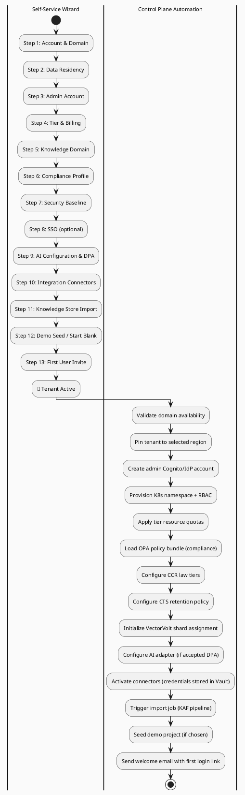
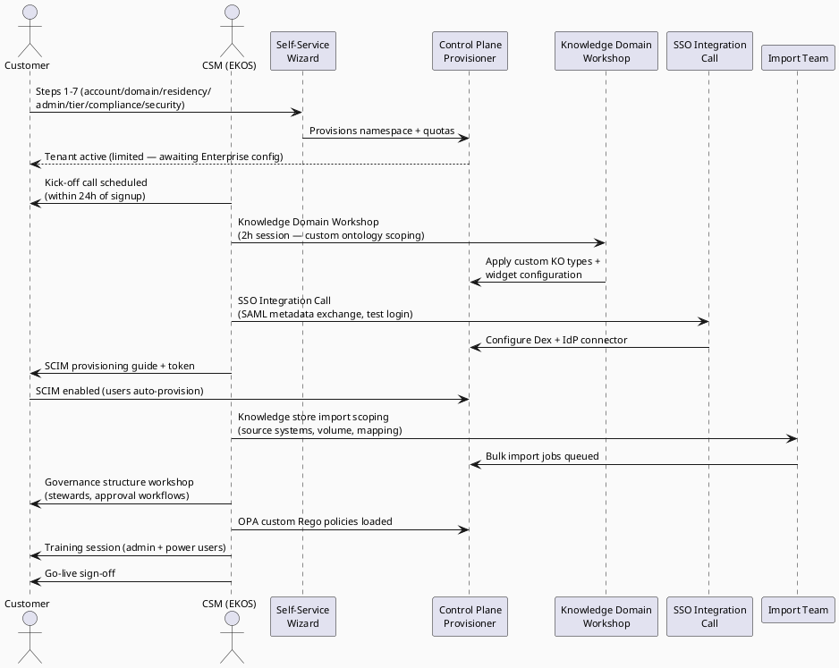
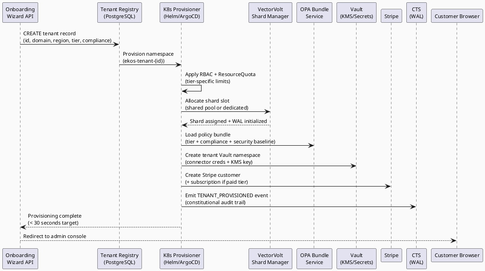

# EKOS Architecture — A21: Customer Onboarding Architecture

> **Status:** ✅ Done · **Generated:** 2026-07-03
> Defines the complete customer onboarding journey for all EKOS deployment tiers:
> the self-service wizard (Free/Pro/Team), the assisted onboarding flow (Enterprise/Dedicated),
> and the control plane automation that executes behind each step. Anchored by
> [A20](A20-saas-platform-architecture.md) (SaaS tiers + provisioner), [Vol 08](../08-enterprise-customization-workflow-orchestration.md)
> (enterprise customization), [Vol 09](../09-enterprise-table-stakes-and-trust.md)
> (SSO/SCIM/i18n/DR), [A06](A06-security-identity-trust-architecture.md) (identity),
> [ADR-052](../ADR-REGISTER.md#adr-052) (storage providers), Book 1 Law 7/8/10.

---

## 1. Purpose & Scope

Specify **how a new customer becomes a productive EKOS tenant** — from first signup to first
Knowledge Object created. Three distinct journeys are defined: (1) self-service wizard for
Free/Pro/Team tiers, (2) assisted onboarding for Enterprise/Dedicated, and (3) the control
plane automation that provisions infrastructure at each step. Onboarding is not a "nice to
have" — it determines time-to-value, which determines retention. Every step that requires
manual effort or a support ticket is a churn risk.

**Scope boundary:** This document covers tenant onboarding only. User onboarding
(new users added *within* an existing tenant) is covered by Vol 09 §SCIM + the in-product
user invitation flow. Platform operator onboarding (how EKOS team adds a new region) is A20.

---

## 2. Onboarding Principles

- **A21-001** — **Data residency is step 1, always.** No data is written to any store
  before the tenant's region is confirmed. The provisioner gates on residency selection;
  there is no default region that can be changed later without migration.
- **A21-002** — **The admin account is the only account created by EKOS.** All subsequent
  users are provisioned by the tenant's own admin (via SCIM/manual invite). EKOS never
  creates user accounts on behalf of the tenant beyond the initial admin.
- **A21-003** — **SSO is optional at Pro, recommended at Team, mandatory at Enterprise.**
  Self-service SSO configuration wizard eliminates the need to email EKOS support for SAML
  metadata exchange.
- **A21-004** — **Knowledge domain selection is not optional for Enterprise.** Generic
  "requirements" and "decisions" are fine for Pro/Team; Enterprise onboarding includes a
  Knowledge Domain Workshop to configure the ontology for the customer's industry and
  regulatory context before users are provisioned.
- **A21-005** — **Import before invite.** Knowledge store import (Confluence, Jira, GitHub,
  etc.) should run before users are invited. Users who log in to an empty system churn;
  users who log in to their own organizational knowledge already structured churn far less.
- **A21-006** — **Compliance profile drives CCR + CTS configuration.** The compliance
  profile is not a label — it configures which OPA policy bundles are loaded, which CTS
  event types are emitted, and what audit retention applies. It must be set at onboarding,
  not retroactively.
- **A21-007** — **AI features require an explicit DPA acceptance** (Law 7: no training on
  customer content). AI features are disabled until the customer accepts. This is a legal
  protection for both parties.
- **A21-008** — **Demo seed data is the default for self-service.** An empty canvas is a
  conversion killer. The default path seeds a realistic sample project; the customer can
  choose "import my own data" or "start blank" as explicit deviations.

---

## 3. Onboarding Journey Overview

---

## 4. Self-Service Wizard (Free / Pro / Team)

### Step 1 — Account & Domain

- **A21-010** — Customer provides: work email (verified), organization name, intended
  subdomain (`acme.ekos.io`). Domain availability checked in real time against Tenant Registry.
- **A21-011** — For Enterprise (custom domain): DNS CNAME validation required
  (`_ekos-verify.knowledge.acme.com → verify.ekos.io`). CNAME must resolve before provisioning
  completes. CSM assists if DNS propagation causes delays.
- **A21-012** — Organization size selector (1–10 / 11–50 / 51–500 / 500+) drives default
  resource quotas and determines whether a CSM is auto-assigned.

### Step 2 — Data Residency Selection

- **A21-013** — Customer selects: 🇺🇸 United States (us-east-1) · 🇪🇺 European Union
  (eu-west-1) · 🌏 Asia-Pacific (ap-southeast-1). For Enterprise: additional regions
  available on request (OQ-A21-A: customer-specific region provisioning).
- **A21-014** — Selection is **permanent for the tenant lifetime**. Changing region = full
  data migration + new tenant provisioning + old tenant deletion — treated as a migration
  project, not a settings change. Warning shown inline with migration cost estimate.
- **A21-015** — Control plane action: Provisioner pins `tenant.region = selected`; all
  subsequent K8s namespace creation, PostgreSQL+AGE cluster assignment, VectorVolt shard
  routing, and S3 bucket creation target the selected region. No data ever written outside
  selected region from this point.

### Step 3 — Admin Account

- **A21-016** — Admin account is created with the verified work email. EKOS generates a
  secure one-time setup link (24h TTL, single-use). Admin sets password + configures MFA
  (TOTP required for all admin accounts regardless of tier).
- **A21-017** — Admin receives: tenant ID, admin console URL, API key (for CLI/SDK access),
  onboarding checklist link. Subsequent users are provisioned by the admin — EKOS does not
  create additional accounts.
- **A21-018** — Control plane: admin account stored in IdP (Cognito / tenant's own IdP
  once SSO is configured at Step 8); assigned `ekos:admin` role; ABAC policy grants full
  governance access; CCR capability cache warmed for admin worker ID.

### Step 4 — Tier & Billing

- **A21-019** — Tier selection with feature comparison table (same table as A20 §2).
  Credit card collected at Pro+ (Stripe Elements, PCI-compliant iframe — EKOS never stores
  card data). Free tier: email only, no card.
- **A21-020** — License type: Per-user monthly · Per-user annual (20% discount) · Volume
  commitment (Enterprise — custom quote). For Enterprise: purchase order / invoice flow
  instead of credit card.
- **A21-021** — Trial: 14-day free trial of the selected paid tier; credit card collected
  but not charged until Day 15. Trial downgrade path if customer does not convert (data
  retained 30 days, then deletion workflow).
- **A21-022** — Control plane: Stripe customer + subscription created; `billing.tier` set in
  Tenant Registry; resource quotas applied to K8s namespace; VectorVolt shard pool slot
  allocated (shared pool for Pro/Team; reservation queued for Enterprise dedicated node pool).

### Step 5 — Knowledge Domain Setup

- **A21-023** — Customer selects their primary knowledge domain. This configures which KO
  types and widget library presets are active by default:

  | Domain | Active KO Types | Default Widgets |
  |---|---|---|
  | Software Engineering | Requirements, Architecture Decisions, BPMN Processes, Risk Register, API Contracts | Requirement, ADR, Flow, Risk Matrix, Trade-off |
  | Enterprise Architecture | Capabilities, Value Streams, Applications, Tech Radar, Roadmaps | Capability Map, ArchiMate, Timeline, Portfolio |
  | Product Management | Epics, User Stories, Personas, OKRs, Journey Maps | Story Map, OKR, Persona, Journey |
  | Legal & Compliance | Policies, Controls, Evidence, Audit Findings | Control Matrix, Evidence, Audit Trail |
  | Operations & ITSM | Incidents, Runbooks, Change Requests, SLOs | Runbook, SLO Dashboard, RCA |
  | Custom (Enterprise+) | Defined in Knowledge Domain Workshop | Configured by EKOS ontology team |

- **A21-024** — Additional KO types can be enabled at any time from the admin console. The
  selection here is a starting point, not a restriction.
- **A21-025** — Control plane: ontology seed applied to PostgreSQL+AGE graph store (creates
  base KO type nodes); VectorVolt ColumnarStore schema initialized for selected KO types;
  OPA widget entitlement policy scoped to tier + selected domain.

### Step 6 — Compliance Profile

- **A21-026** — Customer selects which regulations apply. Multi-select. Selection drives
  CCR configuration, CTS event emission, and audit retention:

  | Profile | What it activates |
  |---|---|
  | **GDPR** | Consent tracking events in CTS; right-to-erasure workflow; EU data residency enforced (overrides Step 2 if customer forgot); DPA counter-signature required |
  | **HIPAA** | PHI classification on KO types; access audit trail (every Knowledge.Open logged); BAA required before tenant goes live |
  | **SOC2** | All mutation + access + auth events in CTS; 7-year WORM retention; nightly evidence report generation enabled |
  | **ISO 27001** | Security incident + policy violation events in CTS; asset register KO type activated |
  | **FedRAMP (IL2/IL4)** | Air-gap or GovCloud deployment required; escalated to Enterprise CSM team; standard self-service wizard cannot complete this tier |
  | **None / Internal** | Default CTS events only; 90-day retention; no compliance reports generated |

- **A21-027** — GDPR selection: inline DPA presented and counter-signed digitally. Counter-signature stored as a KO in the tenant's own graph (Law 11 — non-destructive; the DPA acceptance is itself a Knowledge Object with full audit trail).
- **A21-028** — Control plane: OPA policy bundle variant loaded (compliance-profile-specific
  Rego rules); CTS retention policy applied to S3 bucket lifecycle; nightly evidence report
  Lambda/job scheduled if SOC2 selected; HIPAA BAA workflow triggered (CSM notified).

### Step 7 — Security Baseline Policy

- **A21-029** — Customer configures:
  - **MFA enforcement**: Required for all users · Required for admins only · Optional (Free only)
  - **Session timeout**: 1h / 4h / 8h / 24h (default 8h; Enterprise can customize)
  - **IP allowlist**: CIDR ranges allowed to access the tenant (empty = no restriction)
  - **API key expiration**: 30d / 90d / 1yr / Never (default 90d)
  - **Data classification levels**: Enable/disable Confidential and Restricted levels
    (Public + Internal always on)
- **A21-030** — Sensible defaults are pre-filled for each tier (Enterprise defaults are
  stricter). Customer can accept defaults with one click. All choices are changeable in
  admin console post-onboarding.
- **A21-031** — Control plane: OPA security policy configured with IP allowlist CIDR ranges;
  session duration applied to IdP token TTL; MFA enforcement flag set in tenant config;
  API key rotation policy scheduled.

### Step 8 — SSO Configuration (optional at Pro/Team, recommended at Enterprise)

- **A21-032** — SSO protocol selection: **SAML 2.0** (most enterprise IdPs) · **OIDC**
  (Okta/Azure AD/Google Workspace modern flow) · **Skip** (use EKOS username/password).
- **A21-033** — Self-service SAML wizard:
  1. Customer downloads EKOS Service Provider metadata XML (generated on-the-fly for their
     tenant subdomain).
  2. Customer pastes their IdP SSO URL + x509 certificate.
  3. EKOS performs a live metadata validation (fetches IdP metadata URL or validates pasted
     cert).
  4. Test login button — opens IdP login in a new tab, returns assertion to EKOS, shows
     parsed attributes (email, groups, roles).
  5. Attribute mapping: map IdP groups → EKOS roles (Admin / Steward / Contributor / Viewer).
  6. Confirm — SSO is live. Password login disabled for SSO-provisioned users.
- **A21-034** — SCIM provisioning (Team+): after SSO, customer can enable SCIM 2.0 for
  automated user lifecycle. EKOS generates a SCIM bearer token; customer pastes it into
  their IdP SCIM configuration. Users are provisioned/deprovisioned automatically as they
  are added/removed in the IdP.
- **A21-035** — Control plane: IdP metadata stored in Vault; tenant auth config updated
  (`sso.enabled = true`, `sso.protocol`, `sso.idp_metadata_url`); Dex OIDC connector
  configured; test assertion validation; SCIM endpoint activated if enabled.

### Step 9 — AI Configuration & Data Processing Agreement

- **A21-036** — AI provider selection:
  - **EKOS-managed** (default): EKOS routes AI calls to the configured provider (Bedrock /
    Azure OpenAI / Vertex AI — per EKOS's A05 AI architecture). Customer does not configure
    a specific provider.
  - **Bring your own**: Customer provides their own API key for a supported provider. EKOS
    stores the key in Vault; calls go directly from EKOS pods to the provider.
  - **Sovereign / Air-gap**: AI runs on EKOS-managed GPU nodes (sovereign Ollama). Selected
    automatically for air-gap compliance profiles. No external API calls.
- **A21-037** — **AI DPA acceptance is mandatory before any AI feature activates** (Law 7):
  "No customer content is used to train or fine-tune any AI model. AI model providers
  receive only the fact-sheet contract (structured symbolic data), never raw customer
  knowledge objects." Customer accepts inline; acceptance stored as a signed KO in the
  tenant graph (bitemporal, non-destructive — if a customer later withdraws consent, the
  withdrawal is a new KO, not an overwrite).
- **A21-038** — AI feature scope: customer selects which AI feature categories to enable:
  Knowledge Analysts (background AI that enriches KOs), AI Explainability (why-AI-said-this
  trails), AI Search (semantic query over knowledge graph), AI Suggestions (inline drafting
  assistance). Each can be individually toggled.
- **A21-039** — Control plane: AI adapter configured with provider credentials (Vault);
  DPA acceptance recorded in CTS + tenant graph; AI feature flags applied to tenant's OPA
  entitlement policy; GPU node pool shard allocated (sovereign mode only).

### Step 10 — Integration Connectors

- **A21-040** — Customer selects which knowledge sources to connect. Connectors are
  configured here and can be added/removed at any time from the admin console.

  | Connector | What it ingests | Auth method |
  |---|---|---|
  | **Confluence** | Pages, spaces, comments → Knowledge Objects | OAuth 2.0 (Atlassian) |
  | **Jira** | Issues, epics, sprints → Requirements + Decisions | OAuth 2.0 (Atlassian) |
  | **Azure DevOps** | Work items, repos, wikis, pipelines → KOs | AAD OAuth / PAT |
  | **GitHub** | Issues, wikis, READMEs, ADR files, discussions | GitHub App (org install) |
  | **SharePoint / OneDrive** | Documents, lists → Knowledge Objects | Microsoft Graph OAuth |
  | **Notion** | Pages, databases → Knowledge Objects | Notion OAuth |
  | **Google Drive** | Docs, Sheets, Slides → Knowledge Objects | Google OAuth |
  | **Slack** | Meeting transcripts, decisions in channels | Slack App OAuth |
  | **Microsoft Teams** | Meeting transcripts, channel decisions | Azure App OAuth |
  | **SAP** | Process definitions, org structures | SAP OAuth / API key |
  | **ServiceNow** | Incidents, changes, CMDB → Operational KOs | OAuth 2.0 |
  | **Custom (Enterprise+)** | Any REST/GraphQL source | API key / OAuth |

- **A21-041** — Connector credentials are stored in Vault (never in application database).
  Each connector runs as a Knowledge Acquisition Framework pod (Vol 21) with tenant-scoped
  isolation — Connector A's credentials are never accessible to Connector B's pod.
- **A21-042** — Initial sync is scheduled immediately after onboarding completes. Delta sync
  runs on configurable cadence (default: every 15 minutes for real-time sources, daily for
  document stores). Sync status visible in admin console connector dashboard.

### Step 11 — Knowledge Store Import

- **A21-043** — Import is a one-time bulk migration of existing knowledge (vs. connectors
  which provide ongoing sync). Import sources:

  | Source | Format | Import mechanism |
  |---|---|---|
  | Confluence full export | XML space export | KAF OfflineWalCompiler — bulk WAL load |
  | Jira full export | XML / CSV | KAF batch import |
  | SharePoint site export | CSOM export | KAF batch import |
  | Graph database | Neo4j dump / Cypher export | Direct PostgreSQL+AGE ingestion |
  | Custom CSV / Excel | EKOS import template | KAF batch import |
  | `.ekr` packages | EKOS native format | Direct Knowledge Kernel ingestion |

- **A21-044** — Import runs as a background job (VectorVolt OfflineWalCompiler at Gate 1+;
  standard batch job pre-Gate 1). Progress shown in admin console. Large imports (>1M KOs)
  are estimated with completion time before the customer commits.
- **A21-045** — Import is non-destructive: if the same knowledge object is imported twice
  (idempotent import key = source system ID + source URL), the second import creates a new
  transaction-time record, not an overwrite. Full bitemporal history from import day forward.
- **A21-046** — Import quality: after bulk import, the AI Analysts (if DPA accepted) run
  automatically to enrich imported KOs — linking related items, identifying gaps, surfacing
  knowledge structure. This is the first visible AI value for the customer.

### Step 12 — Demo Seed vs Import vs Start Blank

- **A21-047** — If no import was configured at Step 11, customer is presented with:
  - **Seed demo project** (default, recommended): a realistic pre-built project is created
    with sample KOs for the selected Knowledge Domain (Step 5). The ESIP Demo Setup Wizard
    (see [project_esip_demo_wizard memory](../../../memory/project_esip_demo_wizard.md))
    runs automatically. The demo project is labeled `[DEMO]` and can be deleted at any time.
  - **Start blank**: tenant is provisioned with empty knowledge graph. For customers who
    know exactly what they want to create from day one.
- **A21-048** — Demo project content is domain-specific (Step 5). A Software Engineering
  tenant gets a sample architecture project with ADRs, requirements, BPMN processes, and
  C4 diagrams. An Enterprise Architecture tenant gets a sample capability map + roadmap.
- **A21-049** — The demo project also demonstrates the widget library, AI Analysts running
  on real content, and the Knowledge Economy publishing flow — it is the primary product
  demo, not just sample data.

### Step 13 — First User Invite

- **A21-050** — Admin is presented with an invite flow immediately after onboarding
  completes. Can invite up to 5 users inline (email + role). Remaining invites go to the
  admin console. If SSO/SCIM configured (Step 8), invite is optional — users will
  auto-provision on first SSO login.
- **A21-051** — Invited users receive a branded welcome email (EKOS default branding or
  customer brand if configured at Step 8+). Email includes: tenant URL, one-click login
  link (24h TTL), 3-step getting-started guide, link to the demo project.

---

## 5. Assisted Onboarding Flow (Enterprise / Dedicated)

Enterprise and Dedicated tiers require human-assisted steps that cannot be fully
self-served. The self-service wizard covers Steps 1–7; the remaining steps involve a
Customer Success Manager (CSM).

### Knowledge Domain Workshop (Enterprise/Dedicated)

- **A21-052** — 2-hour workshop with the tenant's knowledge architects and the EKOS CSM.
  Output: custom KO type definitions (name, attributes, relationships), custom widget
  presets for the tenant's industry, custom ontology namespaces (e.g., `acme:requirement`
  vs EKOS standard `ekos:requirement`).
- **A21-053** — Output is captured as a Knowledge Domain Configuration file (YAML) and
  applied to the tenant via the admin API. Custom types are available within 30 minutes of
  workshop completion.
- **A21-054** — Custom types are additive — they extend the EKOS standard ontology, never
  replace it. Standard widgets continue to work alongside custom ones.

### Governance Structure Setup (Enterprise/Dedicated)

- **A21-055** — CSM facilitates: identify Knowledge Stewards (named individuals responsible
  for KO quality per domain); define approval workflows (e.g., "Architecture Decisions
  require 2 steward approvals before Published state"); configure OPA policy rules for
  the tenant's governance model.
- **A21-056** — Output: steward assignments stored as ABAC role bindings in the tenant's
  graph; approval workflow configurations stored as OPA Rego policy bundle (tenant-scoped,
  loaded into the CCR policy tier); governance dashboard widget configured.
- **A21-057** — Without governance setup, Law 12 (governance) is technically enforced by
  EKOS's default OPA rules — but those rules are generic. The governance workshop makes
  them specific to the tenant's actual processes.

### Knowledge Store Import (Enterprise/Dedicated — Managed)

- **A21-058** — For Enterprise/Dedicated, import is managed by the EKOS import team:
  scoping call → mapping session → pilot import (first 10K KOs) → customer review →
  full import → validation report. Large imports (>10M KOs) are split across multiple
  import windows.
- **A21-059** — Import SLA: pilot import completed within 5 business days of scoping call;
  full import within 10 business days of pilot approval.
- **A21-060** — Import validation: after full import, EKOS generates an import report
  (total KOs imported, warnings, duplicates, relationship resolution rate, AI enrichment
  coverage). Customer signs off on the report before CSM marks onboarding complete.

---

## 6. Control Plane Automation (Provisioner Detail)

Every self-service step triggers automated Provisioner actions. This section specifies
what the Provisioner does and in what order.

- **A21-061** — Provisioning target: **< 30 seconds** from wizard completion to tenant
  admin console accessible. Helm + ArgoCD sync is async; wizard polls for readiness.
- **A21-062** — Provisioning is **idempotent**: if the wizard is submitted twice (network
  retry, browser back button), the Provisioner checks the Tenant Registry for an existing
  tenant record with the same domain and returns the existing tenant, not a duplicate.
- **A21-063** — Provisioning failures: if any step fails (K8s API unavailable, VectorVolt
  shard exhausted, Stripe API error), the Provisioner rolls back via compensating actions
  (K8s namespace deleted, Vault namespace deleted, Stripe customer deleted). Customer sees
  a clean error message with retry option. Failure event emitted to CTS for ops alerting.
- **A21-064** — VectorVolt shard assignment: at Gate 1 (VV Phase 1+2+3 complete),
  VectorVolt's TenantManager registers the new tenant and assigns shard routing. Pre-Gate 1,
  a PostgreSQL schema is created for the tenant instead, and VectorVolt assignment is
  deferred to Gate 1 activation (transparent to tenant).

---

## 7. Trial → Paid Conversion Journey

- **A21-065** — Trial timeline (14-day):

  | Day | Automated touchpoint | Goal |
  |---|---|---|
  | 0 | Welcome email + onboarding checklist | First login |
  | 1 | "Did you complete setup?" email (if checklist <50%) | Connector + import |
  | 3 | "Your first week with EKOS" email (usage summary: KOs created, AI calls, widgets used) | Stickiness signal |
  | 7 | In-app banner: "7 days left — here's what Pro gives you" | Feature awareness |
  | 10 | CSM outreach email (Pro+ trials) | Handle objections |
  | 13 | "Trial ends tomorrow" email + upgrade prompt | Conversion |
  | 14 | Trial end — downgrade to Free (data retained); upgrade prompt in console | Last chance |
  | 44 | Data deletion warning (30 days post-trial if not converted) | Urgency |
  | 74 | Data deleted (tenant deprovisioned) | Offboard |

- **A21-066** — In-product conversion: one-click upgrade from any screen. Billing info
  already on file from trial signup. No re-onboarding required — tier is updated in Tenant
  Registry + Stripe + OPA entitlement policy in < 5 minutes.
- **A21-067** — Annual commitment discount (20%) offered at Day 7 and Day 13 touchpoints.
  Enterprise custom quote sent by CSM at Day 10.

---

## 8. Offboarding & Data Deletion

- **A21-068** — Customer-initiated offboarding: admin triggers "Cancel subscription" in
  Customer Portal. Tenant enters `CANCELLING` state; data retained for 30 days (recovery
  window). Subscription cancelled in Stripe immediately.
- **A21-069** — After 30-day recovery window: Provisioner deprovisions tenant:
  (1) K8s namespace + all pods deleted; (2) VectorVolt shard released; (3) PostgreSQL
  schema dropped; (4) Redis keys purged; (5) Vault tenant namespace deleted (KMS key
  destroyed — data becomes cryptographically unrecoverable); (6) S3 CTS archive deleted
  (unless SOC2 retention applies — 7 years); (7) CTS `TENANT_DEPROVISIONED` event emitted;
  (8) Tenant record in Tenant Registry flagged `DELETED` (soft delete — never physically
  removed from Tenant Registry audit table, per Law 11).
- **A21-070** — GDPR right-to-erasure: customer can request data deletion before the 30-day
  window. EKOS processes within 72 hours (GDPR Art. 17 compliance). CTS records are retained
  per SOC2 requirements even post-erasure (they contain no personal knowledge content —
  only event metadata). This is documented in the DPA counter-signed at Step 6.

---

## 9. Onboarding Completeness Score

- **A21-071** — The admin console shows an **Onboarding Score** (0–100%) computed from:

  | Step | Weight |
  |---|---|
  | Data residency confirmed | 5% |
  | Admin MFA enabled | 10% |
  | SSO configured (or explicitly skipped) | 10% |
  | Knowledge domain selected | 5% |
  | Compliance profile set | 10% |
  | At least one connector active | 15% |
  | Knowledge import completed (or started) | 15% |
  | AI DPA accepted (or explicitly declined) | 5% |
  | At least 5 users provisioned | 15% |
  | First real Knowledge Object created | 10% |

- **A21-072** — Score <50% at Day 7 triggers a CSM outreach for Pro+ tenants. Score <30%
  at Day 14 triggers an automated "complete your setup" email. Score = 100% triggers a
  "🎉 You're fully set up" in-app notification + CSM marks onboarding complete.

---

## 10. Knowledge Economy Opt-In (optional)

- **A21-073** — After onboarding completes, admin can optionally activate Knowledge Economy
  participation from the admin console (not part of the main wizard to avoid overload):
  - Stripe Connect onboarding (for receiving payments): bank account + identity verification
  - Internal policy: can individual contributors publish paid knowledge, or only org-level?
  - Revenue split configuration (if org publishes as org, individual contributors can be
    given a configurable share %)
- **A21-074** — Knowledge Economy activation is independent of tier — any Pro+ tenant can
  participate. Free-tier tenants can browse and purchase published knowledge but cannot
  publish for sale.

---

## 11. Onboarding for On-Prem & Client-Cloud

- **A21-075** — On-prem (A18): self-service wizard does not apply. Onboarding is:
  (1) EKOS sales signs contract; (2) Customer completes hardware + network prerequisites
  checklist (A18 §3); (3) EKOS delivers signed offline bundle (A18 §9); (4) Customer IT
  runs installation sequence (A18 §10); (5) EKOS CSM joins remotely (or on-site) for
  first-run configuration wizard (equivalent to Steps 3–11 above, run as a CLI wizard via
  `vvctl init-tenant`); (6) CSM signs off on go-live.
- **A21-076** — Client-cloud / BYOC (A19): onboarding is:
  (1) EKOS sales signs contract; (2) Customer completes cloud prerequisites (A19 §14);
  (3) Customer runs OpenTofu + Helm install (`helm install ekos ekos/ekos -f values-aws.yaml`);
  (4) EKOS CSM remotely validates deployment health; (5) `vvctl init-tenant` equivalent
  run in customer's cluster; (6) Steps 3–11 completed via admin console in customer's
  deployment.
- **A21-077** — License validation for on-prem/BYOC: the only external call is the license
  heartbeat (A19 §12). If offline license is chosen (air-gap), EKOS issues a JWT signed
  with RSA-4096; tenant sends heartbeat log file monthly; EKOS validates and issues
  renewal JWT. No customer data in the heartbeat payload.

---

## 12. Open Questions

- **OQ-A21-A** — Customer-specific region provisioning (non-standard regions like
  `me-south-1`, `af-south-1`) — needs dedicated infra; when to support?
- **OQ-A21-B** — HIPAA BAA counter-signature flow — DocuSign integration or manual PDF?
  Target: fully digital, embedded in wizard (Step 6).
- **OQ-A21-C** — FedRAMP IL2/IL4 self-service vs always-assisted — leaning always-assisted
  given compliance complexity; confirm scope.
- **OQ-A21-D** — Import for `.ekr` packages from other EKOS tenants — licensing implications
  if the package is a paid Knowledge Economy artifact.
- **OQ-A21-E** — Onboarding score weighting — validate weights against actual activation
  data once first 100 tenants onboarded; may need A/B test.
- **OQ-A21-F** — `vvctl init-tenant` CLI wizard specification — needed for on-prem/BYOC;
  write as a follow-on to the CLI spec in VectorVolt Phase 6 (Concept 6.12).

---

_Created 2026-07-03. Customer onboarding architecture for all EKOS deployment tiers.
Read alongside A20 (SaaS), A18 (on-prem), A19 (client-cloud)._
